# Changelog

What changed for players in each release of Head in a Jar, newest first.

## 0.7.1 · Secondment (2026-11-21)

Put a jarred head on a headless body with the Secondment Collar, and the head drives the body as a member of your
staff: the head brings the skills, the body brings the hardware.

#### New

- **The Secondment Collar.** With hands, **Use** it on a host, then **Use** a Jarred Head on the collared host. The
  jar twists on, the body mumbles in the head's voice, and the pair works for you under the head's own file. "One
  head per body. HR is very clear."
- **Head is skills, body is hardware.** The head brings its jobs, wage, temper and turret post; the body brings its
  movement, hands, carry, health and habits (a zombie body burns by day).

  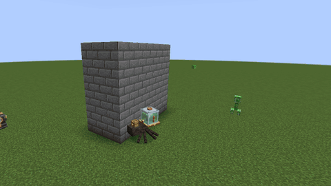

- **Team sync.** The pair grows into each other with work: at 25% the body's traits, at 50% its Ability, at 75% its
  Secondary, at 100% faster work and the Team Spirit advancement.
- **Broth.** The collar's canister needs broth. Staff top it up at each punch-in from the Time Clock's new
  **Broth tank**, seen on the clock's new **Broth** tab.
- **The Redundancy Package.** When the body dies, the head floats down under a tiny gold canopy and lands as a placed
  Jarred Head with its file and grade, and DOLORES regrets the loss of the body.

  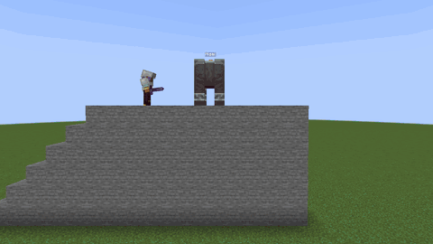

- **Sixteen famous pairings.** DOLORES remarks on each once: "Security has taken the stairs. All of them."
- Three advancements, one memo, a handbook entry, Jade lines for a secondee and the server value `staff.secondment`.

#### Fixed

- **The brass collar under a hosted jar** sampled the wrong rows of its sheet, so its back, side walls and one lug
  could be missing.
- **Swimming staff punch in from the water.** A squid on staff never reached its clock; now it punches from the
  water within reach of it, and a clock with no water by it is told so.
- **Climbing staff stay on top of a wall.** A spider stepping onto a stop at a wall's edge let go and fell.
- **Headless drowned, strays and sheep** no longer show their overlay's or wool's head above the neck.

#### Updating

- A 0.7.1 game can join a 0.7.0 server; a 0.7.0 game cannot join a 0.7.1 server. Update both.

Full details

**Fitting the collar**
- The body braces as the jar twists on, and the head's mind drives the body as a member of your staff under its own
  file. It finds a Time Clock of yours and works its Job Card.
- Collars, heads and the rest are refused in the book's order, each with its line ("One head per body. HR is very
  clear.").
- A host that refuses shakes its whole body; a seated head shakes in its jar. A head used on a creature that still
  has its own is refused too.

**Head and body**
- An attacking head uses its attack from the jar on Security.
- The body's movement: walls, air, water, hops, teleports.

**Team sync**
- 1% every 24 seconds of work on shift with a card, half that when the blood does not mix (an iron golem body takes
  any head).
- At 50% a Neural Lace takes too. At 100% the pair works 10% faster and carries 10% more.
- The job brain uses the tricks on their cooldowns, at intruders only, and never explodes, groans or calls a wind
  charge ("Staff do not explode. Policy 9.2.").

**Broth**
- The collar's canister holds 500 mB, drinks 1 mB every 6 seconds and shows its level in a sight glass.
- The Time Clock's Broth tank holds 4,000 mB; a bucket or a pipe fills it.
- Dry, the head sags, the body stands by, then walks back to the office for more.

**The Redundancy Package**
- The head survives unless its glass was gone, it fell into the void, or it came down in lava.
- A seconded jar has its glass (10, 20 or 30 points), lost to explosions, falling blocks, shots at the neck and swings
  at the jar, and mended by a Glass Patch.

**Handling a seconded pair**
- **Sneak** + **Use** with an empty hand unseats the head, file and grade kept.
- Shears take an empty collar back; a broth bucket fills the canister; a syringe held sneaking draws the head through
  the collar once a day.

**Also**
- Advancements: Secondment, Team Spirit, Redundancy Package.
- The collar's clasp has its own sound (nobody has listened to it yet).

## 0.7.0 · The workforce (2026-11-21)

Hire living creatures as staff. Give them a Time Clock, a job on a card and a shift, and they haul, sort, farm and
keep watch on your site while you do something else.

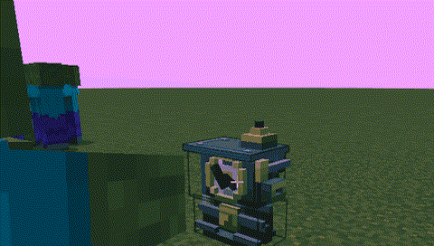

#### New

- **The Staff Lanyard.** **Use** it on a living creature to hire it. A badge drops over its head, it looks at you and
  waits for work. Its own mind is off: it never despawns and attacks nobody of its own accord. Hostiles must be worn
  down to half their health first.

  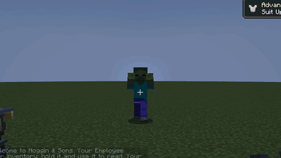

- **The Time Clock.** A punch clock that makes a work site around it. At each shift your staff queue up, punch in,
  take a Job Card and go to work; off shift they stand round the clock. Its screen holds the Roster, the Job Rack,
  the Pay Drawer and the Shifts.
- **The Clipboard and Job Cards.** Mark chests as Pick-Ups and Drop-Offs and an area with the Clipboard, then print a
  Job Card. Put it in the Job Rack and an idle worker takes it, or hand it to one worker.
- **Four jobs.** **Hauling**, **Sorting**, **Farming** and **Security**. Every species has its own talents: zombies
  cannot read the labels, cats have one job, fliers fly. Nobody breaks a block or leaves the site.
- **The Hard Hat.** Undead staff in one can work by day without burning, and falling blocks do staff no harm. You can
  wear one too: "Policy 4.1: hard hats, not helmets."
- **The Supervisor's Whistle.** Pick up to six of your staff as a **detail**: they follow you and fight what you point
  at. Cats, wolves, parrots and foxes keep you company instead.

  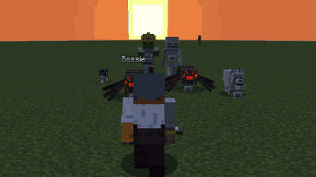

- **Letting staff go.** **Sneak** + **Use** a Clipboard on a worker twice within 3 seconds. You get the lanyard back
  with a Notice of Separation; the creature works its notice, is seen off the site, and is an ordinary creature
  again. It "may not take it well."
- **Quirks.** Staff keep a habit of their kind. The enderman stops when stared at ("Do you mind?"), a piglin pockets
  the odd item, a llama left unpaid spits at whoever opens its clock.

#### Changed

- **Turrets and golems spare staff.** Turret Pedestals now spare lanyarded monsters and all staff. Iron golems, snow
  golems and wolves leave staff alone unless staff start it.
- **The Safety Placard** has four new notices, among them "STAFF ARE NOT LUNCH", and clearer lettering.
- Five advancements, three memos, six handbook entries, and staff commands for operators.

#### Updating

- Worlds from 0.6.3 load as they are.
- A 0.7.0 game can join a 0.6.3 server; a 0.6.3 game cannot join a 0.7.0 server. Update both.

Full details

**Hiring**
- A string loop and a brass badge drop over the creature's head; it stops, looks at you and stands awaiting
  assignment. Its own mind is off: it never despawns, attacks nobody, can be led, and keeps its temperament as a
  quirk.
- Refused, each with its line ("Shulkers do not commute."): babies, bosses, hosts, creepers, fish, bats, vexes and
  shulkers, a village's iron golem, and anyone else's pet or staff.
- A player employs 24 at most.
- The badge is worn in your team's colour. Staff names float over them when you look (the client value
  `staffNameplates`).

**Letting go**
- The lanyard comes back with a **Notice of Separation (Form 45-S)** (and its Hard Hat), and the file says
  "restructuring".
- The creature serves 10 seconds' notice, head down, walking 12 blocks from you while a Security colleague sees it out
  and DOLORES says so. Then it is an ordinary creature again: "%s has left the company and may not take it well."

**The Time Clock**
- Its site reaches 16 blocks out on the level, 8 up and 8 down. Clocks need 8 blocks between them.
- Staff within 16 blocks join a clock with room: 8 to a clock.
- At each shift they walk up, punch in one at a time (the bell for the late), take a Job Card and go. Off shift they
  stand round the clock, facing it.
- The screen: **Roster** (rename, recall), **Job Rack**, **Pay Drawer** (wages taken at dawn; a hopper may fill it)
  and **Shifts** (Day, Night or Redstone for each worker; undead start on Night).
- Undead within 2 blocks of their own clock do not burn: it has an awning.

**The Clipboard and Job Cards**
- Bind a Clipboard to your clock, mark containers as Pick-Ups and Drop-Offs and two corners as an area, then
  **Print** a Job Card from one paper.
- In the Job Rack, idle staff take the card they can do with the fewest workers on it; or give a card to one worker
  by hand.
- Marks show as chalk lines to whoever holds the Clipboard (the client value `staffChalk`).

**The four jobs**
- **Hauling** carries from Pick-Ups to Drop-Offs, filters obeyed. It waits at a full Drop-Off, and for a cat on the
  chest.
- **Sorting** empties one Pick-Up by filter, with "Everything else" for the rest.
- **Farming** harvests ripe crops and replants, shears sheep and milks cows in a pen.
- **Security** patrols the site and sees hostiles off with the species' own attack: melee, arrows from the Pick-Up, a
  blaze's fireballs that light nothing, a snow golem's snowballs. A parrot or an armadillo raises the alarm.
- Each species has its aptitudes from the book's table: zombies cannot read the labels, cats have one job, fliers
  fly, slimes hop, endermen teleport between stops.
- Nobody breaks a block, tramples farmland, loads a chunk or leaves the site.

**The Hard Hat**
- **Use** it on a worker: undead staff in one may work days and do not burn, and falling blocks do staff no harm.
- A player may wear one too: a leather helmet's armour, and half the harm from falling blocks. It never wears out.

**The Supervisor's Whistle**
- **Use** it on up to six of your staff to make a detail that follows you (Follow and Hold in the air, **Sneak** +
  **Use** stands them down) and fights what you point at. Cats, wolves, parrots and foxes are pets that keep you
  company instead.
- A detail never follows through a portal. Left far behind, or five minutes without you, it takes the company
  shuttle back to its clock without loading a chunk.
- A jar whistles through a Speaker Grille.

**Every quirk**
- The enderman stops when stared at ("Do you mind?"); a piglin skims one item in 64 into its pocket; a chicken lays
  into what it carries; a goat rams a colleague; a llama left unpaid spits at whoever opens its clock; a dolphin
  surfaces for air; a villager will not trade on shift; an iron golem offers villager staff a poppy; a witch splashes
  hurt colleagues with Regeneration.

**Also**
- Operators have `/headoffice staff list`, `recall` and `pause` (the pause is kept with the world and shown by
  `/headoffice status`). Staff think twice a second, each in turn.
- The Safety Placard's lettering was redrawn: V comes to a point, M has its notch and N's diagonal runs to the foot,
  on every notice in both languages.
- Advancements: Non-Human Resources, Restructuring, Clocking In, In Writing, Away Day.

## 0.6.3 · Bodies at work (2026-11-21)

Every headless body now has a trick of its own, a chicken sawn without a jar runs about as chickens do, and a
headless body can walk a Treadmill to make power for your machines.

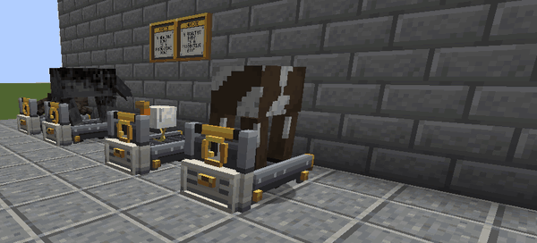

#### New

- **Every body does something.** The ten hosts that had no trick now have an Ability at 50% sync, such as the cow's
  **Moo**, the pig's **Rooting** and the cat's **Hiss**. Five more have a Secondary at 75%, such as the wolf's
  **Howl** and the dolphin's **Treasure Sense**. Every one is listed under Full details.
- **The headless chicken.** A chicken sawn without a jar runs in tight, flapping circles round where it was cut.
  "DOLORES: It will be fine. Probably."

  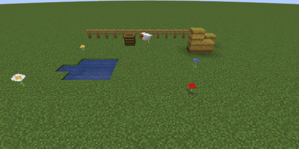

- **The Corporate Wellness Treadmill.** Ride a host onto the belt and get off: "Clocked in." It walks in place and
  makes power, more or less by species, and feeds it to the machine at its near end. **Use** it to read it.

#### Changed

- **The Safety Placard** has a new notice: "A HEALTHY BODY IS A PRODUCTIVE BODY".
- A memo the first time a Treadmill powers a machine, and handbook pages on the Treadmill and on every body's trick.

#### Updating

- Worlds from 0.6.2 load as they are.
- A 0.6.3 game can join a 0.6.2 server; a 0.6.2 game cannot join a 0.6.3 server. Update both.

Full details

**The new Abilities (at 50% sync)**
- Cow, **Moo**: animals that eat wheat within 16 blocks follow you for 10 seconds.
- Pig, **Rooting**: carrots, potatoes, beetroots and mushrooms within 16 blocks are outlined for you alone, through
  the ground, for 10 seconds.
- Sheep, **Shed**: 1 to 3 wool of its colour; the fleece stays on.
- Llama, **Spit**: 1 damage and a shove, 12 blocks.
- Villager, **Sound the Bell**: raiders within 32 blocks glow, villagers run indoors.
- Piglin, **Barter**: a gold ingot from your pockets, admired for 6 seconds, then a barter's loot. "No gold in your
  pockets. Piglins check."
- Strider, **Warm Up**: on or off; standing still on lava heals you.
- Turtle, **Withdraw**: 80% less damage for 5 seconds, going nowhere.
- Frog, **Long Jump**.
- Cat, **Hiss**: creepers within 8 blocks back off for 5 seconds.

**The new Secondaries (at 75% sync)**
- Camel, **Dash**.
- Horse, donkey and mule, **Rear**: a ring of knockback (players only where PvP is on).
- Iron golem, **Mend**: an iron ingot, +25 health.
- Wolf, **Howl**: your own tame wolves within 16 blocks follow you for a minute.
- Dolphin, **Treasure Sense**: bubbles point to the nearest shipwreck, ocean ruin or buried treasure within 4 chunks.

**New traits at 25% sync**
- A sheep takes half fall damage, iron golems leave a villager alone and piglins a piglin.

**The headless chicken**
- It never runs more than 12 blocks out, and runs round ponds and pits.
- Riding it, a lead or a Treadmill stops it. The server value `bodies.headlessChicken` turns it off.
- A chicken host from an older world runs round where it stands.
- Watching one run for 10 seconds earns a hidden advancement.

**The Treadmill**
- Two blocks long. It makes 4 to 24 FE/t by species (a cow 10, a chicken 12, a camel 24, anything not listed 8),
  holds 10 kFE and pushes up to 1,000 FE/t from its near end, as the Galvanic Pile does.
- A body on the belt rots twice as fast; a laced one is Tired and makes half; full sync adds 10%.
- Fliers, swimmers, ghasts, striders, slimes, shells and the heavy ones refuse ("Ghasts do not do cardio."), and a
  creature with its head on gets "Staff with heads use the stairs."
- The rates are a data map (`headinajar:treadmill`) a modpack can change, and the server value
  `bodies.treadmillOutput` scales them all.
- Advancements **Corporate Wellness** and **Cardio Department**.

## 0.6.2 · DNA for every mob (2026-11-16)

Every natural vanilla creature now carries a gene you can sample and splice. The Gene Splicer is sorted by
department, the DNA Sequencer keeps a Staff Directory of every creature, and the Body Printer can print a host from a
sample.

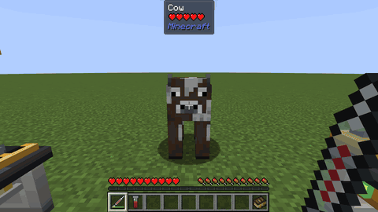

#### New

- **Every creature carries a gene.** Forty new genes, eighty-nine in all. Ruminant Gut lets you graze, Mountain
  Hooves step up whole blocks, Fleece hides your steps from sculk sensors. Each new gene's cost is printed on its
  cassette: "Cost: you moo when hurt."
- **The Staff Directory.** A new **Directory** tab on the DNA Sequencer: the vanilla creatures by department,
  stamped as your team samples, jars and rides them, with a hint for every blank.

  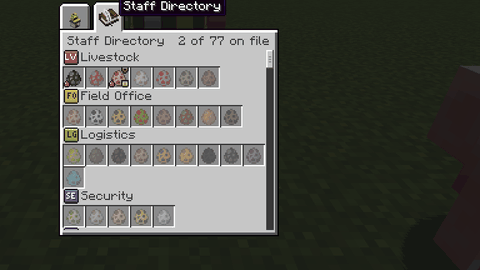

- **Print-to-Order.** Put a good DNA Fraction in the Body Printer's new **Template** slot and it prints a headless
  host of that species. "Your new Cow is ready. It is a little damp."

  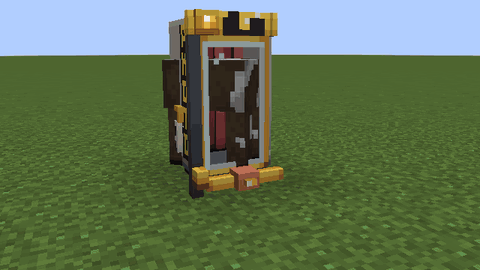

- **A Nitwit's sample** "Carries no readable genes. HR has checked twice." Every other villager still carries Hero's
  Blood.

#### Changed

- **The Splicer is sorted by department.** Each row has a department chip: press it for the next department, then
  the arrows for its genes. Twenty-two new named synergies and thirteen new named conflicts.

  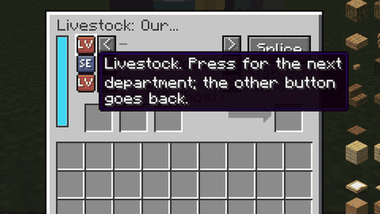

- **The Safety Placard** has two new notices: "QUIET FLOOR: THE WARDEN IS WORKING" and "PLEASE DO NOT TAP THE GLASS".

  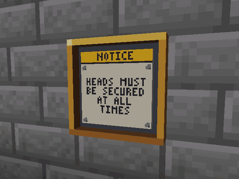

- Five advancements, five memos, handbook pages and ten new sounds with subtitles.

#### Fixed

- **Sampling tools refuse plainly.** A tool that cannot draw from a live creature now refuses with the refusal sound
  and the creature shaking its head.
- **A serum a host or a mecha will not take** is refused the same way, not with the welcome sound.

#### Updating

- Client and server must both be on 0.6.2.
- Going back to 0.6.1 drops the new genes from serums and bodies and empties a Body Printer's Template slot.

Full details

**The new genes**
- Every natural vanilla creature now carries at least one gene (the giant, the illusioner and the zombie horse still
  carry none).
- Among them: Ruminant Gut lets you graze; Fleece hides your steps from sculk sensors and a listening Warden;
  Mountain Hooves step up whole blocks; Undeath turns Instant Damage into healing and burns you by day; Weeping
  Glands cry a Ghast Tear every 20 minutes in a host or a mecha.
- Six are actives: Snow Pounce, Tongue and Spit Gland fit a body; Phase, Fang Line and Levitation Bolt only a host or
  a mecha.
- Every new gene's cost is printed in grey on its cassette.
- Old samples and fractions read into the new genes: "Following a review, the cow has been found to carry genes
  after all. HR apologises to the cow."

**The Splicer**
- Press a row's department chip for the next department with a gene you can use, then the arrows for its genes.
- The title strip names the department, a gene's name shows its card, and **Stab** lists the strand's named pairs.
- Twenty-two new synergies and thirteen new conflicts, all named.

**The Staff Directory**
- The 82 vanilla creatures by department with their spawn eggs, stamped as your team samples, jars and rides them,
  with a hint for every blank cell and three [REDACTED] creatures to find.
- A teammate's filing shows at the top of the grid ("Pufferfish: filed by Alex").
- The Bio-Scanner adds "Unfiled" to a creature your team has never sampled.

**Print-to-Order**
- The Template slot takes a DNA Fraction of quality 40 or better and prints a headless host of that species.
- Its materials are scaled by its size (a chicken is a quarter of a print, a pig half, a cow a whole one), and it
  comes out at the fraction's quality as freshness.
- The door is one block wide and two tall; marine models are delivered into water; printed hosts drop no loot when
  they die.

**Refusals**
- A sampling tool used on a live creature it cannot draw from (a Precision Syringe on a warden's thick hide, a Syringe
  on a skeleton) now refuses with the refusal sound and the creature shaking its head, as it does on the creature's
  placed head.
- A serum a host or a mecha will not take (too heavy, or no port free) is refused the same way, not with the welcome
  sound.
- A mecha's genes wait for its self-test after you climb in: "Snow Pounce waits for the self-test. Nothing fires
  before the checklist."

**Also**
- Advancements: An Apology to the Cow, Headhunter, Complete Census, Off the Books, Made to Order.
- The handbook has new pages on gene departments, named pairs, the Staff Directory and Print-to-Order.
- New server values `genetics.phaseThroughWalls`, `genetics.bulldozeBreaksBlocks` and `genetics.specimenPrinting`;
  new client option `geneQuirks`.
- Ten new sounds with subtitles ("Colleague moos", "Tongue lashes", "Phases through the wall"...).

## 0.6.1 · Heads at work (2026-11-16)

Placed heads go to work. Ring one and it talks; give it lunch and it does a desk job. Any head can keep watch from a
Turret Pedestal, and every head gives a little blood once a day.

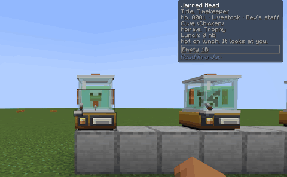

#### New

- **Every head has a title and a bell.** A placed head has a job title ("Canteen Supervisor", "Sleep Auditor").
  **Use** it with an empty hand: the bell rings and it says a line in its own noise, with HR's translation.
- **Lunch.** The plinth has a bowl. **Use** a Nutrient Broth Bucket on it to fill it; a pipe can top it up after the
  first lunch. A fed head works.
- **Desk jobs.** Eighteen species have a job. A blaze makes furnaces beside it cook faster, a ghast cries a tear at
  dawn, a cat keeps creepers off, a sheep gives wool to shears. Every job is listed under Full details.

  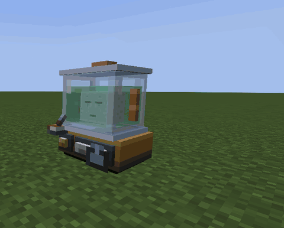

- **Morale does work.** Happy (Engaged) heads work faster; unhappy (Disengaged) ones work at half speed and complain.
  Lunch, colleagues, rivals and things its species dislikes move it; a cake helps a lot.
- **Lookouts.** Every head now fits a Turret Pedestal. A head with no attack keeps watch: it raises the alarm, makes
  intruders glow, and a comparator beside it can read the alarm.

  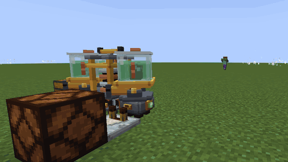

- **The Living Library.** Any placed or stationed head gives one blood sample a day to the right sampling tool, with
  no harm done. "It gave blood today. HR insists on a day's rest."

#### Changed

- **Staff stay with their employers.** Only a head's employer, or someone they trust, may take a head with an
  employer off its plinth or draw its blood: "Bessie reports to Steve. Ask them to trust you."
- **A goat's head** is drawn raised in its jar, looking out, so it is no longer tiny.
- Three advancements, four memos, handbook pages and eight new sounds with subtitles.

#### Fixed

- **Turret arrows reach their target.** A Turret Pedestal's arrows started inside the mount itself, so a skeleton, stray or
  bogged head's arrows stuck in it and never reached anything. Turrets in old worlds start hitting.

#### Updating

- Worlds from 0.6.0 load as they are. A trophy head does nothing new until it is fed or rung, except that a Leech
  Jar beside it now draws it once a day.
- A 0.6.1 game can join a 0.6.0 server; a 0.6.0 game cannot join a 0.6.1 server (new sounds). Update both.

Full details

**Titles and the bell**
- A placed head's tooltip, Jade and file card give its job title ("Canteen Supervisor", "Grief Counsellor", "Sleep
  Auditor"; a villager's is its profession).
- **Use** a placed head with an empty hand: the bell rings, it looks up, nods and says a line in its own noise with
  HR's translation, over the jar for 5 seconds for everyone within 16 blocks and on your action bar: "Moo." (HR
  translates: "Is there a canteen?").
- Every species has two to four lines and never says the same one twice running. A villager head still opens its
  trades.
- A big head in a big jar (a warden in a Reinforced Jar, a ghast in an Executive one) says "It is a snug fit." the
  first time it is ever rung.

**Lunch**
- **Use** a Nutrient Broth Bucket on the bowl: it fills (1,000 mB, three in-game days) and the empty bucket comes
  back.
- The first lunch hires a trophy, villagers and wage-less creatures included. After that a pipe may top the bowl up
  from any side but the top.
- A spoon taps the bowl now and then while it eats. The bowl's broth stays in the head when you break it.

**Every desk job (a fed head works)**
- A cow makes broth near it last longer; a sheep gives wool to shears and takes dye; a mooshroom gives stew to a bowl;
  a chicken clucks the hour.
- A cat keeps creepers off and leaves its employer a gift after a night's sleep.
- A blaze makes furnaces beside it cook a quarter faster; a ghast cries a tear at dawn (and wails at night).
- A piglin barters a gold ingot (and turns, off a Nether block, outside the Nether); an allay fetches dropped items of
  the kind you gave it into a chest.
- A frog croaks before rain; a squid gives ink to a glass bottle; a goat gives up its horns; a sniffer digs up a seed.
- An iron golem cheers villager heads and hands out a poppy; an evoker turns blue sheep red.
- A warden logs every sound within 16 blocks (and does not like a noisy floor); a zombie answers the door.
- A fed villager reads its best offer when you ring it with an emerald.

**Morale**
- Engaged heads do their timed work (a blaze's furnaces, a piglin's inspection) a fifth faster, and Disengaged ones at
  half speed. A Disengaged ghast cries two tears.
- A Disengaged head complains over its jar every two minutes ("Moo." (HR translates: "I was promised dental.")).
- At dawn a fed head gains 5 (never above 60 from lunch alone) and a hungry one loses 5 (never below 30).
- A colleague of its department within 8 blocks is +2, a rival within 4 is -5, and something its species dislikes
  (rain for a bee, open sky for a zombie) is -5.
- A cake used on a staff head is +40, once a day ("It is not hungry for cake.").
- DOLORES writes the first time one of your heads is Disengaged.

**Lookouts**
- The thirteen heads that attacked still do, with today's numbers. Any other head is a **Lookout**: "Cow head: no
  attack. It will keep watch and raise the alarm."
- It watches 16 blocks (never through walls), raises its own species' alarm with a double ding every 5 seconds while
  a hostile is in sight, makes it glow for everyone, and deals no damage. It draws 1 FE/t watching, 2 alarmed.
- **A comparator** on either cell of a Turret Pedestal reads 15 while its Lookout is alarmed or its head has a target,
  and for 2 seconds after: the mod's first comparator output.

**The Living Library**
- Any placed head, and any head at a Turret Pedestal, Employee Mount, Neural Socket or Cerebral Array, gives one
  blood sample a day to the right sampling tool, quality 70 to 95 (50 to 75 for a trophy or a head whose bowl is
  empty), with no harm done; it winces.
- A Leech Jar touching a plinth draws the head once a day and farms creatures the rest of the time.

**Employers**
- A head nobody employs is anyone's, as before; whoever sets a head down employs it, trophy or not.
- A member of staff taken off its plinth, or out of a Turret Pedestal, says goodbye ("Clearing my desk.").

**The turret fix**
- Its fireballs, snowballs and potions started inside the mount too (0.6.0 did the same). They now leave from
  outside it.

**Also**
- Advancements: Lunch Is Served, Neighbourhood Watch and Blood Bank. Four memos from DOLORES. The Employee Handbook has
  new pages on desk jobs, Lookouts and the Living Library.
- New server values `heads.deskJobs`, `heads.lookouts`, `heads.wardenDarkness`, `heads.livingLibrary` and
  `staff.complaints`.
- Eight new sounds with subtitles ("Desk bell rings", "Lookout raises the alarm", "Warden head shushes"...).

**Old worlds**
- The Array, Mount and Socket numbers and an attacking Turret's are unchanged. A Turret holding a head with no attack
  is now a Lookout and draws 1 to 2 FE/t instead of its old idle draw.

## 0.6.0 · Foundations (2026-11-15)

The Surgical Saw now says why it will not cut, every creature's head shows in its jar, and every creature the company
touches gets a staff file. Heads can be put on the payroll and wear the company's badge.

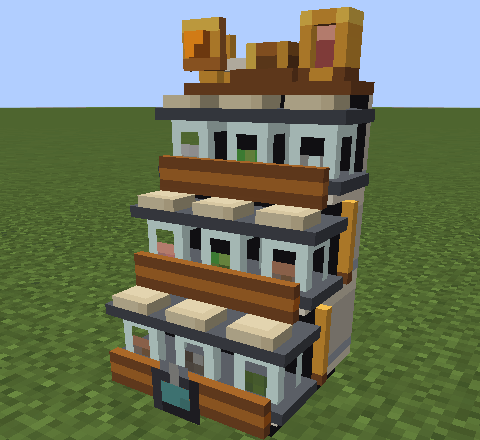

#### New

- **The saw reads a table.** Before anything spins up, the Surgical Saw says why it will not cut, each case in its own
  line, and nothing is spent. "Child labour is against company policy. Come back when it's grown."
- **Some creatures are all head.** A slime, magma cube, shulker, vex, bee, silverfish, endermite or tadpole goes into
  the jar whole, and only into a jar.

  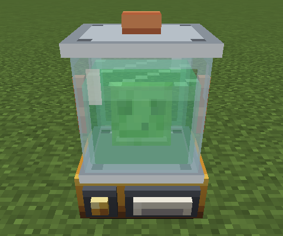

- **Big heads need a big jar.** A warden, an elder guardian or a big slime needs a Reinforced Life Support Jar or
  bigger; a ghast or a ravager needs an Executive one. "The Ghast's head needs an Executive Life Support Jar."
- **Every head is drawn in its jar.** Until now only people-shaped heads were drawn; a cow head or a creeper on a
  Turret Pedestal sat in an empty-looking jar. Every vanilla creature's head now shows, floating in the saline.
- **The Personnel File.** Every creature the company samples, cuts, places or fits to a station gets a staff number,
  a name, a department and a short history. **Sneak** + **Use** a placed head with an empty hand to open its file.

  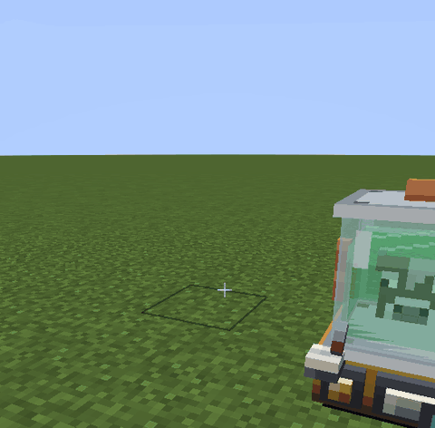

- **Paying a head.** Feed a placed head its wage by hand (wheat for a cow) and it is on the payroll: "Bessie is on the
  payroll. Wages at dawn, from a chest beside it." Paid or not, its morale shows it.
- **Lanyards.** Heads on the payroll, and heads at work in stations, wear a small badge in their employer's team
  colour, or the company's teal.

  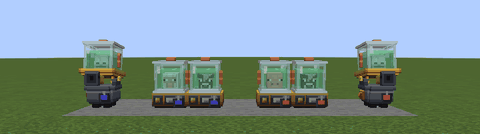

- **Leaving.** When a host or a Utility Shell dies, its employer gets an Exit Interview line and a Condolence Card
  drops where it happened: "[Exit Interview] Bessie (Cow), Livestock, 12 days: 'Moo.' Reason for leaving: lava."

#### Changed

- **DOLORES keeps to the rules.** Her memos come at most one a minute, never during an operation near you, and no
  longer cover the jar's bars.

  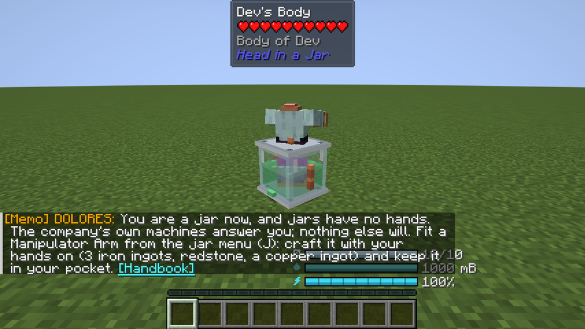

- **A head set down by hand faces you**, its plinth's front (and its badge) to you. Heads already placed keep the way
  they face.
- Three advancements and new handbook pages on staff files and pay; the saw's page has the table.

#### Updating

- Worlds from 0.5.4 load as they are. Heads in them appear in jars that looked empty.
- A 0.6.0 game can join a 0.5.4 server; a 0.5.4 game cannot join a 0.6.0 server. Update both.

Full details

**The saw's refusals**
- Each refusal comes with the refusal sound, and the creature shakes its head once.
- Babies: "Child labour is against company policy. Come back when it's grown." (a server can allow them again with
  `saw.allowBabies`).
- The Ender Dragon: "The Dragon is a Board matter. See the Board Room Core." The Wither: "The Wither has three heads
  and no Human Resources department."
- Other bosses, named creatures, other people's pets, hosts, shells and armour stands each have their own line too.

**All-head creatures**
- Without a jar: "A slime is all head. Bring a jar; there would be no body to keep."
- With one, the whole creature goes into the jar: no body is left, nothing drops and a slime does not split.

**Big heads**
- A warden, elder guardian, hoglin, zoglin, sniffer or a size-2 slime or magma cube needs a Reinforced Life Support
  Jar or bigger; a ghast, a ravager or a slime of size 4 or more an Executive one.
- Without a jar they give a body as before.
- A snow golem loses its pumpkin to the first cut ("Pumpkin removed. The head underneath is snow. Saw again.").

**Heads in jars**
- Until now only heads of people-shaped creatures (zombies, skeletons, villagers, illagers and the like) were drawn: a
  placed cow head, a creeper on a Turret Pedestal or a blaze in a Cerebral Array sat in an empty jar.
- Every vanilla creature's head now shows, scaled to float inside the saline (a creature's jar is kept fuller than
  your own), and the creatures that are all head are drawn whole.
- A head records the jar it went into, and one in a Compact Jar is drawn in that jar's shape; the other three jars
  still look alike.

**The Personnel File**
- A staff number, a name from HR's pool, a department and up to eight history lines.
- With Jade: "No. 0012 · Livestock · Steve's staff", and the name for the employer and those they trust.
- Its employer can rename it on the file card (16 characters).
- Sneaking and using a villager head with an empty hand now opens its file instead of its trades.

**Pay**
- Use a placed head's wage on it by hand (wheat for a cow, a carrot for a pig) to put it on the payroll.
- At each dawn it takes one wage from a chest beside it. Its morale goes up when paid and down when not (Engaged,
  Content, Disengaged).
- A head that has never been paid by hand is a trophy and never takes anything. Villager heads still trade and are
  never paid by hand.

**Lanyards**
- Worn by a head on the payroll, and by every Turret Pedestal, Employee Mount, Neural Socket and Cerebral Array with a
  head in it, in the employer's team colour or the company's teal.
- The client setting `lanyards` hides them.

**Leaving**
- The employer is the player who sawed the host, or placed the shell. They get one Exit Interview line.
- A host farm sends one line for each host that rots away.

**DOLORES**
- Her memos now come at most one a minute, and never while a Separation Chair near you is operating.
- Two new memos: the first time one of your creatures is numbered, and the first unpaid dawn.
- Her memos no longer cross the jar's bars: the chat sits above them while they show.

**Heads set down by hand**
- A jarred head placed by hand used to be set facing away from whoever placed it, turned only partway round to look
  at them; it now looks at the player who set it down.

**Also**
- Advancements: Entirely Head, Staff Number and Pay Grade.

## 0.5.4 · Corrections to the minutes (2026-11-15)

A small release of corrections. The Board can now vote a motion down, the wrong sampling tool names the right one,
and a mecha's Hemo-Syringe keeps the same rules as the hand syringes.

#### Fixed

- **A Board Meeting's motion can fall.** A motion now carries only when the ayes outnumber the nays; before, every
  motion was announced as carried, even 1 to 8. "[Board Meeting] Motion: unionise. Not carried: 1 for, 4 against."
- **The right tool, named.** A Marrow Drill, Oil Tap or Ecto Trap used on the wrong bloodless creature now names the
  tool it takes: "Wrong tool for this creature. Use the Oil Tap."
- **The Hemo-Syringe stops at a thick hide.** On a mecha's arm it no longer draws blood from bosses, the Elder
  Guardian or the Warden, which by hand only a Leviathan Needle gets through.
- **The Hemo-Syringe no longer jabs the bloodless.** On a mecha's arm it no longer hurts a bloodless creature, an iron
  golem say; it names the tool that creature takes.
- **JEI says half.** The Surgical Saw's JEI page now says it takes a creature at half its health or less, as it has
  since 0.5.2.
- **The README quotes the game.** Eleven lines it quoted had drifted from what the game says; each now reads as the
  game's own.

#### Updating

- 0.5.4 changes no saved data and nothing that passes between game and server.

Full details

- **The Board:** a tie does not carry; a motion that falls is announced as such.
- **The right tool:** before, a Marrow Drill, Oil Tap or Ecto Trap on a bloodless creature of another kind gave the
  syringe's line listing all three, the tool in your hand among them. Now it names the one that creature takes
  ("Wrong tool for this creature. Use the Oil Tap." for a Marrow Drill on an iron golem).
- **The Hemo-Syringe at a thick hide** now refuses as the hand syringes do ("Its hide is too thick: use a Leviathan
  Needle") and does not jab them.
- **The Hemo-Syringe at a bloodless creature** now refuses with the line that names the tool that creature takes
  ("Wrong tool for this creature. Use the Oil Tap." at an iron golem), and does not hurt it. Before, it hurt it and
  drew nothing.
- **JEI:** the page said the saw takes a creature below 25% of its health.
- **The README:** among the corrected lines are the glass's warnings, running out of saline, the EMP's line and the
  wrong-tool line.

## 0.5.3 · Dents from every side (2026-11-15)

Damaged machines show their dents from every side, the Assembly Gantry's arm welds each part as it lands, and the
jar's screen gets out of your way.

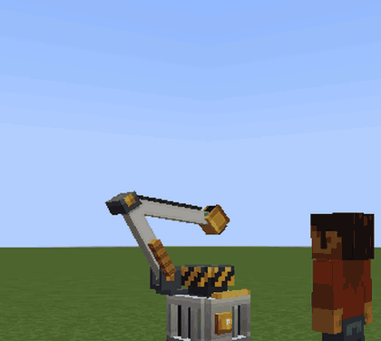

#### Changed

- **Dents from every side.** A damaged machine now shows its dents about as plainly from its front, back and flanks
  as the Bulwark does along its left, parked or on the move. The Chimera's flesh bruises, tears and cracks to the
  bone.
- **The Assembly Gantry's arm meets every part as it lands.** Each module shows on the frame only once the welder
  reaches it, and every weld lands on time. The arm crosses an Executive once instead of swinging across it five
  times.
- **A jar's hearts and armour show when they matter.** The glass takes every hit first, so while it holds above 3
  points and your head is unhurt, a jar's screen shows only its three bars.

  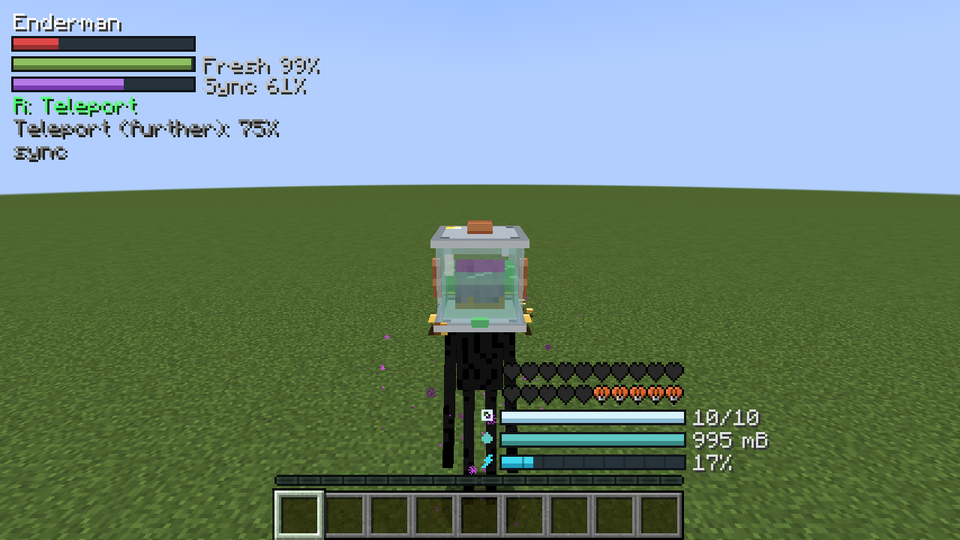

- **The action bar steps up over chat.** While chat lines show under it, the action bar sits just above them instead
  of across them.
- **Setting up a Utility Shell is heard:** a Lunk, a Rover or a Spider Walker set up from its chassis makes the
  machines' "Servo settles".

#### Fixed

- **A clean view when you swap into your jar.** Swapping into your jar soon after your head was put back on could
  cover the view with large flat purple squares. The stitch's Nausea now stays with your body.
- **A jar woken from the head you carry** no longer looks out through the inside of your body.
- **A new frame** no longer stands finished on the pad for a moment before it folds up to be built.

#### Updating

- Worlds from 0.5.2 load as they are.
- 0.5.2 and 0.5.3 connect to each other, either way round.

Full details

**Dents**
- Seen from five and eight blocks. The Hopper, the Chimera and the Kite's flanks now worsen plainly at half health;
  the Wheelhouse's and the Executive's flanks show their first dents at three quarters.
- The Executive's black paint chips to bare steel round a dent instead of blurring into a mottle.
- The Chimera's flesh takes wear of its own: purple bruises, then tears, at the last torn to the bone, and its bone
  cracks.
- The Utility Shells' fainter sides dent more too. The Rover's front and back (mostly lamps, tyres and thin rails)
  and the Kite's back still show less.

**The Gantry's arm**
- Each module now shows on the frame only once the arm's welder has come to it, a few pixels off, and seats as the
  tool presses it home; before, it often showed alone for a moment first (most plainly on a Colossus's right
  shoulder).
- Every weld now lands on time on every frame. A Skitter fits its sensors before its second side plate and its arm
  last, the turntable turning it a little at a time, instead of welding four parts up to half a second late.
- A Chimera, a Kite, a Bulwark and a Colossus take a tick or a few longer over some parts.
- An Executive fits its middle plate, one side, the two sensors on top and then the other side, so the arm crosses it
  once instead of swinging from side to side across it five times.
- A Colossus's legs and back plates and a Skitter's arm are now welded by the tool instead of an arc. The thirteen
  parts the tool still cannot get to show with the welder aimed at them and get an arc as they seat.

**Swapping into the jar**
- The Nausea of the stitch went with you into the jar, and a jar is so small that the effect's motes were born at its
  eye. The Nausea now stays with your body, giving off no motes there, and comes back to you when you swap into the
  body again.
- A jar woken from the head you were carrying starts where your body stands; the body is no longer drawn around a
  first-person view inside it.
- A mote already in the air as you swap can still show for a moment.

**The screen**
- The action bar moves only while chat lines are showing under it (a memo from DOLORES arriving as she says
  something, say); with no chat in the way it stays where it was.
- The hearts and the armour row come back once the glass is down to 3 or less, or as soon as your head itself is
  hurt.
- The Utility Shell's "Servo settles" plays where it stands.

## 0.5.2 · Bolder dents (2026-11-15)

Dents read plainly on every mecha and now on the Utility Shells too, the Gantry's arm is finished, and the Surgical
Saw gives you a fair chance to stop at half health.

#### Changed

- **Dents that read on every frame.** The Hopper, the Kite, the Skitter and the Chimera showed their dents only
  faintly; from five and eight blocks they now read nearly as plainly as the Bulwark's.
- **The Utility Shells dent too.** The Lunk, the Rover and the Spider Walker dent on the side they were hit from most,
  and the dents go when the shell is whole again.
- **The Assembly Gantry's arm, finished off.** Its rods are now steel as thick as the arm, its telescopes are heard,
  and it welds the heavy frames' shoulders as they land.

  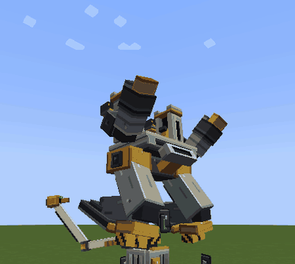

- **The Surgical Saw takes a creature at half its health or less.** Below a quarter was often a narrower gap than one
  weapon hit. Now a fist or any sword leaves a cow, pig, sheep, villager, skeleton or zombie at half or less for at
  least one hit before the hit that kills it.
- **The Employee Mount says how it hangs:** hold **Sneak** as you use it on the machine. Its tooltip, the handbook and
  the README say so.
- **The Gantry's wall refusal is shorter**, so it fits the action bar at GUI scale 3: "The frame's head would be in
  the blocks beside the pad. Clear them."

#### Fixed

- **Parked machines keep their quick shadows after a portal** with the BSL shader pack.
- **A jar on the Charging Dock looks past the dock, not into it**, so your clicks and Telekinesis no longer go to the
  dock.
- **A Suture Kit held on past the stitch stays quiet** instead of saying your head is already on.

#### Updating

- Worlds from 0.5.1 load as they are.
- 0.5.1 and 0.5.2 still connect to each other, either way round; a 0.5.1 game sees the shells clean.

Full details

**Dents**
- The Kite reads along its folded wings, the Skitter down its splayed legs, the Hopper (parked too) over its arms and
  cage. The other frames' fainter sides take more dents as well.
- The Utility Shells go a stage further at three quarters, half and a quarter of their health, as the mecha frames do.

**The Gantry's arm**
- A rod run out of the arm now shows as steel as thick as the arm itself instead of a thin pole, and none of it shows
  at rest.
- The telescopes are heard going out and coming in ("Gantry arm extends", "Gantry arm retracts").
- A Colossus now fits its left shoulder hardpoint last, once the turntable has turned that shoulder round to the arm,
  and an Executive fits each shoulder hardpoint straight after the arm below it. The arm welds the heavies' shoulders
  as they land instead of up to most of a second late, and swings across an Executive less often.
- The swivel no longer spins round within a tick.
- Some welds still come as an arc where the arm has no clean way in, and a Skitter's left arm is welded about half a
  second after it lands.

**The saw at half health**
- A stone, iron or diamond sword used to take a cow from whole to dead without a stop below a quarter.
- Now every plain weapon from a fist to a diamond sword, and every axe on all but a sheep, leaves a cow, pig, sheep,
  villager, skeleton or zombie at half or less for at least one hit before the hit that kills it. A stone sword takes
  a cow 10, 5, dead, so saw after the first hit.
- A stone, iron or diamond axe still kills a sheep with its first hit.
- A host is still raised to a quarter of its health if it was lower.

**Shadows after a portal**
- With the BSL shader pack, a trip to the Nether used to switch off the parked machines' quick shadows until the game
  restarted, and parked machines took about five times as long to draw from then on. Each dimension now tries them
  afresh (in the Nether, BSL's shadows are still drawn the ordinary way).

**The Charging Dock**
- A head set down on the dock sits side-on to the dock's column, and swapping into it wakes you facing that way.
- Before, you woke looking into the column: your crosshair, your clicks and Telekinesis went to the dock ("Machines
  and chests stay put"), and the camera in front of the jar sat inside it.

**The Suture Kit**
- A stitch that worked is no longer followed by "Your head is already on. Keep the kit for when it isn't." while the
  button is still down; a fresh press still says so.

**The Employee Mount**
- Without Sneak, a machine with a screen opens instead, as a chest does when you place a block against it.
- Its tooltip, the handbook's Villager Staff entry and the README say so.

## 0.5.1 · Wear and tear (2026-11-14)

A damaged mecha now shows where it was hit and limps when it is nearly wrecked, the Assembly Gantry reaches the tall
frames, and one rule decides who may pick up another player.

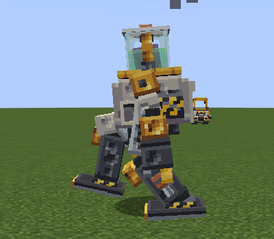

#### New

- **Wear and tear you can read from across the yard.** A damaged mecha's panels dent on the side it was hit from
  most, worse at three quarters, half and a quarter of its health. Below a quarter, a walking frame limps, dragging
  the leg on that side. The Assembly Gantry's plates take the dents out again.
- **The Assembly Gantry reaches the tall frames.** Its arm telescopes, so the welder reaches a Colossus's or an
  Executive's shoulders instead of striking an arc from the knees.

  

#### Changed

- **One rule for handling a player.** The Bulwark's lift, the Kite's talons, the Tractor Beam and the Grapple Hook
  take a player only if that player trusts you or is on your team. "... has not authorised handling. Ask them to
  trust you."
- **Getting off a flier puts you on the ground** beside it, instead of on its back to fall from there.
- **Parked mecha are cheap to draw under shader packs too**, with Iris and the BSL or Complementary packs, and look
  the same.

#### Fixed

- **Power beside the Gantry no longer stops a build.** A frame may now overhang what stands beside the pad, such as
  the Galvanic Pile that powers the Gantry.
- **Old goggles wait for you.** Goggles coming back from the old Curios head slot to a creative player with no room
  anywhere stay at their feet instead of vanishing.

#### Updating

- Worlds from 0.5.0 load as they are.
- Client and server must both be on 0.5.1. A 0.5.0 game and a 0.5.1 server (or the other way round) decline to
  connect, the disconnect screen naming Head in a Jar's channels as the mismatch.

Full details

**Wear and tear**
- The dents go a stage further at three quarters, half and a quarter of its health, and come out again as the
  Assembly Gantry puts the plates on.
- Below a quarter of its health a walking frame limps at its usual speed, dragging the leg on the side it was hit
  from more, the arm on that side hanging.
- A 0.5.0 game and a 0.5.1 server now decline to connect rather than disagree about what a mecha is doing.

**Handling players**
- The Bulwark's lift, the Kite's talons, the Tractor Beam and the Grapple Hook take a player only if that player
  trusts you or is on your team, as the Lunk's toss does. The Hopper's landing and the Wheelhouse's ram move players
  by the same rule. A refused hook costs nothing.

**Getting off a flier**
- Before, you were put on its back to fall from there (four blocks from a ghast, and a knock on the glass).

**Old goggles**
- They stay at the player's feet, as they do for everyone else, instead of vanishing at the first touch.

**Shader packs**
- With Iris 1.8.12 and BSL Classic v10.0 or Complementary Reimagined r5.5.1, a parked machine is drawn from its kept
  look through the pack's own programs, its shadow included, for a fifth or less of what it cost, and looks the same.
  Any other pack or Iris version draws it as before.

**The Gantry's telescoping arm**
- For a Colossus or an Executive the upper arm and the forearm slide out along steel rods, and most welds now land on
  the tick their part does. A few of the highest still come a moment late or as an arc.

**Power beside the Gantry**
- A frame wider than the pad may now overhang what stands beside it. Before, a pile set beside it, as its tooltip
  says, made Assemble answer that something blocks the space over the pad.
- The space straight over the pad must still be clear, and so must the blocks beside it at the frame's head height:
  "The frame would stand with its head in the blocks beside the pad. Clear them up to its head height."

## 0.5.0 · The mecha line (2026-11-14)

All eight mecha frames, the three Utility Shells and the Assembly Gantry are rebuilt and fully animated. Every sound
has a subtitle, DOLORES pages you when something important happens, and the screen and the handbook say what is going
on.

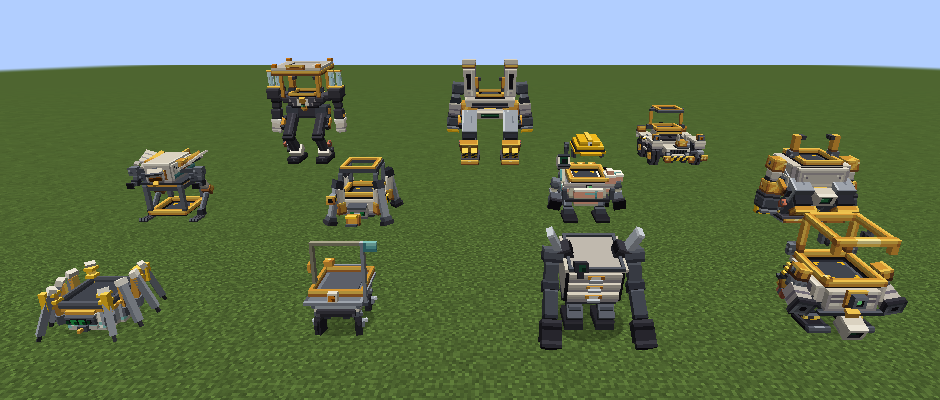

#### New

- **The mecha line, rebuilt.** Every frame and shell is animated from its build on the Gantry to its collapse when
  wrecked, with your jar in the seat and every module on its socket. **Drive** in a cockpit is each frame's own move,
  from the Hopper's Pogo Protocol to the Kite's Talon Lift.

  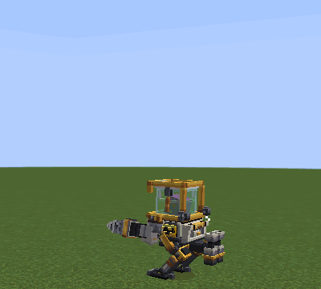 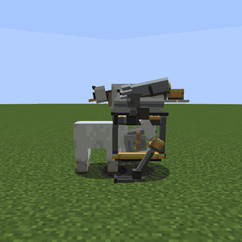

- **The Golden Parachute is a real parachute:** a klaxon, the restraint blown open, a gold canopy and a letter from
  the company.

  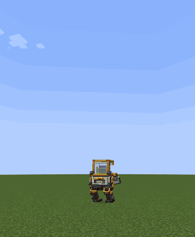

- **The Assembly Gantry, rebuilt.** A turntable and a welding arm: the arm welds each module home as the frame builds
  itself, and the turntable presents the finished machine to you.

  

- **Arms at work.** Every beam leaves its tool's muzzle and lands where you aim, and each tool spins, kicks, braces or
  strikes as it should. A hot mecha's vents glow; a damaged one sparks, smokes and limps.

  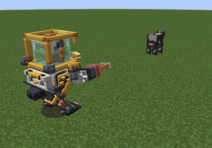

- **DOLORES pages you.** The first time something important happens, a memo arrives in chat with a beep, naming your
  keys and linking to the handbook page.

  

- **A career ladder.** Twelve new advancements lead from your first ingot to your first mecha, each saying what to do
  next. **Orientation Day** is yours the moment you arrive.
- **The Employee Handbook, Second Edition.** Ten chapters in the order you need them, with the company's forms, memos
  and incident reports.

  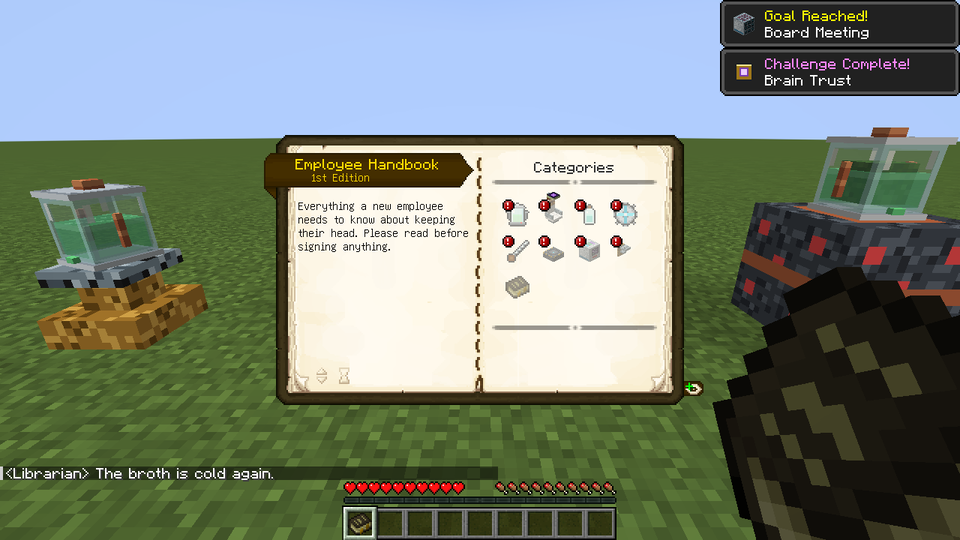

- **Taking a body, made visible.** The saw pops a head like a cork, a jar locks onto a host with a brass collar, and
  sync shows as rings down the body.

  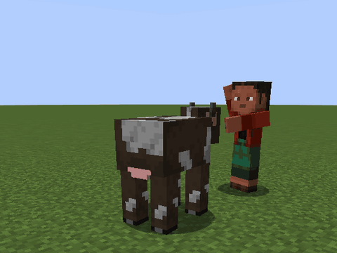

- **The Commute.** Swapping between body and jar pulls the old view away with a teal band, and the body powers down
  and up with three beeps.

  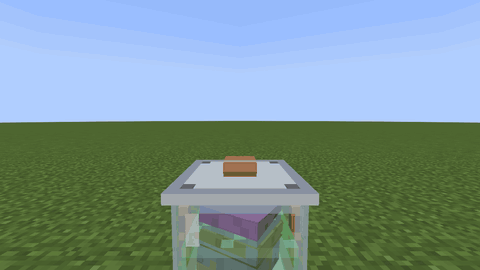

- **Your body waits for you:** at attention, then fidgeting, then sitting down; it turns to you and waves. A body
  that dies falls over, and HR sends a card.

  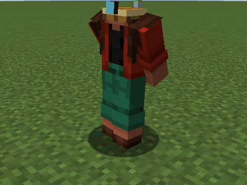

- **Every jar shows its life support:** the saline stands at its level in the glass, a lamp on the lid shows the
  charge, and failing glass is heard to crack.

  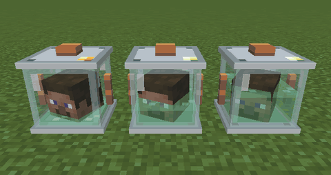

- **Ripe hosts slump, sway, stumble and draw flies.** Embalming goes in with a sparkle.

#### Changed

- **Mecha modules that now do what they say:** the Signal Booster, the Bio-Scanner, Anchor Clamps and shoulder
  hardpoints all work.
- **Every sound says what it is.** Every sound the mod plays has its own subtitle in both languages, and a room full
  of machines is heard as at most six sounds.
- **Parked mecha cost a tenth to draw.**
- **A clearer screen.** The jar's three bars carry their own marks, a low bar is hatched as well as red, and the
  host, mecha and gene panels share one column at the top left, clear of chat.

  

- **New default keys: Swap is Home, Secondary is mouse button 5**, so neither shares a key with Curios any more.
  Keys you set yourself are kept.
- **Fliers fly.** A ridden bat takes off now, and holding **Sneak** high up on any flier flies you down and lets you
  off near the ground instead of dropping you.

  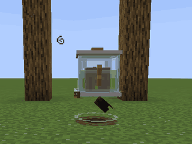

- **The Body Locker guards what it holds.** A locker with someone's body in it breaks only for its owner or someone
  they trust. The Curios head slot for goggles is gone: goggles count only on the jar.
- **Every key answers.** **Swap**, **Drive** and gene keys that cannot work right now say why.
- **One set of rules.** Small rules made consistent: the Lacrimal Laser stops at walls, lifting someone's
  mecha needs their trust, turrets need to see their target. All of them are under Full details.

#### Fixed

- A host's head stays hidden under Fresh Animations and other re-modelling packs; a corpse no longer lies half under
  the ground; a renamed Head Satchel counts; a dud serum says it was a dud; `/headoffice status` speaks your language,
  and `/headoffice trust` says when nothing changed.

#### Updating

- Worlds from 0.4.0 load as they are. Goggles left in the old Curios head slot come back to your inventory, Ender
  Chest or feet.
- Client and server must both be on 0.5.0.

Full details

**The mecha line**
- All eight frames and the three Utility Shells are fully animated, from the build on the Assembly Gantry, module by
  module, to the collapse when wrecked.
- **Drive** moves: the Hopper's Pogo Protocol, the Bulwark's Heavy Lifting, the Colossus's Siege, the Executive's
  premium jingle, the Wheelhouse's Rush Hour, the Skitter's Dragline, the Kite's Talon Lift and the Chimera's Graft.
- The Lunk holds what it tosses overhead first.
- The Golden Parachute opens a tangle instead of a canopy with no room overhead.

**Modules**
- The Signal Booster carries your link like a walking Relay Mast, the Bio-Scanner reads out the creature under your
  crosshair, Anchor Clamps grip the ground against knock-back, and shoulder hardpoints fire with the arm below them
  (alone in Siege).
- The Gantry and the HUD say when a mecha is built over its load lock; parked mecha no longer vent at passers-by;
  servers that forbid flight no longer kick pilots of flying, swinging or leaping mecha.

**Sounds**
- None borrows another thing's: the company jingle ends an operation and a printed body (no more level-up ding), a
  desk bell after the saw, a jar's wheels, roll, propeller and Hop Springs are heard, a weak link is static in your
  head that worsens with it, the Neural Socket clicks like a switchboard, and the Arc Cannon cracks instead of
  thundering.
- A room full of machines is heard as at most six sounds, identical machines together as one.

**Parked mecha**
- Kept as a copy of their look while nobody is aboard. Boarding shows only the mod's own climb-out line, never the
  game's "Press ... to Dismount".

**The Assembly Gantry**
- Repair ends with a weld pass and a charge lead from the reel, and Take apart is the arm's work with a wrench.
- Its lamp says ready, waiting, working, short of power or no.
- The turntable presents the finished machine to whoever pressed Assemble.

**Arms at work**
- The beams: the Plasma Lance (with a dimming visor), the Arc Cannon's jumping bolt, the Tractor Beam's ribbons, the
  Flamethrower's jet, the Welding Torch's arc.
- Each tool spins, kicks, braces, strikes or guards as it should, a fist's blow lands when the arm gets there, and the
  Manipulator Hand shows what it holds.
- A hot mecha's vents glow and its metal ticks; a damaged one sparks, smokes and limps.

**DOLORES's memos**
- They come the first time something important happens: your first day, your first moment as a jar with no hands,
  your head left out to dry, low charge, your first host, your first mecha.
- The link to the handbook page needs Patchouli. `memos` in the client config turns them off.

**The handbook**
- Without Patchouli the written book has the same text page for page, with a contents page you can click.
- The first-day copy goes into your hotbar, not your hand.

**The screen**
- The numbers show when they matter (`hudNumbers` keeps them up). The link bar points to your other half.
- The Neural Handshake's ring sits above the jar.
- Tooltips name the keys as you bound them, the Jar menu explains its slots, JEI has pages for some thirty more
  items, and Jade shows a host's abilities and your own head's saline and glass.

**Taking a body**
- The body shakes itself or pats the air where its head was; the collar is a brass bayonet collar; the handshake plays
  the company jingle.

**The Commute and the waiting body**
- The teal band goes up into the body or down into the jar.
- The waiting body holds out its arms to you. Your own corpse sends up a flare only you can see.

**Fliers**
- A ridden bat used to stay asleep.

**The Body Locker**
- It no longer takes power from cables.
- Goggles left in the old Curios slot come back to your inventory, Ender Chest or feet.

**Every key answers**
- **Swap** and **Drive** with your head on, and gene keys that cannot fire, all say why.
- A host's active genes fire with **Sneak**.
- A key another mod also uses is named once when you join.

**One set of rules**
- The Lacrimal Laser stops at walls. Lifting someone's mecha, or anything they ride, needs their trust.
- The Shock Lid zaps with no glass left, the Saline Recycler works for a set-down head, and a jar resting in an empty
  Cradle is topped up.
- Flat wheels fold away and say so. The Leech Jar never takes the last point of health.
- Turrets need to see their target, and their shots and blasts spare whoever they would never aim at.
- A Neural Socket's hotbar keys reach level 1 and leave your hotbar alone.
- Employee Mounts count on either half of a tall machine.
- A laced body refuses Embalming Fluid and a second lace, and keeps them.

## 0.4.0 · The machines (2026-11-12)

All twenty-two company machines are rebuilt as working machines: their parts move when they work, each has its own
sounds, and a lamp on its front says what it is doing. Most now stand two blocks tall.

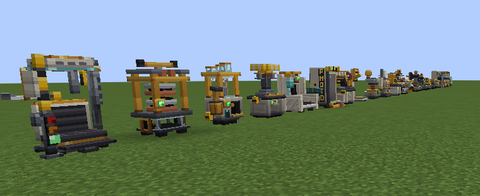

#### New

- **The machine line, rebuilt.** From the Galvanic Pile to the Leech Jar, presses, paddles, dishes, shutters and
  spools move when they work, and a lamp on the front says ready, working, waiting or short of power.

  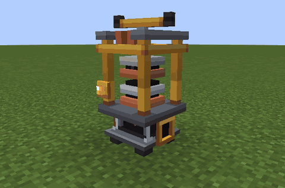

- **Machines that watch you.** Relay Masts turn their dishes along the link they carry, the Signal Jammer's turbine
  spins up when it cuts a link, a Turret Pedestal patrols and swings onto its target, and a placed Jarred Head turns
  to look at you.

  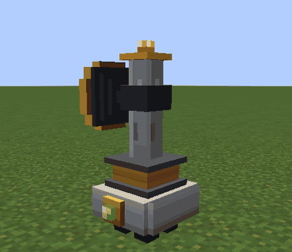

- **Tesla Nodes face each other.** Each node's ball turns to its partner and the arc runs ball to ball.

  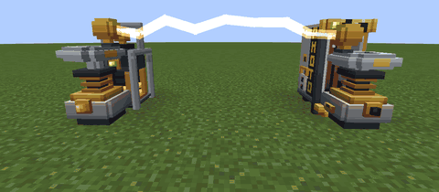

#### Changed

- **Most machines are two blocks tall.** Leave the block above free when you place one: "No headroom. Needs two
  blocks of height." Clicks, hoppers, pipes and cables work on either half.
- **Every refusal shows on the machine:** a red lamp for two seconds and a rattle of the part concerned, with the
  line that says why.
- **The Body Locker keeps a body for its owner.** A body checked in from now on goes back only to whoever checked it
  in, or to someone they trust (`/headoffice trust`).
- **The Injection Rig takes a moment.** The shot lands a second and a half after **Inject**; step away and it is
  called off, with nothing used.

  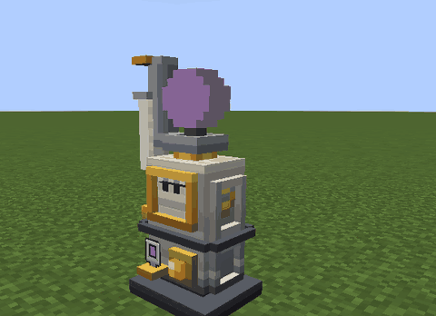

- **The Safety Placard's notices are painted on the board**, in English or Brazilian Portuguese with your game.

  

#### Updating

- Worlds from 0.3.0 load as they are. A machine placed under a block keeps working at one block tall and takes its
  upper half within two seconds of the block above being cleared.
- Bodies already in a Body Locker go to anyone, as before.

Full details

- **The twenty-two machines** run from the Galvanic Pile to the Leech Jar; each has its own sounds.
- **New refusal lines:** an empty Charging Dock, cooked food at the Galvanic Pile, an empty bucket at a Saline Mixer
  with too little saline.
- **Tesla Nodes:** a pair linked in an older world finds its sender on the first tick.

## 0.3.0 · Fair warning (2026-11-12)

Telekinesis and the big moments are drawn properly now, and the game warns you before something costs you your head.

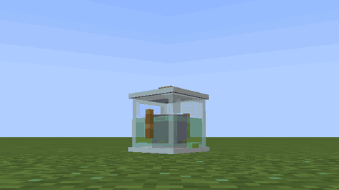

#### New

- **Telekinesis you can see.** A held creature, item or block hangs in front of the jar on a glowing line and swings
  with its weight. The ability key sets it down, attack throws it.
- **Effects for the big moments.** Swapping between body and head, the Lacrimal Laser, the arcs between linked Tesla
  Nodes and a guardian turret's lock beam are drawn properly now, most with their own sounds.

  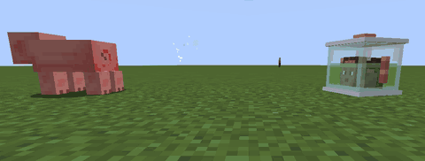

- **Warned before it costs you.** A jar's glass says every knock it takes and warns at the last ones before a hit is
  a real death.

#### Changed

- **More clicks answer.** The company's items used at nothing or on a colleague say where they go, and a friend you
  trust can top up your jar.
- **Hosts ride at a sensible pace.** A ridden cow, pig or other land creature now tops out near a sprint (a cow was
  nearly twice that).

  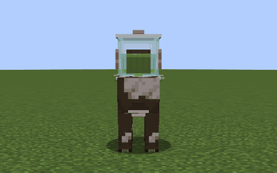

#### Fixed

- **The Neural Handshake now always starts when you first board a host** (it used to be skipped now and then), and
  the screen says the host's legs wait until it is done.

  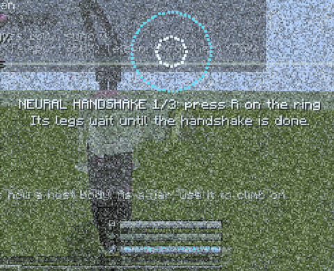

- **Hitting your own placed head** no longer cracks it.
- **The chair:** a seated patient can reopen the panel with use, and DOLORES says so truly when your head is piped to
  a Cradle instead of the tray.

Full details

**Telekinesis**
- The held thing hangs out in front of the jar where you can see all of it, and lags behind with its weight.
- The hold says why it ended when it runs out of charge or reach. A grab that fails says why (too heavy, a boss, a
  machine, nothing in reach).
- Lifting another player, their placed head or their body takes their trust: `/headoffice trust add`.

**Effects**
- `screenShake` in the client config (0-100) sets how much they may move the camera; the photosensitive option turns
  it off.

**Warnings**
- A head left near fire, a jar smashed by a mob and a wrecked mecha all say what happened (a wrecked mecha throws you
  clear).
- The Syringe never takes a creature's last health, and a printed body that has to wait for you says so.

**Clicks**
- A friend you trust can top up your jar with a Saline Bottle or a Glass Patch.
- Clicks while plugged into a Neural Socket say how to unplug.

**Riding**
- Horses and the other vanilla mounts are unchanged.

## 0.2.0 · A new chair (2026-11-12)

The Separation Chair is rebuilt and fully animated, its attendant DOLORES talks you through the operation, and things
that did nothing when clicked now say why.

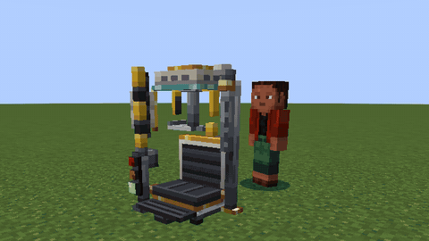

#### New

- **A new Separation Chair.** The barrier comes down, the hood scans you, the blade swings, and a claw carries your
  head into the jar on the chair's tray, then hands it to you. Everyone nearby sees the same operation at the same
  moment.
- **DOLORES speaks.** The chair's attendant talks you through the operation out loud, in English or Brazilian
  Portuguese; the patient hears her muffled.
- **The handbook on your first day.** Every player is handed the Employee Handbook when they first join.

#### Changed

- **Every click answers.** Things that used to do nothing when clicked now say why not and what to do instead, in one
  short line. A bare jar can now work every Noggin & Sons block with a menu or a status.
- **The power numbers, on one scale.** Mecha batteries are a quarter of their old size and charge on the Assembly
  Gantry; jars, shells and machines were rebalanced to match.
- **And more:** the Charging Dock charges a jar standing on it or a head set down on it, and getting out of a mecha or
  a shell puts you beside it.

  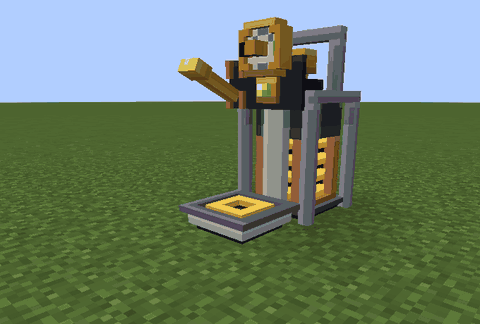

#### Fixed

- **The jar crash is fixed.** Placed jarred heads, and turrets, mounts, Arrays and sockets holding a head, no longer
  crash the game when they come into view.

#### Updating

- Older saves load: a mecha charged above its new battery size starts full.
- Players in existing worlds get their handbook at their next login.

Full details

**The chair**
- Everyone nearby sees the same operation at the same moment, even if they walk up halfway through.
- The chair needs a little room to its left and in front for the tray and the hood, and says so if something is in
  the way.

**DOLORES**
- She speaks in whichever language your game is in.
- Her volume is the **Voice/Speech** slider in Music & Sounds, and `doloresVoice` in the client config turns her off
  (the lines still show on screen).

**Clicks that answer**
- Among them: a bare jar at a chest, the jar menu key with your head still on, a chair already in use, a Cradle with
  no power, and many more.
- Vanilla blocks still need a Manipulator Arm.

**The handbook**
- A book and a Surgical Steel Blend make a new copy; without Patchouli it is a written book.

**Power**
- A mecha parked on the Assembly Gantry charges from it.
- Reinforced and Executive jars hold more charge than a basic one.
- Shells, the Propeller, the Signal Jammer and idle turrets drain far less.
- Only one Dragon Head counts in a Cerebral Array.

**And more**
- A Rover drives at a Rover's pace and a crash costs one knock, not the whole jar.
- Held keys no longer carry over when your link breaks.
- A weak link shows the clicks it drops.
- The Galvanic Pile, the Gantry, the Dock and the Cradle explain themselves in their tooltips.
- A key shared by Sprint and the ability is explained once.

## 0.1.0 · Opening day (2026-11-08)

The first public version of Head in a Jar, in English and Brazilian Portuguese.

#### New

- **The Separation Chair.** The company's chair takes your head off and puts it in a jar.
- **Life-support jars and the linked body.** Your head lives in a jar, and your body carries on without it.
- **Mob hosts and Utility Shells.** A jar can ride a headless creature, or a shell built for the purpose.
- **Mecha frames and modules.** Bigger machines for a jar to drive.
- **The Genetics Department.** Sample, splice and inject genes.
- **Heads at work** and **the handbook.**
