# Head in a Jar

*Head Office, Noggin & Sons' employee programme for the ambitious and the slightly unhinged.*

A Minecraft mod for **NeoForge 1.21.1**. Sit in the Separation Chair, sign Form 27-B, and lose your head on purpose. Your
head lives in a life-support jar; your headless body walks around on a wireless neuro-link while you see through a camera
on its neck. From there it gets stranger. Jars can ride the headless bodies of mobs, pilot mecha you build part by part,
splice genes from the creatures you sample, and put other people's heads to work.


*The operation, seen by a colleague (shown at double speed). Sit down with **Use** and hold the Sign button on its screen.*

Fully playable in **English** and **Brazilian Portuguese** (every line of text, the handbook, the advancements and
DOLORES's voice). This page describes release **0.5.0**.

## Requirements

- Minecraft **1.21.1** with **NeoForge 21.1.200** or newer.
- **GeckoLib 4.9.3** or a newer 4.x for 1.21.1 (required; GeckoLib 5 is not accepted).
- Install it on both the client and the server.
- Optional: Curios, JEI, Jade, Patchouli, Entity Model Features (see [Other mods](#other-mods)).

## How to read this page

New here? Read [Your first week at Head Office](#your-first-week-at-head-office): it takes you from a fresh world to
your first mecha. Lost in a strange body? [What can I do right now?](#what-can-i-do-right-now) says what each form can
and cannot do. Everything else is reference. Keys are named by their action (**Ability**, **Swap**, **Use**...); the
default key for each is in [Controls](#controls).

## Contents

- [Your first week at Head Office](#your-first-week-at-head-office)
- [What can I do right now?](#what-can-i-do-right-now)
- [The Separation Chair](#the-separation-chair)
- [Living with your head off](#living-with-your-head-off)
- [Jars and telepresence gear](#jars-and-telepresence-gear)
- [Power and life-support blocks](#power-and-life-support-blocks)
- [Jar modules](#jar-modules)
- [Hostile Takeover: mob bodies](#hostile-takeover-mob-bodies)
- [Utility Shells](#utility-shells)
- [Jarred heads](#jarred-heads)
- [Mecha Division](#mecha-division)
- [Genetics Department](#genetics-department)
- [Board of Directors: heads at work](#board-of-directors-heads-at-work)
- [Controls](#controls)
- [Commands](#commands)
- [Configuration](#configuration)
- [Advancements](#advancements)
- [The Employee Handbook](#the-employee-handbook)
- [Other mods](#other-mods)
- [Sounds](#sounds)
- [Release notes](#release-notes)
- [Building from source](#building-from-source)
- [License](#license)

---

## Your first week at Head Office

A walkthrough from a fresh world to your first jarred week. Every new employee is handed the **Employee Handbook**
on their first day: it goes into a free slot of your hotbar, not into your hand. A lost copy is a book and a
**Surgical Steel Blend**, shapeless. The advancements tab **Head in a Jar** is open from your first moment, and each
step there says what to do next (see [Advancements](#advancements)); DOLORES pages you in chat the first time
something new happens (see [Memos from DOLORES](#memos-from-dolores)).

### Day 1: Surgical Steel and parts

Shopping list before you start: iron, coal, bone meal, copper, redstone, glass, **amethyst shards** (a geode),
**slime balls**, **kelp**, sugar, leather, string, white wool, a piston, a lever, shears, a repeater. Later tiers need
nether quartz, gold, lapis, diamonds, ender pearls, netherite scrap, obsidian and tinted glass.

1. **Surgical Steel Blend**: iron ingot, bone meal and coal, shapeless. Smelt it (10 seconds) or blast it (5 seconds)
   into a **Surgical Steel Ingot**. Nine ingots make a **Block of Surgical Steel**, and back.
2. The parts. In every recipe on this page, "ingot" on its own means a Surgical Steel Ingot, and "gap" an empty
   square.

| Part | Recipe |
|---|---|
| **Neuro-Copper Wire** (makes 4) | copper ingot, redstone, copper ingot in a row |
| **Lens** | glass, amethyst shard, glass in a row |
| **Servo** | a piston on top; ingot, wire, ingot below |
| **Synapse Chip** | quartz, wire, quartz; gold ingot, lapis, gold ingot below (needed from Day 7: nether quartz) |

### Day 2: power and saline

- **Galvanic Pile**: six copper ingots, two wires and one rotten flesh (copper ring, wire above and below the flesh).
  It stands two blocks tall, so leave the block above it free. **Use** meat on it to feed it: rotten flesh gives
  4,000 FE, a spider eye 6,000, any raw meat or fish 3,000. It burns at 20 FE a tick and shares its power evenly among
  every machine touching its lower half, taking turns over who goes first. **Use** it with an empty hand to see its
  stock. Hoppers can feed it.
- **Cranial Saline**: a water bottle, sugar, kelp and redstone, shapeless, make **two** bottles. You need **four** for
  the operation. A few spares are wise.

### Day 3: the kit

| Item | Recipe | What it is for |
|---|---|---|
| **Life Support Jar** | copper ingot on top; glass, slime ball, glass; ingot, redstone, ingot | Your new home. 3 module slots |
| **Relay Goggles Mk I** | leather, copper ingot, leather; lens, wire, lens | Worn by your head. 48 blocks of link |
| **Collar Cam** | a lens on top; wire, servo, wire; three ingots | Bolted to your neck. Your body sees through it |
| **Head Satchel** | string, leather, string; leather, gap, leather; three leather | Carry your own head with a perfect link |
| **Suture Kit** | string, slime ball, iron nugget, saline bottle, shapeless | Puts your head back on. Bring a spare |

### Day 4: the operation

1. Make the **Excision Head** (a Block of Surgical Steel on top; servo, lens, shears; a redstone block below) and the
   **Booth Console** (wire, glass pane, wire; ingot, repeater, ingot; wire below), then the **Separation Chair**
   (white wool, Excision Head, white wool; ingot, white wool, ingot; Booth Console, servo, lever).
2. Place the chair with your Galvanic Pile touching it. It needs **40,000 FE**: ten rotten flesh, about 100 seconds of
   burning.
3. Keep the room clear (left as the patient sits): the block to the left of the seat and the one above it (the jar tray), the block in front and
   the two above it, the front-left block one and two up, and the space above the chair.
4. **Use** the chair to sit down; its console opens. Load the jar, the goggles, the Collar Cam and four bottles of
   saline. Hold the **Sign** button for two seconds.
5. Watch. You can get up with **Sneak** before the five-second mark. After that, DOLORES finishes.

You stand up in your own headless body, seeing through the Collar Cam. Your head is in its jar on the chair's tray,
to your left. If an empty **Life Support Cradle** stood within 3 blocks of the chair, your head was piped there
instead, and DOLORES says so. The bar at the top of the screen is your **link quality**; the small arrow at its left
points to your head.

### Day 5: living with it

- **Pick your head up.** With the Head Satchel on you, **Use** your jar. An empty hand hugs it in front of you; hold
  anything and it goes on your back. A carried head always has a perfect link and drinks no saline.
- **Or dock it** in a Life Support Cradle, filled with saline and powered. A docked head is safe and kept topped up.
- **Swap** between body and head whenever you like. Back into the body needs a link above 20%.
- **Feed the head.** A set-down head slowly drinks saline: 1 mB every 12 seconds, about 3 hours 20 minutes for a full
  basic jar. From your body, **Use** Cranial Saline on it. In jar form, the **Jar menu** has a feed slot for Saline Bottles, Glass Patches and redstone (5,000 FE a
  dust, 45,000 a block). A **Charging Dock** charges a jar standing on it.
- **Your body can die without you.** It becomes a corpse that keeps your things, and you wake up in your jar.

### Day 6: when it goes wrong

Walk too far and the link breaks: you wake up in your head. To get back:

- **Drive** tips a bare jar on its side to roll, very slowly. With the **Wheels** module it drives at half speed.
- **Courier**, in the **Jar menu**: your body is delivered to your head in 30 seconds, for 20,000 FE of charge.
- **Suture Kit** at your body, as a jar, sews the head back on for good.
- **Let go**, in the **Jar menu**, is the last resort: a real death, and you respawn whole.

### Day 7: what's next

- **Borrow a body.** Make a **Surgical Saw**, wear a creature down below a quarter of its health and saw its head
  off. As a jar, **Use** the standing body to climb on. See [Hostile Takeover](#hostile-takeover-mob-bodies).
- **Build a mecha.** **Mecha Plating** (8 ingots around an iron block, makes 2), an **Assembly Gantry**, a **Hopper
  Frame** and **Hydraulic Legs**, 10 kFE, Assemble, and watch it build itself on the pad; climb in as a jar and hold
  **Drive** to pogo. A **Galvanic Stack** keeps it charged. See [Mecha Division](#mecha-division).
- **Start the lab.** Syringe, Centrifuge, DNA Sequencer, Gene Splicer, Injection Rig. See
  [Genetics Department](#genetics-department).
- **Put heads to work.** Saw a head off with an empty Life Support Jar in your other hand. See
  [Board of Directors](#board-of-directors-heads-at-work).

---

## What can I do right now?

Head Office recognises six forms of employee, plus one carrying arrangement. Find yours.

| | **Body** (head on) | **Linked** (headless body) | **Carrying your head** | **Jar** (and Compact Jar) | **Hosted** | **Pilot** | **Socket** |
|---|---|---|---|---|---|---|---|
| How you get here | You start here | The Separation Chair; **Swap** from a jar | Linked, with a **Head Satchel** on you: **Use** your set-down head | **Swap** from linked; your linked body dies; the link breaks | As a jar, **Use** a host body or a shell | As a jar, **Use** your own mecha's cockpit | As a jar, plug into a **Neural Socket** |
| How you leave | Separation Chair | **Swap** (to your head); **Suture Kit** | Set it down (**Sneak** + **Use** the satchel), dock it, or sew it on | **Swap** to your body; **Suture Kit**; **Let go** | **Sneak** (on a flier, within three blocks of the ground) | Hold **Sneak** and press **Jar menu** | **Sneak** and press **Jar menu** |
| Walk | Yes | Yes (stutters on a weak link) | Yes | No. Tip over and roll, or fit legs, springs, wheels or a propeller | The host walks | The mecha walks | No |
| Break and place blocks | Yes | Yes | Yes | Only with a **Manipulator Arm** (half speed, 200 FE a block) | No | Through the mecha's arms | No |
| Attack | Yes | Yes | Yes | Only with an Arm (200 FE a swing, half damage) | The host's abilities | The mecha's arms | No |
| Use items in the air | Yes | Yes | Yes | Only with an Arm | No | No | No |
| Pick up items | Yes | Yes | Yes | Only with an Arm or a **Magnet** (Telekinesis lifts items but does not pocket them) | Same as jar | Same as jar | Same as jar |
| Open blocks | All | All | All | The company's machines only (see below); vanilla blocks need an Arm | None | None | None |
| Portals | Yes | **No**, unless you carry your head or your goggles and collar are entangled | Yes | Yes | As a ridden mob | Yes, except the Colossus and Executive (too big) | No |
| **Swap** | "Your head is still on. The Separation Chair sees to that." | Wake up in your head | Become a jar where you stand | Back into your body | "Not from up here. Get down first." | Opens the Cargo Hold | "Swap works from a jar or a body. Get down first." |
| Dying | A normal death | Not a death: your body becomes a corpse, you wake up in your head | Your body becomes a corpse, you become a jar on the spot | A real death | A real death | A real death | A real death |

A jar never gets hungry and cannot drown. A linked body cannot wear a helmet: it goes into your pockets.

Without an Arm, a jar can still work every Noggin & Sons block with a menu or a status: the Body Printer, Saline Mixer,
Charging Dock, Life Support Cradle, Galvanic Pile, Leyden Jar, Tesla Node, Relay Masts, Signal Jammer, Safety Placard,
Separation Chair and the other departments' machines. It can read them, not pour things into them: whatever it holds is
not used on the block. It can also **Use** its own body, a host or shell to climb onto, a boat or a minecart.

A **real death** in jar form ends the arrangement. Your modules, goggles and Collar Cam drop where you were. The jar
itself is not returned. Your idle body falls down for good. You respawn with your head on. A real death also happens
if, while linked, your set-down head is destroyed or dries out.

---

## The Separation Chair


The **Separation Chair** takes your head off and leaves your body linked to it. It is staffed by DOLORES, who is
professional about it.

### What it needs

- **Parts**: one jar (any of the four), one pair of goggles (any tier), one **Collar Cam**, four bottles of
  **Cranial Saline**. Hoppers and pipes can load it. Empty slots show what goes in them.
- **Power**: 40,000 FE stored before it will start. It holds 50,000 and takes up to 2,000 FE a tick. A Galvanic Pile
  touching it is the usual supply.
- **Room** (left and right as the patient sits): the block to the left of the seat and the block above that (the tray: a jar can't even be loaded with them
  blocked), the block in front and the two above it, the front-left block one and two up, and the space above the chair.

**Use** sits you down and opens the console. **Sneak** and **Use** with empty hands opens it without sitting. Anyone
clicking while someone is seated, and any jar, gets the console only. Only the seated patient can sign.

The console lists Power (40 kFE), Life Support Jar, Relay Goggles, Collar Cam and Cranial Saline x4, ticked or not, and
shows the blade wear. **Form 27-B**: hold the Sign button for two seconds. Let go or slide off and the pen lifts.
Point at **Sign** first: if it can't be signed yet, its hover says why ("Sit down to sign", or DOLORES's line for the
first missing part).

### What refuses

Only the first missing thing is named, in DOLORES's words:

| Missing | She says |
|---|---|
| Power | "Insufficient power. I refuse to stop halfway." |
| Jar | "Where would we put your head? Insert a Life Support Jar." |
| Goggles | "Relay Goggles required. You will want to see." |
| Collar Cam | "Collar Cam required. Your neck needs a hat." |
| Saline | "Four bottles of Cranial Saline, please. Heads get thirsty." |
| Your head is already off | "Our records show your head is already off." |
| Room | "The chair needs room to work. Clear the block in front." (or whichever) |
| Tray space, when loading a jar | "The jar tray can't come out. Clear the block to its left." |
| Not seated | "Sit in the chair to sign" |

Mid-operation, others are told "Operation in progress. Kindly wait behind the line." The chair cannot be broken until
it is done: "Not mid-operation. It comes apart once it is done." Broken when idle, it drops what it holds.

### The operation, beat by beat

Twelve seconds. Everyone nearby sees the same moment, even someone who walks up halfway through.

| Time | What a bystander sees and hears | What the patient sees |
|---|---|---|
| 0 s | "Thank you for choosing Elective Separation. Please keep your arms inside the chair." The barrier motors down and latches. | The edges darken |
| 1-3 s | "Administering a pleasant gas. Breathe normally. Or don't." The hood nods; pale green gas puffs from under the dome; three beeps | A green tint |
| 3-5 s | "Scanning. Please hold still. You have a lovely neck." A ring of light runs down over the face | A green line follows the ring |
| 5 s | "Commencing separation. This will not hurt for very long." From here there is no getting up | Fade to black |
| 5.3-6.7 s | A privacy curtain rises. "Privacy, please." | Black |
| 6 s | The blade. A ring of white smoke at the neck, a spark. Heard 24 blocks off. A helmet goes into your pockets | Black, and silent |
| 7-10 s | "Your head is now in a jar. Congratulations on your promotion." The jar's lid pops, the claw carries the head over, the goggles go on, the head drops into the jar and the saline rises | Black; muffled bubbling |
| 10.5-12 s | The Collar Cam is bolted on with three ratchet clicks; sparks on the antenna; the barrier lifts | The feed boots up: "NEURO-LINK 2.1 ... 100%" |

At the end you stand up in front of the chair, linked, a little dizzy for 8 seconds. DOLORES: "Neuro-link established.
Please collect your head on the way out." Or, if an empty Cradle within 3 blocks took it: "Your head has been piped to
the Cradle." Your jar starts full of charge, saline and glass.

### Getting up before the cut

**Sneak** before the five-second mark and the operation is called off: "Procedure cancelled. Your head remains
attached. For now." You keep every part. The chair keeps three quarters of its energy: a cancellation costs 10,000 FE.
After the five-second mark the restraints hold. A patient who leaves the game after the cut is finished at once.

### Blade wear and the botch

Each operation adds 5% blade wear (3% with a Mason on staff beside the chair). Above 80% the blade can botch: 10% odds
at 85% wear, rising to 40% at 100%. With no Mason, the first 17 operations are always clean. A botch: DOLORES says
"Oopsie.", your view is upside down for 30 seconds, your head floats upside down in its jar for as long, and the
Collar Cam is left **Crooked**, losing 10% of its range for good. A Self-Righting Gyro rights the view at once.

**Replacement Blade**: two Surgical Steel Ingots and a diamond, shapeless. **Use** it on the idle chair: wear back to
0. "New blade fitted. So shiny." Not mid-operation: "Not mid-operation. Change the blade afterwards."

### DOLORES

She speaks her lines aloud, in English or Brazilian Portuguese to match your game, in the **Voice/Speech** volume
slider; the patient hears her muffled through the anaesthetic. Her refusals are spoken at most once a sitting each.
`doloresVoice = false` in the client config keeps her to text.

### Memos from DOLORES

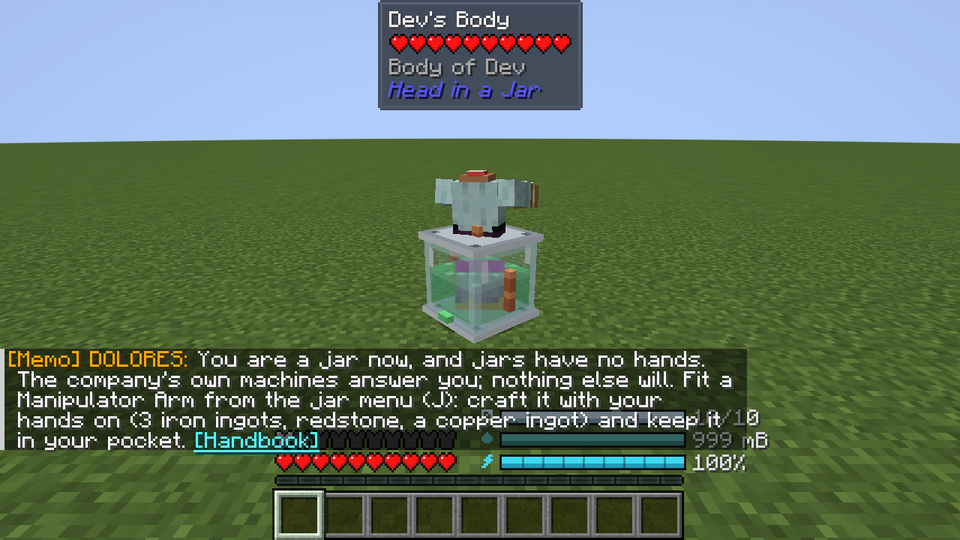

*A memo arriving: the first time you are a jar without a Manipulator Arm.*

The first time something important happens to you, DOLORES pages you: one line in chat, "[Memo] DOLORES: ...", with
a beep. There are seven, and each comes once per player, ever:

| When | What she tells you |
|---|---|
| Your first day as a new employee (not a player from an earlier version), head still on | Welcome to Noggin & Sons: the book you were handed is your Employee Handbook (**Use** it to read it), and your first jobs are on the Head in a Jar tab of the advancements. |
| Linked, your head left behind (on the tray, set down or docked) | You are your body now; **Swap** takes you to your head, which drinks saline while you are away unless you carry it in a Head Satchel. |
| Linked, your set-down head under a quarter of its saline | When it runs out the glass cracks, then it is a real death: use Cranial Saline on it, or carry it. |
| A jar with no Manipulator Arm | A jar has no hands; the company's machines answer you, nothing else will. Fit an Arm from the **Jar menu**: craft it with your hands on (3 iron ingots, redstone, a copper ingot) and keep it in your pocket. |
| In any jar form, charge under a quarter | Stand on a fed Charging Dock, put redstone in the jar menu's feed slot, or dock in a Life Support Cradle. |
| Your first ride on a mob host | Sync grows about 5% a minute; the first ability opens at 50% (**Ability**), the second at 75%. **Sneak** gets you down. |
| Your first mecha assembled | It is on the pad: **Swap** to your jar and **Use** the mecha to climb in; hold **Sneak** and **Jar menu** to get out. |

Each memo names your keys as you have bound them. With Patchouli installed, a "[Handbook]" link at the end opens the
handbook at the page that says more. Memos are a courtesy, not a requirement: `memos = false` in the client config
turns them off (a memo missed that way is not sent again later).

---

## Living with your head off


### Link quality

The bar at the top of the screen reads LINK (percent), HEAD or BODY (which half it measures to), and the distance in
metres: to your head as a linked body, to your body as a jar. Five steps show the signal at a glance. It stays up
while the link is under 70%, while you are a jar, and while your head is set down somewhere; otherwise it shows for a
few seconds after something changes, then fades. When your game can see your other half (within about 96 blocks), a
small arrow left of the bar points to it, turned to where you face: straight up means straight ahead. Carrying your
head, the bar says "ON HIP". While your head is away, a small "PLACED" or "DOCKED" box right of the bar shows its
saline and glass. With Jade showing its box at the top centre, the bar moves down under it.

- **Distance**: full strength up to half your goggles' range, then falling evenly to nothing at the full range.
  Relay Goggles Mk I reach 48 blocks (perfect to 24), Mk II 160, Mk III 640, Quantum Goggles the whole dimension.
- **Range boosts**: Hub Antenna module x1.5 (while the jar has charge), Antenna Whip on the collar x1.25. A crooked
  collar x0.9.
- **What surrounds you** multiplies it: under water x0.6 (not with a Waterproof Seal), deep underground with no sky
  above and more than 16 blocks below the surface x0.8, a thunderstorm x0.85, a Nether portal within 8 blocks x0.7,
  the Warden's Darkness x0.5, Mining Fatigue III or worse x0.5.
- **Signal Jammer**: someone else's, within 16 blocks, x0.3.
- **Relay Masts**: your head reaches a mast within your goggles' range, masts reach each other, and the last mast
  reaches your body within its radius (96 blocks, Mk II 192). Each mast in the chain costs 3%.
- **Other dimensions**: no link at all, unless your goggles and Collar Cam are entangled (80%, before the rest).
- **Carrying your head**: always 100%.

A Life Support Cradle has no effect on the link.

**When it is weak**: scanlines thicken as the link falls. Under 40% your body stutters now and then and snow creeps in.
Under 20% "WEAK SIGNAL" blinks, your body stutters more, and one click in four is lost (the bar's frame flashes red
and "CLICK LOST" shows under it).
`staticIntensity` and `photosensitive` in the client config tone this down; the Noise Filter halves it.

**When it breaks**: at 0% for five seconds, or when your body leaves the dimension without an entangled link, you wake
up in your head. "Connection to body lost. Walk back to it, or book the Courier." Your body stays standing. A link
that comes back after two seconds or more at 0%, before it breaks, says so out loud ("Link restored").

### Swap

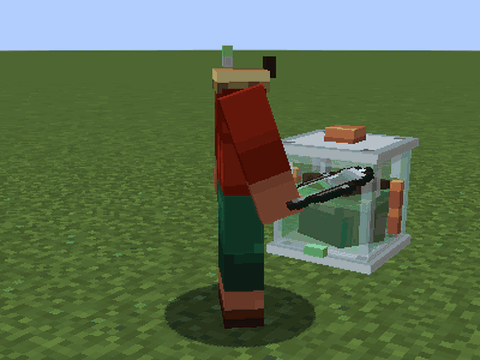

*Swap, seen by a colleague: out of the body into the jar, then back. Press **Swap**.*

- **Linked**: **Swap** wakes you up in your head at any signal. Your body is left standing, in its armour.
- **Jar**: **Swap** puts your head down where it stands (into a Cradle if you are sitting in one) and moves you into
  your body. It needs a body on file, not a corpse, a Collar Cam, and a link above 20%: "Signal at 18%. Get closer to
  your body or a Relay Mast." **Using** your standing body does the same.
- With your head still on: "Your head is still on. The Separation Chair sees to that." Not from a host, a mecha or a
  socket.

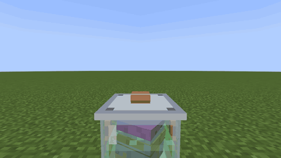

*The Commute from the inside: from your body into your jar and back. Press **Swap**.*

**The Commute.** Going out into your body, the jar's view pulls back and away up the screen, there is one burst of
static, a pale teal band sweeps up the screen, and the body's view settles into place from slightly wide and slightly
above. Going back into the jar, the band sweeps down. It takes half a second, and you have control at once. Anyone
nearby hears the body power down with three falling beeps from its collar when you leave it ("Body powers down"), and
power up with three rising ones when you arrive ("Body powers up"). Under `photosensitive` the swap is a plain
crossfade; `screenShake` sets how much the view settles, and at 0 it arrives still.

### Your body, while you are out

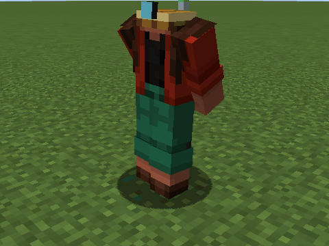

*A body left standing: at attention, a fidget, sitting down after three minutes, and a wave when its jar comes near
and looks at it (time sped up between the clips).*

Your body waits at attention, hands clasped behind its back, breathing, shifting its weight every few seconds. After
half a minute it starts to fidget, about every twelve seconds: it pats its pockets, reaches up to straighten its Collar
Cam (or pats the stump), checks a watch it does not have, or taps a foot. After three minutes it sits down
cross-legged and waits with its hands in its lap. When you come back as a jar within 16 blocks it turns toward you;
within 8, if you look at it, it waves; within 3 it holds out its arms for you. Staff are reminded that the body is not
a coat stand. The clock is your own game's: it starts when your game first sees the body.

### Carrying your head

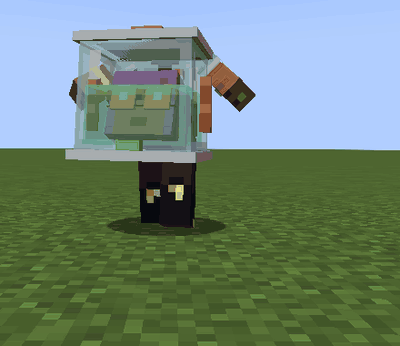

*Carrying your head with an empty hand: **Use** your set-down head with a Head Satchel on you.*

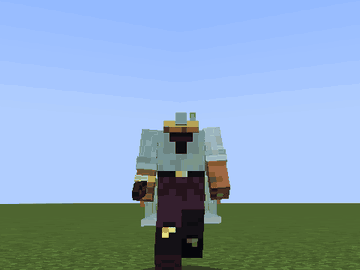

*Hold anything and the jar goes on your back.*


With a **Head Satchel** in your inventory (or on a Curios belt; a renamed one counts too), **Use** your set-down head; to take it out of a
Cradle, **Use** the Cradle. Without a satchel: "You need a Head Satchel to carry your head".

With an empty hand you hug the jar in front of you, a hand on each side, your head turned round inside to look up at
you. Hold anything and it swings onto your back, looking out behind. Carried, the link is perfect, the head drinks no
saline, and portals let you through. Hits land on your body, not the jar. If your body dies, you become the jar on the
spot.

**Setting it down**: hold the satchel in your hand (the jar swings onto your back meanwhile), then **Sneak** and **Use** it: it goes down in front of you (at your feet against a wall), or
onto a Charging Dock you are looking at. **Use** an empty Cradle to dock it, or a Charging Dock to stand it on the plate.

### Your set-down head

No player can hurt it, you included: "That's your own head. Carry it in your Head Satchel instead." Mobs, explosions,
fire and lava can. Heat cracks one point of glass a second; anything else a point per point of damage. Each knock is
reported to you with what is left. While you are offline it is safe. A friend you trust can top it up.

### Saline

| Jar | Saline |
|---|---|
| Life Support Jar, Compact Jar | 1,000 mB |
| Reinforced | 1,500 mB |
| Executive | 2,000 mB |

A head out in the world drinks 1 mB every 12 seconds (half that with a Saline Recycler): a full basic jar lasts about 3
hours 20 minutes. A docked or carried head drinks nothing. A **Saline Bottle** adds 250 mB; its tooltip says how long
your jar's saline lasts out in the world on this server's settings.

Run dry and "Your head is dehydrating! Find saline." Every 30 seconds after that the jar loses a point of glass; once
the glass is gone, a jar loses half a heart every 30 seconds, and **a set-down head dies for real**. A basic head left
dry dies five minutes after it runs out.

### Jar Integrity

The glass soaks up damage before you do. Life Support and Compact Jars have 10 points, Reinforced 20, Executive 30.
Any hit on a jar costs at least one point. The jar tells you: "The glass took a knock: 7/10 left." At 3 or fewer:
"the next bad knock is a real death". At 0: "No glass left: every hit now is real. Get away, then rest in a Life
Support Cradle."

A **Glass Patch** mends 5 points. A Cradle mends one point every 10 seconds, for a head docked in it or a jar sitting
on its cushion.

### Charge

| Jar | Charge |
|---|---|
| Life Support Jar, Compact Jar | 100,000 FE |
| Reinforced | 250,000 FE |
| Executive | 500,000 FE |

A jar spends 2 FE a tick just being alive (a full basic jar: about 42 minutes), plus whatever its modules use. A linked
player spends nothing. Charge it with redstone in the feed slot (5,000 FE a dust, 45,000 a block), on a **Charging
Dock** (500 FE a tick), or docked in a Cradle (up to 10,000 FE a second). Out of charge, powered modules stop: "The jar
is out of charge. Recharge at a Charging Dock."

### The jar's gauges

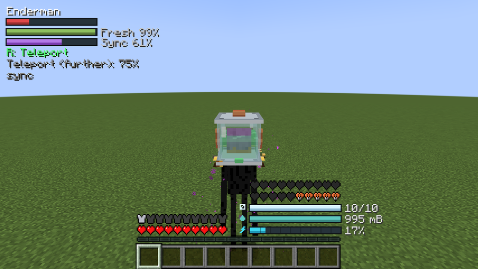

*The HUD at GUI scale 3, a jar riding an enderman on low charge: the side column at the top left, the jar's bars by
the hotbar, the low charge bar red and hatched.*

As a jar (riding, piloting or plugged in included), three bars sit where your hunger bar would be: charge at the
bottom, marked with a bolt; saline above it, a drop; Jar Integrity on top, a pane of glass. A bar under 15% turns red
and is hatched, so low reads without the colour. The numbers (charge in percent, saline in mB, glass as points left)
appear just right of their bars for three seconds after any of them changes, while any is under a quarter, and while
you hold **Sneak**; `hudNumbers = true` in the client config keeps them up all the time.

Everything else the mod tells you sits in one column at the top left, never wider than a third of the screen: the
host panel while you ride, the mecha's panel in a cockpit, and your active genes with their keys. A long line wraps.

### Reading a jar

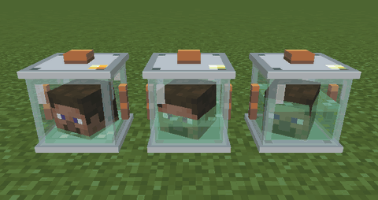

*A nearly dry jar low on charge, a half jar and a full one: the saline level in the glass, the lamp on the lid.*

Every jar shows how its occupant is doing, to anyone who looks: yours as a jar, on a host or in a mecha, in your
arms, and your set-down head.

- **Saline** stands at its level in the glass. A dry jar is empty glass.
- **Charge**: a small lamp on the lid. Steady green; a slow amber pulse under a quarter; dark when flat.
- **Glass**: as its integrity falls past half you hear it crack ("Jar glass cracks"), and past a quarter split ("Jar
  glass splits").

A head docked in a Cradle always looks full and topped up. Jarred creature heads, turrets and mounts show none of this.

### The Jar menu

**Jar menu**, in any jar form. Seven module slots, each framed; those past your jar's tier are shut, and say which
jar opens them. One of each module. Point at an empty slot and it says what goes there. A **feed slot** for
redstone, redstone blocks, Saline Bottles and Glass Patches (anything left over comes back when you close it); point
at it empty for what each is worth. The charge bar, which shows the exact figure ("11,416 / 100,000 FE") when you
point at it. Two buttons: **Courier** and **Let go**. As a linked body: "The jar menu is with your head. Swap to it
first."

### Getting about as a jar

**Drive** tips a bare jar on its side: it rolls at an eighth of walking speed and the world looks sideways. **Drive**
again sits it up. With the **Wheels** module, **Drive** drops the wheels instead (see Jar modules). A jar may also ride
a boat or a minecart.

### The Courier

From the **Jar menu** (or `/headoffice courier`), as a jar or in a socket. Thirty seconds later Noggin & Sons sets
your body down beside you, from anywhere, another dimension included. The fee is 20,000 FE, or all your charge if you
have less: it never refuses for charge. Refunded if the body can't be found, or if you stop being a jar first. Refusals:
"Your body is right here. Use it." (under 8 blocks away), "The Courier is already on its way. Thank you for waiting."
A corpse is delivered too: "one body, deceased".

### Body death and corpses

An idle body has 10 hearts and wears your chest, leg and foot armour. Killed, it lies down as a corpse.

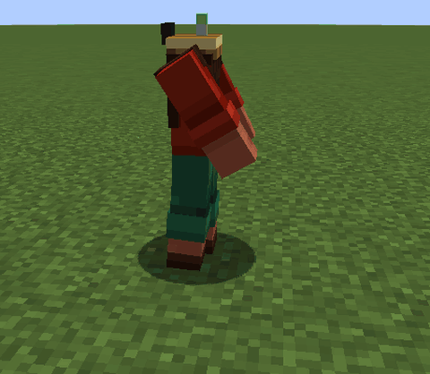

*A body dying where it stood, seen from the side.*

A body that dies sits down hard as its knees go, then tips onto its back with a thud and a last three beeps from the
collar. If it was waiting idle, its owner is told in chat: "Your body has died. HR has sent a card." The card lies on
its chest under its folded hands; while someone has its things open, the hands move aside. Your own corpse sends up a small orange flare
every two seconds, which only you can see, and as a jar the link bar's arrow points to it.

When your **linked** body dies, it is not your death. It becomes a corpse holding your inventory and armour, and you
wake up in your head at full health, told once: "Your body has died. You wake up in your head. A Suture Kit on the
corpse brings it back." (no card from HR this time) `linkLossInventory` in the server config can keep your things with you, or drop them.

A corpse can't be hurt. You, in a body, can **Use** it to open its belongings, as can anyone you trust (and your
team). Anyone else: "They can let you in with /headoffice trust." As a jar at your corpse, **Use** it: a Suture Kit
anywhere on you or in the corpse is used and your head goes back on; with no kit, the belongings open so you can take
the parts for one (a Suture Kit is shapeless and fits your inventory's own crafting grid). A body that falls into the void leaves its corpse where it last stood.

### Putting your head back on

**Suture Kit**:

- **Carrying your head**: hold **Use** for 3 seconds. The needle hand works small circles, a stitch at a time; the
  desk dings when you are done.
- **As a jar**: **Use** the kit on your own body or corpse.

You are whole again, back where your body was. Your modules and an empty jar of the same kind come back; the goggles
and Collar Cam come back a little worn (upgrades and entanglement kept). You feel queasy for 30 seconds. From a corpse
you get all your things back and start on 3 hearts.

### Let go

The **Jar menu**'s **Let go** button, after a confirmation: "Your head gives up. You die, your modules drop, and you
respawn with a body." The jar is not returned.

### The Body Printer

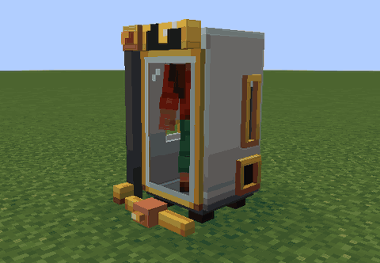

*The end of a print: press **Print** as a jar with everything loaded.*

Lost your body for good? The **Body Printer** prints a new one, Collar Cam fitted. Recipe: ingot, glass, ingot; servo,
piston, servo; ingot, redstone block, ingot. It is a photo booth two blocks tall.

Load 16 rotten flesh, 8 bone blocks, 4 redstone blocks, 8 slime balls and 2,000 mB of saline (bottles, buckets or
pipes; the tank holds 4,000), store 200,000 FE (it holds 250,000 and takes up to 5,000 FE a tick), then press **Print**
as a jar. Nothing is taken until the whole print's power is stored. A minute later the body stands in front of the
printer: "Your new body is ready. It is a little damp." The new body replaces your old one; an old standing body falls
down. If you have a body on when it finishes, the new one waits in the vat until you are a jar.

While it prints, the print bar travels down the booth and the body takes shape beneath it, then colours in from the
top down; at the end the door swings open and the body steps out. With all four materials loaded the print head waits
in the middle. Short of power mid-print, the bar sags and the lamp dims.

Refusals: "Bodies are for heads in jars. Come back decapitated.", "Short 4 Slime Ball. Load it and press Print
again.", "A print takes 200 kFE stored; it has 100. Feed its Galvanic Pile first.", "Printing already, 40 s to go.
Wait for the body."

---

## Jars and telepresence gear

### The jars


| Jar | Recipe | Slots | Charge | Saline | Glass |
|---|---|---|---|---|---|
| **Life Support Jar** | copper ingot; glass, slime ball, glass; ingot, redstone, ingot | 3 | 100 kFE | 1,000 mB | 10 |
| **Compact Jar** | a Life Support Jar alone in the grid (and back) | 3 | 100 kFE | 1,000 mB | 10 |
| **Reinforced Life Support Jar** | netherite scrap; tinted glass, Life Support Jar, tinted glass; obsidian. Fire-proof | 5 | 250 kFE | 1,500 mB | 20 |
| **Executive Life Support Jar** | shulker shell, Synapse Chip, shulker shell; gold block, Reinforced Jar, gold block. Fire-proof | 7 | 500 kFE | 2,000 mB | 30 |

The Life Support, Reinforced and Executive jars are roomy: your head turns right round inside. The Compact Jar is
head-sized: your head faces its front and the whole jar turns with it. A jar goes into the Separation Chair. You get it
back only from a Suture Kit.

### Relay Goggles

| Goggles | Recipe | Range |
|---|---|---|
| **Relay Goggles Mk I** | leather, copper ingot, leather; lens, wire, lens | 48 blocks |
| **Relay Goggles Mk II** | gold ingot, Synapse Chip, gold ingot; Mk I below | 160 blocks |
| **Relay Goggles Mk III** | diamond, Synapse Chip, diamond; ender pearl, Mk II, ender pearl | 640 blocks |
| **Quantum Goggles** | Quantum Knot, Mk III, Quantum Knot | the whole dimension |

**New goggles after the cut**: as a linked body, **Use** them on your set-down head or on the Cradle holding it. The
old pair comes back. A carried head has to be set down first.

### Collar Cam and its upgrades

**Collar Cam**: a lens on top; wire, servo, wire; three ingots. Without one on your neck you can't swap back into your
body.

Each Collar Cam takes up to **4** upgrades. **Use** an upgrade with a Collar Cam in your other hand, or, once your head
is off, as a linked body (it goes into the collar on your neck). "No Collar Cam to fit it to, or no room left (4
upgrades)".

<details><summary>The nine Collar Cam upgrades</summary>

| Upgrade | Recipe | What it does |
|---|---|---|
| **Wide Lens** | glass pane, lens, glass pane | A wider view (linked) |
| **Periscope Stalk** | lens over two iron bars | Your headless body stands at full height |
| **Night Optics** | lens over a golden carrot | Night vision (linked) |
| **Waterproof Seal** | dried kelp, slime ball, dried kelp | No link loss under water |
| **Shielded Housing** | iron ingot, lead, iron ingot | Immune to EMP |
| **Antenna Whip** | lightning rod over two copper ingots | +25% link range |
| **Noise Filter** | white wool, amethyst shard, white wool | Half the static |
| **Thermal Overlay** | lens over a glow ink sac | Living things within 24 blocks glow (linked) |
| **Zoom Optic** | lens, spyglass, lens | Hold **Collar zoom** for x3 zoom (linked) |

</details>

### Entangled Pair, Entangled Shard, Quantum Knot

**Quantum Knot**: eye of ender, echo shard, eye of ender; amethyst shard, Synapse Chip, amethyst shard; eye of ender,
amethyst shard, eye of ender. A rare ingredient.

**Entangled Pair**: Quantum Knot, end crystal, Quantum Knot. **Use** it to split it into two **Entangled Shards** that
share one state. Craft one shard with your goggles and the other with your Collar Cam. Do the collar before the
operation: it can't be changed afterwards. Entangled goggles and collar carry the link into other dimensions (80%), and
let a linked body use portals without its head.

### EMP Grenade

Two iron ingots, two copper ingots and a redstone block (iron above and below, copper either side). **Use** to throw.
Within 8 blocks of where it lands: linked bodies drop back into their heads ("EMP! The link is down"), jars lose half
their charge, mecha half their battery, turrets go dark. Shielded Housing protects you. Two seconds between throws.

### Head Satchel, Suture Kit, Glass Patch

- **Head Satchel**: two string and six leather. Carries your head (see Carrying your head).
- **Suture Kit**: string, slime ball, iron nugget and a Saline Bottle, shapeless. Stacks to 16. Puts your head back on.
- **Glass Patch**: a glass pane and a slime ball, shapeless. Stacks to 16. Mends 5 points of glass. **Use** it in the
  air while carrying your head or as a jar with an Arm, **Use** it on your set-down head, or put it in the feed slot.
  "The glass is sound. Keep the patch for later."

---

## Power and life-support blocks

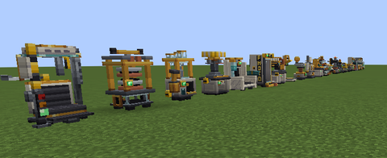

Every Noggin & Sons machine is a working machine now: parts that move when it works, sounds of its own (all
subtitled), and a **lamp** on its front that tells you how it is getting on.

| Lamp | Means |
|---|---|
| Dark | Off: no power, or nothing to do (**Use** it with an empty hand to see which) |
| Green | Ready |
| Amber | Waiting for something you can fix: an output full, an input missing, a jar full |
| Amber, pulsing | Working |
| Dim amber, pulsing | Working short of power |
| Red, for two seconds | It has just refused you |

A refusal also says why in one line, plays "Noggin & Sons declines" and rattles the part it concerns.

**Powering things.** Every machine takes FE (Forge Energy) from any side, its upper half included: a Galvanic Pile,
Leyden Jar or unlinked Tesla Node touching it, a linked Tesla Node, or another mod's cables. Those three push power out
only from their lower half; a cable can draw from either half. 1 kFE is 1,000 FE; mB is a thousandth of a bucket. **Use** a power block with an empty
hand to see its charge.

### Two blocks tall

Most machines stand two blocks tall. Of the twenty-two rebuilt machines only the Signal Jammer, the Employee Mount, the Neural Socket, the Safety Placard
and a placed Jarred Head fit in one. A tall machine needs the block above it free when you place it: "No headroom.
Needs two blocks of height." Its upper half (a block of its own, **Machine (upper half)**) is part of the machine: clicking it clicks the machine, breaking it breaks
the machine (which drops as usual), and hoppers, pipes and cables connect to either half.

**Machines from an older world.** A machine placed before 0.4.0 takes the block above it on its first tick, if that
block is empty (air, grass, a snow layer). If anything else is there, nothing is replaced: the machine stays one block
high and works as before, but only its lower half is drawn. On the Life Support Cradle, Charging Dock, Body Printer,
Cerebral Array, Leyden Jar and Relay Mast the lamp is in the upper half and is not drawn either. Break the block above
and the machine takes its upper half within two seconds. Machines that had no facing before (the Galvanic Pile, Life
Support Cradle, Charging Dock, Tesla Node, both Relay Masts, Signal Jammer and Leyden Jar) now face north. Everything
they held is kept.

### Galvanic Pile

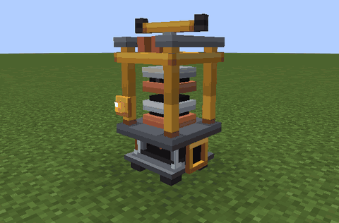

*The Galvanic Pile at work after meat goes in: **Use** rotten flesh on it.*

**Galvanic Pile**: six copper ingots, two Neuro-Copper Wires and one rotten flesh (copper ring, wire above and below
the flesh). A Volta press over a glass pan of meat.

- **Use** meat on it to feed it (a jar can't): rotten flesh gives 4,000 FE, a spider eye 6,000, any raw meat or fish
  3,000. It says how much went in and how much it has left to burn. Its slot takes one stack of one kind of meat.
  Hoppers can feed it.
- It burns 20 FE a tick into its own 50,000 FE store, and shares it evenly, up to 1,000 FE a tick each, among the
  machines touching its lower half. **Use** it with an empty hand to see its charge and fuel.
- At work the handle turns the press screw a quarter at a time, a spark jumps the terminals, the meat smokes a little
  and now and then twitches. The press sinks as each piece burns. A new piece winds the handle back; the last one
  leaves the press with a sigh.
- Refusals: "The pile is full of Rotten Flesh. Let it burn some first." and, for food it doesn't burn, "The Galvanic
  Pile burns Rotten Flesh and Spider Eye, not Cooked Beef." (raw meat and fish burn too).

### Leyden Jar

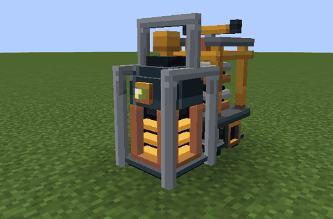

*A Leyden Jar filling from the pile behind it: its cells light up as the charge rises.*

**Leyden Jar**: wire on top; glass, copper block, glass; glass, ingot, glass. A glass battery in a carrying cage.

- Holds 250,000 FE. Takes up to 2,000 FE a tick, and gives up to 2,000 FE a tick to every machine touching its lower
  half. It never feeds another Leyden Jar, beside it or stacked above or below it.
- Nothing on it moves. Its charge shows as lit cells in three windows, in four steps; the lamp pulses while it fills,
  and a spark snaps from the knob when it is full.

### Tesla Node

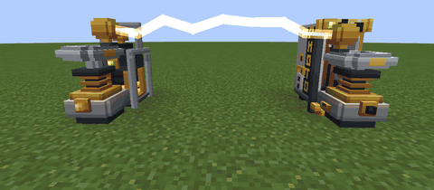

*Two linked Tesla Nodes passing power: link them with the Surgical Wrench, sender first.*

**Tesla Node**: lightning rod; wire, copper block, wire; three ingots. A small Tesla coil with a ball riding its ring.

- Holds 10,000 FE and takes up to 2,000 FE a tick. Linked, it sends up to 2,000 FE a tick to the node it is linked to,
  up to 16 blocks away, losing 5%. Unlinked, it feeds the machines touching its lower half (but not other nodes); so does the
  receiving node of a linked pair.
- **Surgical Wrench** (shaped: an ingot top middle; a wire in the centre with an ingot to its right; an
  ingot bottom left): **Use** the sending node ("Sending node chosen: now
  use the receiving node"; the node looks round for its partner), then the receiving one ("Tesla Nodes linked").
  **Sneak** and **Use** a node to unlink it. Either half of a node will do. Each click that works turns the wrench a
  quarter turn in three ratchet clicks.
- Each node's ball turns to face its partner. While power flows the sender's ring spins, a crackling arc joins the two
  balls with a bead running toward the receiver, and once a second the ring kicks and the ball lights up. The
  `photosensitive` option in the client config turns the kick and the light off.
- Refusals: "Too far: nodes reach 16 blocks. Put one closer.", "A node can't send to itself. Use a second node.",
  "This node sends nowhere. Unlink it at the sending node." The wrench on any other company block: "The wrench only
  links each Tesla Node. Nothing to adjust here."

### Charging Dock

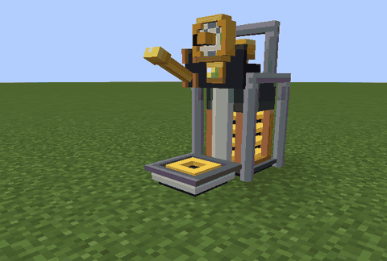

*A head set down on a Charging Dock: carrying your head, **Use** the dock.*

**Charging Dock**: copper ingot, wire, copper ingot; ingot, redstone block, ingot. A charging plate with a knife
switch and a dial.

- Holds 20,000 FE and takes up to 2,000 FE a tick. It charges a jar standing on its plate at 500 FE a tick, or your
  own head set down on it while you are out in your body: carrying your head, **Use** the dock and the head goes onto
  the plate. "Charging Dock: charging, 40%." and, when it is done, "Charging Dock: your jar is fully charged."
- When a jar or a head is on the plate the switch closes and the needle follows its charge from E to F; sparks fly
  while it charges and a bell rings when it is full. With nothing left to give, the switch drops open and the needle
  sinks below E.
- **Use** it with an empty hand to see its charge. With no charge at all it refuses: "The Charging Dock is empty.
  Feed it from a Galvanic Pile or a cable."

### Relay Mast

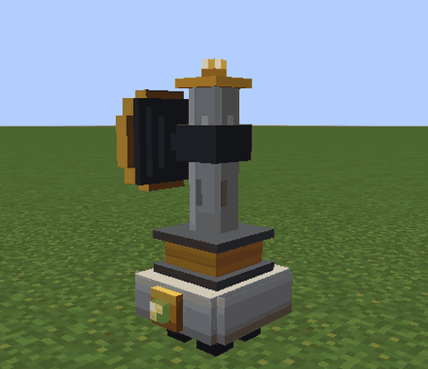

*A Relay Mast turning its dish along the link it carries.*

**Relay Mast**: lens; wire, ingot, wire; ingot. A pole with a dish.

- Relays your link 96 blocks (see [Link quality](#link-quality)). Holds 100,000 FE, takes up to 2,000 FE a tick and
  uses 1 FE a tick (about 83 minutes on a full charge), even while its chunk is unloaded. A Cartographer on staff adds
  half again to its reach.
- While it carries a link, the dish turns toward the next mast in the chain (the last one toward your body) and the
  lamp pulses. Its aviation lamp is lit while it has power. Without power the dish droops. It flinches at a lightning
  strike within 32 blocks while it rains.

### Relay Mast Mk II

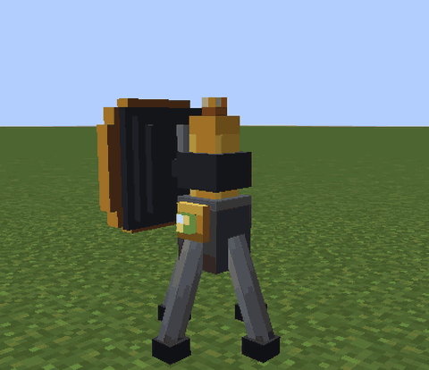

*A Relay Mast Mk II turning its dish to a new hop.*

**Relay Mast Mk II**: Synapse Chip; wire, Relay Mast, wire; gold block. As the Mast, 192 blocks. Its lamp stage rises
over the dish while it carries a link, and its beacon glows while it has power.

### Signal Jammer

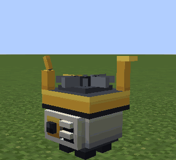

*A powered Signal Jammer, its turbine turning.*

**Signal Jammer**: wire, Synapse Chip, wire; amethyst, ingot, amethyst; wire, redstone block, wire. One block tall,
with a turbine on top.

- Cuts other people's link to 30% within 16 blocks. Whoever placed it, those they trust and their team are spared. A
  jammer placed by a command has no owner and spares nobody. Holds 100,000 FE and uses 4 FE a tick.
- Powered, its turbine idles round. When it cuts someone's link the turbine spins up hard, it crackles, and the grille
  fills with static.

### Saline Mixer

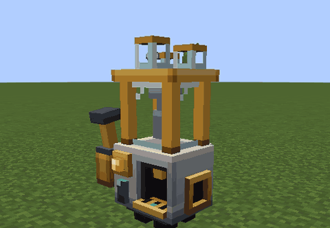

*The Saline Mixer mixing a batch: it starts by itself once water and ingredients are in.*

**Saline Mixer**: ingot, bucket, ingot; wire, cauldron, wire; ingot, redstone, ingot. A soda fountain.

- 1,000 mB water + sugar + kelp (or dried kelp) + redstone + 2,000 FE over 10 seconds = 1,000 mB saline. It starts by
  itself once everything is in; a batch that runs short waits where it stopped. A Fisherman on staff mixes 25% faster.
- Holds 4,000 mB of water, 4,000 mB of saline and 20,000 FE (up to 1,000 FE a tick). **Use** it to open its screen.
  **Use** a water bucket on it to pour the water in, an empty bucket to take 1,000 mB of saline out. Glass bottles in
  its bottle slot fill at 250 mB each. Pipes put water in and take saline out.
- Mixing, the caps on the sugar, kelp and redstone canisters lift in turn and drop a dose, the paddle turns and the
  saline bubbles. Bottling, the tap is pulled and saline runs into the bottle. A flag goes up when bottles are ready.
  The tank and the water sight glass show how full they are.
- Refusals: "Not enough Cranial Saline in the Saline Mixer to fill a Bucket." and, for the wrong liquid, "The Saline
  Mixer doesn't take Lava. Check what it runs on."

**Cranial Saline**: a bottle is a water bottle, sugar, kelp and redstone, shapeless (makes 2); a **Bucket of Cranial Saline**
 comes from an empty bucket on the Saline Mixer. 250 mB a bottle, 1,000 a bucket. A bottle tops up a jar;
buckets and bottles fill the Cradle and the Body Printer. Poured out, it is a teal liquid you can swim in.

### Life Support Cradle

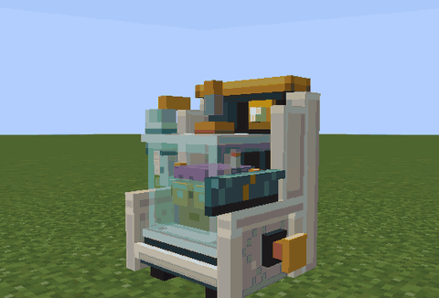

*A head docked in the Cradle: carrying your head, **Use** the empty Cradle.*

**Life Support Cradle**: glass, gap, glass; wire, gap, wire; three ingots. A wingback armchair that keeps a head
alive.

- Holds one docked head, safe from all harm. Each second it refills the head's saline from its 4,000 mB tank, gives up
  to 10,000 FE of charge and uses 100 FE; every 10 seconds it mends a point of glass. The saline and glass work without
  power; the charge needs it. A docked head drinks no saline. It holds 50,000 FE (up to 2,000 FE a tick). Broken, it
  sets the head down. It does not change the link.
- **Docking a head**: carrying your head, **Use** the empty Cradle. As a jar, **Use** it to climb onto its cushion
  ("You settle into the Cradle. Swap now and your head stays docked."). Sitting there you are kept topped up as a
  docked head is, from the same tank and buffer; **Swap** and your head stays docked. Or have one within 3 blocks of
  the Separation Chair when you are operated on. To take the head out, **Use** the Cradle with a Head Satchel on you.
- Docking, the hose swings onto the jar's valve and a blanket is laid over its lap. With power, the bellows on its back
  breathes slowly for as long as the head is there. Undocking puts hose and blanket back. The saline bag shows its
  level.
- Anyone else who uses it hears whose head it holds and, if it lacks power or saline, what to bring: "This Cradle has
  no power. Put a Galvanic Pile beside it.", "This Cradle has no saline to give. Fill it with Cranial Saline." or "No
  power, no saline. Put a Galvanic Pile beside it; fill with Cranial Saline." Other refusals: "The Cradle is empty. Carry
  your head here in a Head Satchel and use it.", "Your head is docked here. Bring a Head Satchel to take it out.", "The
  Cradle's tank is full. Keep the bottle.", "The Cradle takes Cranial Saline only.", "No room to climb in. Clear the
  space above the Cradle."

### Safety Placard

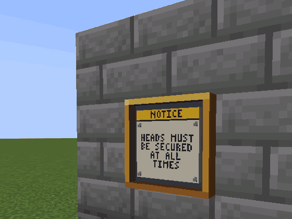

*A Safety Placard changing notices: **Use** it.*

**Safety Placard**: yellow dye, black dye, yellow dye; yellow dye, ingot, yellow dye (makes 4). Hangs on a wall.
**Use** it to show the next of twelve company notices, from "HEADS MUST BE SECURED AT ALL TIMES" to "DOLORES IS
LISTENING". The notice is painted on the board in your game's language, and read out above your hotbar.

### Materials

| Material | Recipe |
|---|---|
| **Surgical Steel Blend** | iron ingot, bone meal, coal, shapeless |
| **Surgical Steel Ingot** | smelt (10 s) or blast (5 s) the blend; nine from a block |
| **Block of Surgical Steel** | nine ingots |
| **Neuro-Copper Wire** | copper ingot, redstone, copper ingot in a row (makes 4) |
| **Lens** | glass, amethyst shard, glass in a row |
| **Servo** | piston on top; ingot, wire, ingot below |
| **Synapse Chip** | quartz, wire, quartz; gold ingot, lapis, gold ingot below |
| **Excision Head** | Block of Surgical Steel on top; servo, lens, shears; redstone block below |
| **Booth Console** | wire, glass pane, wire; ingot, repeater, ingot; wire below |
| **Replacement Blade** | two ingots and a diamond, shapeless |

## Jar modules

A head in a jar is a head. Modules are how Noggin & Sons makes it an employee again.

### Fitting a module

- Modules go into the jar, not the jar item. You fit them **after** the operation, as a **jar**: press **Jar menu**,
  then drag a module into an open slot (or **Sneak**-click it from your inventory). Take it out the same way.
  Craft modules before the operation or as a linked body, and keep them in your inventory: your head keeps the
  inventory, but a jar cannot use a crafting table.
- One of each kind per jar. A second **Telekinesis Module** simply won't go in.
- Slots: **Life Support Jar** 3, **Compact Jar** 3, **Reinforced Jar** 5, **Executive Jar** 7. Slots your jar doesn't
  have are shown shut; point at one and it names the jar that has it.
- Each module's tooltip says to fit it from the **Jar menu**; the Telekinesis Module, Lacrimal Laser and Wheels also
  name the key that works them, as you have bound it.
- The **Jar menu** opens as a **jar**, **hosted**, **pilot** or in a **socket**. As a **linked** body it says "The jar
  menu is with your head. Swap to it first." With your head still on: "Your head is still on. The jar menu is for a
  head in a jar."
- The menu also shows your charge, a feed slot (Redstone 5,000 FE a dust, 45,000 FE a block; Saline Bottles and Glass
  Patches go in too), **Let go** and **Courier**.
- When you put your head back on, every module comes back to you with an empty jar of the same kind. If the jar
  breaks for real, the modules drop where it broke.

### What a jar costs to run

- **Charge:** a Life Support or Compact Jar holds 100,000 FE, a Reinforced Jar 250,000 FE, an Executive Jar 500,000 FE.
- **Keeping the head alive:** 2 FE every tick (40 FE a second) while you are the jar, whatever else you do. A full
  basic jar lasts about 42 minutes on that alone (config `idleDrain`, `maxCharge`).
- **With a Manipulator Arm**, as a **jar**: every attack, every block broken and every block placed costs 200 FE.
- Modules whose tooltip says "Uses charge" spend charge and stop working at 0 FE. Those whose tooltip says "Needs some
  charge" spend nothing of their own but stop at 0 FE too; the table says which.
- A key pressed with no module behind it makes the jar glug and says "No Telekinesis Module fitted. Fit one from the
  jar menu" (with the key). A module fitted on an empty jar says "The jar is out of charge. Recharge at a Charging
  Dock."

### Telekinesis

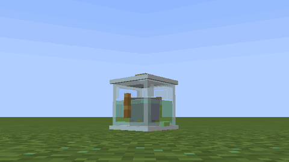

*Telekinesis: **Ability** to grab, look to move it, **Attack** to throw.*

The **Telekinesis Module** lets the head move things it has no hands for. Craft it from 4 Amethyst Shards (corners),
3 Ender Pearls, 1 Copper Ingot (centre) and 1 Redstone (bottom middle).

It works only as a bare **jar** (the Compact Jar too, and in a boat or minecart). **Hosted**, **pilot** or in a
**socket**, **Ability** belongs to the host, the mecha or the socket, and anything you held is let go.

- **Grab:** look at it and press **Ability**. It reaches 16 blocks (config `telekinesisRange`). While nothing is held,
  corner brackets show what you would get, as far as the server lets you reach: teal if you can lift it, grey if not.
  (Someone else's things show teal even without their trust; the grab then says so.) 500 FE.
- **Hold:** it hangs in front of the jar (a held block becomes a **Lifted Block** until you let go), far enough out that you can see all of it. Look up to raise it, down to lower
  it. Heavy things lag and swing behind. A glowing line runs from the goggles; a held creature glows teal and stops
  walking. 50 FE a tick (1,000 FE a second): a full basic jar holds for about a minute and a half.
- **Set down:** press **Ability** again. It drops where it is.
- **Throw:** **Attack** while holding. It flies along your look. A thrown block lands as a falling block and hurts what
  it lands on, more the further it fell. 2,000 FE.
- **It also lets go** when you **Swap** to your body, when the charge runs out (the line dims twice and goes slack),
  when the held thing ends up more than 24 blocks away (the line snaps), when you take the module out, or when you climb
  onto a host or into a mecha.

What you can lift: any creature, a dropped item, a placed head jar, and any single plain block up to obsidian (config
`telekinesisMaxHardness`). What you can't, and what the jar says:

| Tried to lift | The jar says |
|---|---|
| nothing, air or a liquid | "Nothing in reach to lift. Look straight at it." |
| a chest, a furnace, any machine | "Machines and chests stay put. Lift a plain block." |
| bedrock, anything harder than obsidian | "Too hard to budge. Pick something softer." |
| a door, a tall flower, a bed | "Too awkward to lift in one piece. Try a single block." |
| a block you may not break there | "You may not move that here. It isn't yours to move." |
| the Ender Dragon, the Wither | "Far too important to lift. Find something smaller." |
| a player in creative or spectator | "That one can't be lifted. Try a creature or a block." |
| another player, their placed head or body, their mecha, or anything another player is riding | "(name) hasn't trusted you. Ask them: /headoffice trust add." |

Another player, their head, their body and their mecha (parked or not) can be lifted only once they have trusted you
with `/headoffice trust add`, or while you are on their team and they are online. Anything another player is riding,
a host, a shell or a horse, counts as theirs while they ride it.
A failed grab sends the line out and curls it back, with a fizzle.

### Lacrimal Laser


*The Lacrimal Laser, seen from the side. Press **Secondary** as a jar.*

The **Lacrimal Laser** makes the head weep under pressure. Craft it from 1 Lens on top of 2 Ghast Tears with a Copper
Ingot between them.

As a **jar**, press **Secondary**: two thin beams of tears leave the goggles and meet on the first creature in front
of you within 8 blocks, for 4 damage (2 hearts), ignoring armour. The beam stops at the first block in its way:
nothing behind a wall is hurt. It sets nothing alight. Each shot costs 1,500 FE,
hit or miss, and the laser needs 1 second between shots.

- Under 1,500 FE: "Not enough charge for the laser. Recharge at a Charging Dock."
- Too soon: "The laser is still cooling. Give it a second."
- **Hosted**, **pilot** or in a **socket**, **Secondary** is the host's, the mecha's or the socket's.

### Wheels, and tipping over


*Wheels down: press **Drive** with the Wheels module fitted, then walk.*


*No wheels: **Drive** tips the jar over and it rolls, very slowly.*

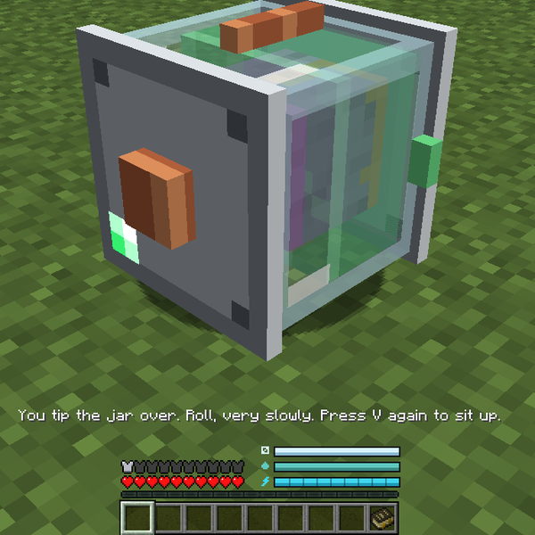

*A bare jar tipped over: **Drive** tips it and sits it up again.*

The **Wheels** module is a jar's commute. Craft it from 2 Iron Nuggets over 2 Black Dye with a Copper Ingot between
them.

- As a **jar**, press **Drive**: "Wheels down". Four little wheels drop under the jar and you drive at half walking
  speed, 10 FE a tick while moving. No jumping on wheels. **Drive** again: "Wheels up".
- Out of charge with the wheels down, they fold away and the jar says so: "Wheels flat: folded. Charge at a Charging
  Dock, or (your **Drive** key) to roll."
- **No Wheels** (or no charge)? **Drive** tips the bare jar on its side: "You tip the jar over. Roll, very slowly.
  Press (your **Drive** key) again to sit up." You roll at about an eighth of walking speed and see the world
  sideways. It costs nothing. **Drive** again: "Upright again".
- Wheels fold and the jar sits up when you leave the **jar** form. With your head on, **Drive** says "Nothing to drive
  on foot. Drive is for jars and mecha."; **linked**, "Your body has legs. Walk."; **hosted** or **pilot**: "Not from
  up here. Get down first."; in a socket, "Plugged into the socket. Sneak with the jar menu key to unplug first."

### Propeller

The **Propeller** gives the jar flight. Craft it from 4 Feathers in the corners, 2 Iron Ingots, a Copper Ingot in the
middle and a Redstone at the bottom.

A bare jar can't walk, but with a Propeller it can **Jump**. Press **Jump** twice quickly to take off, then fly as in
creative: **Jump** to rise, **Sneak** to sink. 25 FE a tick while flying. On the ground it still only hops.

### All jar modules

<details><summary>All 23 jar modules: recipe, what it does, cost</summary>

All recipes are shaped, on a crafting table. "Needs some charge" means it stops at 0 FE but spends none of its own.

| Module | Recipe | What it does | Cost | Key |
|---|---|---|---|---|
| **Hop Springs** | Piston on top, Iron Ingot, Copper Ingot, Iron Ingot across, Slime Ball below | the jar hops along whenever you walk, at 60% speed | 100 FE a hop | walk |
| **Propeller** | 4 Feathers, 2 Iron Ingots, Copper Ingot, Redstone | flight (**Jump** twice) | 25 FE a tick flying | **Jump** |
| **Wheels** | 2 Iron Nuggets, 2 Black Dye, Copper Ingot | drive at half walking speed | 10 FE a tick moving | **Drive** |
| **Spider Legs** | 4 String, 2 Surgical Steel Ingots, Servo | walk at 80% speed and step up full blocks | needs some charge | walk |
| **Suction Cups** | 2 Slime Balls, Copper Ingot, Surgical Steel Ingot | walk into a wall to climb it; **Sneak** to hang on; no fall damage while on it. Needs legs, springs or wheels to reach the wall | needs some charge | walk, **Sneak** |
| **Water Jet** | Kelp, 2 Prismarine Shards, Copper Ingot, 2 Iron Ingots, Redstone | swim 2.5 times as fast; hop along the bottom | 50 FE a tick moving in water | walk |
| **Manipulator Arm** | 3 Iron Ingots, Redstone, Copper Ingot | as a **jar**: mine (at half speed), place, use items and blocks, open chests, trade, fight (half damage), pick things up | 200 FE per attack, break or place | **Use**, **Attack** |
| **Telekinesis Module** | 4 Amethyst Shards, 3 Ender Pearls, Copper Ingot, Redstone | grab, hold, set down and throw blocks, creatures and items | 500 grab, 50 a tick held, 2,000 throw | **Ability**, **Attack** |
| **Drill Bit** | Diamond, Gold Ingot, 2 Iron Ingots, Copper Ingot | mining six times as fast as a jar otherwise digs (three times normal). Works only as a **jar** with a **Manipulator Arm** | none | **Attack** |
| **Armour Plating** | 8 Iron Ingots around a Copper Ingot | +6 armour, +2 toughness | none | - |
| **Heat Shield** | 4 Blaze Powder, 4 Magma Cream, Copper Ingot | fire, lava and magma can't hurt the jar, and it stops burning; keeps your placed head cool while you're out in your body | 100 FE a tick while burning or in lava | - |
| **Night Lens** | Glass, 2 Gold Nuggets, Copper Ingot, Golden Carrot | Night Vision | none | - |
| **Magnet** | Redstone, Lapis Lazuli, 3 Iron Ingots, Copper Ingot | pulls dropped items within 6 blocks to the jar; lets a jar without an arm pick them up | none | - |
| **Speaker Grille** | 3 Iron Bars, 2 Neuro-Copper Wire, Note Block | what you say in chat floats over your jar for 5 seconds (up to 60 letters), every line, the same words twice included | none | chat |
| **Saline Recycler** | 2 Glass, Hopper, 2 Neuro-Copper Wire, Servo | the head uses half the saline (1 mB every 24 seconds), whether you are the jar or it is set down while you walk your body | needs some charge | - |
| **Shock Lid** | 3 Lightning Rods, 2 Neuro-Copper Wire, Redstone Block | anything that hits the jar in melee takes 3 damage (1.5 hearts) and is knocked back, glass or no glass | 500 FE a zap | - |
| **Self-Righting Gyro** | 4 Gold Ingots around a Compass | no knockback; no upside-down view after a botched cut | none | - |
| **Hub Antenna** | Lightning Rod, Neuro-Copper Wire, 2 Surgical Steel Ingots, Synapse Chip | +50% neuro-link range, as long as the jar has charge | needs some charge | - |
| **Life Sign Monitor** | 2 Neuro-Copper Wire, Glistering Melon Slice, 2 Surgical Steel Ingots, Redstone | your body's health on the HUD ("BODY 20/20") while you're the jar | none | - |
| **Hat Mount** | Leather Helmet between 2 Surgical Steel Ingots | the helmet in your helmet slot sits on the lid | none | - |
| **Cortex Coprocessor** | 2 Gold Nuggets, Synapse Chip, 2 Redstone, Lens | forgives one miscalled base per call at the DNA Sequencer; as a **pilot**, pulls your aim onto a hostile within 24 blocks | needs some charge | - |
| **Lacrimal Laser** | Lens, 2 Ghast Tears, Copper Ingot | twin tear beams: 4 damage (2 hearts) to the first creature within 8 blocks; stops at the first block | 1,500 FE a shot, 1 s apart | **Secondary** |
| **Body Recall Beacon** | Bell, 2 Copper Ingots, Neuro-Copper Wire | while you're the jar, your idle body walks to you (3 blocks a second) if it's in the same world and its chunk is loaded; it stops at drops over 3 blocks, lava and fire | 10 FE a tick it walks | - |

</details>

## Hostile Takeover: mob bodies


A creature with its head taken off keeps walking, provided someone steers. Noggin & Sons calls this a **host**. You
are the someone.

### The Surgical Saw

The **Surgical Saw** takes the head off a weakened creature. It has 200 uses.

- **Recipe** (shaped): a Diamond in the bottom left corner, a Servo in the centre, and a Surgical Steel Ingot to the right
  of the Servo and another in the top right corner. That is 2 Surgical Steel Ingots, 1 Servo, 1 Diamond.
- **Use** it on a creature at **a quarter of its health or less**. You need hands: a body or a linked body. Above a
  quarter: "Too lively. Wear it down below a quarter of its health first."
- **Off limits:** bosses (the Ender Dragon, the Wither), players, armour stands, **any creature with a name tag**,
  someone else's tamed pet (yours is fine), and anything that is already a host, a shell or a mecha. The saw says "The
  saw refuses: bosses, named mobs, other people's pets and hosts are off limits."
- Every cut costs one use. The creature holds perfectly still while the saw spins up, then its head comes out of the
  neck like a champagne cork ("Head pops off"), with the snip of the blade and a small sanitary puff at the neck. The
  head rises, turns over and is gone in a puff at the top. A moment later the desk dings: the paperwork is done.
- The body takes a moment to notice. Half a second later a creature on four legs (or any shape that is not a person)
  takes a step back and shakes itself like a wet dog. A two-armed one reaches up to where its head was, pats the air
  twice, and lowers its hands.
- In your hands the saw is held two-handed; it trembles as it spins up and pushes through on the pop.

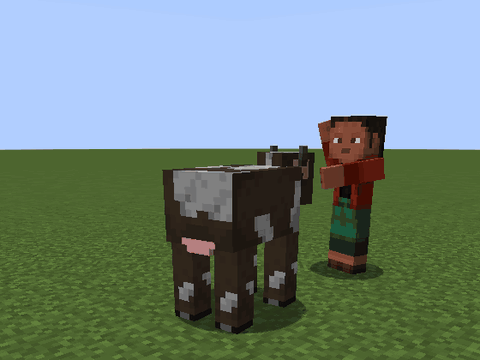

*Taking a body, seen by a colleague: **Use** the saw on a creature at a quarter of its health or less.*

The saw does one of two things, depending on your **off hand**:

| Off hand | Result |
|---|---|
| Anything but a Life Support Jar | The head comes off and the body stays standing as a **host**: "Cow is now a host body". It is raised to a quarter of its health if it was lower. |
| An empty Life Support Jar (basic, Compact, Reinforced or Executive) | The head does not fly off: it arcs from the neck into the jar in your hand. You keep the **head** in the jar, and the body falls (normal drops). See [Jarred heads](#jarred-heads). |

A jar in your main hand does not count. If the creature somehow survives the cut (a totem, Resistance, a claim), you
keep your jar and hear "Cow pulled through. Weaken it further and try again."

A host has no mind of its own. It stands where it was cut, fights nobody, never despawns (not even a monster on
Peaceful), and is drawn without its head, under re-modelling resource packs such as Fresh Animations too. (The head
that flies off is the creature's own model head; under such a pack it may be the plain vanilla one.)

### Boarding and getting off

- **Board:** as a **jar**, **Use** the host. You climb onto its neck and are now **hosted**. If you are **carrying your
  head** in the Head Satchel, **Use** works too: your body is left standing and you go up in the jar.
- With your head on, **Use** on a host only reads it out: "Host: freshness 87%, sync 40%".
- Someone already aboard: "Someone is already in that body".
- Boarding, the jar locks onto the neck with a bayonet twist and a soft seal ("Jar locks on"): a brass collar round the
  jar's base turns a quarter turn home, the body braces under the weight and settles, and a moment later it mumbles in
  its own voice, low and groggy. The collar stays for as long as you ride.
- **Get off:** **Sneak**. On a flier more than three blocks up, sneak does not drop you: "Too high to get off Bat.
  Hold (your **Sneak** key) to fly down and off." Keep holding it and the flier sinks; within three blocks of the
  ground or water you get off by yourself. If the host dies
  or rots away you are a plain jar again at once. However you come off, the seal lets go ("Jar unlocks"), the legs
  buckle a little, and the body mumbles itself back to sleep.

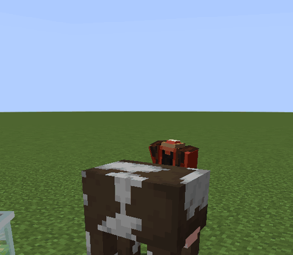

*A jar seating on a host: as a jar, **Use** the host.*
- Hosted, you have no hands. **Use** on anything else gets "A host has no hands for that. Get down first." (on another
  host: "One body at a time. Get down from this one first."). **Swap** and **Drive** get "Not from up here. Get down
  first."

### Steering

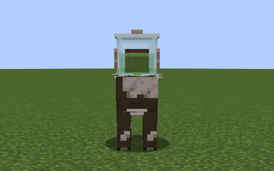

*Riding a host: it goes where you look. **Sneak** gets off.*

- It goes where you look. Forward is full speed, backward a quarter, sideways half.
- **Jump** jumps, except the Iron Golem, which cannot.
- **Fliers** climb while you hold **Jump**, sink while you hold **Sneak**, and glide down slowly when you let go.
  They take no fall damage.
- **Climbers** go up any wall they walk into. **Slow fallers** drift down and take no fall damage.
- **Attack** makes the host hit with its own strength (2 damage if it has none), out to about 2.5 blocks past its
  front. Too far: "Out of this body's reach. Get closer." The blow is yours for PvP, claims and kill credit.
- **Speed:** land hosts are held to about a player's pace: up to 5.1 blocks a second, 5.6 at full sync (a sprint).
  Horses, donkeys, mules, llamas and camels keep their own riding speed. Fliers and swimmers in water are not held back.

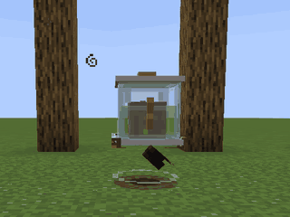

*On a flier: hold **Jump** to climb, hold **Sneak** to come down and off.*

### The Neural Handshake

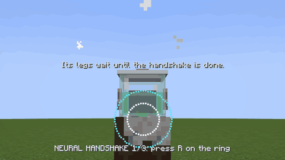

*The Neural Handshake when you first board a host: press **Ability** as the ring meets the circle.*

The first time anyone boards a host, the jar and the body introduce themselves.

- A white circle appears in the upper part of the screen, well above your crosshair, with a cyan ring closing in on it
  and, under them, "NEURAL HANDSHAKE 1/3: press (your **Ability** key) on the ring". Press **Ability** once as the
  ring meets the circle. There is a short window, about a third of a second
  in each round.
- Three rounds of 1.5 seconds each. The circle flashes green for a hit and red for a miss. "Its legs wait until the
  handshake is done": you cannot move until it is over.
- Each hit: **+3% sync**. Each miss: 2 seconds of Nausea. A perfect handshake is +9%.
- Each hit plays the next note of the company jingle; a miss buzzes and the tune starts over. A perfect handshake
  finishes the jingle with a little teal sparkle. Only you hear it: the rest of the office is spared.
- It happens once per body. Getting off halfway cancels it, and it starts again next time.
- Not a fan: set `handshake = false` in the client config for a flat +5% instead.

### Sync

Sync is how well the jar and the body get along. It starts at 0 and grows **1% every 12 seconds you ride**: 10 minutes
of riding to 50%, 20 to 100%. It does not grow while nobody rides.

| Sync | What you get |
|---|---|
| under 25% | the legs stop listening for half a second every 10 seconds |
| 25% | the body's traits: fire immunity, water breathing, no fall damage, knockback immunity, night vision, Dolphin's Grace, and creatures of its kind leaving you alone |
| 50% | the **Ability** (and the body will take Neural Lace) |
| 75% | the **Secondary** |
| 100% | +10% health, damage and speed; the advancement **Fully Synced** |

Below the mark: "Needs 50% sync". A body moves its own way from the first second: a flier flies, a spider climbs, a
chicken floats; until 25% the host panel says "Moves as itself now; traits at 25% sync". Using an ability the body does not
have: "Cow has no trick for that. Try another body." Too soon after the last: "This body is catching its breath. One
moment." Boarding your first host earns **Hostile Takeover**.

Each time sync passes a quarter (25, 50, 75, 100%), a teal ring runs down the body; at 100% a wide pale ring spreads
on the ground. Anyone nearby can see it.

### Freshness and rot

A host loses **2% freshness a minute**, ridden or not: 50 minutes from fresh to nothing. Below 50% it walks 15% slower,
starts to slump forward, and a fly finds it. Below 25% it walks 30% slower, slumps further, sways, and has two flies.
Below 10% it stumbles now and then and has three. The flies hum, faintly and high. At 0 it falls apart, drops what it
would drop, and puts you on the ground. An embalmed body has none of this.

**Embalming Fluid** (shapeless: Saline Bottle, Spider Eye, Sugar, Bone Meal; stacks to 16). **Use** it on a host:
freshness back to 100%, and for the next 20 minutes it rots at **half** the rate. It does not stop rot. You get the
bottle back. "Embalmed: fresh again, and it keeps longer". It goes in with a hiss, a lavender sparkle and a ding. On a creature with its head on: "Embalming Fluid is for host
bodies. Use a Surgical Saw on it first." On a machine: "Machines don't rot. Embalming Fluid is for flesh." Hosts cannot
eat: food gets "Nothing to eat with. Embalming Fluid keeps it fresh."

**Neural Lace** (shaped: Gold Nugget, String, Gold Nugget / Spider Eye, Synapse Chip, Spider Eye / Gold Nugget, String,
Gold Nugget). **Use** it on a host at **50% sync or more**: freshness back to 100%, and the body **never rots again**.
"Neural Lace grafted: this body will never decay". Under 50%: "The lace needs at least 50% sync to take", and you keep
the lace. Once a body is laced, Embalming Fluid is refused and kept: "Laced bodies never rot. Keep the Embalming
Fluid for one that does." A second lace: "This body is laced already. Keep the Neural Lace."

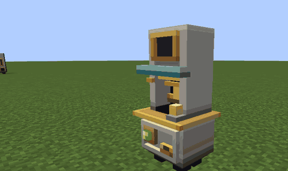

*A body checked out of the Body Locker: **Use** the locker.*

**Body Locker** (shaped: Surgical Steel Ingot, Iron Door, Surgical Steel Ingot / Surgical Steel Ingot, Glass, Surgical
Steel Ingot / Surgical Steel Ingot, Packed Ice, Surgical Steel Ingot). A theatre cloakroom, two blocks tall. **Use** it
to check in the nearest unridden host within 3 blocks, where time stops for it: "Cow stored. It will keep." The body is
whisked inside, the shutter rolls down, the ticket clinks, the body's portrait appears in the header and Noggin & Sons
approves. **Use** it again and the body steps out in front at once, "Cow released", while the shutter unlatches, the
bell rings and the shutter rolls back up. The body goes back only to whoever
checked it in, or to someone they trust (`/headoffice trust`, or their team). Anyone else: "That body is someone
else's. Its owner can trust you with /headoffice trust." A body stored before 0.4.0 carries no owner on its ticket, and
anyone can take it out. It holds one body, takes shells and your own mechas, and will not take someone else's mecha, or
a pet whose owner doesn't trust you (the same line). Break the locker and the body walks out, but a locker holding
someone's body breaks only for its owner or someone they trust: "That locker holds someone else's Cow. Its owner can
break it." (said once for each time you hold the button down) (An empty locker, or one holding a body stored before 0.4.0, breaks for anyone.) Nothing in range: "No host
body within 3 blocks". A jar can work it. It needs no power and takes none from cables.

### The host HUD

While hosted, the top left of the screen shows the host's name, a red health bar, a green freshness bar ("Fresh 87%"),
a purple sync bar ("Sync 40%"), and a line for each ability the body really has: green with its key once it is open
("R: Teleport", with your key), grey with the sync it opens at until then ("Teleport (further): 75% sync"). A second
ability of the same kind as the first is called "(further)". A body with none says "No abilities in this body". A
Utility Shell shows no freshness, and says "NO CHARGE: recharge at a Charging Dock" when your jar is flat. The panel is
no wider than a third of the screen; a long line wraps. With Jade installed, looking at a host shows its freshness,
sync and abilities (see [Other mods](#other-mods)).

### Abilities

| Ability | What it does |
|---|---|
| Teleport | the body jumps to the block you look at |
| Explode | a blast that breaks no blocks; the body is gone and your jar loses half its integrity unless it has a Shock Lid |
| Fireball | fireballs where you look (blaze: three small; ghast: one large) |
| Arrows | a volley of arrows that cannot be picked up |
| Web Shot | a cobweb on the creature or block you look at, only into open air; it melts after 10 seconds. Blocked: "No room for a web there. Aim at open air." |
| Charge | a lunge forward that hits and knocks back what is in the way |
| Pounce | a charge with a hop |
| Toss | throws the creature you look at (within 4 blocks) into the air |
| Roar | everything nearby gets Slowness V and Weakness and is pushed back |
| Ink | Blindness for 4 seconds on everything within 6 blocks |
| Sonic Boom | 10 damage to the creature you look at, up to 15 blocks |
| Groan | every creature of the host's kind within 16 blocks attacks the one you look at |
| Echolocation | everything within 16 blocks glows for 10 seconds |
| Wind Charge | a wind charge where you look |
| Splash | a splash Potion of Weakness |
| Hover | the body floats up, then drifts down |
| Sprint | Speed III for 5 seconds |
| Lay Egg | an egg |

Aimed abilities with nothing in sight: "Nothing there to aim at. Look at a target." Times below are the cooldowns.

<details><summary>Every vanilla host</summary>

Any creature the saw accepts can be a host. One not listed here just walks: no traits, no abilities. All rot at 2% a
minute. Traits other than flight, climbing and slow fall need 25% sync.

| Creature | Ability (50%) | Secondary (75%) | Traits |
|---|---|---|---|
| Bat | Echolocation, 10 s | – | flight, night vision |
| Blaze | 3 fireballs, 5 s | Hover (4 s up, 7 s down), 8 s | fire immune, slow fall |
| Breeze | Wind Charge, 2 s | – | no fall damage |
| Camel | Charge (a shove, no damage), 4 s | – | – |
| Cat | – | – | no fall damage |
| Cave Spider | Web Shot (12 blocks), 3 s | – | climbs, night vision |
| Chicken | Lay Egg, 60 s | – | slow fall |
| Cow | – | – | – |
| Creeper | Explode | – | – |
| Dolphin | Charge (4 damage), 3 s | – | water breathing, Dolphin's Grace for you |
| Donkey | Sprint, 10 s | – | – |
| Drowned | Groan, 10 s | – | water breathing; zombies leave you alone |
| Enderman | Teleport (24 blocks), 3 s | Teleport (48 blocks), 10 s | endermen leave you alone |
| Fox | Pounce (3 damage), 3 s | – | night vision |
| Frog | – | – | no fall damage |
| Ghast | 1 large fireball, 3 s | – | flight, fire immune |
| Glow Squid | Ink, 10 s | – | water breathing, night vision |
| Goat | Charge (2 damage, big knockback), 4 s | – | no fall damage |
| Horse | Sprint, 10 s | – | – |
| Husk | Groan, 10 s | – | zombies leave you alone |
| Iron Golem | Toss, 2 s | – | knockback immune; cannot jump |
| Llama | – | – | – |
| Mule | Sprint, 10 s | – | – |
| Ocelot | Sprint, 8 s | – | no fall damage |
| Phantom | Pounce (6 damage), 4 s | – | flight |
| Pig | – | – | – |
| Piglin | – | – | – |
| Polar Bear | Roar (4 blocks, 1.5 s), 10 s | – | – |
| Ravager | Charge (12 damage), 5 s | Roar (6 blocks, 2 s), 10 s | – |
| Sheep | – | – | – |
| Skeleton | 3 arrows, 6 s | – | 2.5 hearts less health |
| Spider | Web Shot (16 blocks), 3 s | – | climbs, night vision |
| Squid | Ink, 10 s | – | water breathing |
| Stray | 3 arrows, 6 s | – | – |
| Strider | – | – | fire immune |
| Turtle | – | – | water breathing |
| Villager | – | – | – |
| Warden | Sonic Boom, 10 s | – | night vision, knockback immune |
| Witch | Splash, 5 s | – | – |
| Wolf | Pounce (4 damage), 3 s | – | – |
| Zombie | Groan, 10 s | – | zombies leave you alone |

</details>

<details><summary>Hosts from other mods</summary>

Each works only when its mod is installed. Rot is 2% a minute unless the last column says otherwise.

| Mod | Creature | Ability (50%) | Secondary (75%) | Traits | Rot |
|---|---|---|---|---|---|
| Aether | Flying Cow | – | – | flight | |
| Aether | Moa | Hover, 6 s | Sprint, 10 s | slow fall, no fall damage | |
| Aether | Phyg | – | – | flight | |
| Brazil Legends | Capelobo | Pounce (5 damage), 3 s | – | night vision | |
| Brazil Legends | Headless Mule | 1 fireball, 2 s | Sprint, 10 s | fire immune; needs no saw | never |
| Brazil Legends | Mapinguari | Roar, 10 s | Charge (8 damage), 6 s | knockback immune | |
| Brazil Legends | Saci Pererê | Teleport (8 blocks), 3 s | – | no fall damage | |
| Friends & Foes | Copper Golem | – | – | – | never |
| Friends & Foes | Tuff Golem | – | – | knockback immune | never |
| Friends & Foes | Wildfire | 3 fireballs, 2 s | – | fire immune, slow fall; blazes leave you alone | |
| Mowzie's Mobs | Foliaath | Pounce (6 damage), 2 s | – | knockback immune | 1%/min |
| Mowzie's Mobs | Grottol | Charge (4 damage), 4 s | – | knockback immune | never |
| Mutant Monsters | Mutant Creeper | Explode (bigger), 10 s | Pounce (6 damage), 3 s | – | |
| Mutant Monsters | Mutant Enderman | Teleport (32 blocks), 2 s | Toss, 3 s | endermen leave you alone | |
| Mutant Monsters | Mutant Skeleton | 5 arrows, 2 s | – | skeletons leave you alone | |
| Mutant Monsters | Mutant Zombie | Roar, 8 s | Toss, 3 s | knockback immune; zombies leave you alone | |
| Naturalist | Alligator | Pounce (7 damage), 3 s | – | water breathing | |
| Naturalist | Bear | Roar, 10 s | – | – | |
| Naturalist | Elephant | Toss, 3 s | Charge (6 damage), 5 s | knockback immune | |
| Naturalist | Giraffe | Sprint, 10 s | – | – | |
| Naturalist | Komodo Dragon | Pounce (5 damage), 3 s | – | – | |
| Naturalist | Lion | Pounce (6 damage), 2 s | Roar, 10 s | – | |
| Naturalist | Rhino | Charge (8 damage), 3 s | – | knockback immune | |
| Naturalist | Tiger | Pounce (6 damage), 2 s | – | night vision | |
| OreSpawn | Baryonyx | Pounce (6 damage), 3 s | – | water breathing | |
| OreSpawn | Cryolophosaurus | Charge (6 damage), 3 s | – | – | |
| OreSpawn | Emperor Scorpion | Pounce (8 damage), 3 s | – | knockback immune | |
| OreSpawn | Mothra | – | – | flight, slow fall | |
| OreSpawn | Spider Robot | Web Shot, 3 s | – | climbs, no fall damage | never |
| OreSpawn | T-Rex | Roar (8 blocks), 8 s | Charge (10 damage), 5 s | knockback immune | |
| Plants & Zombies | Chomper | Pounce (8 damage), 3 s | – | – | 1%/min |
| Plants & Zombies | Gargantuar | Toss, 3 s | Roar, 10 s | knockback immune | |
| Plants & Zombies | Peashooter | 1 arrow, 1 s | – | – | 1%/min |
| Plants & Zombies | Sunflower | – | – | – | 1%/min |
| Bumblezone | Beehemoth | – | – | flight, slow fall; bees leave you alone | |
| Twilight Forest | Boar | Charge (3 damage), 3 s | – | – | |
| Twilight Forest | Deer | Sprint, 10 s | – | no fall damage | |
| Twilight Forest | Minotaur | Charge (8 damage), 4 s | – | minotaurs leave you alone | |
| Twilight Forest | Skeleton Druid | Splash, 5 s | – | druids leave you alone | |
| Twilight Forest | Troll | Toss, 3 s | – | knockback immune | |
| Twilight Forest | Yeti | Toss, 3 s | Roar, 10 s | – | |

</details>

### The Headless Mule

The Headless Mule from Brazil Legends never had a head, so it needs no saw: as a **jar**, **Use** it and you are aboard.
It never rots, is fire immune once synced, throws fireballs and sprints. Riding one earns **Mula-sem-cabeça**.

## Utility Shells

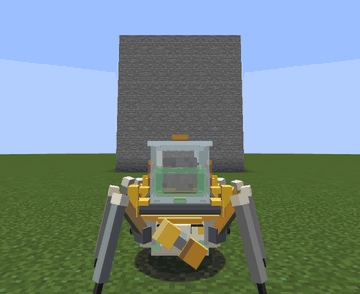

*A Spider Walker climbing: walk into the wall.*

Robot bodies for a jar, for when a cow will not do. A shell needs no saw and no handshake, never rots, and counts as
fully synced from the start. It runs on your jar's charge.

| | **Lunk** | **Rover** | **Spider Walker** |
|---|---|---|---|
| Recipe (shaped) | Servo, Iron Block, Servo / Iron Block, Collar Cam, Iron Block / Iron Block, –, Iron Block | –, Collar Cam, – / Surgical Steel Ingot, Chest, Surgical Steel Ingot / Servo, –, Servo | String, Collar Cam, String / Servo, Surgical Steel Ingot, Servo / String, Surgical Steel Ingot, String |
| Chassis item | **Lunk Chassis** | **Rover Chassis** | **Spider Walker Chassis** |
| Health | 66 (33 hearts) | 33 (16.5 hearts) | 33 (16.5 hearts) |
| Attack | 9.9 | 2.2 | 4.4 |
| Speed | about 4.4 blocks/s | about 9 blocks/s | about 7 blocks/s |
| Steps up | 1 block | 1.5 blocks | 1 block |
| **Ability** | Toss: lifts the creature you look at (within 4 blocks) overhead and throws it into the air, every 1.5 s | Sprint: Speed III for 5 s, every 10 s | Web Shot, up to 16 blocks, every 3 s |
| Extras | not knocked back | 9-slot cargo hold | climbs walls, never takes fall damage |

None of them has a **Secondary**.

- **Set up:** **Use** the chassis on the ground. The shell stands there facing you.
- **Get in:** as a **jar** (or **carrying your head**), **Use** it. **Get out:** **Sneak**. The Rover and the Spider
  Walker put you down behind them, or to the right, left or front when behind is blocked. The Lunk turns and lifts you
  down in front of it, or behind, right or left.
- **The Lunk's toss:** the fists close on what you look at, hold it overhead, and throw it up and a little forward. The
  toss itself does no harm; the landing is the creature's business. It takes a player only if they trust you
  (teammates count): "... has not authorised handling. Ask them to trust you." Anything up to 1.5 blocks wide and 2 tall
  is held first; anything bigger is thrown without the courtesy. Refused, its arms come up and drop: "Nothing there to aim at. Look at
  a target."
- **The Rover's sprint:** the motor revs, the bell rings and it gallops. The Rover limps when your jar is nearly flat.
- **The Spider Walker's web:** aimed at a creature if one is in reach, otherwise at the block you look at. The web lands
  a moment after the spit and melts after 10 seconds. "No room for a web there. Aim at open air."
- **The Rover's hold:** **Sneak** and **Use** the Rover, in any form, to open its 9 slots. Shells have no owner, so
  anyone can open anyone's Rover. The other two say "Only the Rover has a cargo hold".
- **Charge:** a shell takes **3 FE a tick** from your jar on top of the jar's own upkeep, so a basic jar lasts about 17
  minutes, a Reinforced about 42 and an Executive about 83. Out of charge, the shell stops: "NO CHARGE: recharge at a
  Charging Dock", and abilities get "The jar is out of charge. Recharge at a Charging Dock."
- **Crashes:** drive into a wall at more than 6 blocks a second and the jar takes one knock (one integrity, never the
  last one): sparks at the front, a clang, and "Crash! Rover met a wall. The jar took one knock." The next crash counts
  only after 2 seconds. The Rover and the Spider Walker are fast enough for this; the Lunk is not, unless something
  speeds it up.
- Shells cannot drown, do not despawn and stand still when empty. Leads, Embalming Fluid and Neural Lace do not work on
  them ("A machine has no nerves to lace. Neural Lace is for flesh.").
- A shell cannot be folded back into its chassis. Destroyed, it plays out its last moments, then drops 2 Servos, 3
  Surgical Steel Ingots and whatever was in its hold.

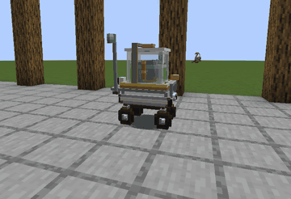

*The Rover's sprint: **Ability**.*

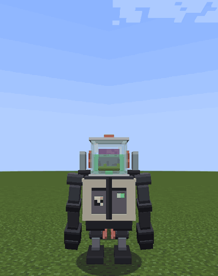

*The Lunk's toss: look at a creature within 4 blocks and press **Ability**.*

## Jarred heads

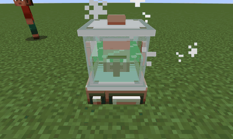

*A placed jarred head turning to watch a player walk past.*

Saw a creature with an empty Life Support Jar in your **off hand** and you keep its head: a **Jarred Head**, named for
its owner ("Jarred Villager Head"). It keeps everything the creature was.

- **Place it:** **Use** it on any surface, with hands (not as a bare jar). It needs nothing under it. It stands in its
  jar on a small plinth with a push bell, and the head turns to look at the nearest player within 6 blocks.
- **Use the placed head** (a jar can do this): a jarred villager opens its usual trading screen with all its trades
  (the bell rings), keeps the uses and experience you give it, nods at each trade, and restocks if 10 minutes have
  passed since it last did. If someone else is trading, it shakes its head: "This head is with another customer. Come
  back shortly." Any other head: "A jarred Cow head. It looks at you."
- **Break it** to get the item back with everything in it, mid-trade included.
- Only villagers trade. Other heads have work to do: see [Heads at work](#board-of-directors-heads-at-work).

## Mecha Division

A jar on its own is a modest career. A jar in a mecha is senior management. You build a mecha from a **frame** and
**modules** at the **Assembly Gantry**, climb into the cockpit as a jar, and the mecha does the walking, the lifting
and, where necessary, the restructuring. Every frame has a move of its own on **Drive**.

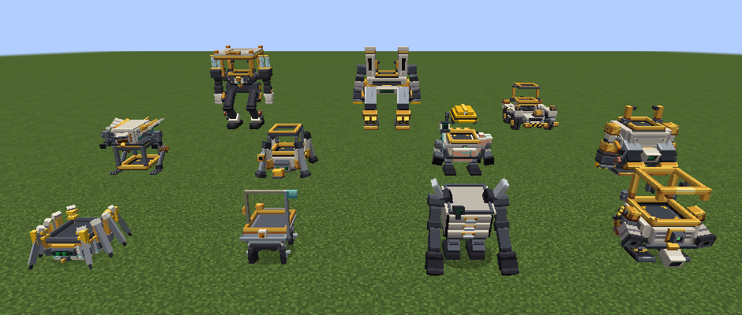

*The eight frames and the three shells.*

### The Assembly Gantry

The **Assembly Gantry** builds, takes apart, repairs and charges mecha. The mecha stands **on top of the block**: the
Gantry is the pad.

- **Recipe** (crafting table, shaped): 2 Neuro-Copper Wire, 1 Synapse Chip, 2 Surgical Steel Ingot, 1 Anvil and 3
  **Mecha Plating** (top row wire, chip, wire; middle row steel, anvil, steel; bottom row three plating).
- **Power:** it holds 100,000 FE and takes up to 5,000 FE a tick from any side. It gives none out.
- **Automation:** a hopper or pipe may keep the Mecha Plating slot filled from the top or the sides. The frame and module
  slots are yours alone.

The Gantry is a cream pedestal with a striped turntable on top and an Anglepoise welding arm folded behind it, its
brass head resting in a cup. Its lamp reads as every company machine's: green when it holds 10,000 FE or more, amber
while a frame stands parked on the pad, pulsing amber while it builds, repairs, takes apart or charges, dim and pulsing
when it is short of power, dark when empty, and red when it refuses. Open its screen and the head lifts and looks at you.

**Mecha Plating** comes 2 at a time from 8 Surgical Steel Ingot around 1 Iron Block. It goes into the Gantry, most frames
and many modules, and it is how a mecha is patched (see *Damage and repair*).

**Use** the Gantry to open its screen:

- The frame goes in the top-left slot, Mecha Plating under it. Then up to 16 module slots, in rows of six. Only as many
  slots as the frame has are open; the rest are grey. Each open slot is tinted by kind (Legs green, Back blue, Core
  yellow, Torso grey, Arm red, Sensor purple) and takes one module of that kind. Put the frame in first.
- The screen totals the mass against the frame's load rating (red when over) and the standing power drain in FE a tick.
  Over 125% of the rating it reads, for example, "807/350 kg: locked", and its tooltip explains: "Over 125% of its
  rating the servos lock: it stands, but it will not move. Take a module out."
- **<** and **>** pick a module slot (outlined in yellow). **-** and **+** move that module's slider by 10%, from 0 to
  100% (new modules start at 50%). The slider is kept on the module itself. A module without one: "... has nothing to
  adjust. Pick another module."
- **Assemble** spends 10,000 FE: a klaxon, the arm swings back to stand off, and half a second later the mecha
  **builds itself on top of the Gantry** while the arm reaches in and welds each module home with a spray of sparks
  (the tallest frames' high sockets get an arc from the welder). The turntable turns the frame to reach its far side,
  then turns it to face whoever pressed Assemble: ten seconds for most
  frames, eleven for a Chimera, twelve for an Executive and sixteen for a Colossus, each fitted module clunking home in turn ("Module clunks home"). You are its owner.
  Its battery starts with whatever is left in the Gantry after the 10,000 FE, up to the battery's size, so a new mecha
  has at most 90,000 FE. A frame that kept serums from an earlier mecha (a Chimera, an Executive, or any frame that had a Bio-Integration
  Port) puts them back in. Built
  over the lock, you are told: "807/350 kg, too heavy to move. Remove a module."
  Climbing in before the build is done skips the rest of it.
- **Take apart** (three seconds of the arm at work with a wrench, ending in "Mecha taken apart") pulls the mecha on the pad back into the slots: frame, modules with their sliders, and any serums
  (kept on the frame, whose tooltip says "Keeps N serums"). Its battery's charge goes back into the Gantry, as much as fits in its 100,000 FE;
  the rest is lost. The **Cargo Hold's contents are dropped on top of the Gantry**. The frame and module slots must be
  empty first (the Mecha Plating can stay). A mecha rebuilt this way is at
  full health again.
- **Repair** spends Mecha Plating from its slot, 20 health a plate, until the mecha on the pad is whole. A paid armorer,
  weaponsmith or toolsmith in an Employee Mount facing the Gantry makes each plate go a third further (unpaid: a
  seventh). Repair also fills the battery at once, from the Gantry's own store; then the turntable presents the frame
  and the arm makes a weld pass along it while a charge lead runs from the reel, and the screen's gauge runs down.
- **Charging on the pad:** any mecha standing on the Gantry, piloted or parked, takes up to 5,000 FE a tick from it, so
  an empty Executive fills in about 20 seconds while the Gantry is fed that fast.

What the Gantry says when it won't:

| When | It says |
|---|---|
| no frame | "No frame to build on. Put one in the frame slot." |
| a press while it is still working | "The Gantry is at work. Wait for its arm to stand off." |
| blocks in the space over the pad | "Something blocks the space over the pad. Clear it for the frame." |
| a mecha already on the pad | "Something stands on the Gantry. Clear its top first." |
| a frame that needs legs has none that walk | "This frame can't walk. Fit walking legs, like Hydraulic Legs." (Arachnid Legs, Stilts, a Hover Skirt and Lava Treads walk too) |
| under 10,000 FE | "Assembly needs 10 kFE. Feed the Gantry power." |
| the frame fails to stand | "The frame wouldn't stand up. Try again." |
| nothing on the pad (Take apart, Repair) | "No mecha on the Gantry. Park one on top of it." |
| someone is aboard it | "Someone is aboard that mecha. They need to get out first." |
| someone else's mecha | "That mecha isn't yours. Its owner can trust you." |
| Take apart with the slots in use | "The slots are full. Empty the Gantry first." |
| Repair with no Mecha Plating in its slot | "Nothing to mend it with. Put Mecha Plating in the plating slot." (the battery is still topped up) |
| Repair on a whole mecha with nothing to top up | "Hopper is in perfect order. Nothing to repair." |
| slider buttons on an empty slot | "Nothing in that slot to adjust. Pick a fitted module." |

Frames and modules used in the air say they go in the Gantry.


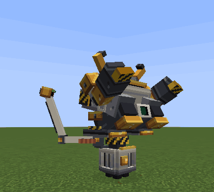

*Assemble: the frame builds itself on the pad while the arm welds each module home.*

### Your first mecha

The cheapest mecha that walks:

1. An **Assembly Gantry**, powered, with at least 10,000 FE (more, if you want the battery to start with something in
   it). Its Synapse Chip takes nether quartz, so a trip to the Nether comes first.
2. A **Hopper Frame**: 1 Collar Cam, 2 Mecha Plating, 3 Servo (Collar Cam top middle; plating, servo, plating in the
   middle row; servos in the bottom corners).
3. **Hydraulic Legs**: 2 Servo, 4 Mecha Plating. A frame built on legs needs walking legs, or the Gantry refuses.
4. Optional but advisable: a **Galvanic Stack** (power, always), and a **Drill Arm** (something to do with your hands,
   which you no longer have).

Frame in, modules in, **Assemble**. The Hopper builds itself on top of the Gantry and keeps charging there while it
stands on it. Climb in and it boots: a self-test, the company jingle, and "SELF-TEST ... OK. N modules answered."

### Getting in and out

- **Getting in:** as a **jar**, **Use** the mecha. **Carrying your head**, **Use** the mecha: your body is left standing
  and the jar climbs in. You are now a **pilot**. The screen says "Hold **Sneak** and **Jar menu** to climb out".
- Only the owner, a player the owner trusts, or the owner's teammate (while the owner is online) may climb in: "That
  mecha belongs to someone else. Ask them to trust you." A mecha with someone already in it: "Someone is already in that
  body".
- **Getting out:** hold **Sneak** and **Jar menu** together for about a second (the status line counts "Ejecting...
  N%", unless it is already showing a warning). **Sneak** alone does not get you out. **Jar menu** on its own opens the jar menu as usual. The frame lets you out
  and you are set down behind it (or beside it, or in front, when behind is blocked) as a plain **jar**.
- Anyone else who **Uses** a mecha sees "Mecha: N kFE, H / M HP", or takes a passenger seat if it has one and is being
  piloted.

### Piloting

| Action | In the cockpit |
|---|---|
| **Attack** | the left arm. On a Colossus or Executive also the left shoulder hardpoint. |
| **Use** | the right arm. On a Colossus or Executive also the right shoulder hardpoint. |
| **Drive** | the frame's own move: see *Each frame's own move*. |
| **Jump** | jump (none on a Wheelhouse, or over 100% load); in mid-air, the Jump Jets; held, the Rocket Pack, the Kite's wings or the Glider Wings. Hanging from a Skitter's line, held, it pays the line out. |
| **Sneak** | switches **Ability** and **Secondary** to genes; on a Skitter clinging to a wall, lets go |
| **Ability** | fires the selected utility module (Ender Satchel, Smoke Mortar, Missile Pod, Workbench, Ore Scanner) |
| **Secondary** | picks the next utility module |
| **Sneak** + **Ability** / **Sneak** + **Secondary** | fire the mecha's first / second active gene. With no utility fitted, **Ability** and **Secondary** fire them alone. |
| **Swap** | opens the Cargo Hold |

Your clicks go to the arms, never to the world. Each arm acts on a press, while held, or on release, as its module
says. An arm button with nothing fitted: "Nothing fitted on that arm. Fit one at the Assembly Gantry." Venting, the arms
say "Venting heat. The arms come back once it cools."; on a flat battery, "Battery flat. Park it on the Assembly Gantry to
charge." With nothing on **Ability** or **Secondary** at all: "No utility module fitted. Fit one at the Assembly Gantry." Arm
damage counts as yours: PvP rules, land claims and kill credit apply, and digging goes through the same protection
checks as your own.

The pilot's panel, in the column at the top left, shows the mecha's name, the selected utility ("[**Ability**]
Missile Pod [**Secondary**] next"), the Cargo Hold's key if fitted, health, "Battery N kFE", "Heat N%", "Mass N / M kg"
against the load rating, each arm on its own line by the control that fires it ("Left Button: Drill Arm", "Right
Button: -", as you have bound **Attack** and **Use**), and one status line: "VENTING: wait for it to cool", "NO POWER:
park it on the Gantry", "OVERLOADED: servos locked. Lighten it at the Assembly Gantry", "NO LEGS: fit walking legs at
the Assembly Gantry", or the eject count. Under it, a reminder of what **Drive** does in this frame ("**Drive** kneels for Siege"). A Colossus or Executive adds its shoulders: "Shoulders, with the arm below  L: ...  R: ...". With a
**Bio-Scanner**, the creature under your crosshair is read out: "Cow: 8 / 10 health, Warm blood". The mecha's active
genes, if any, are listed under it.

The third-person camera sits further back for bigger frames and turns about the top of the machine, so the crosshair
passes over the jar rather than through the hull (the Hopper keeps your own eye as its pivot). First person: from the
jar's own eyes in a Colossus, Executive or Chimera; at your usual eye height in a Hopper, Bulwark, Wheelhouse or
Skitter; from inside the Kite's body, with the parts in the way left undrawn. Landings, the Wheelhouse's ram, and the
Colossus's footfalls and Siege spades shake the camera, unless the photosensitive option is on.


### Each frame's own move

**Drive** in a cockpit is the frame's signature move. Every press gets an answer: the move, or the frame's refusal
(a shrug, a buzzer, a cough of the line gun) and a line saying why.

| Frame | **Drive** | Costs |
|---|---|---|
| **Hopper** | The **Pogo Protocol**: hold to crouch ("POGO PROTOCOL N%"), let go to leap 3 to 9 blocks by how long you held; look up for height. It lands with a thud and a ring of knock-back that hurts nothing. | 250 to 1,000 FE and 5 to 15 heat, by the charge |
| **Bulwark** | **Heavy Lifting**: lifts what stands right in front of it (a creature up to horse size, or a loose block) overhead, and walks with it. Press again to throw it where you look, or, looking down, to set it down in front. | 500 FE a lift, 5 FE a tick held, 750 FE and 12 heat a throw |
| **Colossus** | **Siege**: from a standstill on firm, open ground it kneels and digs its knee spades in. Anchored: no knock-back, the shoulder weapons cycle twice as fast, it sheds heat half as fast again, and blows from the front are cut by 30%. The arms are planted and it cannot walk or turn. Press again to stand it up. | 10,000 FE to kneel, 8 FE a tick held |
| **Executive** | The **premium jingle**: it tugs its lapels, nods, and the jingle plays for all to hear. It does not lift; it delegates. Its four Gene Port vials show their serums. | 20,000 FE (it plays on whatever is left) |
| **Wheelhouse** | **Rush Hour**, on a road: the RIGHT OF WAY flag snaps up and it runs at 1.6 times speed for 4 seconds, its buffer beam knocking aside whatever stands in front. Then it cools down for 10 seconds. | 3,000 FE and 8 heat, then 3 FE a tick |
| **Skitter** | The **Dragline**: fires a hi-vis safety line at the block you look at, within 24 blocks. Hold to reel in, hold **Jump** while hanging to pay out, let go to swing, tap **Drive** to cut. | 2,000 FE and 3 heat a line, 3 FE a tick reeling |
| **Kite** | The **Talon Lift**, in flight: picks up the creature just below (up to sheep size) and carries it under the hips. Press again to drop it. | 625 FE a grab, 2 FE a tick carried |
| **Chimera** | The **Graft**: within 5 seconds of an arm hitting a creature, the arm comes up to its face, it sniffs and gulps, and it has that creature's gene for 60 seconds, at full strength and taking no Gene Port. Its veins run in the creature's blood colour meanwhile. | 2,000 FE, 1 Bio-Gel (Cargo Hold or your pockets), then 3 FE a tick |

The details, and what each frame says when it won't:

- **Hopper:** it needs walking legs, solid ground and two blocks clear overhead. "Not enough charge to jump. Recharge at
  the Assembly Gantry.", "Already airborne. Land first, then jump.", "No headroom for a jump. Find open sky.", "Venting
  heat. The springs wait for it to cool." The landing moves other players only if they trust you, and the Hopper takes
  no fall damage from its own leap.
- **Bulwark:** the grab looks where you look, and the body turns to it while the fists reach. While its fists are full,
  the arms wait: "Hands full. Throw the load or set it down first." It refuses with "Nothing within reach to lift. Walk
  right up to it.", "... is over the lifting limit. Try something cow-sized.", "... is not freight. Find another load."
  (bosses), "... has not authorised handling. Ask them to trust you." (a player who does not trust you), "No room
  overhead to carry Cow. Find open sky." It lets go by itself with "Load released: the ceiling is too low to carry it.",
  "Load released: no charge left to hold it." or "Load released: the fists vent with the rest." Blocks follow the
  Telekinesis rules, and a thrown block can hurt what it lands on.
- **Colossus:** "Siege starts from a standstill. Stop first.", "No footing for Siege. Land first.", "Planning refuses a
  site under water. Find dry ground.", "The ground won't take the spades. Find solid ground.", "No room behind for the
  outriggers. Find open ground behind." (it needs 2.4 blocks clear to each side and 3.5 behind), "Not enough charge
  for Siege. Recharge at the Assembly Gantry." In Siege, **Attack** and **Use** fire only the shoulders ("The arms are
  planted for Siege. Stand it up to use them."). If the battery runs flat it stands up: "Siege lifted: no charge left to
  hold it." Leave it mid-Siege, or lose it there, and it stands itself up.
- **Executive:** "The jingle is still playing. Let it finish." Each vial fills with its serum's load, takes the colour
  of the kind of gene that makes up most of it, and dims while that gene rests.
- **Wheelhouse:** dirt and grass, sand, snow, gravel, leaves and mud are off-road: "OFF-ROAD: no right of way on dirt.
  Find a road." Otherwise: "COOLING DOWN: right of way again in N s.", "NO POWER for Rush Hour. Recharge at the Assembly
  Gantry.", "VENTING: right of way suspended. Wait for it to cool." The ram hurts each creature once a run (4 to 8, more
  the faster you go) and moves a player only if they trust you; it leaves machines and anything being ridden alone.
- **Skitter:** "Nothing to fix the line to within 24 blocks. Aim at a wall.", "Not enough charge for the Dragline.
  Recharge at the Assembly Gantry." The line runs 32 blocks at most: "Line parted: too far from the anchor." or "Line
  lost: the anchor gave way." The Skitter also walks up walls and holds on to them where it stops; **Sneak** lets go. On
  a wall with a flat battery or while venting it cannot hold on: "No power to hold the wall. Recharge at the Assembly
  Gantry." or "Venting heat: the legs let go of the wall."
- **Kite:** "Talons work from the air. Take off first.", "Nothing below to pick up. Fly low over it.", "... is over
  the airmail limit. Try something sheep-sized.", "... is not airmail. Find another
  parcel." A parcel that touches the ground is set down there; one that snags on a block is let go ("Parcel released: it
  caught on something.").
- **Chimera:** "Nothing tasted lately. Hit something, then graft.", "... tastes of nothing useful. Try another
  creature.", "... is above our pay grade. Graft something ordinary." (Legendary genes), "No Bio-Gel aboard. Carry some
  in the hold or on you.", "A graft is still taking (N s). Let it wear off." The HUD shows "Grafted: ... (N s)" while
  it lasts.

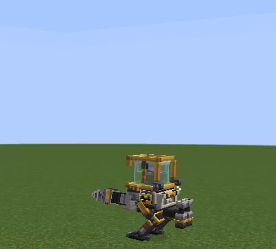

*Hopper: hold **Drive** to crouch, let go to leap.*

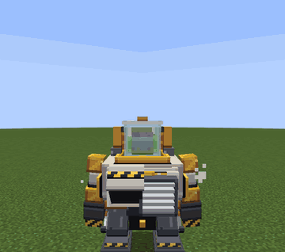

*Bulwark: **Drive** lifts what stands in front of it; **Drive** again throws it.*

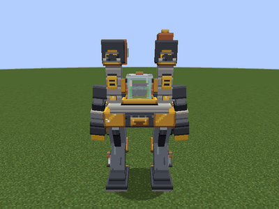

*Colossus: **Drive** from a standstill kneels into Siege; **Drive** again stands it up.*

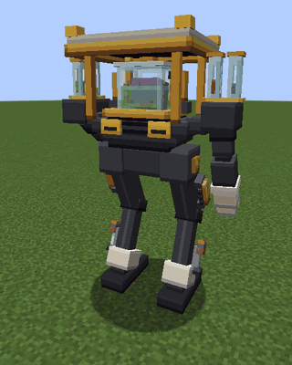

*Executive: **Drive** plays the premium jingle.*

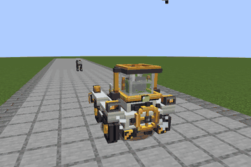

*Wheelhouse: **Drive** on a road for Rush Hour.*

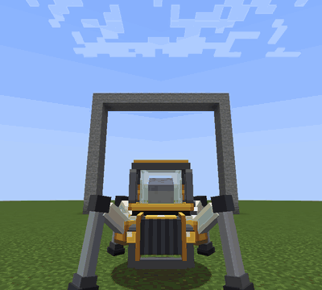

*Skitter: **Drive** at a block within 24 fires the line; hold it to reel in.*

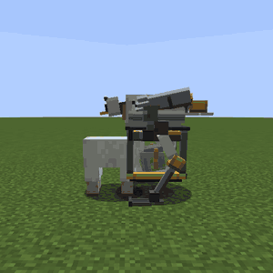

*Kite: in flight, low over a creature, **Drive** picks it up; **Drive** again drops it.*

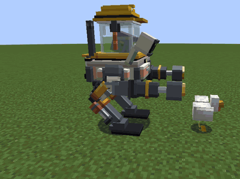

*Chimera: hit a creature with an arm, then **Drive** within 5 seconds.*

### Arms at work

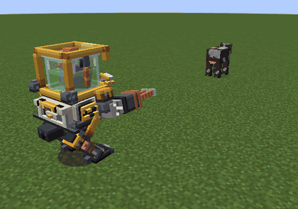

*A Plasma Lance: hold the arm's button and the beam goes where you aim.*

Every beam and stream leaves the tool's own muzzle on the arm and lands where you aim: the Plasma Lance's copper beam
(while your own lance burns, the edges of your view dim like a welder's visor), the Arc Cannon's white bolt, jumping
on to up to three hostiles a moment apart (a miss lands where you aim), the Tractor Beam's three twisting teal ribbons
round what it holds, the Flamethrower's jet bending up at its end, the Welding Torch's short blue-white arc, the Rivet
Gun's rivets from the gun's own side. Each tool moves by its kind: the Drill, Chainsaw and Harvester spin; the Rivet
Gun and Arc Cannon kick; the Flamethrower, Tractor Beam, Welding Torch and Plasma Lance brace and hold; the Hydraulic
Fist, Grapple Hook, Excavator Scoop and Hemo-Syringe strike; the Riot Shield and Manipulator Hand guard, and a blow on
a raised guard jolts the arm back. The fist's blow and the syringe's jab land when the arm gets there, a moment after
the press, and the Arc Cannon fires on its recoil; the cost is paid at the press. The Manipulator Hand holds your
selected item in its claw.

### Power, heat and mass

**Battery.** Every mecha has its own battery; the jar's charge is not touched. While piloted it pays the frame's idle
drain, each module's standing drain, 4 FE a tick while moving, and whatever the arms, utilities and its own move cost.
Overloaded, the idle, standing and moving drain is 1.5 times. **Parked, a mecha drains just 1 FE a tick** (plus 20 a tick for Lava Treads on lava, and 5,000 for each Reactive Armour
charge it buys back), and a Galvanic Stack or Solar Skin
keeps charging it; so do a Combustion Kernel, Bio-Reactor Core or Fusion Bottle with fuel in the Cargo Hold. Charge it
on the Gantry, or fit a core.

**Limp mode.** At 0 FE the mecha moves at 30% speed, cannot fly or climb, and every arm, utility and powered module
stops: "Battery flat. Park it on the Assembly Gantry to charge." Plain jumping and Glider Wings still work.

**Heat.** Heat is counted in points up to the frame's heat cap (see *Frames*); the HUD shows it as a percentage of the cap. Modules and actions make heat; the frame sheds a fixed amount each tick (plus 4 for Radiator Fins, 6 for a
Coolant Loop). Shedding is three times faster under water, half as fast again in rain, and half as fast in the Nether.
Lava adds 10 heat a tick, burning adds 3 (not with Fire Suppression). From 60% the heat bar turns yellow, Radiator
Fins open, the vents glow a dark amber and the hot metal ticks; from 85% the glow is amber, and red while venting. From 85% most arms work at 70%. At 100% it **vents**: 5 seconds of shutdown in a cloud of steam that blinds
anyone within 3 blocks; heat drops to half at once and keeps falling while it vents. The steam also scalds the cockpit
for 2 damage (which the mecha takes, like any hit on the pilot) unless the jar has a Heat Shield. While venting it
cannot walk, jump, fire or use anything, though one already in the air keeps flying and steering, and a Rocket Pack
still lifts: "Venting heat. Everything comes back once it cools."
**A parked mecha makes no heat of its own and never vents by itself**: walk up to one with a Fusion Bottle and it stands quiet. An
**EMP Grenade** halves the battery and forces a vent, parked or not.

**Mass.** Frame plus modules, plus 1 kg for each filled Cargo Hold slot. Against the frame's load rating:

| Load | Speed | Jumping |
|---|---|---|
| up to 60% | full | full |
| 60 to 100% | falls to 60% | falls to half |
| 100 to 125% (overloaded) | 30%, drain 1.5 times | none, and a Kite cannot fly |
| over 125% | none: "OVERLOADED: servos locked. Lighten it at the Assembly Gantry" | none |

### Damage and repair

- Damage shows: below half health sparks spit from the seams; below a quarter the hull smokes, every blow crackles,
  and the machine limps (at its usual speed). A flat battery limps too.
- A hit aimed at the pilot lands on the mecha. A pilot cannot hurt their own mecha. Falls of up to 6 blocks do nothing.
- **Wrecked** (0 health in one go): the Golden Parachute fires (below) and the glass takes one knock (never the last
  one): "Hopper wrecked, you're clear. Glass N/M." (your glass, now and at most). The
  machine collapses on its face, then a small blast that breaks no blocks and spares whoever was aboard. Each module has
  an even chance to drop; otherwise it drops as one Mecha Plating. The Cargo Hold drops everything. The frame is lost.
- **Repair:** **Repair** at the Gantry (20 health a plate), Mecha Plating **Used** on your own mecha (20 health; "Nothing
  to patch. The plating can wait." when whole; a pilot has no hands for it), the **Welding Torch**, the **Hemo-Syringe**,
  or a **Medical Injector** in a Chimera.

### The Golden Parachute

When a hit leaves a piloted mecha under 10% health, or wrecks it, the company's severance package deploys. The eject
klaxon sounds, the frame's restraint is blown open (the Hopper's hoop, the Bulwark's jar clamps, the Wheelhouse's ring,
the floor of the Kite's lantern) and the jar is fired up and back, clear of the machine (away from the wall, if it was
climbing one; a Kite in flight drops it out of its lantern instead). A gold canopy snaps open and the jar drifts down under it, held up until it lands: "GOLDEN PARACHUTE
DEPLOYED". With less than three blocks of air overhead the canopy tangles ("Golden Parachute tangled: no room overhead to
open. Brace for landing."), and on too short a drop it has no time to open ("Golden Parachute tangled: too little air to
open it. Brace for landing."). Every parachute comes with a letter, even when the machine survives: "Noggin & Sons regrets the loss of your Hopper at x,
y, z. Your Severance Form is in the post." (for the other frames, "your Bulwark Frame" and so on). The mecha
stays behind, empty.

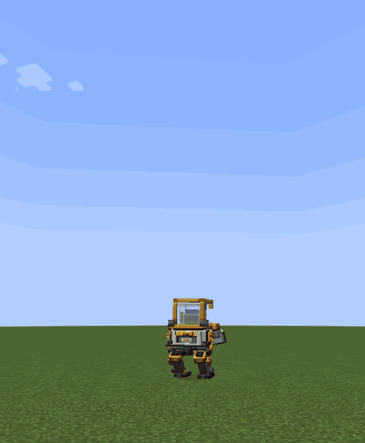

*The Golden Parachute fires by itself when a hit leaves a piloted mecha under 10% health.*

### Passengers and the Cargo Hold

- **Seats:** the Wheelhouse has 2, a **Passenger Pod** adds 1. A player in **body** or **linked** form **Uses** a piloted
  mecha to take a seat ("No free seat. Wait for one to empty." when full) and leaves with **Sneak**. A jar cannot take a
  passenger seat. Passengers who log out are set down.
- **Cargo Hold:** 27 slots. Open it with **Swap** from the cockpit, or **Sneak** and **Use** a parked mecha from outside
  (owner or trusted). Drills, saws, scoops, the Harvester and the Hemo-Syringe put their haul in it; cores, the Rivet
  Gun, the Medical Injector, the Welding Torch and the Chimera's Graft take their supplies from it. Plasma Pellets and
  Bio-Gel **Used** on a mecha are refused: "Fuel goes in the Cargo Hold. Sneak-use the mecha to open it." Without one
  fitted: "No Cargo Hold fitted. Fit one at the Assembly Gantry."

### Trust

A mecha belongs to whoever assembled it. The owner, the players they trust with `/headoffice trust add <player>`, and
the owner's teammates (while the owner is online) may pilot it, open its hold, patch it with plating, inject it, rename
it with a Name Tag, and take it apart or repair it at a Gantry. Nobody else's Tractor Beam can pick it up. A lead does
not go on a machine. A mecha's lifts, landings and rams move another player only if that player trusts the pilot.

### Gene Ports

The Chimera has 3 Gene Ports, the Executive 4, and a **Bio-Integration Port** adds 1 to any frame. A player with hands
(**body** or **linked**, or a jar with a Manipulator Arm) **Uses** a Serum on the mecha from outside. Each port takes one
serum of load up to 8; blood type never matters, though a serum can still mutate or curdle. The bottle comes back. "This mecha has no Gene Port. Fit a
Bio-Integration Port at the Gantry."; "No room for another serum"; "Too heavy for this body: a host takes 6, a Gene
Port 8." Genes work at full strength in a mecha,
and Draconic Wings let any mecha fly (a host takes them but does not fly; a body cannot carry them, load 6). Fire the
active ones with **Sneak** + **Ability** and **Sneak** + **Secondary** (or the keys alone when no utility is fitted). Taking the mecha apart keeps the serums on the
frame. A Chimera's Graft adds a gene for a minute without using a port.

### Frames

Speed is against a player walking (1.0 = walking pace). Slots are Legs / Back / Core / Torso / Arm / Sensor.

| Frame | Health | Armour | Battery | Load / dry mass | Speed | Heat cap / cooling a tick | Slots | **Drive** | Also |
|---|---|---|---|---|---|---|---|---|---|
| **Hopper** | 60 | 6 | 100 kFE | 350 / 150 kg | 1.3 | 400 / 3 | 1/1/1/2/2/1 | Pogo Protocol | the first mecha |
| **Bulwark** | 140 | 12 | 300 kFE | 800 / 320 kg | 1.1 | 800 / 5 | 1/2/1/3/2/2 | Heavy Lifting | |
| **Chimera** | 120 | 8 | 200 kFE | 700 / 220 kg | 1.2 | 700 / 6 | 1/1/1/3/2/1 | Graft | 3 Gene Ports; Medical Injector repairs it |
| **Wheelhouse** | 90 | 10 | 300 kFE | 1000 / 300 kg | 2.4 on built ground, 0.8 off-road | 600 / 4 | 0/2/1/2/1/1 | Rush Hour | drives without legs; 2 passenger seats; cannot jump, so no Rocket Pack or Glider Wings, and Jump Jets fire only once it is already in the air (off a ledge) |
| **Skitter** | 100 | 10 | 200 kFE | 600 / 260 kg | 1.2 | 600 / 4 | 0/1/1/2/1/2 | Dragline | walks without legs, climbs walls and clings to them; one arm |
| **Kite** | 70 | 6 | 250 kFE | 280 / 120 kg | 1.2, much faster flying | 500 / 6 | 1/0/1/1/2/1 | Talon Lift | flies by holding **Jump** (40 FE and 2 heat a tick aloft), no fall damage; walks without legs, so its Legs slot takes any Legs module; cannot fly overloaded; no Back slot |
| **Colossus** | 300 | 18 | 1,000 kFE | 1800 / 700 kg | 0.9 | 1600 / 8 | 1/2/2/5/4/2 | Siege | 2 arms and 2 shoulder hardpoints; too big for a nether portal |
| **Executive** | 360 | 20 | 2,000 kFE | 2000 / 750 kg | 1.0 | 2000 / 10 | 1/2/2/5/4/2 | premium jingle | the Colossus, more so; 4 Gene Ports; too big for a nether portal |

Idle drain: 2 FE a tick (Hopper, Kite), 3 (Chimera, Wheelhouse, Skitter), 5 (Bulwark), 8 (Colossus), 10 (Executive).
Every frame steps up one block, never drowns, and shrugs off most knockback. Frame tooltips list health, armour, load,
battery, slots and Gene Ports.

| Frame item | Recipe (crafting table, shaped) |
|---|---|
| **Hopper Frame** | 1 Collar Cam, 2 Mecha Plating, 3 Servo |
| **Bulwark Frame** | 4 Mecha Plating, 1 Collar Cam, 1 Netherite Scrap, 2 Servo |
| **Chimera Frame** | 2 Bio-Gel, 1 Collar Cam, 2 Mecha Plating, 1 Nether Wart Block, 2 Servo |
| **Wheelhouse Frame** | 4 Mecha Plating, 1 Collar Cam, 1 Minecart, 2 Servo |
| **Skitter Frame** | 4 Servo, 1 Collar Cam, 2 Mecha Plating, 1 Fermented Spider Eye |
| **Kite Frame** | 2 Phantom Membrane, 1 Collar Cam, 2 Mecha Plating, 2 Servo |
| **Colossus Frame** | 4 Mecha Plating, 1 Collar Cam, 2 Netherite Ingot, 1 Bulwark Frame, 1 Servo |
| **Executive Frame** | 4 Gold Block, 2 Synapse Chip, 2 Nether Star, 1 Colossus Frame |

All eight frames are animated: each builds itself on the pad, boots when you climb in, walks, turns, limps when hurt,
works its arms, vents, lets you out, and collapses when wrecked, with the real jar in its seat and every module on its
socket. Each has its own sounds, from the Bulwark's "Mecha cracks its neck" to the Executive's "Shoe taps impatiently",
every one with a subtitle. A parked mecha (standing still, nobody aboard) is drawn from a kept copy of its look, so a
yard full of parked machines costs about a tenth of the drawing time it used to; with an Iris shader pack in use they are
drawn as before.

### Modules

58 modules in six kinds. Every module stacks to 1 and is made on a crafting table. Its tooltip gives what it does, its
slot and its mass, and its slider setting if it has one. FE costs are per use unless marked "a tick"; "standing" costs
are paid every tick while piloted. Every module shows on the machine where it is fitted.

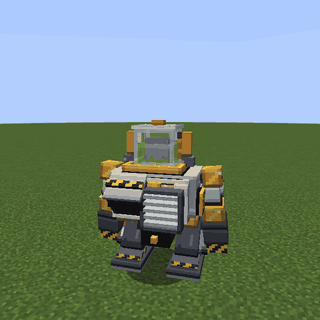

*A Bulwark with every slot filled.*

<details>
<summary>All 58 mecha modules</summary>

**Legs.** A frame built on legs (Hopper, Bulwark, Chimera, Colossus, Executive) has one Legs slot, and it must hold one
that walks. The Kite walks on its own, so the modules here that do not walk fit only a Kite.

| Module | Mass | Recipe | What it does | Key | Slider |
|---|---|---|---|---|---|
| **Hydraulic Legs** | 60 kg | 2 Servo, 4 Mecha Plating | Walks. | – | Stride: 60% to 140% speed |
| **Spring Heels** | 20 kg | 2 Piston, 2 Slime Block | Jumps higher. Kite only, and a Kite with charge takes off instead of jumping, so they work only on a flat battery. | **Jump** | Tension: how high |
| **Anchor Clamps** | 30 kg | 2 Anvil, 2 Mecha Plating | Grip the ground: no knock-back while it stands; no fall damage. Kite only. | – | none |
| **Aqua Fins** | 15 kg | 2 Prismarine Shard, 2 Mecha Plating | Twice as fast in water; climbs out at the bank. Kite only. | – | none |
| **Sprint Servos** | 25 kg | 2 Redstone, 1 Servo | Up to 80% faster while there is power; 15 FE a tick while moving. Kite only. | – | Boost: how much faster |
| **Stilts** | 35 kg | 2 Mecha Plating, 4 Iron Bars | Walks; steps up two blocks. | – | none |
| **Arachnid Legs** | 90 kg | 4 String, 2 Servo, 1 Mecha Plating | Walks; walks up walls while powered (12 FE a tick on a wall). No fall damage while climbing. | – | none |
| **Hover Skirt** | 50 kg | 3 Mecha Plating, 2 Phantom Membrane | Walks; floats over ground, water and lava. No fall damage. Standing 30 FE and 2 heat a tick. | – | Altitude: 0.5 to 2 blocks |
| **Lava Treads** | 40 kg | 2 Magma Block, 1 Mecha Plating | Walks; rises out of lava and puts out its own fire (20 FE and 3 heat a tick on lava, on top of the lava's own heat). | – | none |

**Back**

| Module | Mass | Recipe | What it does | Key | Slider |
|---|---|---|---|---|---|
| **Jump Jets** | 45 kg | 2 Fire Charge, 2 Blast Furnace, 1 Synapse Chip | A burst upward. Three per landing, 600 FE and 15 heat each. "Jets spent. They refill when you land." | **Jump** in mid-air | Thrust: how high each burst lifts |
| **Rocket Pack** | 110 kg | 2 Blaze Rod, 1 Synapse Chip, 2 Fire Charge | Flight while its thrust beats the mecha's mass: climbs, or sinks slowly while falling. 120 to 300 FE and 6 heat a tick while climbing. | hold **Jump** | Thrust: 200 to 800 kg |
| **Glider Wings** | 40 kg | 2 Phantom Membrane, 1 Mecha Plating | Glide where you look while falling. No fall damage while gliding. Works on a flat battery. | hold **Jump** | none |
| **Cargo Hold** | 80 kg | 5 Mecha Plating, 1 Chest | 27 slots; see *Passengers and the Cargo Hold*. | **Swap** | none |
| **Passenger Pod** | 120 kg | 3 Glass, 2 Mecha Plating, 1 White Wool | One passenger seat for a player in **body** or **linked** form. | – | none |
| **Radiator Fins** | 30 kg | 3 Iron Bars, 3 Mecha Plating | Sheds 4 more heat a tick; the fins open when it runs hot. | – | none |
| **Battery Rack** | 70 kg | 3 Leyden Jar, 3 Mecha Plating | +125 kFE battery. | – | none |
| **Ender Satchel** | 15 kg | 2 Mecha Plating, 1 Ender Chest | Utility: opens your ender chest. 2,000 FE. | **Ability** | none |
| **Smoke Mortar** | 35 kg | 1 Campfire, 2 Mecha Plating, 1 Dispenser | Utility: a smoke cloud 8 blocks across where you aim (up to 24 blocks), 10 seconds. Blinds what is inside; mobs in it lose their target. 2,000 FE, 10 heat. | **Ability** | none |
| **Missile Pod** | 90 kg | 3 Firework Rocket, 2 Mecha Plating, 1 Synapse Chip | Utility: four homing **Micro-Missiles** (fewer if the charge runs out), shared in turn between what you aim at (up to 48 blocks) and the nearest hostiles within 32; with no target they fly straight. 4 to 12 damage a hit and a small blast that breaks no blocks. 4,000 FE each. | **Ability** | Warhead: damage, and 10 to 30 heat a missile |

**Core**

| Module | Mass | Recipe | What it does | Key | Slider |
|---|---|---|---|---|---|
| **Galvanic Stack** | 25 kg | 1 Galvanic Pile, 1 Mecha Plating | 10 FE a tick, always, parked too. | – | none |
| **Combustion Kernel** | 60 kg | 4 Mecha Plating, 1 Blast Furnace, 1 Neuro-Copper Wire | Burns furnace fuel from the Cargo Hold: up to 80 FE (and 0.2 heat) a tick (a coal is 16,000 FE). Keeps burning while parked, full or not. | – | none |
| **Bio-Reactor Core** | 50 kg | 4 Mecha Plating, 1 Bio-Gel, 1 Smoker | Eats from the Cargo Hold: Bio-Gel 20,000 FE, a Plasma Vial 10,000, food 2,000 a point of hunger. Up to 60 FE and 2 heat a tick. | – | none |
| **Capacitor Bank** | 50 kg | 3 Leyden Jar, 2 Mecha Plating, 1 Synapse Chip | +500 kFE battery. | – | none |
| **Fusion Bottle** | 140 kg | 2 Tinted Glass, 1 Nether Star, 2 Mecha Plating, 1 Beacon | Burns Plasma Pellets from the Cargo Hold or your inventory, 1,000,000 FE each. Very hot. | – | Output: 150 to 600 FE and 3.75 to 15 heat a tick |

**Torso**

| Module | Mass | Recipe | What it does | Key | Slider |
|---|---|---|---|---|---|
| **Mecha Armour Plating** | 60 kg | 5 Mecha Plating, 1 Iron Block | Takes 10 to 30% off every hit. | – | Thickness: how much |
| **Thorn Plating** | 50 kg | 2 Cactus, 1 Mecha Plating | A melee attacker takes 30% of the hit back. | – | none |
| **Fire Suppression** | 25 kg | 2 Water Bucket, 1 Mecha Plating | Mecha cannot burn; mecha and pilot are put out. | – | none |
| **Life Support Recycler** | 20 kg | 2 Saline Recycler, 1 Mecha Plating | While powered, keeps the pilot's saline and charge full and mends the jar's glass one point every 30 seconds. Standing 10 FE a tick. | – | none |
| **Signal Booster** | 15 kg | 1 Relay Mast, 2 Mecha Plating, 1 Synapse Chip | A Relay Mast that walks: with charge in it, your head reaches the mecha within your goggles' range and the mecha reaches your body within 96 blocks, for you and those you trust. Standing 20 FE a tick. | – | none |
| **Solar Skin** | 20 kg | 3 Daylight Detector, 3 Mecha Plating | 15 FE a tick by day under open sky. | – | none |
| **Coolant Loop** | 45 kg | 2 Packed Ice, 1 Mecha Plating | Sheds 6 more heat a tick. | – | none |
| **Reactive Armour** | 70 kg | 2 TNT, 1 Mecha Plating | Takes 40% off explosions and projectiles, 6 charges; one comes back every 30 seconds for 5,000 FE. | – | none |
| **Energy Shield** | 40 kg | 2 Amethyst Shard, 3 Mecha Plating, 1 Synapse Chip | Takes part of each hit on the battery instead, 1,000 FE (and 1 heat) a point of damage, while the battery lasts. Standing 40 FE and 4 heat a tick. | – | Strength: 25 to 100% of the hit |
| **Medical Injector** | 30 kg | 2 Bio-Gel, 1 Syringe, 3 Mecha Plating | Once a second, each player aboard under the threshold gets 4 health for 1 Bio-Gel (Cargo Hold or your inventory). A hurt Chimera mends 1 health a second, 20 health a Bio-Gel. | – | Threshold: 0 to 100% health |
| **Stealth Field** | 30 kg | 2 Eye of Ender, 3 Mecha Plating, 1 Synapse Chip | Mobs more than 4 blocks off lose track of you. Any arm drops it for 3 seconds. Standing 200 FE and 8 heat a tick. | – | none |
| **Tesla Coil** | 60 kg | 1 Tesla Node, 1 Mecha Plating | Once a second, arcs hit up to 3 nearby hostiles (10 heat when it does). 100 to 400 FE a tick while piloted. | – | Voltage: reach 3 to 6 blocks, 2 to 6 damage |
| **Workbench** | 10 kg | 1 Crafting Table, 1 Mecha Plating | Utility: a crafting grid. Free. | **Ability** | none |
| **Bio-Integration Port** | 40 kg | 2 Bio-Gel, 1 Injection Rig, 2 Mecha Plating, 1 Synapse Chip | One Gene Port on any frame; the battery holds 20% less. | – | none |

**Arms.** Fitted to an arm slot, or on a Colossus or Executive a shoulder hardpoint, which fires with the arm below it
(the Riot Shield works only on an arm). **Attack** works the left, **Use** the right. "Nothing in reach. Aim at
something." and "That arm is still cycling. One moment." apply throughout.

| Module | Mass | Recipe | What it does | Key | Slider |
|---|---|---|---|---|---|
| **Drill Arm** | 70 kg | 3 Diamond, 1 Iron Block, 1 Servo | Mines the block within 6 as an iron pickaxe would, 50 FE and 1 heat a block, into the Cargo Hold if fitted. "This ground is protected. Dig somewhere else." | hold | Torque: speed; from 50% a 3x3 head at half speed |
| **Chainsaw Arm** | 60 kg | 3 Iron Ingot, 2 Shears, 1 Servo | On a creature within 4: 8 damage, 40 FE. Held on a log for under a second: fells the whole tree (up to 128 logs), 40 FE and 0.5 heat a log. "The chainsaw wants a creature or a log. Aim at one." | press, hold | none |
| **Hydraulic Fist** | 90 kg | 5 Piston, 1 Servo | On a creature within 4.5: 10 to 22 damage and knockback. 300 to 1,500 FE, up to 4 heat. Once every 0.6 seconds. | press | Force: damage, knockback and cost |
| **Grapple Hook** | 30 kg | 2 Tripwire Hook, 1 Servo | A creature within 32 is yanked to you; otherwise you are pulled to the block you aim at. 800 FE a throw, hit or miss, once a second. | press | none |
| **Tractor Beam** | 50 kg | 1 Telekinesis Module, 1 Servo | Grab a creature or a loose block within 24, hold to carry it, let go to drop it. 80 FE a tick. "The beam won't take that. It isn't yours to move." | press, hold | none |
| **Rivet Gun** | 45 kg | 2 Iron Ingot, 1 Crossbow, 1 Servo | Five rivets a second, one Iron Nugget (Cargo Hold or inventory), 30 FE and 0.5 heat each. "Out of rivets. Carry iron nuggets." | hold | none |
| **Riot Shield** | 80 kg | 5 Mecha Plating, 1 Shield | Hits from the front do a fifth of their damage. | hold | none |
| **Manipulator Hand** | 30 kg | 3 Iron Ingot, 1 Servo | Uses your selected hotbar item like a hand on a block within 6 or in the air; a creature within 6 is hit with it. 50 FE. | press | none |
| **Excavator Scoop** | 80 kg | 4 Iron Shovel, 1 Servo | Digs 3x3 of dirt, sand and gravel at a time, 20 FE a block, into the Cargo Hold if fitted. | hold | none |
| **Flamethrower** | 50 kg | 2 Blaze Powder, 1 Fire Charge, 1 Servo | A cone of fire 7 blocks long. Sets creatures alight for 4 seconds, 1 fire damage a hit. 60 FE and 8 heat a tick. | hold | Spread: narrow to wide cone |
| **Arc Cannon** | 85 kg | 2 Lightning Rod, 1 Tesla Node, 1 Servo | A bolt to the first creature within 16 that jumps on to up to three hostiles nearby. 6,000 FE, 25 heat. "That arm needs 6 kFE. Recharge at the Assembly Gantry." | press | Charge: 8 to 16 damage, 0.5 to 2 seconds between shots |
| **Hemo-Syringe** | 25 kg | 1 Precision Syringe, 1 Servo | On a creature within 4: 4 damage, the frame mends a tenth of it, and a Blood Sample (quality up to 80, less from a hurt, poisoned or burning creature; none from a bloodless one) goes to the Cargo Hold or your inventory. 20 FE. "Players don't give blood here. Aim at a creature." | press | none |
| **Harvester** | 10 kg | 3 Iron Hoe, 1 Servo | Picks and replants every ripe crop in a 5x5 around where you aim, 10 FE a crop. "Nothing ripe there. Come back at harvest." | press | none |
| **Welding Torch** | 30 kg | 1 Blaze Rod, 1 Flint and Steel, 1 Servo | Mends the mecha you aim at within 5, or your own, 2 health a second; one Mecha Plating from the Cargo Hold per 20 health. 80 FE and 6 heat a tick. | hold | none |
| **Plasma Lance** | 120 kg | 2 End Rod, 1 Plasma Pellet, 1 Servo | A beam 32 blocks long. 1 damage a hit and sets the target alight for 3 seconds. 600 FE and 15 heat a tick. | hold | none |

**Sensors**

| Module | Mass | Recipe | What it does | Key | Slider |
|---|---|---|---|---|---|
| **Night Optics** | 5 kg | 1 Lens, 1 Golden Carrot, 1 Servo | Night vision for the pilot while powered. 2 FE a tick. | – | none |
| **Bio-Scanner** | 5 kg | 1 Lens, 1 Synapse Chip | Reads out the creature under your crosshair on the HUD: "Cow: 8 / 10 health, Warm blood". 1 FE a tick. | – | none |
| **Thermal Imaging** | 8 kg | 1 Lens, 1 Glow Ink Sac, 1 Servo | Living things within 32 blocks glow, for everyone who can see them. 10 FE and 1 heat a tick. | – | none |
| **Ore Scanner** | 12 kg | 1 Lens, 1 Compass, 1 Block of Redstone | Utility: marks ores around you for 5 seconds, for your eyes only. 4,000 FE per 8 blocks of radius, 6 heat. | **Ability** | Radius: 8 to 24 blocks |
| **Target Lock** | 5 kg | 1 Lens, 1 Synapse Chip, 1 Redstone | While powered, your aim drifts onto a hostile within 24 blocks near the crosshair. 2 FE a tick. | – | none |

</details>

A utility that cannot pay: "Missile Pod needs 4 kFE. Charge it at the Assembly Gantry."

Advancements in this division: **Facilities Request** (place an Assembly Gantry), **Corporate Ladder** (assemble a
mecha), **Corner Office** (climb into its cockpit), **Chairman of the Board** (build an Executive),
**Heavy Is the Head** (pilot a Colossus or an Executive), **Golden Parachute** (be thrown clear by it), **Frequent
Flyer** (30 seconds aloft in one Kite, all its flights counted together), **Chimera** (give a mecha five or more genes). Jade,
if installed, shows a mecha's charge, heat and mass, and any genes it carries.

---

## Genetics Department

The Genetics Department borrows the best features of other creatures and puts them in you, your hosts and your mecha.
The work runs in five steps:

1. **Collect** a **Blood Sample** with a sampling tool.
2. **Spin** it in the **Centrifuge** into a **DNA Fraction**.
3. **Read** the fraction in the **DNA Sequencer**, which adds to your gene library.
4. **Splice** up to three genes into a **Serum Cassette** at the **Gene Splicer**.
5. **Inject** the serum: into your own body at the **Injection Rig**, or by hand into a host or a mecha with Gene Ports.

**Read this before you splice.** Every gene has a **load**. A serum's load is the sum of its genes' loads, and each
target has a limit:

| Target | Most load per serum | Serums it holds | Can reject |
|---|---|---|---|
| Your own **body** (Injection Rig) | 3 | 2 | yes |
| A **host** (by hand) | 6 | 1 | yes |
| A mecha's **Gene Ports** (by hand) | 8 | one per port | never |

A body therefore takes only genes of load 1 to 3. Most of the showy ones (Ender Blink, Guardian Eye, Frost Breath and
every legendary) weigh 4 to 6 and go only into a host or a mecha. The two active genes a body can carry are **Breeze
Updraft** and **Saci Whirl**. The full gene table is at the end of this section.

Genes work in your body only while you are in **body** or **linked** form. They belong to the body: they stay with it
when you take your head off, and come back when you put it on. They survive death unless the server sets
`keepGenesOnDeath` to false. In bodies and hosts a gene's numbers work at 70%; in a mecha at full strength.

### Collecting samples

Every sampling tool works the same way: **Use** it on a living creature, with your body on. You get a **Blood
Sample** named after the creature ("Blood Sample (Cow)"), and the tool loses one point of durability. A tool that
hurts deals 1 damage, but it **never takes a creature's last point of health**: no sample costs a specimen its life.
The draw takes a moment in your hand: the needle goes in, holds while it draws (a small wet plip, "Syringe draws"),
and comes back out.

| Tool | Recipe (shaped) | Draws from | Quality | Hurts | Gets through thick hide | Durability |
|---|---|---|---|---|---|---|
| **Syringe** | iron nugget over glass over a Surgical Steel Ingot | anything with blood | 30-60 | yes | no | 32 |
| **Precision Syringe** | a Lens between two gold nuggets, a Syringe under the Lens | anything with blood | 60-90 | no | no | 64 |
| **Leviathan Needle** | a Precision Syringe between two netherite scraps | anything with blood | 50-80 | yes | yes | 16 |
| **Marrow Drill** | Servo in a cross of three Surgical Steel Ingots, Neuro-Copper Wire below | marrow (skeletons, the Wither) | 40-80 | yes | yes | 64 |
| **Oil Tap** | a bucket between two Surgical Steel Ingots on a diagonal | oil (iron golems, shells, mecha) | 40-80 | no | yes | 64 |
| **Ecto Trap** | Surgical Steel Ingot over a soul lantern, four glass around | ecto (vex, allay, breeze, snow golem) | 40-80 | no | yes | 64 |

- **Quality** is rolled in the tool's range, then cut by up to half for a hurt creature (full at full health, half at
  a tenth), and cut by 20 more if it is poisoned, withering or on fire. Healthy, calm creatures give the best blood.
- **Thick hide:** bosses, the Elder Guardian and the Warden. "Its hide is too thick: use a Leviathan Needle". The
  bloodless tools get through too, so the Marrow Drill samples the Wither.
- **Bloodless** creatures: "No blood here: use a Marrow Drill, Oil Tap or Ecto Trap". A bloodless tool on the wrong
  creature: "This tool does not work on that creature".
- Players are not specimens: "Colleagues are not samples. Draw from a creature."
- The Ender Dragon can be sampled with the Leviathan Needle, or the easy way: put **Dragon's Breath** in the
  Centrifuge.
- Ten samples earn **Out for Blood**.

A sample's tooltip shows its quality, the creature's blood type, the genes it carries, and how many auto-reads of
samples this good it takes to read each gene to a Draft. Creatures with no genes (a cow, a pig, a zombie) say
"Carries no readable genes".

**Blood types.** Warm, cold and ichor are all flesh and mix. Ender, brimstone, grave and arcane match only
themselves. Marrow, oil and ecto are bloodless. Players are warm. A serum can be rejected when a gene in it comes only
from creatures whose blood does not match the target's (see Injecting).

### Leech Jar

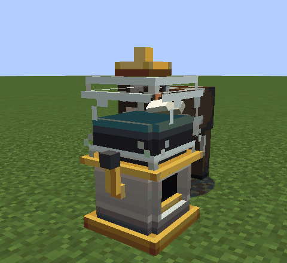

*The Leech Jar sampling a cow beside it, every 30 seconds by itself.*

The **Leech Jar** (glass all round, a Surgical Steel Ingot on top, a slime ball in the middle) is a mob farm's blood
bank: a gumball machine two blocks tall with a leech in the globe. Every 30 seconds it draws a sample from one
creature standing on it, beside it or just under it, for 0.5 damage (a quarter of a heart). Its samples are small:
quality 15-35 before the health rule. It never samples players, thick hides or the bloodless. It holds nine samples and
then stops. **Use** it to empty it into your inventory ("9 samples"), or pull them out with a hopper. It needs no
power.

When a creature stands beside it the leech wakes, turns to face it and presses against the glass. Each sample pops the
nozzle out, turns the crank and drops a vial into the window under the globe. Emptied, the crank turns twice and the
vials clatter out. Full, the leech sulks.

Like the syringes, the leeches never take a creature's last point of health: a farm is not a slaughterhouse.

### Centrifuge

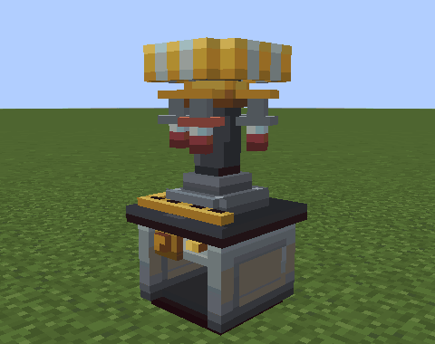

*The Centrifuge spinning samples: put Blood Samples in.*

**Centrifuge:** four Surgical Steel Ingots, Neuro-Copper Wire, two copper ingots, a Servo and redstone. Two blocks tall.

Put a Blood Sample in. Eight seconds and about 3,000 FE later you have a **DNA Fraction** of the same creature and
quality, and a **Plasma Vial**. Dragon's Breath spins into an Ender Dragon DNA Fraction of quality 60 and an empty
bottle. It holds 20,000 FE (up to 1,000 FE a tick). A full output or a flicker of power pauses it ("Paused: output
full", "Paused: no power"); it carries on where it stopped. Hoppers can feed and empty it.

The rotor spins up and its four hangers swing out as it gathers speed. Load one to three samples and it runs lopsided,
wobbling, with "PLEASE BALANCE ROTOR" on its side; four run smooth. The drawer slides out while its screen is open, and
a flag goes up when there is something to collect.

### DNA Sequencer

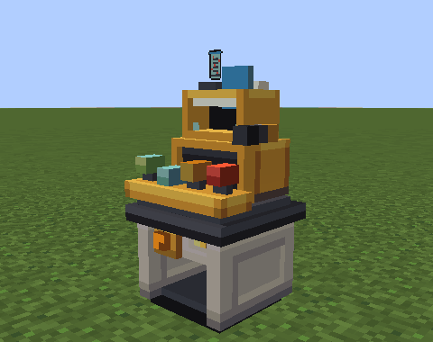

*An auto-read: put a DNA Fraction in and press **Auto**.*

**DNA Sequencer:** four Surgical Steel Ingots, a Lens, two copper ingots, a Synapse Chip and redstone. A cash register,
two blocks tall. Holds 40,000 FE (up to 2,000 FE a tick).

Put a DNA Fraction in. There are two ways to read it, and each read uses up the fraction:

- **Auto.** Press **Auto**: it reads one fraction every 10 seconds for 4,000 FE at 60% accuracy, and keeps going while
  fractions arrive. Press **Auto** again to stop.
- **Call the bases yourself.** Twelve letters scroll across the screen. Call each in turn with the **A**, **C**,
  **G** and **T** buttons (the same letters on the keyboard work while the screen is open). When the twelfth is in,
  the read happens at once for 4,000 FE: accuracy 50%, plus 50% scaled by how many you called right. "Called 11 of 12
  bases". A jar fitted with a **Cortex Coprocessor** gets one miscall forgiven.

Each base read rings up on the register: its key goes down, the crank turns and the call flag shows the base, and the
receipt grows. A read you call tallies its tabs, right and wrong. At the end the receipt is torn off and the cash drawer
rings. Anyone watching sees the keys you strike in the screen.

**How the library grows.** Each read adds, to every gene the creature carries:

> quality x accuracy x 25% / the number of genes the creature carries

So an auto-read adds 15% of the sample's quality, a perfect call 25%. A quality-80 sample of a one-gene creature adds
12% per auto-read: three reads to a Draft. A two-gene creature (a bat, a cave spider) splits it. A gene stops at
100%. The screen shows the fraction's genes with your current percentage.

| Library | Band | Gene works at | Stability cost |
|---|---|---|---|
| under 30% | not usable | - | - |
| 30% or more | **Draft** | 50% | x1.5 |
| 60% or more | **Working** | 75% | x1.2 |
| 100% | **Complete** | 100% | x1 |

The library belongs to your scoreboard team, or to you alone if you have none. Teammates share every percentage. A
read is filed with whoever last pressed a button on the machine. Reading any legendary gene to 100% earns **Legendary
Genes**.

Refusals: "Nothing to read. Put a DNA Fraction in the slot." and "This creature isn't in this world. Take the
fraction out." (a fraction from a mod that is not installed; nothing is spent).

### Gene Splicer

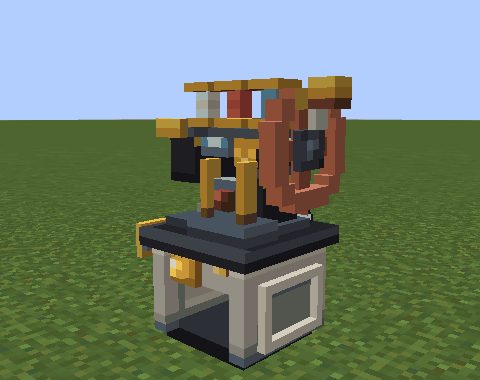

*A splice under way: pick genes, load gel and a bottle, press **Splice**.*

**Gene Splicer:** two Lenses, a Synapse Chip, four Surgical Steel Ingots, a brewing stand and redstone. A sewing
machine, two blocks tall. Holds 40,000 FE (up to 2,000 FE a tick).

The screen has three strand rows. **Use** the arrows on each row to cycle through every gene your library holds at
Draft or better; names are coloured by band. Load the slots: an optional **catalyst**, a **Bio-Gel**, a glass
bottle. Read the numbers, then press **Splice**. A splice takes 60 seconds and about 20,000 FE, uses one catalyst, one
Bio-Gel and the bottle, and makes a **Serum Cassette**. The first earns **Splice of Life**.

Each gene picked lifts its spool, threaded in the gene's colour. Splicing, the wheel turns, the needle stitches and the
spools turn; a riskier strand makes the stitch catch now and then, and a bell rings at each quarter. At the end the
wheel coasts, hiccups once or twice for a risky strand, and the cassette pops up.

- **Stability** starts at 100. Each gene costs its stability cost times its band's factor. Conflicting pairs cost 15
  more, synergy pairs give 10 back, the catalyst adds its bonus. It stays between 0 and 100.
- **Mutation** odds on injection: none at 60 stability or more, then 1.5% per point below 60 (60% at 20, 90% at 0).
  Both numbers show before you commit.
- **Load** shows against the lightest target that takes it: "Load 3/3 (body)", "Load 5/6 (host)", "Load 8/8
  (Chimera)". Over 8 it will not splice.

| Conflicts (-15 each) | Synergies (+10 each) |
|---|---|
| Blaze Core + Gills | Spider Climb + Venom Sac |
| Blaze Core + Axolotl Regrowth | Ender Blink + Echolocation |
| Ender Blink + Golem Frame | Blaze Core + Strider Soles |
| Creeper Gland + Turtle Shell | Glow Cells + Cat Eyes |
| Cat Eyes + Echolocation | Golem Frame + Hoglin Tusks |

**Catalysts:** Nether Star +40, Echo Shard +20, Amethyst Shard +10, Slime Ball +5. A Cleric on staff adds 10 more.

**Bio-Gel:** a slime ball between two Plasma Vials makes two.

Refusals, among others: "No genes picked. Pick at least one with the arrows.", "Ender Blink is already in the
strand. Pick another gene.", "Out of Bio-Gel. Load some in the second slot.", "The last Serum Cassette is still in.
Take it out first.", "Splicing in progress. Wait for the cassette." Taking the gel or bottle out mid-run pauses it.

The cassette's tooltip lists each gene and its strength, then "Stability, load, mutation".

### Injecting


*The rig's arm swinging out: press **Inject** standing at the rig with your body on.*

**Your own body: the Injection Rig.** Six Surgical Steel Ingots around a Syringe, a Servo below. Two blocks tall.
Holds 20,000 FE (up to 1,000 FE a tick). Put the cassette in, stand at the rig with your body on (**body** or
**linked**), press **Inject**. The arm swings the syringe out to you and the shot lands a second and a half later; move
more than a block in that time and it is called off: "Hold still: the shot was called off. Nothing was used." Each
injection costs 5,000 FE and 1 damage, and returns the glass bottle. Serums cannot be injected by hand into yourself:
"No self-injection by hand. Use the Injection Rig."
Refusals: "The rig injects bodies. Put your head back on, or link.", "Too heavy for this body. Splice a lighter
serum." (load over 3), "No room for another serum. A Gene Wash clears the body." (two already in), "The rig is giving
a shot. Wait for it." Refused at the jab, the rig withdraws the needle, its lamp goes red and nothing is taken.

**A host.** **Use** the cassette on a host, with your body on. One serum, load up to 6. A host's passive genes work in
it while it lives. Its active genes fire as a mecha's do: while **hosted**, hold **Sneak** with **Ability** or
**Secondary**, or press the key alone when the host has no ability of its own on it. The gene lines at the top left
list them on the keys they answer.

**A mecha.** **Use** the cassette on your own mecha. The **Chimera** has three Gene Ports, the **Executive** four, and
a **Bio-Integration Port** module adds one to any frame. Load up to 8 per serum, never rejected. Without ports: "This
mecha has no Gene Port. Fit a Bio-Integration Port at the Gantry." Not yours: "That mecha belongs to someone else". The genes stay with the
frame when it is taken apart at the Assembly Gantry. A mecha carrying five or more genes earns **Chimera**.

Anything else (a plain creature, another player, a Headless Body): "Serums go into hosts. Use the Injection Rig, or
make a host with the Surgical Saw."

**What can happen.** In a body or a host, a serum holding a gene whose blood does not match is rejected 30% of the
time: "REJECTED: the blood types fought", with nausea and poison, and the serum is lost. **Hero's Blood**, in the serum
or already in the body, stops rejection altogether. Then the mutation roll: "Serum accepted... with a mutation".
Mostly a nuisance; sometimes nothing takes at all ("DUD: the serum curdled. Nothing took.") and the serum is used up;
now and then something good. Otherwise: "Serum accepted". A serum holding a synergy pair earns **Synergy!**; a first
mutation **Mutually Assured**.

**Stacking.** The same gene in a second serum adds half again, a third a quarter, a fourth nothing.

**Firing active genes.** Your first active gene answers **Ability**, the second **Secondary**. The keys show at the
top left of the screen (for your body and a mecha). In **body** or **linked** form they always fire. As **pilot**,
they fire if the mecha has no utility modules; otherwise hold **Sneak** with the key. **Hosted**, the same with the
host's own abilities. A key that can't fire says why: "No active gene in this body. The Injection Rig can give it
one.", "Only one active gene here: Ender Blink, on (your **Ability** key).", "Ender Blink is still recovering. Give it
a moment.", "Guardian Eye needs something in reach to aim at."

### Gene Wash

**Gene Wash:** a milk bucket over two Plasma Vials with a glass bottle between them; makes two. Drink it with your
body on and every serum and mutation is gone: "Your genes are back to factory settings". A jar cannot drink: "A jar
has nothing to wash. Drink it with your body on." Hosts and mecha cannot be washed.

### All genes

Numbers are at Complete, one copy, in a mecha. Bodies and hosts get 70% of the marked (*) numbers. B = body,
H = host, M = mecha. "Foreign blood" means a player body may reject it (30%) unless it has Hero's Blood.

<details><summary>All 38 genes</summary>

| Gene | Carried by | Kind | What it does | Load | Takes it |
|---|---|---|---|---|---|
| **Spider Climb** | spider, cave spider | passive | climb walls; no fall damage while climbing | 2 | B H M |
| **Ender Blink** | enderman | active | teleport to the block you look at, up to 24 blocks; 3 s cooldown | 4 | H M |
| **Rabbit Spring** | rabbit | passive | jump strength +0.15* | 1 | B H M |
| **Strider Soles** | strider | passive | float up out of lava (no fire protection); foreign blood | 3 | B H M |
| **Phantom Membrane** | phantom, bat | passive | falling fast, hold **Sneak** to glide forward; no fall damage | 3 | B H M |
| **Dolphin Grace** | dolphin | passive | swim speed +100%* | 2 | B H M |
| **Equine Gait** | horse, camel, donkey, mule | passive | speed +15%* | 2 | B H M |
| **Breeze Updraft** | breeze (Ecto Trap) | active | fire a wind charge, 1.5 s cooldown; also no fall damage; foreign blood | 3 | B H M |
| **Gills** | squid, cod, salmon, drowned, tropical fish | passive | never run out of air underwater | 2 | B H M |
| **Golem Frame** | iron golem (Oil Tap) | passive | armour +4*, knockback resistance +50%*; foreign blood | 3 | B H M |
| **Turtle Shell** | turtle | passive | projectile damage -30% | 2 | B H M |
| **Blaze Core** | blaze, magma cube | passive | never burns, immune to fire; foreign blood | 3 | B H M |
| **Slime Body** | slime | passive | no fall damage; knocks back whoever hits you | 2 | B H M |
| **Wither Ward** | wither skeleton (Marrow Drill) | passive | immune to Wither; your hits wither for 3 s; foreign blood | 3 | B H M |
| **Cat Eyes** | cat, ocelot | passive | night vision (players) | 1 | B H M |
| **Glow Cells** | glow squid | passive | you give off light (level 10) | 1 | B H M |
| **Echolocation** | bat | passive | every 4 s, everything within 16 blocks glows for 3 s | 1 | B H M |
| **Venom Sac** | cave spider | passive | your hits poison for 4 s | 2 | B H M |
| **Pack Instinct** | wolf | passive | +1 damage per player or tame pet within 8 blocks, up to +3 | 2 | B H M |
| **Hoglin Tusks** | hoglin | passive | your hits toss the target up; foreign blood | 2 | B H M |
| **Guardian Eye** | guardian, elder guardian | active | laser at what you aim at within 16 blocks, 8* damage; 3 s cooldown | 4 | H M |
| **Creeper Gland** | creeper | passive | you explode when you die (no block damage) | 3 | B H M |
| **Axolotl Regrowth** | axolotl | passive | in water or rain, heal half a heart every 2 s | 2 | B H M |
| **Feather Bones** | chicken | passive | fall slowly, no fall damage | 1 | B H M |
| **Hero's Blood** | villager | passive | Hero of the Village (players); stops blood rejection; costs no stability | 1 | B H M |
| **Draconic Wings** | Ender Dragon | passive | a mecha carrying it can fly | 6 | H M |
| **Sonic Boom** | warden (Leviathan Needle) | active | sonic boom at what you aim at within 15 blocks, 10 damage; 15 s cooldown | 6 | H M |
| **Decay Aura** | wither (Marrow Drill) | active | fire a wither skull (2 s cooldown); hostiles within 6 blocks wither | 6 | H M |
| **Moa Wings** | moa (Aether) | passive | glide down slowly unless you **Sneak** | 3 | B H M |
| **Saci Whirl** | saci (Brazil Legends) | active | whirl 8 blocks along your look; 4 s cooldown | 3 | B H M |
| **Mule Fire** | headless mule (Brazil Legends) | passive | immune to fire; leave a fire trail that lights what follows you; foreign blood | 3 | B H M |
| **Frost Breath** | frostmaw (Mowzie's Mobs), iceologer (Friends & Foes) | active | freezing cone 9 blocks: 4* damage, slowness; 5 s cooldown | 4 | H M |
| **Mutant Might** | mutant zombie, mutant skeleton (Mutant Monsters) | passive | attack damage +3*, more knockback; foreign blood | 3 | B H M |
| **Pachyderm Hide** | elephant, rhino, hippo (Naturalist) | passive | armour +3*, knockback resistance +30%* | 2 | B H M |
| **Photosynthesis** | sunflower, marigold (Plants & Zombies) | passive | in sunlight, a little food (players) or healing | 1 | B H M |
| **Regrowth** | hydra (Twilight Forest) | passive | once every 10 minutes, a killing blow leaves you at 30% health | 5 | H M |
| **Blazing Soul** | Ignis (Cataclysm) | passive | landing from 3+ blocks: no fall damage, a ring of fire around you (4* damage) | 6 | H M |
| **Atomic Breath** | Godzilla (OreSpawn) | active | fire beam 24 blocks: 12* damage, sets it alight; heats a mecha hard; 15 s cooldown | 6 | H M |

Genes from other mods appear only when that mod is installed.

</details>

<details><summary>All 11 mutations</summary>

| Mutation | Effect |
|---|---|
| **Hiccups** | every 20-40 s on the ground, a small hop and a burp |
| **Clucking** | you cluck every 15 s |
| **Bioluminescence** | you give off light, like Glow Cells |
| **Brittle Bones** | fall damage x1.5 |
| **Photophobia** | 15% slower in open daylight |
| **Glass Jaw** | all damage taken +10% |
| **Gigantism** | 10% bigger |
| **Shrinkage** | 10% smaller |
| **Magnetic Personality** | iron ingots and nuggets within 4 blocks drift to you |
| **Hybrid Vigour** (rare) | max health +10% |
| **Chimeric Harmony** (rare) | Has no effect in this release. |

A Gene Wash clears mutations along with everything else.

</details>

## Board of Directors: heads at work

A head is too valuable to waste. Saw one off with an empty jar in your other hand (see the Surgical Saw) and the
**Jarred Head** finds work here. **Use** a block while holding the head to fit it; **Use** with an empty hand to take
it back.

### Turret Pedestal


*A Turret Pedestal swinging onto a zombie: fit a jarred mob head and give it power.*

**Turret Pedestal:** a hopper between two gold ingots, a dispenser between Surgical Steel Ingots, redstone at the
bottom between two more ingots. A brass gun mount, two blocks tall.

Fit a jarred mob head and the pedestal guards 16 blocks around it the way that mob fought. It runs on FE: 1 FE/t while
it watches, 10 FE/t while it has a target. It holds 40,000 FE (up to 2,000 FE a tick). With no head it draws nothing.


| Head | Attack | Every |
|---|---|---|
| Skeleton | arrow; needs arrows in a chest or other container under or beside the pedestal. With none it clicks and waits | 1 s |
| Stray | arrow with slowness (10 s) | 1 s |
| Bogged | arrow with poison (5 s) | 1 s |
| Blaze | fireball | 1.5 s |
| Guardian, Elder Guardian | locks on for 2 s, then a laser for 6 damage (3 hearts) | 3 s |
| Creeper | explodes when a hostile comes within 3 blocks; the head is spent | once |
| Zombie, Husk, Drowned | bites for 4 damage within 2.5 blocks | 1 s |
| Snow Golem | snowball; slowness on what it hits | 0.5 s |
| Witch | splash potion of Weakness | 3 s |
| Evoker | a line of fangs toward the target | 3 s |

It shoots only hostile mobs it can see, the nearest first: never through a wall. It never aims at its owner (whoever
placed it), other players (unless the server sets `pvpTurrets`, then only players not on the owner's team), tame
pets, villagers, iron golems or the owner's team, and its arrows, fireballs, splashes, fangs and blasts pass over all
of them.

The head's jar sits on the mount's cradle. With nothing to shoot it sweeps 60 degrees either side of its front; given a
target it swings round onto it and tilts to aim; without power it droops. Each shot kicks the barrel back, and each
head has its own: the blaze winds up with a flame at the muzzle, the zombie headbutts, the creeper hisses, the evoker
nods. A guardian's lock shows as a guardian beam from the muzzle to its target, warming from cold purple to yellow over
the two seconds while brackets close on the target, amber, then red; a ring flashes when the laser lands.

Refusals (the mount shakes its head): "A turret needs a brain. Fit a Jarred Head.", "That head (Pig) has nothing to
shoot with. Try a skeleton.", "This turret has its head (Skeleton). Take it out by hand first." Fitting a bow head
with no arrows in reach warns "No arrows in reach. Put a Chest of them under it."; a creeper head warns "A creeper
head goes off once and is spent. Choose the spot."

### Cerebral Array


*A fed Cerebral Array at work, the chairman's gavel lifting.*

**Cerebral Array:** a Life Support Jar between two Surgical Steel Ingots, Synapse Chips above and below, Neuro-Copper
Wire in the corners. A jury box of nine specimen jars with the chairman's desk on top, two blocks tall.

Up to nine jarred heads make FE by thinking very hard about broth. **Use** it to open the rack: nine head slots and a
tenth for the **Board Room Core**. Heads and the Core go in by hand only. Each head drinks 1 mB of **Nutrient Broth**
a second; **Use** a broth bucket on the Array or pipe it in (tank 8,000 mB, shown on the urn). No broth, no power.


| Head | FE/t |
|---|---|
| Zombie, Husk, Drowned | 20 |
| Villager, Zombie Villager, Wandering Trader | 40 |
| Witch, Piglin, Piglin Brute | 60 |
| Enderman | 80 |
| Wither Skeleton | 100 |
| Evoker | 120 |
| Any other jarred mob | 10 |
| Dragon Head (with the Board Room Core) | 300 |

- Fed, the heads sit up and bob a little and the chairman lifts his gavel every few seconds; unfed, they sag.
- Five or more heads hold a **Board Meeting**: output +10%, and every five minutes a vote: the gavel comes down, the
  jurors' cards flip up one by one, and the result is announced to everyone within 32 blocks: "[Board Meeting] Motion:
  dental cover. Carried 4 to 1." The Board can be heard murmuring.
- The **Dragon Head** is the vanilla one. It makes nothing without a Board Room Core, and only one sits at the head of
  the table: a second makes nothing.
- The Array holds 500,000 FE and pushes power into every machine touching its lower half. The screen shows broth, FE/t
  and heads.
- Advancements: **Board Meeting** (five heads at work) and **Brain Trust** (500 FE/t).

**Board Room Core:** four gold blocks, four Synapse Chips and a Nether Star. It does one thing: lets the Dragon Head
take the chair.

**Nutrient Broth Bucket:** a water bucket, beetroot soup, mushroom stew and sugar, shapeless.

### Employee Mount


*Payday at an Employee Mount: an emerald from the chest beside it.*

**Employee Mount:** four Surgical Steel Ingots and two iron ingots: a steel ingot in each top corner, an iron ingot
between two steel ones in the middle row, an iron ingot at the bottom centre. A small cubicle, one block tall.

Place it against a machine and **Use** it with a jarred villager. The villager works for that machine, for one emerald
a day, taken from any chest or container touching the mount (not the machine). **Use** the mount to check on them
("Librarian: on the job, paid up"); **Sneak** and **Use** with an empty hand to take them down. Only villagers apply:
"Staff positions are for a jarred Villager only." The first hire earns **Employee of the Month**.

Paid staff stamp forms at their desk, glance about now and then, and keep the day's emerald on the tray; payday comes
with a clink. Unpaid staff give half the bonus, hang their heads, and every two minutes pick up the phone to complain
("I was promised dental."). Three days unpaid and they face the wall. Nitwits do nothing, are never paid, and complain
anyway.


| Profession | Works at | Paid | Unpaid |
|---|---|---|---|
| Librarian | DNA Sequencer (Auto) | accuracy 90% | 75% |
| Cleric | Gene Splicer | stability +10 | +5 |
| Butcher | Leech Jar | samples x1.5 quality | x1.25 |
| Farmer | Cerebral Array | half the broth | three quarters |
| Fletcher | Turret Pedestal | fires 25% faster | 12.5% |
| Mason | Separation Chair | blade wear 3 per operation instead of 5 | 4 |
| Armorer, Weaponsmith, Toolsmith | Assembly Gantry repair | each plate a third further | about a seventh |
| Fisherman | Saline Mixer | 25% faster | 12.5% |
| Cartographer | Relay Mast | range +50% | +25% |

Shepherds and leatherworkers have no post in the company. A machine can take a mount on each side. On a two-block
machine a mount counts against either half, facing it, or standing on top of the machine; the Separation Chair and
the Assembly Gantry also take one on top.

### Neural Socket


*A jar plugging into a Neural Socket: as a jar, **Use** the socket.*

**Neural Socket:** redstone in the corners, Synapse Chips above and below, Neuro-Copper Wire either side of a Surgical
Steel Ingot. One block tall. It needs no power.

Its six redstone channels show as lit bars, one per face: on its four sides, a band under its cap (up) and its foot
(down). When a jar plugs in, or a head is fitted, the clamps rise round the jar, the jack plugs up into it and the bars
light once in turn.

**Plug yourself in.** In **jar** form, **Use** the empty socket. You sit on top in **socket** form and drive six
redstone channels, one per face:

- **scroll** picks a face, **Secondary** steps to the next;
- the hotbar keys set that face's level, 1 the lowest (level 1) and 9 full (15); 0 turns it off. Your hotbar stays
  where it was;
- **Ability** sends a full-strength pulse on it (the first earns **Ask Me Anything**);
- **Sneak** and **Jar menu** unplug: "Unplugged. Back to a plain jar."

The HUD shows every face's output and the signal it receives, how many items sit in touching inventories and how full
touching tanks are. You cannot move or use things while plugged in: "Plugged into the socket. Sneak with the jar menu
key to unplug first." If the socket is broken or you are moved away: "The socket let go. Back to a plain jar."

**Or let a mob head run it.** A jarred head runs a fixed program on all six faces:


| Head | Program |
|---|---|
| Zombie, Husk, Drowned | a 1 Hz clock: on half a second, off half a second |
| Villager | a staircase, 1 up to 15 in eight steps, one step every half second |
| Enderman | full signal while any player within 16 blocks looks straight at it |

Other heads have no program: "That head (Pig) has no program. Try a zombie, villager or enderman." A socket with
someone plugged in: "Steve is plugged in. Wait until they unplug." Refused, the open clamps hop, or the shut ones
chatter.

## Controls

Six keys of your own, under **Head in a Jar** in the Controls screen. Rebind them as you like; every line the game shows
uses the key you chose.

| Action (its name in the Controls screen) | Default | body | linked | jar | hosted | pilot | socket |
|---|---|---|---|---|---|---|---|
| **Jar menu** (Jar menu) | J | Refused: "Your head is still on. The jar menu is for a head in a jar." | Refused: "The jar menu is with your head. Swap to it first." | Opens the Jar menu | Opens the Jar menu | Opens the Jar menu; held with **Sneak** for a second, climbs out | Opens the Jar menu |
| **Ability** (Ability (jar, host, mecha, genes)) | R | Your first active gene | Your first active gene | Telekinesis: grab, or set down | The host's main ability (needs 50% sync); with **Sneak**, or when the host has none, the host's first active gene | The selected utility module; with **Sneak**, or with no utility fitted, the mecha's first active gene | Pulses the selected face at full strength |
| **Secondary** (Secondary (laser, host, mecha, genes)) | Mouse button 5 | Your second active gene | Your second active gene | Lacrimal Laser | The host's second ability (needs 75% sync); with **Sneak**, or when the host has none, the host's second active gene | Next utility module; with **Sneak**, or with no utility fitted, the mecha's second active gene | Next face |
| **Swap** (Swap body / head, open Cargo Hold) | Home | Refused: "Your head is still on. The Separation Chair sees to that." | Back into your head, at any signal | Out to your body, on a signal above 20% | Refused: "Not from up here. Get down first." | Opens the Cargo Hold | Refused: "Swap works from a jar or a body. Get down first." |
| **Drive** (Jar wheels / tip over) | V | Refused: "Nothing to drive on foot. Drive is for jars and mecha." | Refused: "Your body has legs. Walk." | Wheels down or up; without Wheels (or charge), tip over or sit up | Refused: "Not from up here. Get down first." | The frame's own move (see [Each frame's own move](#each-frames-own-move)) | Refused: "Plugged into the socket. Sneak with the jar menu key to unplug first." |
| **Collar zoom** (Collar zoom) | C | - | Zooms x3 while held, with a **Zoom Optic** on the **Collar Cam** | - | - | - | - |

A dash means the key does nothing there. For these keys, carrying your head counts as linked.

**Swap** defaults to Home and **Secondary** to mouse button 5 (a side button), keys no other common mod uses; until
0.4.0 they were K and G, which Curios also uses. A key you set yourself is kept. When one of the mod's keys shares
its key with another control, the game names the clash once when you join a world; with your head on, a press of
**Secondary** (with no active gene), **Swap** or **Drive** on a shared key is left to the other control and says
nothing. Rebind one of them if they get in each other's way.

Some details the table has no room for:

- **Ability** in a jar costs 500 FE per grab. Grabs that fail say why: "Nothing in reach to lift. Look straight at it.",
  "Machines and chests stay put. Lift a plain block.", "Too hard to budge. Pick something softer.", "Far too
  important to lift. Find something smaller." Lifting another player, their body, their placed head, their mecha or
  anything they ride needs their trust (see Commands). Without the module: "No Telekinesis Module fitted. Fit one from
  the jar menu (J)."
- **Secondary** in a jar fires the **Lacrimal Laser**: 4 damage (2 hearts) to the first creature within 8 blocks, not
  through blocks, 1,500 FE a shot, once a second. Otherwise: "The laser is still cooling. Give it a second." or "Not
  enough charge for the laser. Recharge at a Charging Dock."
- **Ability** and **Secondary** on a body's genes (yours, a host's, a mecha's) say why when nothing fires: "No active
  gene in this body. The Injection Rig can give it one.", "Only one active gene here: Ender Blink, on (your **Ability** key).", "Ender Blink
  is still recovering. Give it a moment.", "Guardian Eye needs something in reach to aim at."
- In a cockpit, **Ability** and **Secondary** run the mecha's utility modules. Hold **Sneak** with them, or fit no
  utility, and they fire the mecha's genes instead. With neither: "No utility module fitted. Fit one at the Assembly
  Gantry." The jar's own Telekinesis never works from a cockpit.
- **Ability** is also the Neural Handshake key (see [Hostile Takeover](#the-neural-handshake)).
- In a cockpit, **Drive** is the frame's own move; see [Each frame's own move](#each-frames-own-move).
- If **Ability** and **Sprint** share a key, a jar without Telekinesis, and a body with no active gene, take the press
  as a sprint. The first time the key does both, a line says so, once.

### Vanilla keys in the mod's forms

| Keys | Where | What happens |
|---|---|---|
| Hold **Sneak** + **Jar menu** for one second | pilot | Ejects you. The HUD counts "Ejecting... %". **Sneak** alone does not get you out of a mecha. |
| **Sneak** + **Jar menu** | socket | Unplugs: "Unplugged. Back to a plain jar." |
| **Sneak** | hosted | Gets you down. On a flier more than three blocks up: "Too high to get off Bat. Hold (your **Sneak** key) to fly down and off."; held, the flier sinks and lets you off low down. |
| **Sneak** + **Ability** / **Secondary** | hosted | Fires the host's own active genes instead of its abilities. |
| **Sneak** | pilot | Switches **Ability** and **Secondary** to the mecha's genes. On a Skitter holding a wall, lets go of it. |
| **Sneak** | hosted, on a shell | Gets you down: a Lunk sets the jar in front of it, a Rover or Spider Walker behind it (or to its right, left or front when behind is blocked). |
| **Jump** / **Sneak** | hosted, on a flier | Up / down. |
| **Jump** in the air | pilot, with **Jump Jets** | A mid-air burst, three per landing. Spent: "Jets spent. They refill when you land."; venting or flat, the usual venting and flat-battery lines. |
| **Jump** | pilot | Jumps (with Spring Heels, higher; on a Kite that is only with a flat battery, since a charged Kite takes off instead). The Wheelhouse cannot jump, nor a Colossus in Siege. Held: a Kite takes off and climbs, a Rocket Pack lifts, Glider Wings glide; hanging from a Skitter's Dragline, it pays the line out. |
| **Attack** | jar holding something with Telekinesis | Throws it. |
| **Attack** / **Use** | pilot | Left arm / right arm, with the shoulder hardpoint above it on a Colossus or Executive (in Siege, the shoulders alone). An empty arm: "Nothing fitted on that arm. Fit one at the Assembly Gantry." |
| **Attack** | hosted | The host attacks. |
| **Use** | hosted | Refused: "A host has no hands for that. Get down first." |
| **Use** / **Attack** | jar without a **Manipulator Arm** | Refused with a tap on the glass: "A jar has no hands. Fit a Manipulator Arm.", "A jar can't dig. Fit a Manipulator Arm.", "Glaring is not an attack. Fit a Manipulator Arm.", "Nobody trades with a jar. Fit a Manipulator Arm." Your own body, hosts, shells, mecha, boats and every Noggin & Sons block still answer. |
| **Use** / **Attack** | socket | Refused: "Plugged into the socket. Sneak with the jar menu key to unplug first." |
| **Sneak** + **Use** with the **Head Satchel** | carrying your head | Sets your head down. |
| Scroll | socket | Picks a face of the socket. |
| Hotbar keys (1 to 9) | socket | Set the picked face's redstone level: 1 to 9 give 1, 3, 5, 6, 8, 10, 12, 13 and 15. Your hotbar does not move. |
| 0 | socket | Turns the picked face off. |
| Any click | linked, signal under 20% | One in four is lost. The link bar shows "CLICK LOST". |
| Movement keys | after any change of form | Keys you were holding count as let go until you press them again. |


## Commands

Everything is under `/headoffice`.

<details><summary>All commands</summary>

| Command | Who | What it does |
|---|---|---|
| `/headoffice trust add <players>` | anyone | Lets those players open your corpse, handle your head and body, lift you, your mecha and whatever you ride with Telekinesis, and top up your jar. "%s may now handle your head and body", or "%s is already trusted" |
| `/headoffice trust remove <players>` | anyone | Takes that back. "%s is no longer trusted", or "%s was not on your trust list" |
| `/headoffice trust list` | anyone | "Trusted: ..." |
| `/headoffice courier` | anyone, as a jar or in a socket | Books the Courier, as the Jar menu's button does: your body is delivered to your head in 30 seconds, from anywhere, for a fifth of a basic jar's charge (20,000 FE by default), or all you have if less. Refused if your body is within 8 blocks, already on its way, or there is no body. |
| `/headoffice status` | anyone | Your form, link strength, where your head and body are (set down, in a Cradle, carried; standing or a corpse) with dimension and coordinates, and your charge, in your own language. |
| `/headoffice status <player>` | operators | The same for another player. |
| `/headoffice separate <player>` | operators | Takes the player's head off on the spot, with a new **Life Support Jar**, **Relay Goggles Mk I** and **Collar Cam**. No chair, saline or power needed. |
| `/headoffice restore <player>` | operators | Puts the player's head back on their body (the body must be loaded). |

</details>

## Configuration

The server values are per world, in `serverconfig/headinajar-server.toml` inside the world folder. The client values
are in `config/headinajar-client.toml`.

<details><summary>Server values</summary>

| Key | Default | Range | What it changes |
|---|---|---|---|
| `jar.maxCharge` | 100000 | 1,000 to 10,000,000 | FE a basic or Compact jar holds. A Reinforced jar holds 2.5 times this, an Executive jar 5 times. The Courier's fee is a fifth of it. |
| `jar.idleDrain` | 2 | 0 to 10,000 | FE per tick a jar spends keeping its head alive while you are the jar. 0 turns it off. |
| `jar.telekinesisRange` | 16 | 4 to 64 | How far Telekinesis reaches, in blocks. A hold lets go 8 blocks past this. |
| `jar.telekinesisMaxHardness` | 50.0 | 0 to 1,000 | The hardest block Telekinesis can lift (obsidian is 50). |
| `booth.energyPerOp` | 40000 | 0 to 1,000,000 | FE one separation costs. The chair won't start until its buffer holds all of it. |
| `booth.botchEnabled` | true | true / false | A worn blade can botch the cut and leave your view upside down for 30 seconds. |
| `link.goggleRanges` | 48, 160, 640 | whole numbers above 0 | Link range in blocks for Relay Goggles Mk I, II and III. |
| `link.portalRule` | block | block / break | A linked body without its head at a portal: `block` stops it ("Your body can't leave your head behind. Carry it in a Head Satchel."), `break` lets it through and the link breaks. Carrying your head, or an Entangled Pair, lets you through either way. |
| `link.allowManualUnlink` | true | true / false | Whether **Swap** may take you out of your body at any signal. Off: "This server doesn't allow swapping out. Walk back to your head." |
| `life.linkLossInventory` | corpse | corpse / keep / vanilla | When a linked body dies: `corpse` keeps your things on the corpse, `keep` leaves them with you, `vanilla` drops them. |
| `life.salineDrainSeconds` | 12 | 1 to 3,600 | Seconds per mB of Cranial Saline a head uses out in the world. Docked and carried heads use none. A Saline Recycler doubles it. |
| `life.protectOfflineBodies` | true | true / false | Idle bodies, corpses and placed heads of offline players can't be hurt. |
| `genetics.pvpTurrets` | false | true / false | Turret Pedestals may shoot players who are not on the owner's team. Off, their shots and blasts pass over players. |
| `genetics.keepGenesOnDeath` | true | true / false | Spliced genes stay in your body when you die and respawn. |

</details>

<details><summary>Client values</summary>

| Key | Default | Range | What it changes |
|---|---|---|---|
| `photosensitive` | false | true / false | No flashing, tearing or static bursts in the link HUD; signal effects are shown as text. The swap is a plain crossfade. Also stops all camera movement from the mod's effects, and keeps the rest of the mod's motion small. |
| `staticIntensity` | 100 | 0 to 100 | How strong the link's static and scanlines are, in percent. |
| `handshake` | true | true / false | Play the Neural Handshake when first boarding a host. Off: a flat 5% sync. |
| `doloresVoice` | true | true / false | DOLORES speaks her lines aloud. Off: her lines show as text only. |
| `screenShake` | 100 | 0 to 100 | How much the mod's effects may move the camera (shake, kicks, field-of-view pulls), in percent. It also tones down, to no less than about a third, how much bodies, jars and tools in hand move. |
| `memos` | true | true / false | DOLORES's memos: a line in chat with a beep, the first time something new happens. Off: none are shown, and those missed are not sent again. |
| `hudNumbers` | false | true / false | Keep the numbers beside the jar's bars up all the time. Off: they show while a bar is under a quarter, while you hold **Sneak**, and for three seconds after a change. |

</details>

## Advancements

Thirty-seven, in their own tab, starting at **Orientation Day**, which every employee is given the moment they
arrive. The steps from there to your first mecha are a career ladder: each says what to do next.

<details><summary>All advancements</summary>

| Advancement | Follows | How you earn it |
|---|---|---|
| **Orientation Day** | - | Arrive. Given on your first moment in the world. |
| **Steel Yourself** | Orientation Day | Get a **Surgical Steel Ingot** into your inventory. |
| **Stay Hydrated** | Orientation Day | Get a bottle of **Cranial Saline** into your inventory. |
| **Meat-Based Economy** | Steel Yourself | **Use** meat on a **Galvanic Pile**. |
| **Take a Seat** | Meat-Based Economy | Place a **Separation Chair** beside a fed **Galvanic Pile** (fuel in it, or power made), or feed a pile next to a chair. |
| **Signed in Triplicate** | Take a Seat | Sign Form 27-B in the **Separation Chair**. |
| **Head Start** | Signed in Triplicate | Have the chair's cut go through. |
| **Some Assembly Required** | Head Start | As a jar, fit a module from the **Jar menu**. |
| **Hands-Free No More** | Some Assembly Required | Fit a **Manipulator Arm**. |
| **Plugged In** | Head Start | Charge your jar: a fed Charging Dock, a Cradle, or redstone in the feed slot. |
| **Hands-On Management** | Head Start | Carry your own head in a **Head Satchel**. |
| **Back on Your Shoulders** | Head Start | Put your head back on with a **Suture Kit**. |
| **Cutting Remarks** | Head Start | Get a botched cut. |
| **Have You Tried Turning It Off and On Again** | Head Start | Lose the neuro-link while linked. |
| **Headless Horseman** | Head Start | Mount a horse, donkey, mule, llama or camel while linked. |
| **Head and Shoulders Above** | Head Start | Fit a **Periscope Stalk** to your Collar Cam. |
| **Hostile Takeover** | Head Start | Board a mob host as a jar (shells and mecha don't count). |
| **Fully Synced** | Hostile Takeover | Reach 100% sync with a host. Sync grows 1% per 12 seconds of riding. |
| **Mula-sem-cabeça** | Hostile Takeover | Board the Headless Mule. Needs the Brazil Legends mod. |
| **Temp Agency** | Head Start | As a jar, climb into a Lunk, Rover or Spider Walker. |
| **Facilities Request** | Steel Yourself | Place an **Assembly Gantry**. |
| **Corporate Ladder** | Facilities Request | Assemble a mecha at the Assembly Gantry. |
| **Corner Office** | Corporate Ladder | Climb into a mecha's cockpit. |
| **Golden Parachute** | Corporate Ladder | Be thrown clear by your mecha's Golden Parachute: below 10% health, or wrecked. |
| **Frequent Flyer** | Corporate Ladder | Pilot a Kite in the air for 30 seconds in all. The time adds up over every flight of that Kite and does not reset when you land. |
| **Heavy Is the Head** | Corporate Ladder | Board a Colossus or an Executive. |
| **Chairman of the Board** | Heavy Is the Head | Assemble an Executive. |
| **Out for Blood** | Orientation Day | Draw 10 Blood Samples. |
| **Splice of Life** | Out for Blood | Have a Gene Splicer finish a serum from your library while you are within 16 blocks. |
| **Mutually Assured** | Splice of Life | Suffer a mutation from a serum. |
| **Synergy!** | Splice of Life | Inject a serum that holds both genes of a synergy pair. |
| **Chimera** | Splice of Life | Inject a serum into a mecha that leaves it carrying five or more genes. Any frame counts. |
| **Legendary Genes** | Splice of Life | Read a Legendary gene to 100% in your library. |
| **Employee of the Month** | Orientation Day | Hang a jarred villager on an **Employee Mount**. |
| **Board Meeting** | Employee of the Month | Be within 16 blocks of a fed Cerebral Array holding five or more heads. |
| **Brain Trust** | Board Meeting | Be within 16 blocks of a fed Cerebral Array making 500 FE/t. |
| **Ask Me Anything** | Orientation Day | Pulse a face from a **Neural Socket** with **Ability**. |

</details>

Advancements earned in an older world are kept.

## The Employee Handbook

Every new player is handed the **Employee Handbook** on their first day, once. It goes into the last free slot of
the hotbar, never the one in your hand (then your inventory; only a full one drops it at your feet). A lost copy is
crafted from a Book and a **Surgical Steel Blend** (shapeless, any crafting grid).

This is the Second Edition: ten chapters in the order you will need them (Orientation, Facilities, Life Support,
Separation, Life as a Jar, Getting Home, Temporary Staffing, Mecha Division, Research, Human Resources), 47 entries.
Alongside the explanations it carries the company's paperwork: Form 1-A, the shopping list for one operation; Form
27-B, the chair's checklist; Form 12-M, which frame takes how many of each module; Form 3-P, the pilot's warnings;
Form 9-H, which host does what; Form 31-E, villager staff. Two memos from DOLORES, five Incident Reports, and the odd
footnote from DOLORES. Every key is shown as you have bound it.

With Patchouli installed it is a Patchouli book of 95 pages, with crafting pages for the things you make by hand and
the items themselves on show. DOLORES's memos then end in a "[Handbook]" link that opens it at the right page
(`/headinajar_handbook <entry>` does the same).

Without Patchouli it is a written book from Noggin & Sons with the same text in 97 pages, recipes in
words, and a contents page whose chapter names take you there when clicked.

Both read in your game's language, English or Brazilian Portuguese.


## Other mods

None is needed. Each hook turns on only when its mod is there.

- **JEI:** an information page for every machine and most of the company's items: the Separation Chair, Life Support
  Cradle, Saline Mixer, Body Printer, Galvanic Pile, Leyden Jar, Tesla Node, Surgical Wrench, Charging Dock, Relay Mast
  and Mk II, Signal Jammer, Body Locker, Safety Placard, Assembly Gantry, Centrifuge, DNA Sequencer, Gene Splicer,
  Injection Rig, Leech Jar, Turret Pedestal, Cerebral Array, Board Room Core, Employee Mount, Neural Socket; the four
  jars; Cranial Saline and its bucket, the Glass Patch, the Suture Kit and the Replacement Blade; the Manipulator Arm
  and the Body Recall Beacon; the Surgical Saw, Syringe, Precision Syringe, Serum Cassette, Plasma Vial, Neural Lace
  and Embalming Fluid; the three Utility Shell chassis; the Entangled Pair, Quantum Knot, EMP Grenade and Jarred Head;
  and one shared page for all eight mecha frames. Every recipe shows up in JEI as usual.
- **Jade:** six lines, each can be switched off in Jade's settings. A mecha's battery, heat and mass against its load
  rating. A host's freshness and sync, and the abilities riding it would give, with the sync each opens at
  ("Abilities: Teleport (50%) Teleport (further) (75%)"). Your own set-down head's saline and glass, shown to you
  alone. Whose body or corpse this is. The genes any creature, player or mecha carries. The head working a Turret
  Pedestal, Employee Mount or Neural Socket, and a villager's profession ("On staff: Librarian").

  

- **Curios:** the **Head Satchel** can be worn in the belt slot and counts as carried there. Goggles count only on
  your jar, so the mod offers no Curios head slot for them (goggles left in one from an older world come back to
  you when you join: into your inventory, or your Ender Chest if it is full, or at your feet, where they never
  despawn; a line in chat says where).
- **Patchouli** (any version): the Employee Handbook as a Patchouli book, with recipe pages, and DOLORES's memos link to it.
- **Entity Model Features**, and packs built on it such as **Fresh Animations** (player extension): they keep
  animating you while you carry your head; only your arms stay on the jar. They do not animate a headless body, which
  keeps its own waiting, fidgets and fall, and a host's head stays hidden on a re-modelled creature too.
- **First-person arm mods** such as Punchy: while your head is in your arms, you see just your own two hands on the jar.
- **Camera Overhaul** and **Perception:** with either installed, the mod's own camera shake is halved.
- **Mobs that become hosts** (each needs its mod):
  - Aether: Flying Cow, Moa, Phyg
  - Brazil Legends: Capelobo, Headless Mule (takes a jar without any sawing), Mapinguari, Saci Pererê
  - Friends & Foes: Copper Golem, Tuff Golem, Wildfire
  - Mowzie's Mobs: Foliaath, Grottol
  - Mutant Monsters: Mutant Creeper, Mutant Enderman, Mutant Skeleton, Mutant Zombie
  - Naturalist: Alligator, Bear, Elephant, Giraffe, Komodo Dragon, Lion, Rhino, Tiger
  - OreSpawn: Baryonyx, Cryolophosaurus, Emperor Scorpion, Mothra, Spider Robot, T. Rex
  - Plants & Zombies: Chomper, Gargantuar, Peashooter, Sunflower
  - The Bumblezone: Beehemoth
  - Twilight Forest: Boar, Deer, Minotaur, Skeleton Druid, Troll, Yeti
- **Genes from other mods:** Moa Wings (Aether's Moa), Saci Whirl and Mule Fire (Brazil Legends), Frost Breath
  (Mowzie's Frostmaw, Friends & Foes' Iceologer), Mutant Might (Mutant Monsters), Pachyderm Hide (Naturalist's
  Elephant, Rhino, Hippo), Photosynthesis (Plants & Zombies' Sunflower, Marigold), Regrowth (Twilight Forest's Hydra),
  Blazing Soul (L_Ender's Cataclysm's Ignis), Atomic Breath (OreSpawn's Godzilla). Creatures from Twilight Forest,
  Friends & Foes and OreSpawn also carry some vanilla genes.

## Sounds

The mod brings its own sounds, and every one has a subtitle in English and Brazilian Portuguese. None borrows another
thing's subtitle any more: where the mod still plays a sound from the game, it is under a name that says what you
hear (no bees, beacons or anvils standing in). Below, sounds are named by their subtitles.

- **The Separation Chair**, for every move of the operation, from "Barrier lowers" to "Head plops in", and
  **DOLORES**, who talks you through it aloud in English or Brazilian Portuguese (whichever your game is in). The
  patient hears her muffled. Her volume is the Voice/Speech slider in Music & Sounds, and `doloresVoice` in the client
  config turns her off; her lines still show on screen. A memo from her arrives with "DOLORES sends a memo".
- **The company jingle** ("Noggin & Sons jingle") when an operation ends and when the Body Printer finishes a body; a
  botched operation gets "Jingle goes wrong"; and when your jar runs flat, you alone hear "Jingle signs off". The
  "Desk bell dings" after the saw's cut, an embalming and a suture.
- **The head and the body:** a head popping off ("Head pops off"), the Surgical Saw ("Surgical Saw cuts", "Saw snips
  through"), a jar locking onto a host and letting go ("Jar locks on", "Jar unlocks"), the handshake's jingle and its
  buzz (heard only by you), a body powering down and up and slumping ("Body slumps"), the flies round a ripe host
  ("Flies buzz"), a syringe jab, a serum taking or being rejected ("Serum takes", "Body rejects serum"), and the jar's
  glass ("Jar glass takes a knock", "Jar glass patched", "Jar shatters"; a badly cracked jar "Jar drips").
- **A jar getting about:** its Wheels folding down and away ("Jar wheels fold down", "Jar wheels fold away") and
  whirring faster as it drives ("Jar wheels whir"), a jar tipping over, rolling and righting itself ("Jar tips over",
  "Jar rolls", "Jar rights itself"), the Propeller ("Propeller whirs"), Hop Springs ("Hop Springs release", "Jar
  lands"), and the Shock Lid ("Shock Lid zaps").
- **The link, heard in your head:** a weak link is static that follows its strength: "Link hisses" under 70%, "Link
  crackles" under 40%, "Link breaks up" under 20%, swelling at the very moments a click is lost; then "Link lost" and
  "Link restored". `staticIntensity` in the client config and the Noise Filter turn it down with the picture's static.
  Swapping, Telekinesis taking hold, humming, throwing and letting go, the Lacrimal Laser and arcing Tesla Nodes have
  their own sounds too.
- **The Neural Socket is a switchboard:** "Switchboard connects" when a jar plugs in and "Switchboard disconnects"
  when it leaves, a click for each channel switched on or off ("Socket channel on", "Socket channel off"), each face at
  its own pitch. A zombie head in it ticks once a second ("Socket clock ticks") and groans now and then ("Socketed
  zombie groans").
- **Every company machine at work**, from the Galvanic Pile's press to the Cloakroom's bell, and its refusal rattle; a
  turret locking on ("Turret locks on"). A room full of machines stays listenable: identical machines close together
  are heard as one, at most six machine sounds play at once, nearer and louder first, and idle sounds (a socket's
  clock, an unpaid employee's sigh) are rationed to a few a second. The company's big moments (the jingles, a mecha
  booting, the chair's cut) briefly turn the machines nearby down.
- **Every mecha frame and shell at work**, each with its own: footsteps, servos, the Hopper's pogo spring, the
  Bulwark's grab and throw ("Mecha cracks its neck"), the Colossus's knee spades ("Knee spades dig in"), the
  Executive's premium jingle and "Shoe taps impatiently", the Wheelhouse's engine and horn ("Horn: beep-beep"), the
  Skitter's line gun and reel, the Kite's wingbeats and talons, the Chimera's sniff and gulp ("Graft goes down well"),
  the Lunk's filing drawers ("Filing goes everywhere"); "Mecha powers up" ending on the company jingle, "Vents steam",
  "Jump jets fire", "Missiles launch", the Arc Cannon ("Arc Cannon charges", "Arc Cannon cracks", "Arc jumps"; no thunder),
  the Plasma Lance ("Plasma Lance burns") and the Tesla Coil ("Tesla Coil zaps"), "Hot metal ticks" on a hot machine,
  "Mecha sparks" on a damaged one, the Gantry's "Plating patched", the eject klaxon and the Golden Parachute's canopy; genes splicing, something
  mutating, the Board murmuring, staff complaining.
- **Answers:** "Noggin & Sons declines" when something is refused, "Noggin & Sons approves" when a lab machine
  finishes or the Body Locker takes a body, a tap on the glass when a bare jar reaches for something, a gurgle in the
  jar when a key has no module behind it, and, heard only by you, "Management coughs" for a warning and "Alarm sounds"
  when the next knock may be the last.

## Release notes

The notes for every release are also kept in [CHANGELOG.md](CHANGELOG.md).

### What's new in 0.5.0

- **The mecha line, rebuilt.** All eight frames and the three Utility Shells are fully animated, from the build on
  the Assembly Gantry, module by module, to the collapse when wrecked, with your jar in the seat and every module on
  its socket. **Drive** in a cockpit is each frame's own move: the Hopper's Pogo Protocol, the Bulwark's Heavy Lifting,
  the Colossus's Siege, the Executive's premium jingle, the Wheelhouse's Rush Hour, the Skitter's Dragline, the Kite's
  Talon Lift and the Chimera's Graft. The Lunk holds what it tosses overhead first.
- **The Golden Parachute is a real parachute**: a klaxon, the restraint blown open, a gold canopy (or a tangle, with no
  room overhead) and a letter from the company.
- **Mecha modules that now do what they say**: the Signal Booster carries your link like a walking Relay Mast, the
  Bio-Scanner reads out the creature under your crosshair, Anchor Clamps grip the ground against knock-back, and
  shoulder hardpoints fire with the arm below them (alone in Siege). The Gantry and the HUD say when a mecha is built
  over its load lock; parked mecha no longer vent at passers-by; servers that forbid flight no longer kick pilots of
  flying, swinging or leaping mecha.
- **Every sound says what it is.** Every sound the mod plays has its own subtitle in both languages, and none borrows
  another thing's: the company jingle ends an operation and a printed body (no more level-up ding), a desk bell after
  the saw, a jar's wheels, roll, propeller and Hop Springs are heard, a weak link is static in your head that worsens
  with it, the Neural Socket clicks like a switchboard, and the Arc Cannon cracks instead of thundering. A room full of
  machines is heard as at most six sounds, identical machines together as one.
- **Parked mecha cost a tenth to draw**, kept as a copy of their look while nobody is aboard; boarding shows only the
  mod's own climb-out line, never the game's "Press ... to Dismount".
- **The Assembly Gantry, rebuilt.** A turntable and a welding arm: the arm welds each module home as the frame builds
  itself, the turntable presents the finished machine to whoever pressed Assemble, Repair ends with a weld pass and a
  charge lead from the reel, and Take apart is the arm's work with a wrench. Its lamp says ready, waiting, working,
  short of power or no.
- **Arms at work.** Every beam leaves its tool's muzzle and lands where you aim: the Plasma Lance (with a dimming
  visor), the Arc Cannon's jumping bolt, the Tractor Beam's ribbons, the Flamethrower's jet, the Welding Torch's arc.
  Each tool spins, kicks, braces, strikes or guards as it should, a fist's blow lands when the arm gets there, and the
  Manipulator Hand shows what it holds. A hot mecha's vents glow and its metal ticks; a damaged one sparks, smokes and
  limps.
- **DOLORES pages you.** The first time something important happens (your first day, your first moment as a jar
  with no hands, your head left out to dry, low charge, your first host, your first mecha), a memo arrives in chat
  with a beep, naming your keys and, with Patchouli, linking to the handbook page. `memos` in the client config turns
  them off.
- **A career ladder.** Twelve new advancements lead from your first ingot to your first mecha, each saying what to do
  next; **Orientation Day** is yours the moment you arrive.
- **The Employee Handbook, Second Edition.** Ten chapters in the order you need them, with the company's forms, memos
  and incident reports. Without Patchouli the written book has the same text page for page, with a contents page you
  can click. The first-day copy goes into your hotbar, not your hand.
- **A clearer screen.** The jar's three bars carry their own marks, a low bar is hatched as well as red, and the
  numbers show when they matter (`hudNumbers` keeps them up). The link bar points to your other half. The host, mecha
  and gene panels share one column at the top left, clear of chat, and the Neural Handshake's ring sits above the
  jar. Tooltips name the keys as you bound them, the Jar menu explains its slots, JEI has pages for some thirty more
  items, and Jade shows a host's abilities and your own head's saline and glass.
- **Taking a body, made visible.** The saw pops a head like a cork, the body shakes itself or pats the air where its
  head was, a jar locks onto a host with a brass bayonet collar, the handshake plays the company jingle, and sync
  shows as rings down the body.
- **The Commute.** Swapping pulls the old view away, with a teal band up into the body or down into the jar; the body
  powers down and up with three beeps.
- **Your body waits for you**: at attention, then fidgeting, then sitting down; it turns to you, waves and holds out its
  arms. A body that dies falls over, HR sends a card, and your own corpse sends up a flare only you can see.
- **Ripe hosts slump, sway, stumble and draw flies.** Embalming goes in with a sparkle.
- **Every jar shows its life support**: the saline stands at its level in the glass, a lamp on the lid shows the
  charge, and failing glass is heard to crack.
- **New default keys: Swap is Home, Secondary is mouse button 5**, so neither shares a key with Curios any more.
  Keys you set yourself are kept.
- **Fliers fly.** A ridden bat takes off now (it used to stay asleep), and high up on any flier, holding **Sneak**
  flies you down and lets you off near the ground instead of dropping you.
- **The Body Locker guards what it holds.** A locker with someone's body in it breaks only for its owner or someone
  they trust, and it no longer takes power from cables. The Curios head slot for goggles is gone: goggles count only on
  the jar, and goggles left in it come back to your inventory, Ender Chest or feet.
- **Every key answers.** **Swap** and **Drive** with your head on and gene keys that cannot fire all say why; a host's active genes fire with **Sneak**; a key another mod also uses is named once when you
  join.
- **One set of rules.** The Lacrimal Laser stops at walls. Lifting someone's mecha, or anything they ride, needs their
  trust. The Shock Lid zaps with no glass left, the Saline Recycler works for a set-down head, and a jar resting in an
  empty Cradle is topped up. Flat wheels fold away and say so. The Leech Jar never takes the last point of health.
  Turrets need to see their target, and their shots and blasts spare whoever they would never aim at. A Neural
  Socket's hotbar keys reach level 1 and leave your hotbar alone. Employee Mounts count on either half of a tall
  machine. A laced body refuses Embalming Fluid and a second lace, and keeps them.
- **Fixed:** a host's head stays hidden under Fresh Animations and other re-modelling packs; a corpse no longer lies
  half under the ground; a renamed Head Satchel counts; a dud serum says it was a dud; `/headoffice status` speaks
  your language, and `/headoffice trust` says when nothing changed.
- Client and server must both be on 0.5.0.

<details><summary>What changed in 0.4.0, 0.3.0 and 0.2.0</summary>

### What's new in 0.4.0

- **The machine line, rebuilt.** All twenty-two company machines, from the Galvanic Pile to the Leech Jar, are working
  machines now: presses, paddles, dishes, shutters and spools move when they work, each has its own sounds, and a lamp
  on its front says ready, working, waiting or short of power.
- **Most machines are two blocks tall.** Leave the block above free when you place one ("No headroom. Needs two
  blocks of height."). Clicks, hoppers, pipes and cables work on either half. A machine from an older world under a
  ceiling keeps working at one block and takes its upper half within two seconds of the block above being cleared.
- **Every refusal shows on the machine**: a red lamp for two seconds and a rattle of the part concerned, with the line
  that says why. New lines: an empty Charging Dock, cooked food at the Galvanic Pile, an empty bucket at a Saline
  Mixer with too little saline.
- **The Body Locker keeps a body for its owner.** A body checked in from now on goes back only to whoever checked it
  in, or to someone they trust (`/headoffice trust`). Bodies already stored go to anyone, as before.
- **The Injection Rig takes a moment.** The shot lands a second and a half after **Inject**; step away and it is
  called off, with nothing used.
- **Machines that watch you.** Relay Masts turn their dishes along the link they carry, the Signal Jammer's turbine
  spins up when it cuts a link, a Turret Pedestal patrols and swings onto its target, and a placed Jarred Head turns to
  look at you.
- **Tesla Nodes face each other.** Each node's ball turns to its partner, the arc runs ball to ball, and a pair linked
  in an older world finds its sender on the first tick.
- **The Safety Placard's notices are painted on the board**, in English or Brazilian Portuguese with your game.

### What's new in 0.3.0

- **Telekinesis you can see.** A held creature, item or block hangs out in front of the jar where you can see all of
  it, joined to the jar by a glowing line, and swings and lags behind with its weight. The ability key sets it down,
  attack throws it, and the hold says why it ended when it runs out of charge or reach. A grab that fails says why
  (too heavy, a boss, a machine, nothing in reach). Lifting another player, their placed head or their body takes
  their trust: `/headoffice trust add`.
- **Effects for the big moments.** Swapping between your body and your head, the Lacrimal Laser, the arcs between
  linked Tesla Nodes and a guardian turret's lock beam are drawn properly now, most with their own sounds. `screenShake` in
  the client config (0-100) sets how much they may move the camera; the photosensitive option turns it off.
- **Warned before it costs you.** A jar's glass says every knock it takes, and warns at the last ones before a hit is
  a real death. A head left near fire, a jar smashed by a mob and a wrecked mecha all say what happened (a wrecked
  mecha throws you clear). The Syringe never takes a creature's last health, and a printed body that
  has to wait for you says so.
- **More clicks answer.** The company's items used at nothing or on a colleague say where they go; a friend you trust
  can top up your jar with a Saline Bottle or a Glass Patch; clicks while plugged into a Neural Socket say how to
  unplug; hitting your own placed head no longer cracks it.
- **The Neural Handshake now always starts when you first board a host** (it used to be skipped now and then), and
  the HUD says that the host's legs wait until it is done.
- **Hosts ride at a sensible pace.** A ridden cow, pig or other land creature now tops out near a sprint (a cow was
  nearly twice that). Horses and the other vanilla mounts are unchanged.
- **The chair:** a seated patient can reopen the panel with use, and DOLORES says so truly when your head is piped to a
  Cradle instead of the tray.

### What's new in 0.2.0

- **A new Separation Chair.** Rebuilt and fully animated: the barrier comes down, the hood scans you, the blade swings,
  and a claw carries your head over into the jar waiting on the chair's tray, then hands it to you. Everyone nearby sees
  the same operation at the same moment, even if they walk up halfway through. The chair needs a little room to its left
  and in front for the tray and the hood, and says so if something is in the way.
- **DOLORES speaks.** The chair's attendant talks you through the operation out loud, in English or Brazilian
  Portuguese (whichever language your game is in); the patient hears her muffled. Her volume is the **Voice/Speech** slider in
  Music & Sounds, and `doloresVoice` in the client config turns her off (the lines still show on screen).
- **Every click answers.** Things that used to do nothing when clicked now say why not and what to do instead, in one
  short line: a bare jar at a chest, the jar menu key with your head still on, a chair already in use, a Cradle with no
  power, and many more. A bare jar can now work every Noggin & Sons block with a menu or a status, while vanilla blocks
  still need a Manipulator Arm.
- **The handbook on your first day.** Every player is handed the Employee Handbook when they first join (players in
  existing worlds get theirs at their next login). A book and a Surgical Steel Blend make a new copy; without Patchouli
  it is a written book.
- **The power numbers, on one scale.** Mecha batteries are a quarter of their old size, and a mecha parked on the
  Assembly Gantry charges from it; Reinforced and Executive jars hold more charge than a basic one; shells, the
  Propeller, the Signal Jammer and idle turrets drain far less; only one Dragon Head counts in a Cerebral Array. Older
  saves load: a mecha charged above its new battery size starts full.
- **The jar crash is fixed.** Placed jarred heads, and turrets, mounts, Arrays and sockets holding a head, no longer
  crash the game when they come into view.
- **And more:** the Charging Dock charges a jar standing on it or a head set down on it; a Rover drives at a Rover's
  pace and a crash costs one knock, not the whole jar; held keys no longer carry over when your link breaks; getting out
  of a mecha or a shell puts you beside it; a weak link shows the clicks it drops; the Galvanic Pile, the Gantry, the
  Dock and the Cradle explain themselves in their tooltips; a key shared by Sprint and the ability is explained once.

</details>

## Building from source

Requires JDK 21.

```bash
./gradlew build
```

The jar lands in `build/libs/`. Gradle downloads everything the build needs, including the jars the optional
integrations compile against (JEI, Jade, Curios, Patchouli, Entity Model and Texture Features, Shoulder Surfing
Reloaded) from each project's own Maven repository, so the first build needs an internet connection. None of them is
needed to play: the mod requires only NeoForge and GeckoLib.

## License

All rights reserved for now.
