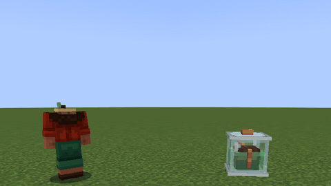
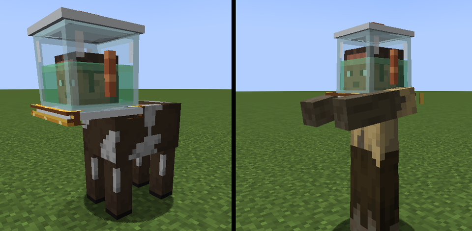
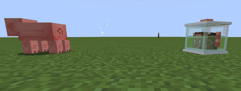
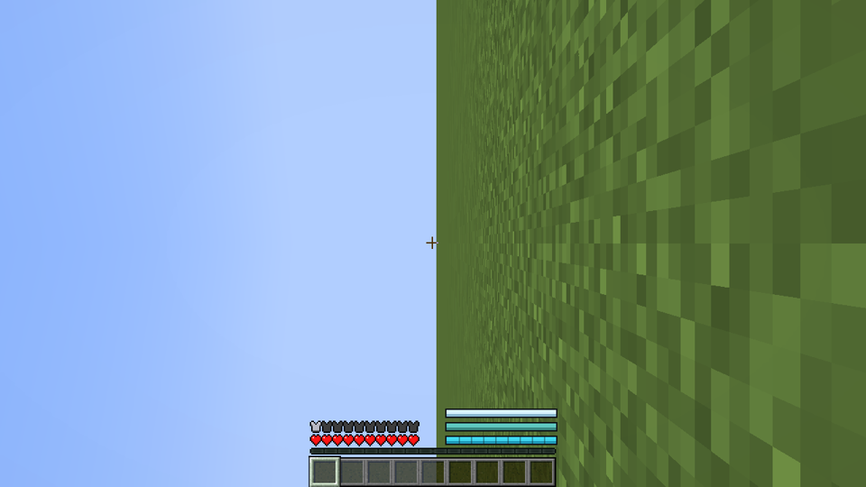

# Head in a Jar

*Head Office, Noggin & Sons' employee programme for the ambitious and the slightly unhinged.*

A Minecraft mod for **NeoForge 1.21.1**. Sit in the Separation Chair, sign Form 27-B, and lose your head on purpose. Your
head lives in a life-support jar; your headless body walks around on a wireless neuro-link while you see through a camera
on its neck. From there it gets stranger. Jars can ride the headless bodies of mobs, pilot mecha you build part by part,
splice genes from the creatures you sample, and put other people's heads to work.


*The operation, seen by a colleague (shown at double speed). Sit down with **Use** and hold **Sign**.*

Fully playable in **English** and **Brazilian Portuguese** (every line of text, the handbook, the advancements and
DOLORES's voice). This page describes release **0.3.0**.

## Requirements

- Minecraft **1.21.1** with **NeoForge 21.1.200** or newer.
- **GeckoLib 4.9.3** or a newer 4.x for 1.21.1 (required; GeckoLib 5 is not accepted).
- Install it on both the client and the server.
- Optional: Curios, JEI, Jade, Patchouli, Entity Model Features (see [Other mods](#other-mods)).

## How to read this page

New here? Read [Your first week at Head Office](#your-first-week-at-head-office): it takes you from a fresh world to
your first mecha. Lost in a strange body? [What can I do right now?](#what-can-i-do-right-now) says what each form can
and cannot do. Everything else is reference. Keys are named by their action (**Ability**, **Swap**, **Use**...); the
default key for each is in [Controls](#controls).

## Contents

- [Your first week at Head Office](#your-first-week-at-head-office)
- [What can I do right now?](#what-can-i-do-right-now)
- [The Separation Chair](#the-separation-chair)
- [Living with your head off](#living-with-your-head-off)
- [Jars and telepresence gear](#jars-and-telepresence-gear)
- [Power and life-support blocks](#power-and-life-support-blocks)
- [Jar modules](#jar-modules)
- [Hostile Takeover: mob bodies](#hostile-takeover-mob-bodies)
- [Utility Shells](#utility-shells)
- [Jarred heads](#jarred-heads)
- [Mecha Division](#mecha-division)
- [Genetics Department](#genetics-department)
- [Board of Directors: heads at work](#board-of-directors-heads-at-work)
- [Controls](#controls)
- [Commands](#commands)
- [Configuration](#configuration)
- [Advancements](#advancements)
- [The Employee Handbook](#the-employee-handbook)
- [Other mods](#other-mods)
- [Sounds](#sounds)
- [Release notes](#release-notes)
- [Building from source](#building-from-source)
- [License](#license)

---

## Your first week at Head Office

A walkthrough from a fresh world to your first jarred week. Every new employee is handed the **Employee Handbook**
on their first day. A lost copy is a book and a **Surgical Steel Blend**, shapeless.

### Day 1: Surgical Steel and parts

Shopping list before you start: iron, coal, bone meal, copper, redstone, glass, **amethyst shards** (a geode),
**slime balls**, **kelp**, sugar, leather, string, white wool, a piston, a lever, shears, a repeater. Later tiers need
nether quartz, gold, lapis, diamonds, ender pearls, netherite scrap, obsidian and tinted glass.

1. **Surgical Steel Blend**: iron ingot, bone meal and coal, shapeless. Smelt it (10 seconds) or blast it (5 seconds)
   into a **Surgical Steel Ingot**. Nine ingots make a **Block of Surgical Steel**, and back.
2. The parts. In every recipe on this page, "ingot" on its own means a Surgical Steel Ingot, and "gap" an empty
   square.

| Part | Recipe |
|---|---|
| **Neuro-Copper Wire** (makes 4) | copper ingot, redstone, copper ingot in a row |
| **Lens** | glass, amethyst shard, glass in a row |
| **Servo** | a piston on top; ingot, wire, ingot below |
| **Synapse Chip** | quartz, wire, quartz; gold ingot, lapis, gold ingot below (needed from Day 7: nether quartz) |

### Day 2: power and saline

- **Galvanic Pile**: six copper ingots, two wires and one rotten flesh (copper ring, wire above and below the flesh).
  **Use** meat on it to feed it: rotten flesh gives 4,000 FE, a spider eye 6,000, any raw meat or fish 3,000. It burns
  at 20 FE a tick and shares its power evenly among every machine touching it, taking turns over who goes first.
  **Use** it with an empty hand to see its stock. Hoppers can feed it.
- **Cranial Saline**: a water bottle, sugar, kelp and redstone, shapeless, make **two** bottles. You need **four** for
  the operation. A few spares are wise.

### Day 3: the kit

| Item | Recipe | What it is for |
|---|---|---|
| **Life Support Jar** | copper ingot on top; glass, slime ball, glass; ingot, redstone, ingot | Your new home. 3 module slots |
| **Relay Goggles Mk I** | leather, copper ingot, leather; lens, wire, lens | Worn by your head. 48 blocks of link |
| **Collar Cam** | a lens on top; wire, servo, wire; three ingots | Bolted to your neck. Your body sees through it |
| **Head Satchel** | string, leather, string; leather, gap, leather; three leather | Carry your own head with a perfect link |
| **Suture Kit** | string, slime ball, iron nugget, saline bottle, shapeless | Puts your head back on. Bring a spare |

### Day 4: the operation

1. Make the **Excision Head** (a Block of Surgical Steel on top; servo, lens, shears; a redstone block below) and the
   **Booth Console** (wire, glass pane, wire; ingot, repeater, ingot; wire below), then the **Separation Chair**
   (white wool, Excision Head, white wool; ingot, white wool, ingot; Booth Console, servo, lever).
2. Place the chair with your Galvanic Pile touching it. It needs **40,000 FE**: ten rotten flesh, about 100 seconds of
   burning.
3. Keep the room clear (left as the patient sits): the block to the left of the seat and the one above it (the jar tray), the block in front and
   the two above it, the front-left block one and two up, and the space above the chair.
4. **Use** the chair to sit down; its console opens. Load the jar, the goggles, the Collar Cam and four bottles of
   saline. Hold the **Sign** button for two seconds.
5. Watch. You can get up with **Sneak** until the cut. After that, DOLORES finishes.

You stand up in your own headless body, seeing through the Collar Cam. Your head is in its jar on the chair's tray,
to your left. If an empty **Life Support Cradle** stood within 3 blocks of the chair, your head was piped there
instead, and DOLORES says so. The bar at the top of the screen is your **link quality**.

### Day 5: living with it

- **Pick your head up.** With the Head Satchel on you, **Use** your jar. An empty hand hugs it in front of you; hold
  anything and it goes on your back. A carried head always has a perfect link and drinks no saline.
- **Or dock it** in a Life Support Cradle, filled with saline and powered. A docked head is safe and kept topped up.
- **Swap** between body and head whenever you like. Back into the body needs a link above 20%.
- **Feed the head.** A set-down head slowly drinks saline: 1 mB every 12 seconds, about 3 hours 20 minutes for a full
  basic jar. In jar form, the **Jar menu** has a feed slot for Saline Bottles, Glass Patches and redstone (5,000 FE a
  dust, 45,000 a block). A **Charging Dock** charges a jar standing on it.
- **Your body can die without you.** It becomes a corpse that keeps your things, and you wake up in your jar.

### Day 6: when it goes wrong

Walk too far and the link breaks: you wake up in your head. To get back:

- **Drive** tips a bare jar on its side to roll, very slowly. With the **Wheels** module it drives at half speed.
- **Courier**, in the **Jar menu**: your body is delivered to your head in 30 seconds, for 20,000 FE of charge.
- **Suture Kit** at your body, as a jar, sews the head back on for good.
- **Let go**, in the **Jar menu**, is the last resort: a real death, and you respawn whole.

### Day 7: what's next

- **Borrow a body.** Make a **Surgical Saw**, wear a creature down below a quarter of its health and saw its head
  off. As a jar, **Use** the standing body to climb on. See [Hostile Takeover](#hostile-takeover-mob-bodies).
- **Build a mecha.** **Mecha Plating** (8 ingots around an iron block, makes 2), an **Assembly Gantry**, a **Hopper
  Frame** and **Hydraulic Legs**, 10 kFE, Assemble; a **Galvanic Stack** keeps it charged. See [Mecha Division](#mecha-division).
- **Start the lab.** Syringe, Centrifuge, DNA Sequencer, Gene Splicer, Injection Rig. See
  [Genetics Department](#genetics-department).
- **Put heads to work.** Saw a head off with an empty Life Support Jar in your other hand. See
  [Board of Directors](#board-of-directors-heads-at-work).

---

## What can I do right now?

Head Office recognises six forms of employee, plus one carrying arrangement. Find yours.

| | **Body** (head on) | **Linked** (headless body) | **Carrying your head** | **Jar** (and Compact Jar) | **Hosted** | **Pilot** | **Socket** |
|---|---|---|---|---|---|---|---|
| How you get here | You start here | The Separation Chair; **Swap** from a jar | Linked, with a **Head Satchel** on you: **Use** your set-down head | **Swap** from linked; your linked body dies; the link breaks | As a jar, **Use** a host body or a shell | As a jar, **Use** your own mecha's cockpit | As a jar, plug into a **Neural Socket** |
| How you leave | Separation Chair | **Swap** (to your head); **Suture Kit** | Set it down (**Sneak** + **Use** the satchel), dock it, or sew it on | **Swap** to your body; **Suture Kit**; **Let go** | **Sneak** | Hold **Sneak** and press **Jar menu** | **Sneak** and press **Jar menu** |
| Walk | Yes | Yes (stutters on a weak link) | Yes | No. Tip over and roll, or fit legs, springs, wheels or a propeller | The host walks | The mecha walks | No |
| Break and place blocks | Yes | Yes | Yes | Only with a **Manipulator Arm** (half speed, 200 FE a block) | No | Through the mecha's arms | No |
| Attack | Yes | Yes | Yes | Only with an Arm (200 FE a swing, half damage) | The host's abilities | The mecha's arms | No |
| Use items in the air | Yes | Yes | Yes | Only with an Arm | No | No | No |
| Pick up items | Yes | Yes | Yes | Only with an Arm or a **Magnet** (Telekinesis lifts items but does not pocket them) | Same as jar | Same as jar | Same as jar |
| Open blocks | All | All | All | The company's machines only (see below); vanilla blocks need an Arm | None | None | None |
| Portals | Yes | **No**, unless you carry your head or your goggles and collar are entangled | Yes | Yes | As a ridden mob | Yes, except the Colossus and Executive (too big) | No |
| **Swap** | Nothing | Wake up in your head | Become a jar where you stand | Back into your body | "Not from up here. Get down first." | Opens the Cargo Hold | "Swap works from a jar or a body. Get down first." |
| Dying | A normal death | Not a death: your body becomes a corpse, you wake up in your head | Your body becomes a corpse, you become a jar on the spot | A real death | A real death | A real death | A real death |

A jar never gets hungry and cannot drown. A linked body cannot wear a helmet: it goes into your pockets.

Without an Arm, a jar can still work every Noggin & Sons block with a menu or a status: the Body Printer, Saline Mixer,
Charging Dock, Life Support Cradle, Galvanic Pile, Leyden Jar, Tesla Node, Relay Masts, Signal Jammer, Safety Placard,
Separation Chair and the other departments' machines. It can read them, not pour things into them: whatever it holds is
not used on the block. It can also **Use** its own body, a host or shell to climb onto, a boat or a minecart.

A **real death** in jar form ends the arrangement. Your modules, goggles and Collar Cam drop where you were. The jar
itself is not returned. Your idle body falls down for good. You respawn with your head on. A real death also happens
if, while linked, your set-down head is destroyed or dries out.

---

## The Separation Chair


The **Separation Chair** takes your head off and leaves your body linked to it. It is staffed by DOLORES, who is
professional about it.

### What it needs

- **Parts**: one jar (any of the four), one pair of goggles (any tier), one **Collar Cam**, four bottles of
  **Cranial Saline**. Hoppers and pipes can load it. Empty slots show what goes in them.
- **Power**: 40,000 FE stored before it will start. It holds 50,000 and takes up to 2,000 FE a tick. A Galvanic Pile
  touching it is the usual supply.
- **Room** (left and right as the patient sits): the block to the left of the seat and the block above that (the tray: a jar can't even be loaded with them
  blocked), the block in front and the two above it, the front-left block one and two up, and the space above the chair.

**Use** sits you down and opens the console. **Sneak** and **Use** with empty hands opens it without sitting. Anyone
clicking while someone is seated, and any jar, gets the console only. Only the seated patient can sign.

The console lists Power (40 kFE), Life Support Jar, Relay Goggles, Collar Cam and Cranial Saline x4, ticked or not, and
shows the blade wear. **Form 27-B**: hold the Sign button for two seconds. Let go or slide off and the pen lifts.

### What refuses

Only the first missing thing is named, in DOLORES's words:

| Missing | She says |
|---|---|
| Power | "Insufficient power. I refuse to stop halfway." |
| Jar | "Where would we put your head? Insert a Life Support Jar." |
| Goggles | "Relay Goggles required. You will want to see." |
| Collar Cam | "Collar Cam required. Your neck needs a hat." |
| Saline | "Four bottles of Cranial Saline, please. Heads get thirsty." |
| Your head is already off | "Our records show your head is already off." |
| Room | "The chair needs room to work. Clear the block in front." (or whichever) |
| Tray space, when loading a jar | "The jar tray can't come out. Clear the block to its left." |
| Not seated | "Sit in the chair to sign" |

Mid-operation, others are told "Operation in progress. Kindly wait behind the line." The chair cannot be broken until
it is done: "Not mid-operation. It comes apart once it is done." Broken when idle, it drops what it holds.

### The operation, beat by beat

Twelve seconds. Everyone nearby sees the same moment, even someone who walks up halfway through.

| Time | What a bystander sees and hears | What the patient sees |
|---|---|---|
| 0 s | "Thank you for choosing Elective Separation. Please keep your arms inside the chair." The barrier motors down and latches. | The edges darken |
| 1-3 s | "Administering a pleasant gas. Breathe normally. Or don't." The hood nods; pale green gas puffs from under the dome; three beeps | A green tint |
| 3-5 s | "Scanning. Please hold still. You have a lovely neck." A ring of light runs down over the face | A green line follows the ring |
| 5 s | "Commencing separation. This will not hurt for very long." From here there is no getting up | Fade to black |
| 5.3-6.7 s | A privacy curtain rises. "Privacy, please." | Black |
| 6 s | The blade. A ring of white smoke at the neck, a spark. Heard 24 blocks off. A helmet goes into your pockets | Black, and silent |
| 7-10 s | "Your head is now in a jar. Congratulations on your promotion." The jar's lid pops, the claw carries the head over, the goggles go on, the head drops into the jar and the saline rises | Black; muffled bubbling |
| 10.5-12 s | The Collar Cam is bolted on with three ratchet clicks; sparks on the antenna; the barrier lifts | The feed boots up: "NEURO-LINK 2.1 ... 100%" |

At the end you stand up in front of the chair, linked, a little dizzy for 8 seconds. DOLORES: "Neuro-link established.
Please collect your head on the way out." Or, if an empty Cradle within 3 blocks took it: "Your head has been piped to
the Cradle." Your jar starts full of charge, saline and glass.

### Getting up before the cut

**Sneak** before the five-second mark and the operation is called off: "Procedure cancelled. Your head remains
attached. For now." You keep every part. The chair keeps three quarters of its energy: a cancellation costs 10,000 FE.
After the five-second mark the restraints hold. A patient who leaves the game after the cut is finished at once.

### Blade wear and the botch

Each operation adds 5% blade wear (3% with a Mason on staff beside the chair). Above 80% the blade can botch: 10% odds
at 85% wear, rising to 40% at 100%. With no Mason, the first 17 operations are always clean. A botch: DOLORES says
"Oopsie.", your view is upside down for 30 seconds, your head floats upside down in its jar for as long, and the
Collar Cam is left **Crooked**, losing 10% of its range for good. A Self-Righting Gyro rights the view at once.

**Replacement Blade**: two Surgical Steel Ingots and a diamond, shapeless. **Use** it on the idle chair: wear back to
0. "New blade fitted. So shiny." Not mid-operation: "Not mid-operation. Change the blade afterwards."

### DOLORES

She speaks her lines aloud, in English or Brazilian Portuguese to match your game, in the **Voice/Speech** volume
slider; the patient hears her muffled through the anaesthetic. Her refusals are spoken at most once a sitting each.
`doloresVoice = false` in the client config keeps her to text.

---

## Living with your head off


### Link quality

The bar at the top of the screen reads LINK (percent), a ping, and the distance to your head (as a jar: to your body).

- **Distance**: full strength up to half your goggles' range, then falling evenly to nothing at the full range.
  Relay Goggles Mk I reach 48 blocks (perfect to 24), Mk II 160, Mk III 640, Quantum Goggles the whole dimension.
- **Range boosts**: Hub Antenna module x1.5 (while the jar has charge), Antenna Whip on the collar x1.25. A crooked
  collar x0.9.
- **What surrounds you** multiplies it: under water x0.6 (not with a Waterproof Seal), deep underground with no sky
  above and more than 16 blocks below the surface x0.8, a thunderstorm x0.85, a Nether portal within 8 blocks x0.7,
  the Warden's Darkness x0.5, Mining Fatigue III or worse x0.5.
- **Signal Jammer**: someone else's, within 16 blocks, x0.3.
- **Relay Masts**: your head reaches a mast within your goggles' range, masts reach each other, and the last mast
  reaches your body within its radius (96 blocks, Mk II 192). Each mast in the chain costs 3%.
- **Other dimensions**: no link at all, unless your goggles and Collar Cam are entangled (80%, before the rest).
- **Carrying your head**: always 100%.

A Life Support Cradle has no effect on the link.

**When it is weak**: scanlines thicken as the link falls. Under 40% your body stutters now and then and snow creeps in.
Under 20% "WEAK SIGNAL" blinks, your body stutters more, and one click in four is lost ("CLICK LOST" on the bar).
`staticIntensity` and `photosensitive` in the client config tone this down; the Noise Filter halves it.

**When it breaks**: at 0% for five seconds, or when your body leaves the dimension without an entangled link, you wake
up in your head. "Connection to body lost. Walk back to it, or book the Courier." Your body stays standing.

### Swap



*Swap, seen by a bystander: the mind goes from the jar to the body. Press **Swap**.*

- **Linked**: **Swap** wakes you up in your head at any signal. Your body is left standing, in its armour.
- **Jar**: **Swap** puts your head down where it stands (into a Cradle if you are sitting in one) and moves you into
  your body. It needs a body on file, not a corpse, a Collar Cam, and a link above 20%: "Signal at 18%. Get closer to
  your body or a Relay Mast." **Using** your standing body does the same.
- Not from a host, a mecha or a socket.

### Carrying your head

<!-- PIC: carry | a linked body hugging its jar in both arms -->

With a **Head Satchel** in your inventory (or on a Curios belt), **Use** your set-down head; to take it out of a
Cradle, **Use** the Cradle. Without a satchel: "You need a Head Satchel to carry your head".

With an empty hand you hug the jar in front of you, a hand on each side, your head turned round inside to look up at
you. Hold anything and it swings onto your back, looking out behind. Carried, the link is perfect, the head drinks no
saline, and portals let you through. Hits land on your body, not the jar. If your body dies, you become the jar on the
spot.

**Setting it down**: **Sneak** and **Use** the satchel: it goes down in front of you (at your feet against a wall), or
onto a Charging Dock you are looking at. **Use** an empty Cradle to dock it, or a Charging Dock to stand it on the plate.

### Your set-down head

No player can hurt it, you included: "That's your own head. Carry it in your Head Satchel instead." Mobs, explosions,
fire and lava can. Heat cracks one point of glass a second; anything else a point per point of damage. Each knock is
reported to you with what is left. While you are offline it is safe. A friend you trust can top it up.

### Saline

| Jar | Saline |
|---|---|
| Life Support Jar, Compact Jar | 1,000 mB |
| Reinforced | 1,500 mB |
| Executive | 2,000 mB |

A head out in the world drinks 1 mB every 12 seconds (half that with a Saline Recycler): a full basic jar lasts about 3
hours 20 minutes. A docked or carried head drinks nothing. A **Saline Bottle** adds 250 mB.

Run dry and "Your head is dehydrating! Find saline." Every 30 seconds after that the jar loses a point of glass; once
the glass is gone, a jar loses half a heart every 30 seconds, and **a set-down head dies for real**. A basic head left
dry dies five minutes after it runs out.

### Jar Integrity

The glass soaks up damage before you do. Life Support and Compact Jars have 10 points, Reinforced 20, Executive 30.
Any hit on a jar costs at least one point. The jar tells you: "The glass took a knock: 7/10 left." At 3 or fewer:
"the next bad knock is a real death". At 0: "No glass left: every hit now is real."

A **Glass Patch** mends 5 points. A Cradle mends one point every 10 seconds, for a head docked in it.

### Charge

| Jar | Charge |
|---|---|
| Life Support Jar, Compact Jar | 100,000 FE |
| Reinforced | 250,000 FE |
| Executive | 500,000 FE |

A jar spends 2 FE a tick just being alive (a full basic jar: about 42 minutes), plus whatever its modules use. A linked
player spends nothing. Charge it with redstone in the feed slot (5,000 FE a dust, 45,000 a block), on a **Charging
Dock** (500 FE a tick), or docked in a Cradle (up to 10,000 FE a second). Out of charge, powered modules stop: "The jar
is out of charge. Recharge at a Charging Dock."

### The Jar menu

**Jar menu**, in any jar form. Seven module slots; those past your jar's tier are shut. One of each module. A **feed
slot** for redstone, redstone blocks, Saline Bottles and Glass Patches (anything left over comes back when you close
it). The charge bar. Two buttons: **Courier** and **Let go**. As a linked body: "The jar menu is with your head. Swap
to it first."

### Getting about as a jar

**Drive** tips a bare jar on its side: it rolls at an eighth of walking speed and the world looks sideways. **Drive**
again sits it up. With the **Wheels** module, **Drive** drops the wheels instead (see Jar modules). A jar may also ride
a boat or a minecart.

### The Courier

From the **Jar menu** (or `/headoffice courier`), as a jar or in a socket. Thirty seconds later Noggin & Sons sets
your body down beside you, from anywhere, another dimension included. The fee is 20,000 FE, or all your charge if you
have less: it never refuses for charge. Refunded if the body can't be found, or if you stop being a jar first. Refusals:
"Your body is right here. Use it." (under 8 blocks away), "The Courier is already on its way. Thank you for waiting."
A corpse is delivered too: "one body, deceased".

### Body death and corpses

An idle body has 10 hearts and wears your chest, leg and foot armour. Killed, it lies down as a corpse.

When your **linked** body dies, it is not your death. It becomes a corpse holding your inventory and armour, and you
wake up in your head at full health: "Your body has died. You wake up in your head. A Suture Kit on the corpse brings
it back." `linkLossInventory` in the server config can keep your things with you, or drop them.

A corpse can't be hurt. You, in a body, can **Use** it to open its belongings, as can anyone you trust (and your
team). Anyone else: "They can let you in with /headoffice trust." As a jar at your corpse, **Use** it: a Suture Kit
anywhere on you or in the corpse is used and your head goes back on; with no kit, the belongings open so you can take
the parts for one (a Suture Kit is shapeless and fits your inventory's own crafting grid). A body that falls into the void leaves its corpse where it last stood.

### Putting your head back on

**Suture Kit**:

- **Carrying your head**: hold **Use** for 3 seconds.
- **As a jar**: **Use** the kit on your own body or corpse.

You are whole again, back where your body was. Your modules and an empty jar of the same kind come back; the goggles
and Collar Cam come back a little worn (upgrades and entanglement kept). You feel queasy for 30 seconds. From a corpse
you get all your things back and start on 3 hearts.

### Let go

The **Jar menu**'s **Let go** button, after a confirmation: "Your head gives up. You die, your modules drop, and you
respawn with a body." The jar is not returned.

### The Body Printer

Lost your body for good? The **Body Printer** prints a new one, Collar Cam fitted. Recipe: ingot, glass, ingot; servo,
piston, servo; ingot, redstone block, ingot. Load 16 rotten flesh, 8 bone blocks, 4 redstone blocks, 8 slime balls and
2,000 mB of saline (bottles, buckets or pipes), store 200,000 FE (it takes up to 5,000 FE a tick), then press **Print**
as a jar. A minute later the body stands in front of the printer: "Your new body is ready. It is a little damp." The new
body replaces your old one; an old standing body falls down. Refusals: "Bodies are for heads in jars. Come back
decapitated.", "Short 4 slime ball. Load it and press Print again.", "A print takes 200 kFE stored". If you have a
body on when it finishes, the new one waits in the vat until you are a jar.

---

## Jars and telepresence gear

### The jars



| Jar | Recipe | Slots | Charge | Saline | Glass |
|---|---|---|---|---|---|
| **Life Support Jar** | copper ingot; glass, slime ball, glass; ingot, redstone, ingot | 3 | 100 kFE | 1,000 mB | 10 |
| **Compact Jar** | a Life Support Jar alone in the grid (and back) | 3 | 100 kFE | 1,000 mB | 10 |
| **Reinforced Life Support Jar** | netherite scrap; tinted glass, Life Support Jar, tinted glass; obsidian. Fire-proof | 5 | 250 kFE | 1,500 mB | 20 |
| **Executive Life Support Jar** | shulker shell, Synapse Chip, shulker shell; gold block, Reinforced Jar, gold block. Fire-proof | 7 | 500 kFE | 2,000 mB | 30 |

The Life Support, Reinforced and Executive jars are roomy: your head turns right round inside. The Compact Jar is
head-sized: your head faces its front and the whole jar turns with it. A jar goes into the Separation Chair. You get it
back only from a Suture Kit.

### Relay Goggles

| Goggles | Recipe | Range |
|---|---|---|
| **Relay Goggles Mk I** | leather, copper ingot, leather; lens, wire, lens | 48 blocks |
| **Relay Goggles Mk II** | gold ingot, Synapse Chip, gold ingot; Mk I below | 160 blocks |
| **Relay Goggles Mk III** | diamond, Synapse Chip, diamond; ender pearl, Mk II, ender pearl | 640 blocks |
| **Quantum Goggles** | Quantum Knot, Mk III, Quantum Knot | the whole dimension |

**New goggles after the cut**: as a linked body, **Use** them on your set-down head or on the Cradle holding it. The
old pair comes back. A carried head has to be set down first.

### Collar Cam and its upgrades

**Collar Cam**: a lens on top; wire, servo, wire; three ingots. Without one on your neck you can't swap back into your
body.

Each Collar Cam takes up to **4** upgrades. **Use** an upgrade with a Collar Cam in your other hand, or, once your head
is off, as a linked body (it goes into the collar on your neck). "No Collar Cam to fit it to, or no room left (4
upgrades)".

<details><summary>The nine Collar Cam upgrades</summary>

| Upgrade | Recipe | What it does |
|---|---|---|
| **Wide Lens** | glass pane, lens, glass pane | A wider view (linked) |
| **Periscope Stalk** | lens over two iron bars | Your headless body stands at full height |
| **Night Optics** | lens over a golden carrot | Night vision (linked) |
| **Waterproof Seal** | dried kelp, slime ball, dried kelp | No link loss under water |
| **Shielded Housing** | iron ingot, lead, iron ingot | Immune to EMP |
| **Antenna Whip** | lightning rod over two copper ingots | +25% link range |
| **Noise Filter** | white wool, amethyst shard, white wool | Half the static |
| **Thermal Overlay** | lens over a glow ink sac | Living things within 24 blocks glow (linked) |
| **Zoom Optic** | lens, spyglass, lens | Hold **Collar zoom** for x3 zoom (linked) |

</details>

### Entangled Pair, Entangled Shard, Quantum Knot

**Quantum Knot**: eye of ender, echo shard, eye of ender; amethyst shard, Synapse Chip, amethyst shard; eye of ender,
amethyst shard, eye of ender. A rare ingredient.

**Entangled Pair**: Quantum Knot, end crystal, Quantum Knot. **Use** it to split it into two **Entangled Shards** that
share one state. Craft one shard with your goggles and the other with your Collar Cam. Do the collar before the
operation: it can't be changed afterwards. Entangled goggles and collar carry the link into other dimensions (80%), and
let a linked body use portals without its head.

### EMP Grenade

Two iron ingots, two copper ingots and a redstone block (iron above and below, copper either side). **Use** to throw.
Within 8 blocks of where it lands: linked bodies drop back into their heads ("EMP! The link is down"), jars lose half
their charge, mecha half their battery, turrets go dark. Shielded Housing protects you. Two seconds between throws.

### Head Satchel, Suture Kit, Glass Patch

- **Head Satchel**: two string and six leather. Carries your head (see Carrying your head).
- **Suture Kit**: string, slime ball, iron nugget and a Saline Bottle, shapeless. Stacks to 16. Puts your head back on.
- **Glass Patch**: a glass pane and a slime ball, shapeless. Stacks to 16. Mends 5 points of glass. **Use** it in the
  air while carrying your head or as a jar with an Arm, **Use** it on your set-down head, or put it in the feed slot.
  "The glass is sound. Keep the patch for later."

---

## Power and life-support blocks


**Use** any of these with an empty hand to see what it holds.

**Powering things.** Every Noggin & Sons machine takes FE (Forge Energy) from any side: a Galvanic Pile, Leyden Jar
or unlinked Tesla Node touching it, a linked Tesla Node, or another mod's cables. 1 kFE is 1,000 FE; mB is a
thousandth of a bucket.

<!-- PIC: tesla | x -->

| Block | Recipe | What it does |
|---|---|---|
| **Galvanic Pile** | six copper ingots, two wires, one rotten flesh | Burns meat into 20 FE a tick: rotten flesh 4,000 FE, spider eye 6,000, raw meat or fish 3,000. Holds 50,000. Shares its power evenly among every machine touching it. **Use** meat on it to feed it (a jar can't). Its fuel slot takes one stack of one kind of meat at a time. "The pile is full of rotten flesh. Let it burn some first." |
| **Leyden Jar** | wire; glass, copper block, glass; glass, ingot, glass | A 250,000 FE battery. Takes and gives 2,000 FE a tick, to every neighbour except other Leyden Jars |
| **Tesla Node** | lightning rod; wire, copper block, wire; three ingots | Sends up to 2,000 FE a tick to the node it is linked to, up to 16 blocks away, losing 5%. Unlinked, it feeds its neighbours. A crackling arc joins linked nodes and brightens while power flows |
| **Surgical Wrench** | a diagonal of three ingots with a wire | Links Tesla Nodes: **Use** the sending node, then the receiving one. **Sneak** and **Use** a node to unlink it. "Too far: nodes reach 16 blocks. Put one closer." |
| **Relay Mast** | lens; wire, ingot, wire; ingot | Relays your link 96 blocks. Holds 100,000 FE and uses 1 FE a tick (about 83 minutes on a full charge), even while its chunk is unloaded |
| **Relay Mast Mk II** | Synapse Chip; wire, Relay Mast, wire; gold block | As the Mast, 192 blocks |
| **Signal Jammer** | wire, Synapse Chip, wire; amethyst, ingot, amethyst; wire, redstone block, wire | Cuts other people's link to 30% within 16 blocks. Whoever placed it, those they trust and their team are spared. Uses 4 FE a tick |
| **Saline Mixer** | ingot, bucket, ingot; wire, cauldron, wire; ingot, redstone, ingot | 1,000 mB water + sugar + kelp (or dried kelp) + redstone + 2,000 FE over 10 seconds = 1,000 mB saline. Fills glass bottles (250 mB each) and buckets. Holds 4,000 mB of each |
| **Cranial Saline** | bottle: water bottle, sugar, kelp, redstone (makes 2); **Bucket of Cranial Saline**: an empty bucket on the Saline Mixer | 250 mB a bottle, 1,000 a bucket. A bottle tops up a jar; buckets and bottles fill the Cradle and the Body Printer. Poured out, it is a teal liquid you can swim in |
| **Life Support Cradle** | glass, gap, glass; wire, gap, wire; three ingots | Holds one docked head, safe from all harm. Each second it refills the head's saline from its 4,000 mB tank, gives up to 10,000 FE of charge (it uses 100 FE a second while occupied) and, every 10 seconds, mends a point of glass. The saline and glass work without power; the charge needs it. A docked head drinks no saline. Broken, it sets the head down. It does not change the link |
| **Charging Dock** | copper ingot, wire, copper ingot; ingot, redstone block, ingot | Charges a jar standing on its plate at 500 FE a tick, or your head set down on it. Holds 20,000 FE. "Charging Dock: your jar is fully charged." |
| **Safety Placard** | yellow dye, black dye, yellow dye; yellow dye, ingot, yellow dye (makes 4) | Hangs on a wall. **Use** it to read the next of twelve company notices, from "HEADS MUST BE SECURED AT ALL TIMES" to "DOLORES IS LISTENING" |

**Docking a head in a Cradle**: carrying your head, **Use** the empty Cradle. As a jar, **Use** it to climb in, then
**Swap**: your head stays docked. Or have one within 3 blocks of the Separation Chair when you are operated on. To take
the head out, **Use** the Cradle with a Head Satchel on you.

### Materials

| Material | Recipe |
|---|---|
| **Surgical Steel Blend** | iron ingot, bone meal, coal, shapeless |
| **Surgical Steel Ingot** | smelt (10 s) or blast (5 s) the blend; nine from a block |
| **Block of Surgical Steel** | nine ingots |
| **Neuro-Copper Wire** | copper ingot, redstone, copper ingot in a row (makes 4) |
| **Lens** | glass, amethyst shard, glass in a row |
| **Servo** | piston on top; ingot, wire, ingot below |
| **Synapse Chip** | quartz, wire, quartz; gold ingot, lapis, gold ingot below |
| **Excision Head** | Block of Surgical Steel on top; servo, lens, shears; redstone block below |
| **Booth Console** | wire, glass pane, wire; ingot, repeater, ingot; wire below |
| **Replacement Blade** | two ingots and a diamond, shapeless |

## Jar modules

A head in a jar is a head. Modules are how Noggin & Sons makes it an employee again.

### Fitting a module

- Modules go into the jar, not the jar item. You fit them **after** the operation, as a **jar**: press **Jar menu**,
  then drag a module into an open slot (or **Sneak**-click it from your inventory). Take it out the same way.
  Craft modules before the operation or as a linked body, and keep them in your inventory: your head keeps the
  inventory, but a jar cannot use a crafting table.
- One of each kind per jar. A second **Telekinesis Module** simply won't go in.
- Slots: **Life Support Jar** 3, **Compact Jar** 3, **Reinforced Jar** 5, **Executive Jar** 7. Slots your jar doesn't
  have are shown shut.
- The **Jar menu** opens as a **jar**, **hosted**, **pilot** or in a **socket**. As a **linked** body it says "The jar
  menu is with your head. Swap to it first." With your head still on: "Your head is still on. The jar menu is for a
  head in a jar."
- The menu also shows your charge, a feed slot (Redstone 5,000 FE a dust, 45,000 FE a block; Saline Bottles and Glass
  Patches go in too), **Let go** and **Courier**.
- When you put your head back on, every module comes back to you with an empty jar of the same kind. If the jar
  breaks for real, the modules drop where it broke.

### What a jar costs to run

- **Charge:** a Life Support or Compact Jar holds 100,000 FE, a Reinforced Jar 250,000 FE, an Executive Jar 500,000 FE.
- **Keeping the head alive:** 2 FE every tick (40 FE a second) while you are the jar, whatever else you do. A full
  basic jar lasts about 42 minutes on that alone (config `idleDrain`, `maxCharge`).
- **With a Manipulator Arm**, as a **jar**: every attack, every block broken and every block placed costs 200 FE.
- Modules marked "Uses charge" stop working at 0 FE. Some of them spend nothing of their own and only need some charge
  left; the table says which.
- A key pressed with no module behind it makes the jar glug and says "No Telekinesis Module fitted. Fit one from the
  jar menu" (with the key). A module fitted on an empty jar says "The jar is out of charge. Recharge at a Charging
  Dock."

### Telekinesis

<!-- PIC: telekinesis | a jar holding a cow in the air, the teal line from its goggles to the glowing cow -->

The **Telekinesis Module** lets the head move things it has no hands for. Craft it from 4 Amethyst Shards (corners),
3 Ender Pearls, 1 Copper Ingot (centre) and 1 Redstone (bottom middle).

It works only as a bare **jar** (the Compact Jar too, and in a boat or minecart). **Hosted**, **pilot** or in a
**socket**, **Ability** belongs to the host, the mecha or the socket, and anything you held is let go.

- **Grab:** look at it and press **Ability**. It reaches 16 blocks (config `telekinesisRange`). While nothing is held,
  corner brackets show what you would get: teal if you can lift it, grey if not. 500 FE.
- **Hold:** it hangs in front of the jar (a held block becomes a **Lifted Block** until you let go), far enough out that you can see all of it. Look up to raise it, down to lower
  it. Heavy things lag and swing behind. A glowing line runs from the goggles; a held creature glows teal and stops
  walking. 50 FE a tick (1,000 FE a second): a full basic jar holds for about a minute and a half.
- **Set down:** press **Ability** again. It drops where it is.
- **Throw:** **Attack** while holding. It flies along your look. A thrown block lands as a falling block and hurts what
  it lands on, more the further it fell. 2,000 FE.
- **It also lets go** when you **Swap** to your body, when the charge runs out (the line dims twice and goes slack),
  when the held thing ends up more than 24 blocks away (the line snaps), when you take the module out, or when you climb
  onto a host or into a mecha.

What you can lift: any creature, a dropped item, a placed head jar, and any single plain block up to obsidian (config
`telekinesisMaxHardness`). What you can't, and what the jar says:

| Tried to lift | The jar says |
|---|---|
| nothing, air or a liquid | "Nothing in reach to lift. Look straight at it." |
| a chest, a furnace, any machine | "Machines and chests stay put. Lift a plain block." |
| bedrock, anything harder than obsidian | "Too hard to budge. Pick something softer." |
| a door, a tall flower, a bed | "Too awkward to lift in one piece. Try a single block." |
| a block you may not break there | "You may not move that here. It isn't yours to move." |
| the Ender Dragon, the Wither | "Far too important to lift. Find something smaller." |
| a player in creative or spectator | "That one can't be lifted. Try a creature or a block." |
| another player, their placed head or their body | "(name) hasn't trusted you. Ask them: /headoffice trust add." |

Another player, their head and their body can be lifted only once they have trusted you with `/headoffice trust add`.
A failed grab sends the line out and curls it back, with a fizzle.

### Lacrimal Laser



*The Lacrimal Laser, seen from the side. Press **Secondary** as a jar.*

The **Lacrimal Laser** makes the head weep under pressure. Craft it from 1 Lens on top of 2 Ghast Tears with a Copper
Ingot between them.

As a **jar**, press **Secondary**: two thin beams of tears leave the goggles and meet on the first creature in front
of you within 8 blocks, for 4 damage (2 hearts), ignoring armour. It sets nothing alight. Each shot costs 1,500 FE,
hit or miss, and the laser needs 1 second between shots.

- Under 1,500 FE: "Not enough charge for the laser. Recharge at a Charging Dock."
- Too soon: "The laser is still cooling. Give it a second."
- **Hosted**, **pilot** or in a **socket**, **Secondary** is the host's, the mecha's or the socket's.

### Wheels, and tipping over


*Wheels down: press **Drive** with the Wheels module fitted, then walk.*


*No wheels: **Drive** tips the jar over and it rolls, very slowly.*



The **Wheels** module is a jar's commute. Craft it from 2 Iron Nuggets over 2 Black Dye with a Copper Ingot between
them.

- As a **jar**, press **Drive**: "Wheels down". Four little wheels drop under the jar and you drive at half walking
  speed, 10 FE a tick while moving. No jumping on wheels. **Drive** again: "Wheels up".
- **No Wheels** (or no charge)? **Drive** tips the bare jar on its side: "You tip the jar over. Roll, very slowly." You roll at about an eighth of walking speed and see the world sideways. It costs nothing.
  **Drive** again: "Upright again".
- Wheels fold and the jar sits up when you leave the **jar** form. **Linked**, **Drive** says "Your body has legs.
  Walk."; **hosted** or **pilot**: "Not from up here. Get down first."

### Propeller

The **Propeller** gives the jar flight. Craft it from 4 Feathers in the corners, 2 Iron Ingots, a Copper Ingot in the
middle and a Redstone at the bottom.

A bare jar can't walk, but with a Propeller it can **Jump**. Press **Jump** twice quickly to take off, then fly as in
creative: **Jump** to rise, **Sneak** to sink. 25 FE a tick while flying. On the ground it still only hops.

### All jar modules

<details><summary>All 23 jar modules: recipe, what it does, cost</summary>

All recipes are shaped, on a crafting table. "Needs some charge" means it stops at 0 FE but spends none of its own.

| Module | Recipe | What it does | Cost | Key |
|---|---|---|---|---|
| **Hop Springs** | Piston on top, Iron Ingot, Copper Ingot, Iron Ingot across, Slime Ball below | the jar hops along whenever you walk, at 60% speed | 100 FE a hop | walk |
| **Propeller** | 4 Feathers, 2 Iron Ingots, Copper Ingot, Redstone | flight (**Jump** twice) | 25 FE a tick flying | **Jump** |
| **Wheels** | 2 Iron Nuggets, 2 Black Dye, Copper Ingot | drive at half walking speed | 10 FE a tick moving | **Drive** |
| **Spider Legs** | 4 String, 2 Surgical Steel Ingots, Servo | walk at 80% speed and step up full blocks | needs some charge | walk |
| **Suction Cups** | 2 Slime Balls, Copper Ingot, Surgical Steel Ingot | walk into a wall to climb it; **Sneak** to hang on; no fall damage while on it. Needs legs, springs or wheels to reach the wall | needs some charge | walk, **Sneak** |
| **Water Jet** | Kelp, 2 Prismarine Shards, Copper Ingot, 2 Iron Ingots, Redstone | swim 2.5 times as fast; hop along the bottom | 50 FE a tick moving in water | walk |
| **Manipulator Arm** | 3 Iron Ingots, Redstone, Copper Ingot | as a **jar**: mine (at half speed), place, use items and blocks, open chests, trade, fight (half damage), pick things up | 200 FE per attack, break or place | **Use**, **Attack** |
| **Telekinesis Module** | 4 Amethyst Shards, 3 Ender Pearls, Copper Ingot, Redstone | grab, hold, set down and throw blocks, creatures and items | 500 grab, 50 a tick held, 2,000 throw | **Ability**, **Attack** |
| **Drill Bit** | Diamond, Gold Ingot, 2 Iron Ingots, Copper Ingot | mining six times as fast as a jar otherwise digs (three times normal). Works only as a **jar** with a **Manipulator Arm** | none | **Attack** |
| **Armour Plating** | 8 Iron Ingots around a Copper Ingot | +6 armour, +2 toughness | none | - |
| **Heat Shield** | 4 Blaze Powder, 4 Magma Cream, Copper Ingot | fire, lava and magma can't hurt the jar, and it stops burning; keeps your placed head cool while you're out in your body | 100 FE a tick while burning or in lava | - |
| **Night Lens** | Glass, 2 Gold Nuggets, Copper Ingot, Golden Carrot | Night Vision | none | - |
| **Magnet** | Redstone, Lapis Lazuli, 3 Iron Ingots, Copper Ingot | pulls dropped items within 6 blocks to the jar; lets a jar without an arm pick them up | none | - |
| **Speaker Grille** | 3 Iron Bars, 2 Neuro-Copper Wire, Note Block | what you say in chat floats over your jar for 5 seconds (up to 60 letters) | none | chat |
| **Saline Recycler** | 2 Glass, Hopper, 2 Neuro-Copper Wire, Servo | while you are the jar, the head uses half the saline (1 mB every 24 seconds) | needs some charge | - |
| **Shock Lid** | 3 Lightning Rods, 2 Neuro-Copper Wire, Redstone Block | anything that hits the jar in melee takes 3 damage (1.5 hearts) and is knocked back | 500 FE a zap | - |
| **Self-Righting Gyro** | 4 Gold Ingots around a Compass | no knockback; no upside-down view after a botched cut | none | - |
| **Hub Antenna** | Lightning Rod, Neuro-Copper Wire, 2 Surgical Steel Ingots, Synapse Chip | +50% neuro-link range, as long as the jar has charge | needs some charge | - |
| **Life Sign Monitor** | 2 Neuro-Copper Wire, Glistering Melon Slice, 2 Surgical Steel Ingots, Redstone | your body's health on the HUD ("BODY 20/20") while you're the jar | none | - |
| **Hat Mount** | Leather Helmet between 2 Surgical Steel Ingots | the helmet in your helmet slot sits on the lid | none | - |
| **Cortex Coprocessor** | 2 Gold Nuggets, Synapse Chip, 2 Redstone, Lens | forgives one miscalled base per call at the DNA Sequencer; as a **pilot**, pulls your aim onto a hostile within 24 blocks | needs some charge | - |
| **Lacrimal Laser** | Lens, 2 Ghast Tears, Copper Ingot | twin tear beams: 4 damage (2 hearts) to the first creature within 8 blocks | 1,500 FE a shot, 1 s apart | **Secondary** |
| **Body Recall Beacon** | Bell, 2 Copper Ingots, Neuro-Copper Wire | while you're the jar, your idle body walks to you (3 blocks a second) if it's in the same world and its chunk is loaded; it stops at drops over 3 blocks, lava and fire | 10 FE a tick it walks | - |

</details>

## Hostile Takeover: mob bodies


A creature with its head taken off keeps walking, provided someone steers. Noggin & Sons calls this a **host**. You
are the someone.

### The Surgical Saw

The **Surgical Saw** takes the head off a weakened creature. It has 200 uses.

- **Recipe** (shaped): a Diamond in the bottom left corner, a Servo in the centre, and a Surgical Steel Ingot to the right
  of the Servo and another in the top right corner. That is 2 Surgical Steel Ingots, 1 Servo, 1 Diamond.
- **Use** it on a creature at **a quarter of its health or less**. You need hands: a body or a linked body. Above a
  quarter: "Too lively. Wear it down below a quarter of its health first."
- **Off limits:** bosses (the Ender Dragon, the Wither), players, armour stands, **any creature with a name tag**,
  someone else's tamed pet (yours is fine), and anything that is already a host, a shell or a mecha. The saw says "The
  saw refuses: bosses, named mobs, other people's pets and hosts are off limits."
- Every cut costs one use, with a shearing sound and a small puff at the neck.

The saw does one of two things, depending on your **off hand**:

| Off hand | Result |
|---|---|
| Anything but a Life Support Jar | The head comes off and the body stays standing as a **host**: "Cow is now a host body". It is raised to a quarter of its health if it was lower. |
| An empty Life Support Jar (basic, Compact, Reinforced or Executive) | You keep the **head** in the jar, and the body falls (normal drops). See [Jarred heads](#jarred-heads). |

A jar in your main hand does not count. If the creature somehow survives the cut (a totem, Resistance, a claim), you
keep your jar and hear "Cow pulled through. Weaken it further and try again."

A host has no mind of its own. It stands where it was cut, fights nobody, never despawns (not even a monster on
Peaceful), and is drawn without its head.

### Boarding and getting off

- **Board:** as a **jar**, **Use** the host. You climb onto its neck and are now **hosted**. If you are **carrying your
  head** in the Head Satchel, **Use** works too: your body is left standing and you go up in the jar.
- With your head on, **Use** on a host only reads it out: "Host: freshness 87%, sync 40%".
- Someone already aboard: "Someone is already in that body".
- **Get off:** **Sneak**. This puts you down wherever you are, including in the air, so look down first. If the host
  dies or rots away you are a plain jar again at once.
- Hosted, you have no hands. **Use** on anything else gets "A host has no hands for that. Get down first." (on another
  host: "One body at a time. Get down from this one first."). **Swap** and **Drive** get "Not from up here. Get down
  first."

### Steering

<!-- PIC: ride | x -->

- It goes where you look. Forward is full speed, backward a quarter, sideways half.
- **Jump** jumps, except the Iron Golem, which cannot.
- **Fliers** climb while you hold **Jump** and glide down slowly when you let go. They take no fall damage.
- **Climbers** go up any wall they walk into. **Slow fallers** drift down and take no fall damage.
- **Attack** makes the host hit with its own strength (2 damage if it has none), out to about 2.5 blocks past its
  front. Too far: "Out of this body's reach. Get closer." The blow is yours for PvP, claims and kill credit.
- **Speed:** land hosts are held to about a player's pace: up to 5.1 blocks a second, 5.6 at full sync (a sprint).
  Horses, donkeys, mules, llamas and camels keep their own riding speed. Fliers and swimmers in water are not held back.

### The Neural Handshake

<!-- PIC: handshake | x -->

The first time anyone boards a host, the jar and the body introduce themselves.

- A white circle appears below your crosshair, with a cyan ring closing in on it: "NEURAL HANDSHAKE 1/3: press Ability
  on the ring". Press **Ability** once as the ring meets the circle. There is a short window, about a third of a second
  in each round.
- Three rounds of 1.5 seconds each. The circle flashes green for a hit and red for a miss. "Its legs wait until the
  handshake is done": you cannot move until it is over.
- Each hit: **+3% sync**. Each miss: 2 seconds of Nausea. A perfect handshake is +9%.
- It happens once per body. Getting off halfway cancels it, and it starts again next time.
- Not a fan: set `handshake = false` in the client config for a flat +5% instead.

### Sync

Sync is how well the jar and the body get along. It starts at 0 and grows **1% every 12 seconds you ride**: 10 minutes
of riding to 50%, 20 to 100%. It does not grow while nobody rides.

| Sync | What you get |
|---|---|
| under 25% | the legs stop listening for half a second every 10 seconds |
| 25% | the body's traits: fire immunity, water breathing, no fall damage, knockback immunity, night vision, Dolphin's Grace, and creatures of its kind leaving you alone |
| 50% | the **Ability** (and the body will take Neural Lace) |
| 75% | the **Secondary** |
| 100% | +10% health, damage and speed; the advancement **Fully Synced** |

Below the mark: "Needs 50% sync". Flight, climbing and slow fall work from the start. Using an ability the body does not
have: "Cow has no trick for that. Try another body." Too soon after the last: "This body is catching its breath. One
moment." Boarding your first host earns **Hostile Takeover**.

### Freshness and rot

A host loses **2% freshness a minute**, ridden or not: 50 minutes from fresh to nothing. Below 50% it walks 15% slower,
below 25% it walks 30% slower and gives off a faint mould. At 0 it falls apart, drops what it would drop, and puts you
on the ground.

**Embalming Fluid** (shapeless: Saline Bottle, Spider Eye, Sugar, Bone Meal; stacks to 16). **Use** it on a host:
freshness back to 100%, and for the next 20 minutes it rots at **half** the rate. It does not stop rot. You get the
bottle back. "Embalmed: fresh again, and it keeps longer". On a creature with its head on: "Embalming Fluid is for host
bodies. Use a Surgical Saw on it first." On a machine: "Machines don't rot. Embalming Fluid is for flesh." Hosts cannot
eat: food gets "Nothing to eat with. Embalming Fluid keeps it fresh."

**Neural Lace** (shaped: Gold Nugget, String, Gold Nugget / Spider Eye, Synapse Chip, Spider Eye / Gold Nugget, String,
Gold Nugget). **Use** it on a host at **50% sync or more**: freshness back to 100%, and the body **never rots again**.
"Neural Lace grafted: this body will never decay". Under 50%: "The lace needs at least 50% sync to take", and you keep
the lace. Once a body is laced, Embalming Fluid does nothing more for it, so do not spend one.

**Body Locker** (shaped: Surgical Steel Ingot, Iron Door, Surgical Steel Ingot / Surgical Steel Ingot, Glass, Surgical
Steel Ingot / Surgical Steel Ingot, Packed Ice, Surgical Steel Ingot). **Use** it to put the nearest unridden host
within 3 blocks in storage, where time stops for it: "Cow stored. It will keep." **Use** it again and the body steps
out in front: "Cow released". Break the locker and the body walks out. It holds one body, takes shells and your own
mechas, and will not take someone else's mecha or pet: "That body belongs to someone else. The locker won't take it."
Nothing in range: "No host body within 3 blocks". A jar can work it. It needs no power; FE piped in has no effect in
this release.

### The host HUD

While hosted, bottom left: the host's name, a red health bar, a green freshness bar ("Fresh 87%"), a purple sync bar
("Sync 40%"), and a line for each ability the body has, naming its key: green when unlocked, grey with the sync it
still needs ("... at 75%"). A body with none says "No abilities in this body". With Jade installed, looking at a host shows
its freshness and sync.

### Abilities

| Ability | What it does |
|---|---|
| Teleport | the body jumps to the block you look at |
| Explode | a blast that breaks no blocks; the body is gone and your jar loses half its integrity unless it has a Shock Lid |
| Fireball | fireballs where you look (blaze: three small; ghast: one large) |
| Arrows | a volley of arrows that cannot be picked up |
| Web Shot | a cobweb on the creature or block you look at, only into open air; it melts after 10 seconds. Blocked: "No room for a web there. Aim at open air." |
| Charge | a lunge forward that hits and knocks back what is in the way |
| Pounce | a charge with a hop |
| Toss | throws the creature you look at (within 4 blocks) into the air |
| Roar | everything nearby gets Slowness V and Weakness and is pushed back |
| Ink | Blindness for 4 seconds on everything within 6 blocks |
| Sonic Boom | 10 damage to the creature you look at, up to 15 blocks |
| Groan | every creature of the host's kind within 16 blocks attacks the one you look at |
| Echolocation | everything within 16 blocks glows for 10 seconds |
| Wind Charge | a wind charge where you look |
| Splash | a splash Potion of Weakness |
| Hover | the body floats up, then drifts down |
| Sprint | Speed III for 5 seconds |
| Lay Egg | an egg |

Aimed abilities with nothing in sight: "Nothing there to aim at. Look at a target." Times below are the cooldowns.

<details><summary>Every vanilla host</summary>

Any creature the saw accepts can be a host. One not listed here just walks: no traits, no abilities. All rot at 2% a
minute. Traits other than flight, climbing and slow fall need 25% sync.

| Creature | Ability (50%) | Secondary (75%) | Traits |
|---|---|---|---|
| Bat | Echolocation, 10 s | – | flight, night vision |
| Blaze | 3 fireballs, 5 s | Hover (4 s up, 7 s down), 8 s | fire immune, slow fall |
| Breeze | Wind Charge, 2 s | – | no fall damage |
| Camel | Charge (no damage), 4 s | – | – |
| Cat | – | – | no fall damage |
| Cave Spider | Web Shot (12 blocks), 3 s | – | climbs, night vision |
| Chicken | Lay Egg, 60 s | – | slow fall |
| Cow | – | – | – |
| Creeper | Explode | – | – |
| Dolphin | Charge (4 damage), 3 s | – | water breathing, Dolphin's Grace for you |
| Donkey | Sprint, 10 s | – | – |
| Drowned | Groan, 10 s | – | water breathing; zombies leave you alone |
| Enderman | Teleport (24 blocks), 3 s | Teleport (48 blocks), 10 s | endermen leave you alone |
| Fox | Pounce (3 damage), 3 s | – | night vision |
| Frog | – | – | no fall damage |
| Ghast | 1 large fireball, 3 s | – | flight, fire immune |
| Glow Squid | Ink, 10 s | – | water breathing, night vision |
| Goat | Charge (2 damage, big knockback), 4 s | – | no fall damage |
| Horse | Sprint, 10 s | – | – |
| Husk | Groan, 10 s | – | zombies leave you alone |
| Iron Golem | Toss, 2 s | – | knockback immune; cannot jump |
| Llama | – | – | – |
| Mule | Sprint, 10 s | – | – |
| Ocelot | Sprint, 8 s | – | no fall damage |
| Phantom | Pounce (6 damage), 4 s | – | flight |
| Pig | – | – | – |
| Piglin | – | – | – |
| Polar Bear | Roar (4 blocks, 1.5 s), 10 s | – | – |
| Ravager | Charge (12 damage), 5 s | Roar (6 blocks, 2 s), 10 s | – |
| Sheep | – | – | – |
| Skeleton | 3 arrows, 6 s | – | 2.5 hearts less health |
| Spider | Web Shot (16 blocks), 3 s | – | climbs, night vision |
| Squid | Ink, 10 s | – | water breathing |
| Stray | 3 arrows, 6 s | – | – |
| Strider | – | – | fire immune |
| Turtle | – | – | water breathing |
| Villager | – | – | – |
| Warden | Sonic Boom, 10 s | – | night vision, knockback immune |
| Witch | Splash, 5 s | – | – |
| Wolf | Pounce (4 damage), 3 s | – | – |
| Zombie | Groan, 10 s | – | zombies leave you alone |

</details>

<details><summary>Hosts from other mods</summary>

Each works only when its mod is installed. Rot is 2% a minute unless the last column says otherwise.

| Mod | Creature | Ability (50%) | Secondary (75%) | Traits | Rot |
|---|---|---|---|---|---|
| Aether | Flying Cow | – | – | flight | |
| Aether | Moa | Hover, 6 s | Sprint, 10 s | slow fall, no fall damage | |
| Aether | Phyg | – | – | flight | |
| Brazil Legends | Capelobo | Pounce (5 damage), 3 s | – | night vision | |
| Brazil Legends | Headless Mule | 1 fireball, 2 s | Sprint, 10 s | fire immune; needs no saw | never |
| Brazil Legends | Mapinguari | Roar, 10 s | Charge (8 damage), 6 s | knockback immune | |
| Brazil Legends | Saci Pererê | Teleport (8 blocks), 3 s | – | no fall damage | |
| Friends & Foes | Copper Golem | – | – | – | never |
| Friends & Foes | Tuff Golem | – | – | knockback immune | never |
| Friends & Foes | Wildfire | 3 fireballs, 2 s | – | fire immune, slow fall; blazes leave you alone | |
| Mowzie's Mobs | Foliaath | Pounce (6 damage), 2 s | – | knockback immune | 1%/min |
| Mowzie's Mobs | Grottol | Charge (4 damage), 4 s | – | knockback immune | never |
| Mutant Monsters | Mutant Creeper | Explode (bigger), 10 s | Pounce (6 damage), 3 s | – | |
| Mutant Monsters | Mutant Enderman | Teleport (32 blocks), 2 s | Toss, 3 s | endermen leave you alone | |
| Mutant Monsters | Mutant Skeleton | 5 arrows, 2 s | – | skeletons leave you alone | |
| Mutant Monsters | Mutant Zombie | Roar, 8 s | Toss, 3 s | knockback immune; zombies leave you alone | |
| Naturalist | Alligator | Pounce (7 damage), 3 s | – | water breathing | |
| Naturalist | Bear | Roar, 10 s | – | – | |
| Naturalist | Elephant | Toss, 3 s | Charge (6 damage), 5 s | knockback immune | |
| Naturalist | Giraffe | Sprint, 10 s | – | – | |
| Naturalist | Komodo Dragon | Pounce (5 damage), 3 s | – | – | |
| Naturalist | Lion | Pounce (6 damage), 2 s | Roar, 10 s | – | |
| Naturalist | Rhino | Charge (8 damage), 3 s | – | knockback immune | |
| Naturalist | Tiger | Pounce (6 damage), 2 s | – | night vision | |
| OreSpawn | Baryonyx | Pounce (6 damage), 3 s | – | water breathing | |
| OreSpawn | Cryolophosaurus | Charge (6 damage), 3 s | – | – | |
| OreSpawn | Emperor Scorpion | Pounce (8 damage), 3 s | – | knockback immune | |
| OreSpawn | Mothra | – | – | flight, slow fall | |
| OreSpawn | Spider Robot | Web Shot, 3 s | – | climbs, no fall damage | never |
| OreSpawn | T-Rex | Roar (8 blocks), 8 s | Charge (10 damage), 5 s | knockback immune | |
| Plants & Zombies | Chomper | Pounce (8 damage), 3 s | – | – | 1%/min |
| Plants & Zombies | Gargantuar | Toss, 3 s | Roar, 10 s | knockback immune | |
| Plants & Zombies | Peashooter | 1 arrow, 1 s | – | – | 1%/min |
| Plants & Zombies | Sunflower | – | – | – | 1%/min |
| Bumblezone | Beehemoth | – | – | flight, slow fall; bees leave you alone | |
| Twilight Forest | Boar | Charge (3 damage), 3 s | – | – | |
| Twilight Forest | Deer | Sprint, 10 s | – | no fall damage | |
| Twilight Forest | Minotaur | Charge (8 damage), 4 s | – | minotaurs leave you alone | |
| Twilight Forest | Skeleton Druid | Splash, 5 s | – | druids leave you alone | |
| Twilight Forest | Troll | Toss, 3 s | – | knockback immune | |
| Twilight Forest | Yeti | Toss, 3 s | Roar, 10 s | – | |

</details>

### The Headless Mule

The Headless Mule from Brazil Legends never had a head, so it needs no saw: as a **jar**, **Use** it and you are aboard.
It never rots, is fire immune once synced, throws fireballs and sprints. Riding one earns **Mula-sem-cabeça**.

## Utility Shells

<!-- PIC: shells | the Lunk, the Rover and the Spider Walker side by side, a jar in the Rover's socket -->

Robot bodies for a jar, for when a cow will not do. A shell needs no saw and no handshake, never rots, and counts as
fully synced from the start. It runs on your jar's charge.

| | **Lunk** | **Rover** | **Spider Walker** |
|---|---|---|---|
| Recipe (shaped) | Servo, Iron Block, Servo / Iron Block, Collar Cam, Iron Block / Iron Block, –, Iron Block | –, Collar Cam, – / Surgical Steel Ingot, Chest, Surgical Steel Ingot / Servo, –, Servo | String, Collar Cam, String / Servo, Surgical Steel Ingot, Servo / String, Surgical Steel Ingot, String |
| Chassis item | **Lunk Chassis** | **Rover Chassis** | **Spider Walker Chassis** |
| Health | 66 (33 hearts) | 33 (16.5 hearts) | 33 (16.5 hearts) |
| Attack | 9.9 | 2.2 | 4.4 |
| Speed | about 4.4 blocks/s | about 9 blocks/s | about 7 blocks/s |
| **Ability** | Toss: throws the creature you look at (within 4 blocks) into the air, every 1.5 s | Sprint: Speed III for 5 s, every 10 s | Web Shot, up to 16 blocks, every 3 s |
| Extras | not knocked back; steps up full blocks | 9-slot cargo hold; steps up 1.5 blocks | climbs walls, never takes fall damage |

None of them has a **Secondary**.

- **Set up:** **Use** the chassis on the ground. The shell stands there facing you.
- **Get in:** as a **jar** (or **carrying your head**), **Use** it. **Get out:** **Sneak**; you are put down beside it,
  behind it if there is room.
- **The Rover's hold:** **Sneak** and **Use** the Rover, in any form, to open its 9 slots. Shells have no owner, so
  anyone can open anyone's Rover. The other two say "Only the Rover has a cargo hold".
- **Charge:** a shell takes **3 FE a tick** from your jar on top of the jar's own upkeep, so a basic jar lasts about 17
  minutes, a Reinforced about 42 and an Executive about 83. Out of charge, the shell stops: "NO CHARGE: recharge at a
  Charging Dock", and abilities get "The jar is out of charge. Recharge at a Charging Dock."
- **Crashes:** drive into a wall at more than 6 blocks a second and the jar takes one knock (one integrity, never the
  last one): sparks at the front, a clang, and "Crash! Rover met a wall. The jar took one knock." The next crash counts
  only after 2 seconds. The Rover and the Spider Walker are fast enough for this; the Lunk is not, unless something
  speeds it up.
- Shells cannot drown, do not despawn and stand still when empty. Leads, Embalming Fluid and Neural Lace do not work on
  them ("A machine has no nerves to lace. Neural Lace is for flesh.").
- A shell cannot be folded back into its chassis. Destroyed, it drops 2 Servos, 3 Surgical Steel Ingots and whatever
  was in its hold.

## Jarred heads


Saw a creature with an empty Life Support Jar in your **off hand** and you keep its head: a **Jarred Head**, named for
its owner ("Jarred Villager Head"). It keeps everything the creature was.

- **Place it:** **Use** it on any surface, with hands (not as a bare jar). It needs nothing under it.
- **Use the placed head** (a jar can do this): a jarred villager opens its usual trading screen with all its trades,
  keeps the uses and experience you give it, and restocks if 10 minutes have passed since it last did. If someone else
  is trading: "This head is with another customer. Come back shortly." Any other head: "A jarred Cow head. It looks at
  you."
- **Break it** to get the item back with everything in it, mid-trade included.
- Only villagers trade. Other heads have work to do: see [Heads at work](#board-of-directors-heads-at-work).

## Mecha Division

A jar on its own is a modest career. A jar in a mecha is senior management. You build a mecha from a **frame** and
**modules** at the **Assembly Gantry**, climb into the cockpit as a jar, and the mecha does the walking, the lifting
and, where necessary, the restructuring.


### The Assembly Gantry

The **Assembly Gantry** builds, takes apart, repairs and charges mecha. The mecha stands **on top of the block**: the
Gantry is the pad.

- **Recipe** (crafting table, shaped): 2 Neuro-Copper Wire, 1 Synapse Chip, 2 Surgical Steel Ingot, 1 Anvil and 3
  **Mecha Plating** (top row wire, chip, wire; middle row steel, anvil, steel; bottom row three plating).
- **Power:** it holds 100,000 FE and takes up to 5,000 FE a tick from any side. It gives none out.
- **Automation:** a hopper or pipe may keep the Mecha Plating slot filled from the top or the sides. The frame and module
  slots are yours alone.

**Mecha Plating** comes 2 at a time from 8 Surgical Steel Ingot around 1 Iron Block. It goes into the Gantry, most frames
and many modules, and it is how a mecha is patched (see *Damage and repair*).

**Use** the Gantry to open its screen:

- The frame goes in the top-left slot, Mecha Plating under it. Then up to 16 module slots, in rows of six. Only as many
  slots as the frame has are open; the rest are grey. Each open slot is tinted by kind (Legs green, Back blue, Core
  yellow, Torso grey, Arm red, Sensor purple) and takes one module of that kind. Put the frame in first.
- The screen totals the mass against the frame's load rating (red when over) and the standing power drain in FE a tick.
- **<** and **>** pick a module slot (outlined in yellow). **-** and **+** move that module's slider by 10%, from 0 to
  100% (new modules start at 50%). The slider is kept on the module itself. A module without one: "... has nothing to
  adjust. Pick another module."
- **Assemble** spends 10,000 FE and stands the mecha on top of the Gantry, facing you. You are its owner. Its battery
  starts with whatever is left in the Gantry after the 10,000 FE, up to the battery's size, so a new mecha has at most
  90,000 FE. A Chimera or Executive frame that kept serums from an earlier mecha puts them back in.
- **Take apart** pulls the mecha on the pad back into the slots: frame, modules with their sliders, and any serums
  (kept on the frame, whose tooltip says "Keeps N serums"). Its battery's charge goes back into the Gantry. The **Cargo
  Hold's contents are dropped on top of the Gantry**. The Gantry must be empty first. A mecha rebuilt this way is at
  full health again.
- **Repair** spends Mecha Plating from its slot, 20 health a plate, until the mecha on the pad is whole. A paid armorer,
  weaponsmith or toolsmith in an Employee Mount facing the Gantry makes each plate go a third further (unpaid: a
  seventh). Repair also fills the battery at once, from the Gantry's own store.
- **Charging on the pad:** any mecha standing on the Gantry, piloted or parked, takes up to 5,000 FE a tick from it. The
  Gantry can only take in 5,000 FE a tick itself, so an Executive needs about 7 minutes to fill from empty.

What the Gantry says when it won't:

| When | It says |
|---|---|
| no frame | "No frame to build on. Put one in the frame slot." |
| anything already on the pad | "Something stands on the Gantry. Clear its top first." |
| a frame that needs legs has none that walk | "This frame can't walk. Fit Hydraulic Legs, Arachnid Legs, Stilts, Hover Skirt or Lava Treads." |
| under 10,000 FE | "Assembly needs 10 kFE. Feed the Gantry power." |
| nothing on the pad (Take apart, Repair) | "No mecha on the Gantry. Park one on top of it." |
| someone is aboard it | "Someone is aboard that mecha. They need to get out first." |
| someone else's mecha | "That mecha isn't yours. Its owner can trust you." |
| Take apart with the slots in use | "The slots are full. Empty the Gantry first." |
| slider buttons on an empty slot | "Nothing in that slot to adjust. Pick a fitted module." |

Frames and modules used in the air say they go in the Gantry.


### Your first mecha

The cheapest mecha that walks:

1. An **Assembly Gantry**, powered, with at least 10,000 FE (more, if you want the battery to start with something in
   it).
2. A **Hopper Frame**: 1 Collar Cam, 2 Mecha Plating, 3 Servo (Collar Cam top middle; plating, servo, plating in the
   middle row; servos in the bottom corners).
3. **Hydraulic Legs**: 2 Servo, 4 Mecha Plating. A frame built on legs needs walking legs, or the Gantry refuses.
4. Optional but advisable: a **Galvanic Stack** (power, always), and a **Drill Arm** (something to do with your hands,
   which you no longer have).

Frame in, modules in, **Assemble**. The mecha appears on top of the Gantry and keeps charging there while it stands on it.

### Getting in and out

- **Getting in:** as a **jar**, **Use** the mecha. **Carrying your head**, **Use** the mecha: your body is left standing
  and the jar climbs in. You are now a **pilot**. The screen says "Hold **Sneak** and **Jar menu** to climb out".
- Only the owner, a player the owner trusts, or the owner's teammate (while the owner is online) may climb in: "That
  mecha belongs to someone else. Ask them to trust you." A mecha with someone already in it: "Someone is already in that
  body".
- **Getting out:** hold **Sneak** and **Jar menu** together for about a second (the status line counts "Ejecting...
  N%"). **Sneak** alone does not get you out. **Jar menu** on its own opens the jar menu as usual. You are set down beside
  the frame as a plain **jar**.
- Anyone else who **Uses** a mecha sees "Mecha: N kFE, H / M HP", or takes a passenger seat if it has one and is being
  piloted.

### Piloting

| Action | In the cockpit |
|---|---|
| **Attack** | the first arm. On a Colossus or Executive also the left shoulder hardpoint. |
| **Use** | the second arm. On a Colossus or Executive also the right shoulder hardpoint. |
| **Jump** | jump; in mid-air, the Jump Jets; held, the Rocket Pack, the Kite's wings or the Glider Wings |
| **Sneak** | brace on Anchor Clamps |
| **Ability** | fires the selected utility module (Ender Satchel, Smoke Mortar, Missile Pod, Workbench, Ore Scanner) |
| **Secondary** | picks the next utility module |
| **Sneak** + **Ability** / **Sneak** + **Secondary** | fire the mecha's first / second active gene. With no utility fitted, **Ability** and **Secondary** fire them alone. |
| **Swap** | opens the Cargo Hold |
| **Drive** | refused: "Not from up here. Get down first." |

Your clicks go to the arms, never to the world. Each arm acts on a press, while held, or on release, as its module
says. An arm button with nothing fitted: "Nothing fitted on that arm. Fit one at the Assembly Gantry." Neither arms nor
utilities answer while the mecha is venting or has a flat battery. With nothing on **Ability** at all: "No utility module
fitted. Fit one at the Assembly Gantry." Arm damage counts as yours: PvP rules, land claims and kill credit apply, and
digging goes through the same protection checks as your own.

The panel at the bottom left shows the mecha's name, the selected utility ("[**Ability**] Missile Pod [**Secondary**]
next"), the Cargo Hold's key if fitted, health, battery in kFE, heat in %, mass against the load rating, the two arms
("L: Drill Arm R: Chainsaw Arm"), and one status line: **VENTING**, **NO POWER: limp mode**, **OVERLOADED: servos
locked**, **NO LEGS: fit walking legs at the Assembly Gantry**, or the eject count. The third-person camera sits further
back for bigger frames. First person is the jar's own view from its seat.


*A Hopper with a Drill Arm: hold **Attack**.*


*A Colossus on the move.*


### Power, heat and mass

**Battery.** Every mecha has its own battery; the jar's charge is not touched. While piloted it pays the frame's idle
drain, each module's standing drain, 4 FE a tick while moving, and whatever the arms and utilities cost. Overloaded, the
drain is 1.5 times. **Parked, a mecha drains just 1 FE a tick**, whatever is fitted, and a Galvanic Stack or Solar Skin
keeps charging it. Charge it on the Gantry, or fit a core.

**Limp mode.** At 0 FE the mecha moves at 30% speed, cannot fly or climb, and every arm, utility and powered module
stops: "Battery flat. Park it on the Assembly Gantry to charge." Plain jumping still works.

**Heat.** Modules and actions make heat; the frame sheds a fixed amount each tick (plus 4 for Radiator Fins, 6 for a
Coolant Loop). Shedding is three times faster under water, half as fast again in rain, and half as fast in the Nether.
Lava adds 10 heat a tick, burning adds 3 (not with Fire Suppression). From 60% the frame glows red. From 85% arms and
utilities work at 70%. At 100% it **vents**: 5 seconds of shutdown in a cloud of steam that blinds anyone within 3
blocks, after which heat is down to half. While venting it cannot walk, jump, fire or use anything: "Venting heat.
Everything comes back once it cools." The frame shudders the whole time. An **EMP Grenade** halves the battery and forces
a vent.

**Mass.** Frame plus modules, plus 1 kg for each filled Cargo Hold slot. Against the frame's load rating:

| Load | Speed | Jumping |
|---|---|---|
| up to 60% | full | full |
| 60 to 100% | falls to 60% | falls to half |
| 100 to 125% (overloaded) | 30%, drain 1.5 times | none, and a Kite cannot fly |
| over 125% | none: "OVERLOADED: servos locked" | none |

### Damage and repair

- A hit aimed at the pilot lands on the mecha. A pilot cannot hurt their own mecha. Falls under 3 blocks do nothing.
- **Golden Parachute:** when a hit leaves a piloted mecha under 10% health, the jar is thrown clear, up and out, with
  10 seconds of Slow Falling: "GOLDEN PARACHUTE DEPLOYED". The mecha stays behind, empty.
- **Wrecked** (0 health in one go): the jar is thrown clear first and its glass takes one knock (never the last one):
  "Hopper is wrecked. You were thrown clear; the glass took one knock: N/M." (your glass, now and at most) Then a small blast that breaks no blocks and
  spares whoever was aboard. Each module has an even chance to drop; otherwise it drops as one Mecha Plating. The Cargo
  Hold drops everything. The frame is lost.
- **Repair:** **Repair** at the Gantry (20 health a plate), Mecha Plating **Used** on your own mecha (20 health; "Nothing
  to patch. The plating can wait." when whole; a pilot has no hands for it), the **Welding Torch**, the **Hemo-Syringe**,
  or a **Medical Injector** in a Chimera.

### Passengers and the Cargo Hold

- **Seats:** the Wheelhouse has 2, a **Passenger Pod** adds 1. A player in **body** or **linked** form **Uses** a piloted
  mecha to take a seat ("No free seat. Wait for one to empty." when full) and leaves with **Sneak**. A jar cannot take a
  passenger seat. Passengers who log out are set down.
- **Cargo Hold:** 27 slots. Open it with **Swap** from the cockpit, or **Sneak** and **Use** a parked mecha from outside
  (owner or trusted). Drills, saws, scoops, the Harvester and the Hemo-Syringe put their haul in it; cores, the Rivet
  Gun, the Medical Injector and the Welding Torch take their supplies from it. Fuel **Used** on a mecha is refused: "Fuel
  goes in the Cargo Hold. Sneak-use the mecha to open it." Without one fitted: "No Cargo Hold fitted. Fit one at the
  Assembly Gantry."

### Trust

A mecha belongs to whoever assembled it. The owner, the players they trust with `/headoffice trust add <player>`, and
the owner's teammates (while the owner is online) may pilot it, open its hold, patch it with plating, inject it, rename
it with a Name Tag, and take it apart or repair it at a Gantry. Nobody else's Tractor Beam can pick it up. A lead does
not go on a machine.

### Gene Ports

The Chimera has 3 Gene Ports, the Executive 4, and a **Bio-Integration Port** adds 1 to any frame. A player with hands
(**body** or **linked**, or a jar with a Manipulator Arm) **Uses** a Serum on the mecha from outside. Each port takes one
serum of load up to 8; blood type never matters. The bottle comes back. "This frame has no Gene Ports (build a
Chimera)"; "No room for another serum"; "That serum is too heavy for this body". Genes work at full strength in a mecha,
and Draconic Wings let any mecha fly. Fire the active ones with **Sneak** + **Ability** and **Sneak** + **Secondary**.
Taking the mecha apart keeps the serums on the frame.

### Frames

Speed is against a player walking (1.0 = walking pace). Slots are Legs / Back / Core / Torso / Arm / Sensor.

| Frame | Health | Armour | Battery | Load / dry mass | Speed | Heat cap / cooling a tick | Slots | Can | Cannot |
|---|---|---|---|---|---|---|---|---|---|
| **Hopper** | 60 | 6 | 100 kFE | 350 / 150 kg | 1.3 | 400 / 3 | 1/1/1/2/2/1 | walk on legs, jump | much else; the first mecha |
| **Bulwark** | 140 | 12 | 300 kFE | 800 / 320 kg | 1.1 | 800 / 5 | 1/2/1/3/2/2 | walk on legs, jump | |
| **Chimera** | 120 | 8 | 200 kFE | 700 / 220 kg | 1.2 | 700 / 6 | 1/1/1/3/2/1 | 3 Gene Ports; Medical Injector repairs it | |
| **Wheelhouse** | 90 | 10 | 300 kFE | 1000 / 300 kg | 2.4 on built ground, 0.8 off-road | 600 / 4 | 0/2/1/2/1/1 | drive without legs; 2 passenger seats | jump, so no Jump Jets, Rocket Pack or Glider Wings; grass, dirt, sand, snow, gravel, leaves and mud are off-road |
| **Skitter** | 100 | 10 | 200 kFE | 600 / 260 kg | 1.2 | 600 / 4 | 0/1/1/2/1/2 | walk without legs, climb walls | use a second arm |
| **Kite** | 70 | 6 | 250 kFE | 280 / 120 kg | 1.2, much faster flying | 500 / 6 | 1/0/1/1/2/1 | fly by holding **Jump** (40 FE and 2 heat a tick aloft), no fall damage | fly overloaded; it has no Back slot |
| **Colossus** | 300 | 18 | 1,000 kFE | 1800 / 700 kg | 0.9 | 1600 / 8 | 1/2/2/5/4/2 | 2 arms and 2 shoulder hardpoints | fit through a nether portal |
| **Executive** | 360 | 20 | 2,000 kFE | 2000 / 750 kg | 1.0 | 2000 / 10 | 1/2/2/5/4/2 | the Colossus, more so; 4 Gene Ports | fit through a nether portal |

Idle drain: 2 FE a tick (Hopper, Kite), 3 (Chimera, Wheelhouse, Skitter), 5 (Bulwark), 8 (Colossus), 10 (Executive).
Every frame steps up one block, never drowns, and shrugs off most knockback. None of them answers **Drive**. Frame
tooltips list health, armour, load, battery, slots and Gene Ports.

| Frame item | Recipe (crafting table, shaped) |
|---|---|
| **Hopper Frame** | 1 Collar Cam, 2 Mecha Plating, 3 Servo |
| **Bulwark Frame** | 4 Mecha Plating, 1 Collar Cam, 1 Netherite Scrap, 2 Servo |
| **Chimera Frame** | 2 Bio-Gel, 1 Collar Cam, 2 Mecha Plating, 1 Nether Wart Block, 2 Servo |
| **Wheelhouse Frame** | 4 Mecha Plating, 1 Collar Cam, 1 Minecart, 2 Servo |
| **Skitter Frame** | 4 Servo, 1 Collar Cam, 2 Mecha Plating, 1 Fermented Spider Eye |
| **Kite Frame** | 2 Phantom Membrane, 1 Collar Cam, 2 Mecha Plating, 2 Servo |
| **Colossus Frame** | 4 Mecha Plating, 1 Collar Cam, 2 Netherite Ingot, 1 Bulwark Frame, 1 Servo |
| **Executive Frame** | 4 Gold Block, 2 Synapse Chip, 2 Nether Star, 1 Colossus Frame |

On screen today: walkers swing their legs, the Skitter scuttles, the Kite's wings flap aloft and fold on the ground, an
arm lifts while its button is held, the Drill spins, a venting frame shudders in steam, and a hot one glows red.

### Modules

58 modules in six kinds. Every module stacks to 1 and is made on a crafting table. Its tooltip gives what it does, its
slot and its mass, and its slider setting if it has one. FE costs are per use unless marked "a tick"; "standing" costs
are paid every tick while piloted.

<details>
<summary>All 58 mecha modules</summary>

**Legs.** A frame built on legs needs one marked "walks".

| Module | Mass | Recipe | What it does | Slider |
|---|---|---|---|---|
| **Hydraulic Legs** | 60 kg | 2 Servo, 4 Mecha Plating | Walks. | Stride: 60% to 140% speed |
| **Spring Heels** | 20 kg | 2 Piston, 2 Slime Block | Jumps higher. | Tension: how high |
| **Anchor Clamps** | 30 kg | 2 Anvil, 2 Mecha Plating | Hold **Sneak** to stand braced and still. No fall damage. | none |
| **Aqua Fins** | 15 kg | 2 Prismarine Shard, 2 Mecha Plating | Twice as fast in water; swims without walking legs and climbs out at the bank. | none |
| **Sprint Servos** | 25 kg | 2 Redstone, 1 Servo | Up to 80% faster while there is power; 15 FE a tick while moving. | Boost: how much faster |
| **Stilts** | 35 kg | 2 Mecha Plating, 4 Iron Bars | Walks; steps up two blocks. | none |
| **Arachnid Legs** | 90 kg | 4 String, 2 Servo, 1 Mecha Plating | Walks; walks up walls while powered (12 FE a tick on a wall). No fall damage while climbing. | none |
| **Hover Skirt** | 50 kg | 3 Mecha Plating, 2 Phantom Membrane | Walks; floats over ground, water and lava. No fall damage. Standing 30 FE and 2 heat a tick. | Altitude: 0.5 to 2 blocks |
| **Lava Treads** | 40 kg | 2 Magma Block, 1 Mecha Plating | Walks; rises out of lava and puts out its own fire (20 FE and 3 heat a tick on lava, on top of the lava's own heat). | none |

**Back**

| Module | Mass | Recipe | What it does | Slider |
|---|---|---|---|---|
| **Jump Jets** | 45 kg | 2 Fire Charge, 2 Blast Furnace, 1 Synapse Chip | **Jump** in mid-air for a burst upward. Three per landing, 600 FE and 15 heat each. "Jets spent. They refill when you land." | none in effect |
| **Rocket Pack** | 110 kg | 2 Blaze Rod, 1 Synapse Chip, 2 Fire Charge | Flight while its thrust beats the mecha's mass: hold **Jump** to climb, hold it while falling to sink slowly. 120 to 300 FE and 6 heat a tick while climbing. | Thrust: 200 to 800 kg |
| **Glider Wings** | 40 kg | 2 Phantom Membrane, 1 Mecha Plating | Hold **Jump** while falling to glide where you look. No fall damage while gliding. | none |
| **Cargo Hold** | 80 kg | 5 Mecha Plating, 1 Chest | 27 slots; see *Passengers and the Cargo Hold*. | none |
| **Passenger Pod** | 120 kg | 3 Glass, 2 Mecha Plating, 1 White Wool | One passenger seat for a player in **body** or **linked** form. | none |
| **Radiator Fins** | 30 kg | 3 Iron Bars, 3 Mecha Plating | Sheds 4 more heat a tick. | none |
| **Battery Rack** | 70 kg | 3 Leyden Jar, 3 Mecha Plating | +125 kFE battery. | none |
| **Ender Satchel** | 15 kg | 2 Mecha Plating, 1 Ender Chest | Utility: **Ability** opens your ender chest. 2,000 FE. | none |
| **Smoke Mortar** | 35 kg | 1 Campfire, 2 Mecha Plating, 1 Dispenser | Utility: a smoke cloud 4 blocks across where you aim (up to 24 blocks), 10 seconds. Blinds what is inside; mobs in it lose their target. 2,000 FE, 10 heat. | none |
| **Missile Pod** | 90 kg | 3 Firework Rocket, 2 Mecha Plating, 1 Synapse Chip | Utility: four homing **Micro-Missiles** at what you aim at (up to 48 blocks) and the nearest hostiles within 32. 4 to 12 damage a hit and a small blast that breaks no blocks. 4,000 FE each. | Warhead: damage, and 10 to 30 heat a missile |

**Core**

| Module | Mass | Recipe | What it does | Slider |
|---|---|---|---|---|
| **Galvanic Stack** | 25 kg | 1 Galvanic Pile, 1 Mecha Plating | 10 FE a tick, always, parked too. | none |
| **Combustion Kernel** | 60 kg | 4 Mecha Plating, 1 Blast Furnace, 1 Neuro-Copper Wire | Burns furnace fuel from the Cargo Hold: up to 80 FE a tick (a coal is 16,000 FE). Keeps burning while parked, full or not. | none |
| **Bio-Reactor Core** | 50 kg | 4 Mecha Plating, 1 Bio-Gel, 1 Smoker | Eats from the Cargo Hold: Bio-Gel 20,000 FE, a Plasma Vial 10,000, food 2,000 a point of hunger. Up to 60 FE and 2 heat a tick. | none |
| **Capacitor Bank** | 50 kg | 3 Leyden Jar, 2 Mecha Plating, 1 Synapse Chip | +500 kFE battery. | none |
| **Fusion Bottle** | 140 kg | 2 Tinted Glass, 1 Nether Star, 2 Mecha Plating, 1 Beacon | Burns Plasma Pellets from the Cargo Hold or your inventory, 1,000,000 FE each. Very hot. | Output: 150 to 600 FE and 3.75 to 15 heat a tick |

**Torso**

| Module | Mass | Recipe | What it does | Slider |
|---|---|---|---|---|
| **Mecha Armour Plating** | 60 kg | 5 Mecha Plating, 1 Iron Block | Takes 10 to 30% off every hit. | Thickness: how much |
| **Thorn Plating** | 50 kg | 2 Cactus, 1 Mecha Plating | A melee attacker takes 30% of the hit back. | none |
| **Fire Suppression** | 25 kg | 2 Water Bucket, 1 Mecha Plating | Mecha cannot burn; mecha and pilot are put out. | none |
| **Life Support Recycler** | 20 kg | 2 Saline Recycler, 1 Mecha Plating | While powered, keeps the pilot's saline and charge full and mends the jar's glass one point every 30 seconds. Standing 10 FE a tick. | none |
| **Signal Booster** | 15 kg | 1 Relay Mast, 2 Mecha Plating, 1 Synapse Chip | Has no effect in this release. Standing 20 FE a tick. | none |
| **Solar Skin** | 20 kg | 3 Daylight Detector, 3 Mecha Plating | 15 FE a tick by day under open sky. | none |
| **Coolant Loop** | 45 kg | 2 Packed Ice, 1 Mecha Plating | Sheds 6 more heat a tick. | none |
| **Reactive Armour** | 70 kg | 2 TNT, 1 Mecha Plating | Takes 40% off explosions and projectiles, 6 charges; one comes back every 30 seconds for 5,000 FE. | none |
| **Energy Shield** | 40 kg | 2 Amethyst Shard, 3 Mecha Plating, 1 Synapse Chip | Takes part of each hit on the battery instead, 1,000 FE (and 1 heat) a point of damage, while the battery lasts. Standing 40 FE and 4 heat a tick. | Strength: 25 to 100% of the hit |
| **Medical Injector** | 30 kg | 2 Bio-Gel, 1 Syringe, 3 Mecha Plating | Once a second, each player aboard under the threshold gets 4 health for 1 Bio-Gel (Cargo Hold or your inventory). A hurt Chimera mends 1 health a second, 20 health a Bio-Gel. | Threshold: 0 to 100% health |
| **Stealth Field** | 30 kg | 2 Eye of Ender, 3 Mecha Plating, 1 Synapse Chip | Mobs more than 4 blocks off lose track of you. Any arm drops it for 3 seconds. Standing 200 FE and 8 heat a tick. | none |
| **Tesla Coil** | 60 kg | 1 Tesla Node, 1 Mecha Plating | Once a second, arcs hit up to 3 nearby hostiles (10 heat when it does). 100 to 400 FE a tick while piloted. | Voltage: reach 3 to 6 blocks, 2 to 6 damage |
| **Workbench** | 10 kg | 1 Crafting Table, 1 Mecha Plating | Utility: a crafting grid. Free. | none |
| **Bio-Integration Port** | 40 kg | 2 Bio-Gel, 1 Injection Rig, 2 Mecha Plating, 1 Synapse Chip | One Gene Port on any frame; the battery holds 20% less. | none |

**Arms.** Fitted to an arm or shoulder slot; **Attack** or **Use** works it. "Nothing in reach. Aim at something." and
"That arm is still cycling. One moment." apply throughout.

| Module | Mass | Recipe | What it does | Slider |
|---|---|---|---|---|
| **Drill Arm** | 70 kg | 3 Diamond, 1 Iron Block, 1 Servo | Hold on a block within 6: mines it as an iron pickaxe would, 50 FE and 1 heat a block, into the Cargo Hold if fitted. "This ground is protected. Dig somewhere else." | Torque: speed; from 50% a 3x3 head at half speed |
| **Chainsaw Arm** | 60 kg | 3 Iron Ingot, 2 Shears, 1 Servo | Press on a creature within 4: 8 damage, 40 FE. Hold on a log for under a second: fells the whole tree (up to 128 logs), 40 FE a log. | none |
| **Hydraulic Fist** | 90 kg | 5 Piston, 1 Servo | Press on a creature within 4.5: 10 to 22 damage and knockback. 300 to 1,500 FE, up to 4 heat. Once every 0.6 seconds. | Force: damage, knockback and cost |
| **Grapple Hook** | 30 kg | 2 Tripwire Hook, 1 Servo | Press: a creature within 32 is yanked to you; otherwise you are pulled to the block you aim at. 800 FE a throw, once a second. | none |
| **Tractor Beam** | 50 kg | 1 Telekinesis (jar module), 1 Servo | Press to grab a creature or a loose block within 24, hold to carry it, let go to drop it. 80 FE a tick. "The beam won't take that. It isn't yours to move." | none |
| **Rivet Gun** | 45 kg | 2 Iron Ingot, 1 Crossbow, 1 Servo | Hold: five rivets a second, one Iron Nugget (Cargo Hold or inventory) and 30 FE each. "Out of rivets. Carry iron nuggets." | none |
| **Riot Shield** | 80 kg | 5 Mecha Plating, 1 Shield | Hold: hits from the front do a fifth of their damage. | none |
| **Manipulator Hand** | 30 kg | 3 Iron Ingot, 1 Servo | Press: uses your selected hotbar item like a hand, on a creature or block within 6 or in the air. 50 FE. | none |
| **Excavator Scoop** | 80 kg | 4 Iron Shovel, 1 Servo | Hold: digs 3x3 of dirt, sand and gravel at a time, 20 FE a block, into the Cargo Hold if fitted. | none |
| **Flamethrower** | 50 kg | 2 Blaze Powder, 1 Fire Charge, 1 Servo | Hold: a cone of fire 7 blocks long. Sets creatures alight for 4 seconds, 1 fire damage a hit. 60 FE and 8 heat a tick. | Spread: narrow to wide cone |
| **Arc Cannon** | 85 kg | 2 Lightning Rod, 1 Tesla Node, 1 Servo | Press: a bolt to the first creature within 16 that jumps on to up to three hostiles nearby. 6,000 FE, 25 heat. "That arm needs 6 kFE. Recharge at the Assembly Gantry." | Charge: 8 to 16 damage, 0.5 to 2 seconds between shots |
| **Hemo-Syringe** | 25 kg | 1 Precision Syringe, 1 Servo | Press on a creature within 4: 4 damage, the frame mends a tenth of it, and a Blood Sample (quality 50 to 80) goes to the Cargo Hold or your inventory. 20 FE. "Players don't give blood here. Aim at a creature." | none |
| **Harvester** | 10 kg | 3 Iron Hoe, 1 Servo | Press: picks and replants every ripe crop in a 5x5 around where you aim, 10 FE a crop. "Nothing ripe there. Come back at harvest." | none |
| **Welding Torch** | 30 kg | 1 Blaze Rod, 1 Flint and Steel, 1 Servo | Hold: mends the mecha you aim at within 5, or your own, 2 health a second; one Mecha Plating from the Cargo Hold per 20 health. 80 FE and 6 heat a tick. | none |
| **Plasma Lance** | 120 kg | 2 End Rod, 1 Plasma Pellet, 1 Servo | Hold: a beam 32 blocks long. 1 damage a hit and sets the target alight for 3 seconds. 600 FE and 15 heat a tick. | none |

**Sensors**

| Module | Mass | Recipe | What it does | Slider |
|---|---|---|---|---|
| **Night Optics** | 5 kg | 1 Lens, 1 Golden Carrot, 1 Servo | Night vision for the pilot while powered. 2 FE a tick. | none |
| **Bio-Scanner** | 5 kg | 1 Lens, 1 Synapse Chip | Has no effect in this release. 1 FE a tick. | none |
| **Thermal Imaging** | 8 kg | 1 Lens, 1 Glow Ink Sac, 1 Servo | Living things within 32 blocks glow, for everyone who can see them. 10 FE and 1 heat a tick. | none |
| **Ore Scanner** | 12 kg | 1 Lens, 1 Compass, 1 Block of Redstone | Utility: marks ores around you for 5 seconds, for your eyes only. 4,000 FE per 8 blocks of radius, 6 heat. | Radius: 8 to 24 blocks |
| **Target Lock** | 5 kg | 1 Lens, 1 Synapse Chip, 1 Redstone | While powered, your aim drifts onto a hostile within 24 blocks near the crosshair. 2 FE a tick. | none |

</details>

A utility that cannot pay: "Missile Pod needs 4 kFE. Park on the Assembly Gantry to charge."

Advancements in this division: **Corporate Ladder** (assemble a mecha), **Chairman of the Board** (build an Executive),
**Heavy Is the Head** (pilot a Colossus or an Executive), **Golden Parachute** (be thrown clear of a dying mecha),
**Frequent Flyer** (30 seconds aloft in a Kite, all flights counted together), **Chimera** (give a mecha five or more
genes). Jade, if installed, shows a mecha's charge, heat and mass, and any genes it carries.

## Genetics Department

The Genetics Department borrows the best features of other creatures and puts them in you, your hosts and your mecha.
The work runs in five steps:

1. **Collect** a **Blood Sample** with a sampling tool.
2. **Spin** it in the **Centrifuge** into a **DNA Fraction**.
3. **Read** the fraction in the **DNA Sequencer**, which adds to your gene library.
4. **Splice** up to three genes into a **Serum Cassette** at the **Gene Splicer**.
5. **Inject** the serum: into your own body at the **Injection Rig**, or by hand into a host or a mecha with Gene Ports.


**Read this before you splice.** Every gene has a **load**. A serum's load is the sum of its genes' loads, and each
target has a limit:

| Target | Most load per serum | Serums it holds | Can reject |
|---|---|---|---|
| Your own **body** (Injection Rig) | 3 | 2 | yes |
| A **host** (by hand) | 6 | 1 | yes |
| A mecha's **Gene Ports** (by hand) | 8 | one per port | never |

A body therefore takes only genes of load 1 to 3. Most of the showy ones (Ender Blink, Guardian Eye, Frost Breath and
every legendary) weigh 4 to 6 and go only into a host or a mecha. The two active genes a body can carry are **Breeze
Updraft** and **Saci Whirl**. The full gene table is at the end of this section.

Genes work in your body only while you are in **body** or **linked** form. They belong to the body: they stay with it
when you take your head off, and come back when you put it on. They survive death unless the server sets
`keepGenesOnDeath` to false. In bodies and hosts a gene's numbers work at 70%; in a mecha at full strength.

### Collecting samples

Every sampling tool works the same way: **Use** it on a living creature, with your body on. You get a **Blood
Sample** named after the creature ("Blood Sample (Cow)"), and the tool loses one point of durability. A tool that
hurts deals 1 damage, but it **never takes a creature's last point of health**: no sample costs a specimen its life.

| Tool | Recipe (shaped) | Draws from | Quality | Hurts | Gets through thick hide | Durability |
|---|---|---|---|---|---|---|
| **Syringe** | iron nugget over glass over a Surgical Steel Ingot | anything with blood | 30-60 | yes | no | 32 |
| **Precision Syringe** | a Lens between two gold nuggets, a Syringe under the Lens | anything with blood | 60-90 | no | no | 64 |
| **Leviathan Needle** | a Precision Syringe between two netherite scraps | anything with blood | 50-80 | yes | yes | 16 |
| **Marrow Drill** | Servo in a cross of three Surgical Steel Ingots, Neuro-Copper Wire below | marrow (skeletons, the Wither) | 40-80 | yes | yes | 64 |
| **Oil Tap** | a bucket between two Surgical Steel Ingots on a diagonal | oil (iron golems, shells, mecha) | 40-80 | no | yes | 64 |
| **Ecto Trap** | Surgical Steel Ingot over a soul lantern, four glass around | ecto (vex, allay, breeze, snow golem) | 40-80 | no | yes | 64 |

- **Quality** is rolled in the tool's range, then cut by up to half for a hurt creature (full at full health, half at
  a tenth), and cut by 20 more if it is poisoned, withering or on fire. Healthy, calm creatures give the best blood.
- **Thick hide:** bosses, the Elder Guardian and the Warden. "Its hide is too thick: use a Leviathan Needle". The
  bloodless tools get through too, so the Marrow Drill samples the Wither.
- **Bloodless** creatures: "No blood here: use a Marrow Drill, Oil Tap or Ecto Trap". A bloodless tool on the wrong
  creature: "This tool does not work on that creature".
- Players are not specimens: "Colleagues are not samples. Draw from a creature."
- The Ender Dragon can be sampled with the Leviathan Needle, or the easy way: put **Dragon's Breath** in the
  Centrifuge.
- Ten samples earn **Out for Blood**.

A sample's tooltip shows its quality, the creature's blood type, the genes it carries, and how many auto-reads of
samples this good it takes to read each gene to a Draft. Creatures with no genes (a cow, a pig, a zombie) say
"Carries no readable genes".

**Blood types.** Warm, cold and ichor are all flesh and mix. Ender, brimstone, grave and arcane match only
themselves. Marrow, oil and ecto are bloodless. Players are warm. A serum can be rejected when a gene in it comes only
from creatures whose blood does not match the target's (see Injecting).

### Leech Jar

The **Leech Jar** (glass all round, a Surgical Steel Ingot on top, a slime ball in the middle) is a mob farm's blood
bank. Every 30 seconds it draws a sample from one creature standing on it, beside it or just under it, for 0.5 damage
(a quarter of a heart). Its samples are small: quality 15-35 before the health rule. It never samples players, thick
hides or the bloodless. It holds nine samples and then stops. **Use** it to empty it into your inventory ("9
samples"), or pull them out with a hopper.

Unlike the syringes, the leeches do not stop at a creature's last point of health. Keep the farm well fed.

### Centrifuge

**Centrifuge:** four Surgical Steel Ingots, Neuro-Copper Wire, two copper ingots, a Servo and redstone.

Put a Blood Sample in. Eight seconds and about 3,000 FE later you have a **DNA Fraction** of the same creature and
quality, and a **Plasma Vial**. Dragon's Breath spins into an Ender Dragon DNA Fraction of quality 60 and an empty
bottle. It holds 20,000 FE. A full output or a flicker of power pauses it ("Paused: output full", "Paused: no
power"); it carries on where it stopped. Hoppers can feed and empty it.

### DNA Sequencer

**DNA Sequencer:** four Surgical Steel Ingots, a Lens, two copper ingots, a Synapse Chip and redstone. Holds 40,000 FE.

Put a DNA Fraction in. There are two ways to read it, and each read uses up the fraction:

- **Auto.** Press **Auto**: it reads one fraction every 10 seconds for 4,000 FE at 60% accuracy, and keeps going while
  fractions arrive. Press **Auto** again to stop.
- **Call the bases yourself.** Twelve letters scroll across the screen. Call each in turn with the **A**, **C**,
  **G** and **T** buttons (the same letters on the keyboard work while the screen is open). When the twelfth is in,
  the read happens at once for 4,000 FE: accuracy 50%, plus 50% scaled by how many you called right. "Called 11 of 12
  bases". A jar fitted with a **Cortex Coprocessor** gets one miscall forgiven.

**How the library grows.** Each read adds, to every gene the creature carries:

> quality x accuracy x 25% / the number of genes the creature carries

So an auto-read adds 15% of the sample's quality, a perfect call 25%. A quality-80 sample of a one-gene creature adds
12% per auto-read: three reads to a Draft. A two-gene creature (a bat, a cave spider) splits it. A gene stops at
100%. The screen shows the fraction's genes with your current percentage.

| Library | Band | Gene works at | Stability cost |
|---|---|---|---|
| under 30% | not usable | - | - |
| 30% or more | **Draft** | 50% | x1.5 |
| 60% or more | **Working** | 75% | x1.2 |
| 100% | **Complete** | 100% | x1 |

The library belongs to your scoreboard team, or to you alone if you have none. Teammates share every percentage. A
read is filed with whoever last pressed a button on the machine. Reading any legendary gene to 100% earns **Legendary
Genes**.

Refusals: "Nothing to read. Put a DNA Fraction in the slot." and "This creature isn't in this world. Take the
fraction out." (a fraction from a mod that is not installed; nothing is spent).

### Gene Splicer

**Gene Splicer:** two Lenses, a Synapse Chip, four Surgical Steel Ingots, a brewing stand and redstone. Holds 40,000 FE.

The screen has three strand rows. **Use** the arrows on each row to cycle through every gene your library holds at
Draft or better; names are coloured by band. Load the slots: an optional **catalyst**, a **Bio-Gel**, a glass
bottle. Read the numbers, then press **Splice**. A splice takes 60 seconds and about 20,000 FE, uses one catalyst, one
Bio-Gel and the bottle, and makes a **Serum Cassette**. The first earns **Splice of Life**.

- **Stability** starts at 100. Each gene costs its stability cost times its band's factor. Conflicting pairs cost 15
  more, synergy pairs give 10 back, the catalyst adds its bonus. It stays between 0 and 100.
- **Mutation** odds on injection: none at 60 stability or more, then 1.5% per point below 60 (60% at 20, 90% at 0).
  Both numbers show before you commit.
- **Load** shows against the lightest target that takes it: "Load 3/3 (body)", "Load 5/6 (host)", "Load 8/8
  (Chimera)". Over 8 it will not splice.

| Conflicts (-15 each) | Synergies (+10 each) |
|---|---|
| Blaze Core + Gills | Spider Climb + Venom Sac |
| Blaze Core + Axolotl Regrowth | Ender Blink + Echolocation |
| Ender Blink + Golem Frame | Blaze Core + Strider Soles |
| Creeper Gland + Turtle Shell | Glow Cells + Cat Eyes |
| Cat Eyes + Echolocation | Golem Frame + Hoglin Tusks |

**Catalysts:** Nether Star +40, Echo Shard +20, Amethyst Shard +10, Slime Ball +5. A Cleric on staff adds 10 more.

**Bio-Gel:** a slime ball between two Plasma Vials makes two.

Refusals, among others: "No genes picked. Pick at least one with the arrows.", "Ender Blink is already in the
strand. Pick another gene.", "Out of Bio-Gel. Load some in the second slot.", "The last Serum Cassette is still in.
Take it out first.", "Splicing in progress. Wait for the cassette." Taking the gel or bottle out mid-run pauses it.

The cassette's tooltip lists each gene and its strength, then "Stability, load, mutation".


### Injecting

**Your own body: the Injection Rig.** Six Surgical Steel Ingots around a Syringe, a Servo below. Holds 20,000 FE.
Put the cassette in, stand at the rig with your body on (**body** or **linked**), press **Inject**. Each injection
costs 5,000 FE and 1 damage, and returns the glass bottle. Serums cannot be injected by hand into yourself: "No
self-injection by hand. Use the Injection Rig."
Refusals: "The rig injects bodies. Put your head back on, or link.", "Too heavy for this body. Splice a lighter
serum." (load over 3), "No room for another serum. A Gene Wash clears the body." (two already in).

**A host.** **Use** the cassette on a host, with your body on. One serum, load up to 6. A host's passive genes work in
it while it lives. Its active genes cannot be fired: while **hosted**, **Ability** and **Secondary** run the host's
own abilities.

**A mecha.** **Use** the cassette on your own mecha. The **Chimera** has three Gene Ports, the **Executive** four, and
a **Bio-Integration Port** module adds one to any frame. Load up to 8 per serum, never rejected. Without ports: "This
frame has no Gene Ports (build a Chimera)". Not yours: "That mecha belongs to someone else". The genes stay with the
frame when it is taken apart at the Assembly Gantry. A mecha carrying five or more genes earns **Chimera**.

Anything else (a plain creature, another player, a Headless Body): "Serums go into hosts. Use the Injection Rig, or
make a host with the Surgical Saw."

**What can happen.** In a body or a host, a serum holding a gene whose blood does not match is rejected 30% of the
time: "REJECTED: the blood types fought", with nausea and poison, and the serum is lost. **Hero's Blood**, in the serum
or already in the body, stops rejection altogether. Then the mutation roll: "Serum accepted... with a mutation".
Mostly a nuisance, sometimes nothing at all happens and the serum is lost (reported the same way as a rejection), and
now and then something good. Otherwise: "Serum accepted". A serum holding a synergy pair earns **Synergy!**; a first
mutation **Mutually Assured**.

**Stacking.** The same gene in a second serum adds half again, a third a quarter, a fourth nothing.

**Firing active genes.** Your first active gene answers **Ability**, the second **Secondary**. The keys show bottom
left. In **body** or **linked** form they always fire. As **pilot**, they fire if the mecha has no utility modules;
otherwise hold **Sneak** with the key. Nothing is said when a gene is cooling down or has no target.

### Gene Wash

**Gene Wash:** a milk bucket over two Plasma Vials with a glass bottle between them; makes two. Drink it with your
body on and every serum and mutation is gone: "Your genes are back to factory settings". A jar cannot drink: "A jar
has nothing to wash. Drink it with your body on." Hosts and mecha cannot be washed.

### All genes

Numbers are at Complete, one copy, in a mecha. Bodies and hosts get 70% of the marked (*) numbers. B = body,
H = host, M = mecha. "Foreign blood" means a player body may reject it (30%) unless it has Hero's Blood.

<details><summary>All 38 genes</summary>

| Gene | Carried by | Kind | What it does | Load | Takes it |
|---|---|---|---|---|---|
| **Spider Climb** | spider, cave spider | passive | climb walls; no fall damage while climbing | 2 | B H M |
| **Ender Blink** | enderman | active | teleport to the block you look at, up to 24 blocks; 3 s cooldown | 4 | H M |
| **Rabbit Spring** | rabbit | passive | jump strength +0.15* | 1 | B H M |
| **Strider Soles** | strider | passive | float up out of lava (no fire protection); foreign blood | 3 | B H M |
| **Phantom Membrane** | phantom, bat | passive | falling fast, hold **Sneak** to glide forward; no fall damage | 3 | B H M |
| **Dolphin Grace** | dolphin | passive | swim speed +100%* | 2 | B H M |
| **Equine Gait** | horse, camel, donkey, mule | passive | speed +15%* | 2 | B H M |
| **Breeze Updraft** | breeze (Ecto Trap) | active | fire a wind charge, 1.5 s cooldown; also no fall damage; foreign blood | 3 | B H M |
| **Gills** | squid, cod, salmon, drowned, tropical fish | passive | never run out of air underwater | 2 | B H M |
| **Golem Frame** | iron golem (Oil Tap) | passive | armour +4*, knockback resistance +50%*; foreign blood | 3 | B H M |
| **Turtle Shell** | turtle | passive | projectile damage -30% | 2 | B H M |
| **Blaze Core** | blaze, magma cube | passive | never burns, immune to fire; foreign blood | 3 | B H M |
| **Slime Body** | slime | passive | no fall damage; knocks back whoever hits you | 2 | B H M |
| **Wither Ward** | wither skeleton (Marrow Drill) | passive | immune to Wither; your hits wither for 3 s; foreign blood | 3 | B H M |
| **Cat Eyes** | cat, ocelot | passive | night vision (players) | 1 | B H M |
| **Glow Cells** | glow squid | passive | you give off light (level 10) | 1 | B H M |
| **Echolocation** | bat | passive | every 4 s, everything within 16 blocks glows for 3 s | 1 | B H M |
| **Venom Sac** | cave spider | passive | your hits poison for 4 s | 2 | B H M |
| **Pack Instinct** | wolf | passive | +1 damage per player or tame pet within 8 blocks, up to +3 | 2 | B H M |
| **Hoglin Tusks** | hoglin | passive | your hits toss the target up; foreign blood | 2 | B H M |
| **Guardian Eye** | guardian, elder guardian | active | laser at what you aim at within 16 blocks, 8* damage; 3 s cooldown | 4 | H M |
| **Creeper Gland** | creeper | passive | you explode when you die (no block damage) | 3 | B H M |
| **Axolotl Regrowth** | axolotl | passive | in water or rain, heal half a heart every 2 s | 2 | B H M |
| **Feather Bones** | chicken | passive | fall slowly, no fall damage | 1 | B H M |
| **Hero's Blood** | villager | passive | Hero of the Village (players); stops blood rejection; costs no stability | 1 | B H M |
| **Draconic Wings** | Ender Dragon | passive | a mecha carrying it can fly | 6 | H M |
| **Sonic Boom** | warden (Leviathan Needle) | active | sonic boom at what you aim at within 15 blocks, 10 damage; 15 s cooldown | 6 | H M |
| **Decay Aura** | wither (Marrow Drill) | active | fire a wither skull (2 s cooldown); hostiles within 6 blocks wither | 6 | H M |
| **Moa Wings** | moa (Aether) | passive | glide down slowly unless you **Sneak** | 3 | B H M |
| **Saci Whirl** | saci (Brazil Legends) | active | whirl 8 blocks along your look; 4 s cooldown | 3 | B H M |
| **Mule Fire** | headless mule (Brazil Legends) | passive | immune to fire; leave a fire trail that lights what follows you; foreign blood | 3 | B H M |
| **Frost Breath** | frostmaw (Mowzie's Mobs), iceologer (Friends & Foes) | active | freezing cone 9 blocks: 4* damage, slowness; 5 s cooldown | 4 | H M |
| **Mutant Might** | mutant zombie, mutant skeleton (Mutant Monsters) | passive | attack damage +3*, more knockback; foreign blood | 3 | B H M |
| **Pachyderm Hide** | elephant, rhino, hippo (Naturalist) | passive | armour +3*, knockback resistance +30%* | 2 | B H M |
| **Photosynthesis** | sunflower, marigold (Plantz) | passive | in sunlight, a little food (players) or healing | 1 | B H M |
| **Regrowth** | hydra (Twilight Forest) | passive | once every 10 minutes, a killing blow leaves you at 30% health | 5 | H M |
| **Blazing Soul** | Ignis (Cataclysm) | passive | landing from 3+ blocks: no fall damage, a ring of fire around you (4* damage) | 6 | H M |
| **Atomic Breath** | Godzilla (OreSpawn) | active | fire beam 24 blocks: 12* damage, sets it alight; heats a mecha hard; 15 s cooldown | 6 | H M |

Genes from other mods appear only when that mod is installed.

</details>

<details><summary>All 11 mutations</summary>

| Mutation | Effect |
|---|---|
| **Hiccups** | every 20-40 s on the ground, a small hop and a burp |
| **Clucking** | you cluck every 15 s |
| **Bioluminescence** | you give off light, like Glow Cells |
| **Brittle Bones** | fall damage x1.5 |
| **Photophobia** | 15% slower in open daylight |
| **Glass Jaw** | all damage taken +10% |
| **Gigantism** | 10% bigger |
| **Shrinkage** | 10% smaller |
| **Magnetic Personality** | iron ingots and nuggets within 4 blocks drift to you |
| **Hybrid Vigour** (rare) | max health +10% |
| **Chimeric Harmony** (rare) | Has no effect in this release. |

A Gene Wash clears mutations along with everything else.

</details>

## Board of Directors: heads at work

A head is too valuable to waste. Saw one off with an empty jar in your other hand (see the Surgical Saw) and the
**Jarred Head** finds work here. **Use** a block while holding the head to fit it; **Use** with an empty hand to take
it back.

<!-- PIC: heads-at-work | a guardian turret locking a zombie, an Array with a full rack, a villager on a mount -->

### Turret Pedestal

**Turret Pedestal:** a hopper between two gold ingots, a dispenser between Surgical Steel Ingots, redstone at the
bottom between two more ingots.

Fit a jarred mob head and the pedestal guards 16 blocks around it the way that mob fought. It runs on FE: 1 FE/t while
it watches, 10 FE/t while it has a target. It holds 40,000 FE. With no head it draws nothing.

| Head | Attack | Every |
|---|---|---|
| Skeleton | arrow; needs arrows in a chest or other container touching the pedestal (not on top) | 1 s |
| Stray | arrow with slowness (10 s) | 1 s |
| Bogged | arrow with poison (5 s) | 1 s |
| Blaze | fireball | 1.5 s |
| Guardian, Elder Guardian | locks on for 2 s, then a laser for 6 damage (3 hearts) | 3 s |
| Creeper | explodes when a hostile comes within 3 blocks; the head is spent | once |
| Zombie, Husk, Drowned | bites for 4 damage within 2.5 blocks | 1 s |
| Snow Golem | snowball and slowness | 0.5 s |
| Witch | splash potion of Weakness | 3 s |
| Evoker | a line of fangs toward the target | 3 s |

It shoots only hostile mobs, the nearest first. It never aims at its owner (whoever placed it), other players (unless
the server sets `pvpTurrets`, then only players not on the owner's team), tame pets, villagers, iron golems or the
owner's team. Explosions, splashes and fangs are less particular about who is standing near the target.

The head turns to follow the nearest hostile. A guardian's lock shows as a guardian beam from the pedestal to its
target, warming from cold purple to yellow over the two seconds while brackets close on the target, amber, then red;
a ring flashes when the laser lands.

Refusals: "A turret needs a brain. Fit a Jarred Head.", "That head (Pig) has nothing to shoot with. Try a skeleton.",
"This turret has its head (Skeleton). Take it out by hand first."

### Cerebral Array

**Cerebral Array:** a Life Support Jar between two Surgical Steel Ingots, Synapse Chips above and below, Neuro-Copper
Wire in the corners.

Up to nine jarred heads make FE by thinking very hard about broth. **Use** it to open the rack: nine head slots and a
tenth for the **Board Room Core**. Heads and the Core go in by hand only. Each head drinks 1 mB of **Nutrient Broth**
a second; **Use** a broth bucket on the Array or pipe it in (tank 8,000 mB). No broth, no power.

| Head | FE/t |
|---|---|
| Zombie, Husk, Drowned | 20 |
| Villager, Zombie Villager, Wandering Trader | 40 |
| Witch, Piglin, Piglin Brute | 60 |
| Enderman | 80 |
| Wither Skeleton | 100 |
| Evoker | 120 |
| Any other jarred mob | 10 |
| Dragon Head (with the Board Room Core) | 300 |

- Five or more heads hold a **Board Meeting**: output +10%, and every five minutes a vote is announced to everyone
  within 32 blocks: "[Board Meeting] Motion: dental cover. Carried 4 to 1." The Board can be heard murmuring.
- The **Dragon Head** is the vanilla one. It makes nothing without a Board Room Core, and only one sits at the head of
  the table: a second makes nothing.
- The Array holds 500,000 FE and pushes power into every neighbour that takes it. The screen shows broth, FE/t and
  heads.
- Advancements: **Board Meeting** (five heads at work) and **Brain Trust** (500 FE/t).

**Board Room Core:** four gold blocks, four Synapse Chips and a Nether Star. It does one thing: lets the Dragon Head
take the chair.

**Nutrient Broth Bucket:** a water bucket, beetroot soup, mushroom stew and sugar, shapeless.


### Employee Mount

**Employee Mount:** four Surgical Steel Ingots and two iron ingots: a steel ingot in each top corner, an iron ingot
between two steel ones in the middle row, an iron ingot at the bottom centre.

Place it against a machine (or on top of one) and **Use** it with a jarred villager. The villager works for that
machine, for one emerald a day, taken from any chest or container touching the mount (not the machine). **Use** the
mount to check on them ("Librarian: on the job, paid up"); **Sneak** and **Use** with an empty hand to take them
down. Only villagers apply: "Staff positions are for a jarred Villager only." The first hire earns **Employee of the
Month**.

Unpaid staff give half the bonus and complain every two minutes ("I was promised dental."). Nitwits do nothing, are
never paid, and complain anyway.

| Profession | Works at | Paid | Unpaid |
|---|---|---|---|
| Librarian | DNA Sequencer (Auto) | accuracy 90% | 75% |
| Cleric | Gene Splicer | stability +10 | +5 |
| Butcher | Leech Jar | samples x1.5 quality | x1.25 |
| Farmer | Cerebral Array | half the broth | three quarters |
| Fletcher | Turret Pedestal | fires 25% faster | 12.5% |
| Mason | Separation Chair | blade wear 3 per operation instead of 5 | 4 |
| Armorer, Weaponsmith, Toolsmith | Assembly Gantry repair | each plate a third further | about a seventh |
| Fisherman | Saline Mixer | 25% faster | 12.5% |
| Cartographer | Relay Mast | range +50% | +25% |

Shepherds and leatherworkers have no post in the company. A machine can take a mount on each side.

### Neural Socket

**Neural Socket:** redstone in the corners, Synapse Chips above and below, Neuro-Copper Wire either side of a Surgical
Steel Ingot. It needs no power.

**Plug yourself in.** In **jar** form, **Use** the empty socket. You sit on top in **socket** form and drive six
redstone channels, one per face:

- **scroll** picks a face, **Secondary** steps to the next;
- the number keys set that face's level (0 off, 9 full);
- **Ability** sends a full-strength pulse on it (the first earns **Ask Me Anything**);
- **Sneak** and **Jar menu** unplug: "Unplugged. Back to a plain jar."

The HUD shows every face's output and the signal it receives, how many items sit in touching inventories and how full
touching tanks are. You cannot move or use things while plugged in: "Plugged into the socket. Sneak with the jar menu
key to unplug first." If the socket is broken or you are moved away: "The socket let go. Back to a plain jar."

**Or let a mob head run it.** A jarred head runs a fixed program on all six faces:

| Head | Program |
|---|---|
| Zombie, Husk, Drowned | a 1 Hz clock: on half a second, off half a second |
| Villager | a staircase, 1 up to 15 in eight steps, one step every half second |
| Enderman | full signal while any player within 16 blocks looks straight at it |

Other heads have no program: "That head (Pig) has no program. Try a zombie, villager or enderman." A socket with
someone plugged in: "Steve is plugged in. Wait until they unplug."


## Controls

Six keys of your own, under **Head in a Jar** in the Controls screen. Rebind them as you like; every line the game shows
uses the key you chose.

| Action (its name in the Controls screen) | Default | body | linked | jar | hosted | pilot | socket |
|---|---|---|---|---|---|---|---|
| **Jar menu** (Jar menu) | J | Refused: "Your head is still on. The jar menu is for a head in a jar." | Refused: "The jar menu is with your head. Swap to it first." | Opens the Jar menu | Opens the Jar menu | Opens the Jar menu | Opens the Jar menu |
| **Ability** (Jar ability (Telekinesis)) | R | Your first active gene | Your first active gene | Telekinesis: grab, or set down | The host's main ability (needs 50% sync) | The selected utility module | Pulses the selected face at full strength |
| **Secondary** (Host secondary ability) | G | Your second active gene | Your second active gene | Lacrimal Laser | The host's second ability (needs 75% sync) | Next utility module | Next face |
| **Swap** (Swap body / head) | K | - | Back into your head, at any signal | Out to your body, on a signal above 20% | Refused: "Not from up here. Get down first." | Opens the Cargo Hold | Refused: "Swap works from a jar or a body. Get down first." |
| **Drive** (Jar wheels / tip over) | V | - | Refused: "Your body has legs. Walk." | Wheels down or up; without Wheels, tip over or sit up | Refused: "Not from up here. Get down first." | Refused, the same | - |
| **Collar zoom** (Collar zoom) | C | - | Zooms x3 while held, with a **Zoom Optic** on the **Collar Cam** | - | - | - | - |

A dash means the key does nothing there. For these keys, carrying your head counts as linked.

Some details the table has no room for:

- **Ability** in a jar costs 500 FE per grab. Grabs that fail say why: "Nothing in reach to lift. Look straight at it.",
  "Machines and chests stay put. Lift a plain block.", "Too hard to budge. Pick something softer.", "Far too
  important to lift. Find something smaller." Lifting another player, their body or their placed head needs their
  trust (see Commands). Without the module: "No Telekinesis Module fitted. Fit one from the jar menu."
- **Secondary** in a jar fires the **Lacrimal Laser**: 4 damage (2 hearts) to the first creature within 8 blocks,
  1,500 FE a shot, once a second. Otherwise: "The laser is still cooling. Give it a second."
- **Ability** and **Secondary** with your head on, or linked, only answer once you carry active genes. Without them
  nothing happens and nothing is said.
- In a cockpit, **Ability** and **Secondary** run the mecha's utility modules. Hold **Sneak** with them, or fit no
  utility, and they fire the mecha's genes instead. With neither: "No utility module fitted." The jar's own
  Telekinesis never works from a cockpit.
- **Ability** is also the Neural Handshake key (see [Hostile Takeover](#the-neural-handshake)).
- If **Ability** and **Sprint** share a key, a jar without Telekinesis takes the press as a sprint. The first time
  the key does both, a line says so, once.

### Vanilla keys in the mod's forms

| Keys | Where | What happens |
|---|---|---|
| Hold **Sneak** + **Jar menu** for one second | pilot | Ejects you. The HUD counts "Ejecting... %". **Sneak** alone does not get you out of a mecha. |
| **Sneak** + **Jar menu** | socket | Unplugs: "Unplugged. Back to a plain jar." |
| **Sneak** | hosted | Gets you down. |
| **Sneak** | pilot | Holds the **Anchor Clamps**, and switches **Ability** and **Secondary** to genes. |
| **Jump** / **Sneak** | hosted, on a flier | Up / down. |
| **Jump** in the air | pilot, with **Jump Jets** | A mid-air burst. Otherwise: "Jets spent. They refill when you land." |
| **Attack** | jar holding something with Telekinesis | Throws it. |
| **Attack** / **Use** | pilot | Left arm / right arm. An empty arm: "Nothing fitted on that arm." |
| **Attack** | hosted | The host attacks. |
| **Use** | hosted | Refused: "A host has no hands for that. Get down first." |
| **Use** / **Attack** | jar without a **Manipulator Arm** | Refused with a tap on the glass: "A jar has no hands.", "A jar can't dig.", "Glaring is not an attack.", "Nobody trades with a jar." Your own body, hosts, shells, mecha, boats and every Noggin & Sons block still answer. |
| **Use** / **Attack** | socket | Refused: "Plugged into the socket. Sneak with the jar menu key to unplug first." |
| **Sneak** + **Use** with the **Head Satchel** | carrying your head | Sets your head down. |
| Scroll | socket | Picks a face of the socket. |
| Number keys | socket | Set the picked face's redstone level; 0 is off, 9 is full. |
| Any click | linked, signal under 20% | One in four is lost. The link bar shows "CLICK LOST". |
| Movement keys | after any change of form | Keys you were holding count as let go until you press them again. |


## Commands

Everything is under `/headoffice`.

<details><summary>All commands</summary>

| Command | Who | What it does |
|---|---|---|
| `/headoffice trust add <players>` | anyone | Lets those players open your corpse, handle your head and body, lift you with Telekinesis and top up your jar. "%s may now handle your head and body" |
| `/headoffice trust remove <players>` | anyone | Takes that back. "%s is no longer trusted" |
| `/headoffice trust list` | anyone | "Trusted: ..." |
| `/headoffice courier` | anyone, as a jar or in a socket | Books the Courier, as the Jar menu's button does: your body is delivered to your head in 30 seconds, from anywhere, for a fifth of a basic jar's charge (20,000 FE by default), or all you have if less. Refused if your body is within 8 blocks, already on its way, or there is no body. |
| `/headoffice status` | anyone | Your form, link strength, where your head and body are, and your charge. |
| `/headoffice status <player>` | operators | The same for another player. |
| `/headoffice separate <player>` | operators | Takes the player's head off on the spot, with a new **Life Support Jar**, **Relay Goggles Mk I** and **Collar Cam**. No chair, saline or power needed. |
| `/headoffice restore <player>` | operators | Puts the player's head back on their body (the body must be loaded). |

</details>

## Configuration

The server values are per world, in `serverconfig/headinajar-server.toml` inside the world folder. The client values
are in `config/headinajar-client.toml`.

<details><summary>Server values</summary>

| Key | Default | Range | What it changes |
|---|---|---|---|
| `jar.maxCharge` | 100000 | 1,000 to 10,000,000 | FE a basic or Compact jar holds. A Reinforced jar holds 2.5 times this, an Executive jar 5 times. The Courier's fee is a fifth of it. |
| `jar.idleDrain` | 2 | 0 to 10,000 | FE per tick a jar spends keeping its head alive while you are the jar. 0 turns it off. |
| `jar.telekinesisRange` | 16 | 4 to 64 | How far Telekinesis reaches, in blocks. A hold lets go 8 blocks past this. |
| `jar.telekinesisMaxHardness` | 50.0 | 0 to 1,000 | The hardest block Telekinesis can lift (obsidian is 50). |
| `booth.energyPerOp` | 40000 | 0 to 1,000,000 | FE one separation costs. The chair won't start until its buffer holds all of it. |
| `booth.botchEnabled` | true | true / false | A worn blade can botch the cut and leave your view upside down for 30 seconds. |
| `link.goggleRanges` | 48, 160, 640 | whole numbers above 0 | Link range in blocks for Relay Goggles Mk I, II and III. |
| `link.portalRule` | block | block / break | A linked body without its head at a portal: `block` stops it ("Your body can't leave your head behind. Carry it in a Head Satchel."), `break` lets it through and the link breaks. Carrying your head, or an Entangled Pair, lets you through either way. |
| `link.allowManualUnlink` | true | true / false | Whether **Swap** may take you out of your body at any signal. Off: "This server doesn't allow swapping out. Walk back to your head." |
| `life.linkLossInventory` | corpse | corpse / keep / vanilla | When a linked body dies: `corpse` keeps your things on the corpse, `keep` leaves them with you, `vanilla` drops them. |
| `life.salineDrainSeconds` | 12 | 1 to 3,600 | Seconds per mB of Cranial Saline a head uses out in the world. Docked and carried heads use none. A Saline Recycler doubles it. |
| `life.protectOfflineBodies` | true | true / false | Idle bodies, corpses and placed heads of offline players can't be hurt. |
| `genetics.pvpTurrets` | false | true / false | Turret Pedestals may shoot players who are not on the owner's team. |
| `genetics.keepGenesOnDeath` | true | true / false | Spliced genes stay in your body when you die and respawn. |

</details>

<details><summary>Client values</summary>

| Key | Default | Range | What it changes |
|---|---|---|---|
| `photosensitive` | false | true / false | No flashing, tearing or static bursts in the link HUD; signal effects are shown as text. Also stops all camera movement from the mod's effects. |
| `staticIntensity` | 100 | 0 to 100 | How strong the link's static and scanlines are, in percent. |
| `handshake` | true | true / false | Play the Neural Handshake when first boarding a host. Off: a flat 5% sync. |
| `doloresVoice` | true | true / false | DOLORES speaks her lines aloud. Off: her lines show as text only. |
| `screenShake` | 100 | 0 to 100 | How much the mod's effects may move the camera (shake, kicks, field-of-view pulls), in percent. |

</details>

## Advancements

Twenty-five, in their own tab, starting at **Orientation Day**.

<details><summary>All advancements</summary>

| Advancement | How you earn it |
|---|---|
| **Orientation Day** | Get a **Surgical Steel Ingot** into your inventory. |
| **Signed in Triplicate** | Sign Form 27-B in the **Separation Chair**. |
| **Head Start** | Have the chair's cut go through. |
| **Cutting Remarks** | Get a botched cut. |
| **Have You Tried Turning It Off and On Again** | Lose the neuro-link while linked. |
| **Headless Horseman** | Mount a horse, donkey, mule, llama or camel while linked. |
| **Head and Shoulders Above** | Fit a **Periscope Stalk** to your Collar Cam. |
| **Hostile Takeover** | Board a mob host as a jar (shells and mecha don't count). |
| **Fully Synced** | Reach 100% sync with a host. Sync grows 1% per 12 seconds of riding. |
| **Mula-sem-cabeça** | Board the Headless Mule. Needs the Brazil Legends mod. |
| **Out for Blood** | Draw 10 Blood Samples. |
| **Splice of Life** | Have a Gene Splicer finish a serum from your library while you are within 16 blocks. |
| **Mutually Assured** | Suffer a mutation from a serum. |
| **Synergy!** | Inject a serum that holds both genes of a synergy pair. |
| **Chimera** | Inject a serum into a mecha that leaves it carrying five or more genes. Any frame counts. |
| **Legendary Genes** | Read a Legendary gene to 100% in your library. |
| **Corporate Ladder** | Assemble a mecha at the Assembly Gantry. |
| **Golden Parachute** | Be thrown clear when your mecha falls below 10% health. |
| **Frequent Flyer** | Pilot a Kite in the air for 30 seconds in all. The time adds up over every flight of that Kite and does not reset when you land. |
| **Heavy Is the Head** | Board a Colossus or an Executive. |
| **Chairman of the Board** | Assemble an Executive. |
| **Employee of the Month** | Hang a jarred villager on an **Employee Mount**. |
| **Board Meeting** | Be within 16 blocks of a fed Cerebral Array holding five or more heads. |
| **Brain Trust** | Be within 16 blocks of a fed Cerebral Array making 500 FE/t. |
| **Ask Me Anything** | Pulse a face from a **Neural Socket** with **Ability**. |

</details>

## The Employee Handbook

Every new player is handed the **Employee Handbook** on their first day, once. A lost copy is crafted from a Book and
a **Surgical Steel Blend** (shapeless, any crafting grid).

With Patchouli installed it is the full book, in eight chapters: Orientation, Elective Separation, Life Support, Jar
Modules, Bodies and Hosting, Mecha Division, Genetics Department and Human Resources. It shows your own key bindings.

Without Patchouli it is a written book from Noggin & Sons with the opening chapters: the welcome, the Separation Chair,
the neuro-link, what to do when it goes wrong, and getting home. The same recipe makes it.

Both read in your game's language, English or Brazilian Portuguese.


## Other mods

None is needed. Each hook turns on only when its mod is there.

- **JEI:** information pages for the Separation Chair, Life Support Cradle, Saline Mixer, Body Printer, Surgical Saw,
  Assembly Gantry, Centrifuge, DNA Sequencer, Gene Splicer, Injection Rig, Leech Jar, Syringe, Serum Cassette, Turret
  Pedestal, Cerebral Array, Employee Mount, Neural Socket, Entangled Pair, EMP Grenade and Jarred Head, and one shared
  page for all eight mecha frames. Every recipe shows up in JEI as usual.
- **Jade:** five lines, each can be switched off in Jade's settings. A mecha's battery, heat and mass against its
  load rating. A host's freshness and sync. Whose body or corpse this is. The genes any creature, player or mecha
  carries. The head working a Turret Pedestal, Employee Mount or Neural Socket, and a villager's profession ("On staff:
  Librarian").
- **Curios:** the **Head Satchel** can be worn in the belt slot and counts as carried there. Goggles placed in a
  Curios head slot have no effect in this release; the link uses the goggles on your jar.
- **Patchouli:** the full Employee Handbook.
- **Entity Model Features**, and packs built on it such as **Fresh Animations** (player extension): they keep
  animating you while you carry your head; only your arms stay on the jar.
- **First-person arm mods** such as Punchy: while your head is in your arms, you see just your own two hands on the jar.
- **Camera Overhaul** and **Perception:** with either installed, the mod's own camera shake is halved.
- **Mobs that become hosts** (each needs its mod):
  - Aether: Flying Cow, Moa, Phyg
  - Brazil Legends: Capelobo, Headless Mule (takes a jar without any sawing), Mapinguari, Saci Pererê
  - Friends & Foes: Copper Golem, Tuff Golem, Wildfire
  - Mowzie's Mobs: Foliaath, Grottol
  - Mutant Monsters: Mutant Creeper, Mutant Enderman, Mutant Skeleton, Mutant Zombie
  - Naturalist: Alligator, Bear, Elephant, Giraffe, Komodo Dragon, Lion, Rhino, Tiger
  - OreSpawn: Baryonyx, Cryolophosaurus, Emperor Scorpion, Mothra, Spider Robot, T. Rex
  - Plants & Zombies: Chomper, Gargantuar, Peashooter, Sunflower
  - The Bumblezone: Beehemoth
  - Twilight Forest: Boar, Deer, Minotaur, Skeleton Druid, Troll, Yeti
- **Genes from other mods:** Moa Wings (Aether's Moa), Saci Whirl and Mule Fire (Brazil Legends), Frost Breath
  (Mowzie's Frostmaw, Friends & Foes' Iceologer), Mutant Might (Mutant Monsters), Pachyderm Hide (Naturalist's
  Elephant, Rhino, Hippo), Photosynthesis (Plants & Zombies' Sunflower, Marigold), Regrowth (Twilight Forest's Hydra),
  Blazing Soul (L_Ender's Cataclysm's Ignis), Atomic Breath (OreSpawn's Godzilla). Creatures from Twilight Forest,
  Friends & Foes and OreSpawn also carry some vanilla genes.

## Sounds

The mod brings its own sounds, all with subtitles:

- the **Separation Chair**, for every move of the operation, from "Barrier lowers" to "Head plops in";
- **DOLORES**, the chair's attendant, who talks you through it aloud in English or Brazilian Portuguese (whichever
  your game is in). The patient hears her muffled. Her volume is the Voice/Speech slider in Music & Sounds, and
  `doloresVoice` in the client config turns her off; her lines still show on screen;
- the link breaking, swapping between body and head, Telekinesis taking hold, humming, throwing, letting go and
  fizzling, the Lacrimal Laser, arcing Tesla Nodes;
- a mecha powering up, genes splicing, something mutating, the Board murmuring, staff complaining;
- answers: "Noggin & Sons declines" when something is refused, a tap on the glass when a bare jar reaches for
  something, a gurgle in the jar when a key has no module behind it, and, heard only by you, "Management coughs" for a
  warning and "Alarm sounds" when the next knock may be the last.

## Release notes

<details><summary>What changed in 0.3.0 and 0.2.0</summary>

### What's new in 0.3.0

- **Telekinesis you can see.** A held creature, item or block hangs out in front of the jar where you can see all of
  it, joined to the jar by a glowing line, and swings and lags behind with its weight. The ability key sets it down,
  attack throws it, and the hold says why it ended when it runs out of charge or reach. A grab that fails says why
  (too heavy, a boss, a machine, nothing in reach). Lifting another player, their placed head or their body takes
  their trust: `/headoffice trust add`.
- **Effects for the big moments.** Swapping between your body and your head, the Lacrimal Laser, the arcs between
  linked Tesla Nodes and a guardian turret's lock beam are drawn properly now, most with their own sounds. `screenShake` in
  the client config (0-100) sets how much they may move the camera; the photosensitive option turns it off.
- **Warned before it costs you.** A jar's glass says every knock it takes, and warns at the last ones before a hit is
  a real death. A head left near fire, a jar smashed by a mob and a wrecked mecha all say what happened (a wrecked
  mecha throws you clear). The Syringe never takes a creature's last health, and a printed body that
  has to wait for you says so.
- **More clicks answer.** The company's items used at nothing or on a colleague say where they go; a friend you trust
  can top up your jar with a Saline Bottle or a Glass Patch; clicks while plugged into a Neural Socket say how to
  unplug; hitting your own placed head no longer cracks it.
- **The Neural Handshake now always starts when you first board a host** (it used to be skipped now and then), and
  the HUD says that the host's legs wait until it is done.
- **Hosts ride at a sensible pace.** A ridden cow, pig or other land creature now tops out near a sprint (a cow was
  nearly twice that). Horses and the other vanilla mounts are unchanged.
- **The chair:** a seated patient can reopen the panel with use, and DOLORES says so truly when your head is piped to a
  Cradle instead of the tray.

### What's new in 0.2.0

- **A new Separation Chair.** Rebuilt and fully animated: the barrier comes down, the hood scans you, the blade swings,
  and a claw carries your head over into the jar waiting on the chair's tray, then hands it to you. Everyone nearby sees
  the same operation at the same moment, even if they walk up halfway through. The chair needs a little room to its left
  and in front for the tray and the hood, and says so if something is in the way.
- **DOLORES speaks.** The chair's attendant talks you through the operation out loud, in English or Brazilian
  Portuguese (whichever language your game is in); the patient hears her muffled. Her volume is the **Voice/Speech** slider in
  Music & Sounds, and `doloresVoice` in the client config turns her off (the lines still show on screen).
- **Every click answers.** Things that used to do nothing when clicked now say why not and what to do instead, in one
  short line: a bare jar at a chest, the jar menu key with your head still on, a chair already in use, a Cradle with no
  power, and many more. A bare jar can now work every Noggin & Sons block with a menu or a status, while vanilla blocks
  still need a Manipulator Arm.
- **The handbook on your first day.** Every player is handed the Employee Handbook when they first join (players in
  existing worlds get theirs at their next login). A book and a Surgical Steel Blend make a new copy; without Patchouli
  it is a written book.
- **The power numbers, on one scale.** Mecha batteries are a quarter of their old size, and a mecha parked on the
  Assembly Gantry charges from it; Reinforced and Executive jars hold more charge than a basic one; shells, the
  Propeller, the Signal Jammer and idle turrets drain far less; only one Dragon Head counts in a Cerebral Array. Older
  saves load: a mecha charged above its new battery size starts full.
- **The jar crash is fixed.** Placed jarred heads, and turrets, mounts, Arrays and sockets holding a head, no longer
  crash the game when they come into view.
- **And more:** the Charging Dock charges a jar standing on it or a head set down on it; a Rover drives at a Rover's
  pace and a crash costs one knock, not the whole jar; held keys no longer carry over when your link breaks; getting out
  of a mecha or a shell puts you beside it; a weak link shows the clicks it drops; the Galvanic Pile, the Gantry, the
  Dock and the Cradle explain themselves in their tooltips; a key shared by Sprint and the ability is explained once.

</details>

## Building from source

Requires JDK 21.

```bash
./gradlew build
```

The jar lands in `build/libs/`. The optional JEI, Jade, Curios and Patchouli integrations compile against those mods'
jars in `libs/` (not included; copy them in from your mods folder).

## License

All rights reserved for now.
