# Head in a Jar

*Head Office, Noggin & Sons' employee programme for the ambitious and the slightly unhinged.*

A Minecraft mod for **NeoForge 1.21.1**. Sit in the Separation Chair, sign Form 27-B, and lose your head on purpose. Your
head lives in a life-support jar; your headless body walks around on a wireless neuro-link while you see through a camera
on its neck. From there it gets stranger. Jars can ride the headless bodies of mobs, pilot mecha you build part by part,
splice genes from the creatures you sample, and put other people's heads to work.

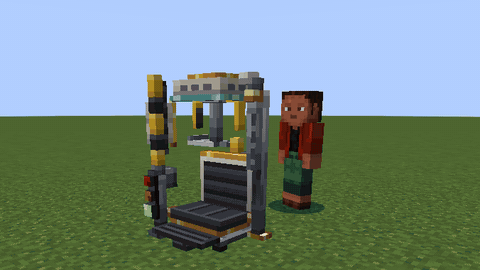

Fully playable in **English** and **Brazilian Portuguese** (every line of text, the handbook and the advancements).

---

## Contents

- [Tutorial: your first week at Head Office](#tutorial-your-first-week-at-head-office)
- [Getting your head off](#getting-your-head-off)
- [Life support](#life-support)
- [Jar modules](#jar-modules)
- [Hostile Takeover: mob bodies](#hostile-takeover-mob-bodies)
- [Mecha Division](#mecha-division)
- [Genetics Department](#genetics-department)
- [Board of Directors: heads at work](#board-of-directors-heads-at-work)
- [Telepresence gear](#telepresence-gear)
- [Controls](#controls)
- [Other mods](#other-mods)
- [Handbook, advancements and sounds](#handbook-advancements-and-sounds)
- [Building from source](#building-from-source)

---

## Tutorial: your first week at Head Office

A walkthrough from a fresh world to driving a mecha. The handbook in-game (a Patchouli book in the Head in a Jar creative
tab) and JEI cover the same ground; every recipe here shows up in JEI.

### Day 1: Surgical Steel and parts

Almost everything is made from **Surgical Steel**.

1. **Surgical Steel Blend** (shapeless): iron ingot + bone meal + coal. Smelt or blast it into a **Surgical Steel Ingot**.
2. Make the basic parts:

| Part | Recipe |
|---|---|
| **Neuro-Copper Wire** (x4) | copper ingot, redstone, copper ingot in a row |
| **Lens** | glass, amethyst shard, glass in a row |
| **Servo** | a piston on top; steel ingot, wire, steel ingot underneath |
| **Synapse Chip** | quartz, wire, quartz; gold ingot, lapis, gold ingot underneath |

### Day 2: power and saline

- **Power.** Build a **Galvanic Pile** (copper and wire around rotten flesh). Feed it raw meat or fish and it makes 20 FE/t,
  pushed into every machine it touches. Later: Leyden Jars to store FE, Tesla Nodes to send it without wires.
- **Cranial Saline** keeps a head alive. Craft a **Saline Bottle** by hand (a water bottle + sugar + kelp + redstone) or
  build a **Saline Mixer** for bulk. You need **four** bottles for the operation and a few spares.

### Day 3: the equipment

| Item | What it's for |
|---|---|
| **Life Support Jar** | your new home: 3 module slots (Reinforced and Executive jars have more) |
| **Relay Goggles** | your head wears them to send the signal (Mk I reaches 48 blocks) |
| **Collar Cam** | bolted to your neck: the camera you'll see through |
| **Head Satchel** | strongly recommended: carry your head with a perfect link at any distance |
| **Suture Kit** | puts your head back on (keep one spare) |

### Day 4: the operation

1. Craft the **Excision Head** and **Booth Console**, then the **Separation Chair**.
2. Place the chair with your Galvanic Pile touching it and let it charge to **40 kFE** (a fed pile takes under two minutes).
3. Open the chair and load the jar, the goggles, the Collar Cam and the four saline bottles.
4. Sit down, open the console and **hold Sign**. You can still get up until the cut; after that DOLORES finishes the job.
   A worn blade can botch it; a Replacement Blade fixes that.

You wake up standing in your own headless body, seeing through the Collar Cam. Your head sits in its jar in front of the
chair. The bar at the top of the screen is your **link quality**.

### Day 5: living with it

- **Pick your head up.** With the Head Satchel in your inventory, use your jar. With an empty hand you carry it in
  both arms; hold anything and it goes on your back. A carried head always has a perfect link.
- **Or dock it.** Build a **Life Support Cradle**, power it, and use it while carrying your head. The Cradle keeps your
  saline and charge topped up and boosts the link.
- **Swap** (**K**) between your body and your head whenever you like. Going back into your body needs a decent signal.
- **Keep the head alive.** A head out in the world slowly drinks its saline. In jar form, press **J** for the jar menu
  and put Saline Bottles (or Glass Patches, for a cracked jar) in its feed slot. Charge the jar on a **Charging Dock** or
  in the Cradle.
- **Your body can die without you.** It becomes a corpse that keeps your things, and you wake up in your jar. Only losing
  the head itself is a real death.

### Day 6: when it goes wrong

Walk too far and the link breaks: you wake up in your head. To get back:

- **Drive:** fit the **Wheels** module in the jar menu, then press **V**.
- **Roll:** no wheels? **V** tips the jar over to roll, very slowly.
- **Courier:** press **Courier** in the jar menu, and your body is delivered to your head in 30 seconds.

To put your head back on for good, use a **Suture Kit**: as a jar next to your body (or its corpse), or while carrying
your own head. **Let Go** in the jar menu is the last resort: you die and respawn whole.

### Day 7: what's next

- **Borrow a body.** Make a **Surgical Saw**, weaken a mob below a quarter of its health and saw its head off. As a jar,
  use the body to climb on. R and G use its abilities; play the Neural Handshake (press R as the rings line up) for a
  better start. Embalming Fluid stops it rotting.
- **Build a mecha.** Make an **Assembly Gantry** and **Mecha Plating**, then a **Hopper Frame**, **Hydraulic Legs** (so
  it can walk), a **Galvanic Stack** (power) and a **Drill**. Put them in the Gantry, give it 10 kFE, press Assemble,
  and use the cockpit as a jar. The mouse buttons work the arms.
- **Start the lab.** Draw blood with a **Syringe**, spin it in a **Centrifuge**, read it in the **DNA Sequencer**, splice
  in the **Gene Splicer**, and inject yourself at the **Injection Rig**.
- **Put heads to work.** Saw a head off with an empty jar in your other hand. Mob heads guard a **Turret Pedestal** or
  power a **Cerebral Array**; villagers staff your machines from an **Employee Mount**.

---

## Getting your head off

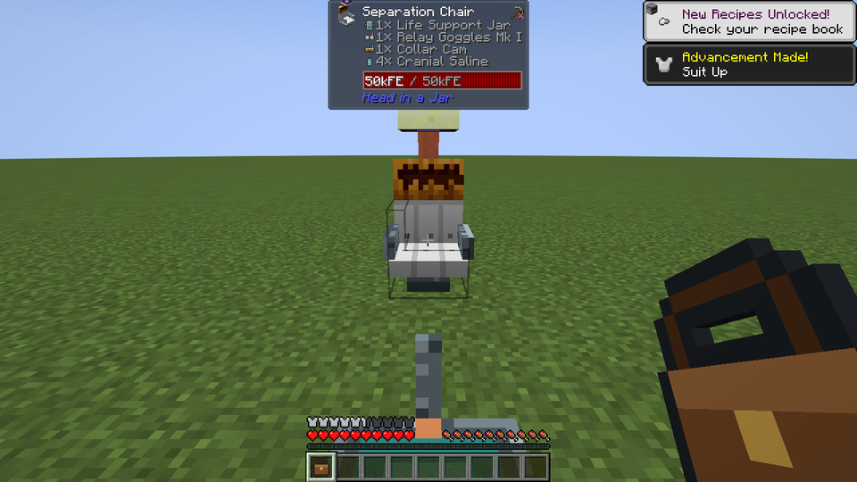

- **The Separation Chair** (DOLORES). Load it with a Life Support Jar, Relay Goggles, a Collar Cam and four bottles of
  Cranial Saline, give it 40 kFE, sit down and hold **Sign** on Form 27-B. You watch the whole operation from the chair: the
  clamps, the anaesthetic, the scan, the cut, and the feed coming back online. A worn blade can botch the cut and leave your
  Collar Cam crooked; Replacement Blades fix that.
- **Linked form.** Afterwards you walk around in your own headless body and see through the **Collar Cam**. Your head
  wears the goggles and sends the signal. The link quality bar (Q) falls with distance, water, rock, storms, portals and
  jammers; a weak link stutters and fills the screen with static; at zero you wake up in your head.
- **Swap** between body and head whenever you like. Put your head down, dock it in a **Life Support Cradle**, or carry it in
  a **Head Satchel** for a perfect link. The jar is carried life size: with an empty hand you hold it in both arms,
  your head turned round inside to look up at you; hold anything and it swings round onto your back, your head
  watching behind you.
- **Death is layered.** If your body dies it becomes a corpse that keeps your things, and you wake up in your jar; use a
  **Suture Kit** on it to get back in, or print a new body in the **Body Printer**. Only losing the head is a real death.
  **Let Go** in the jar menu ends it any time.

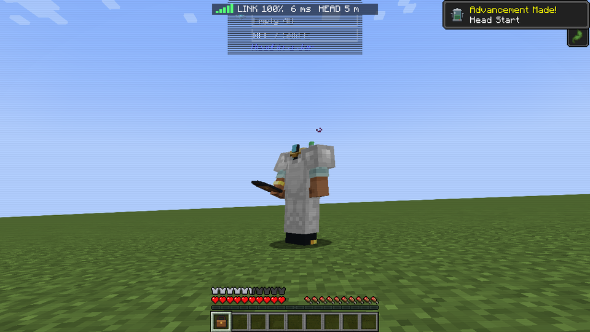

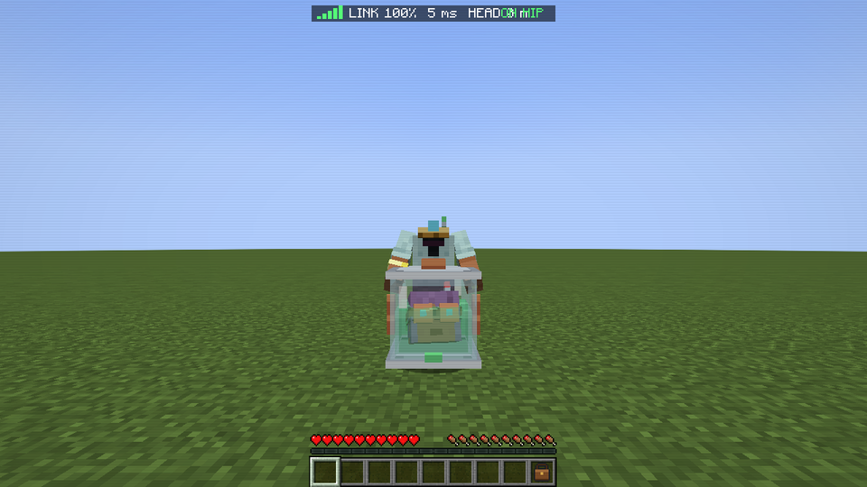

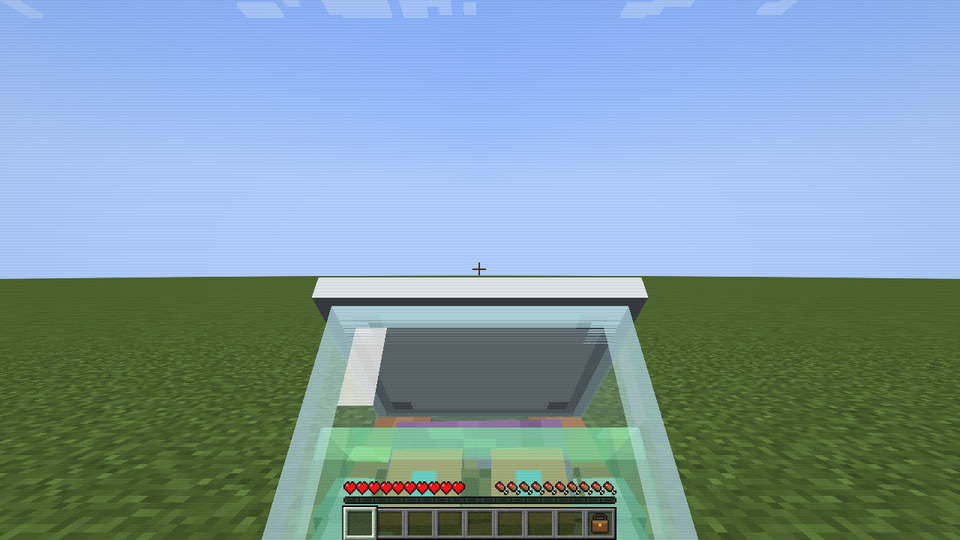

### Getting home

Walk too far and the link breaks: you wake up in your head, wherever you left it. To get back:

- **Drive.** The **Wheels** jar module drops four little wheels on the drive key (V): half walking speed for a little
  charge.
- **Roll.** No wheels? The same key tips a bare jar on its side, and it can roll, very, very slowly. The world looks
  sideways while you do it.
- **Call the Courier.** The jar menu's **Courier** button (or `/headoffice courier`) has your body delivered to your
  head in 30 seconds, from anywhere, for a fifth of your charge.
- Or reach further: better goggles, Relay Masts, the Antenna Whip, an Entangled Pair, the Body Recall Beacon.

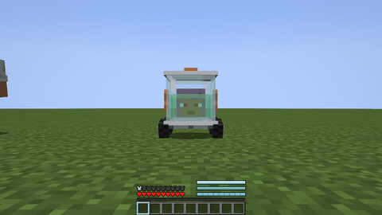 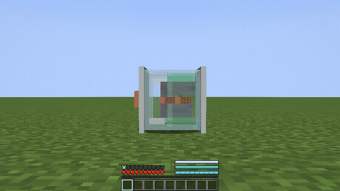

## Life support

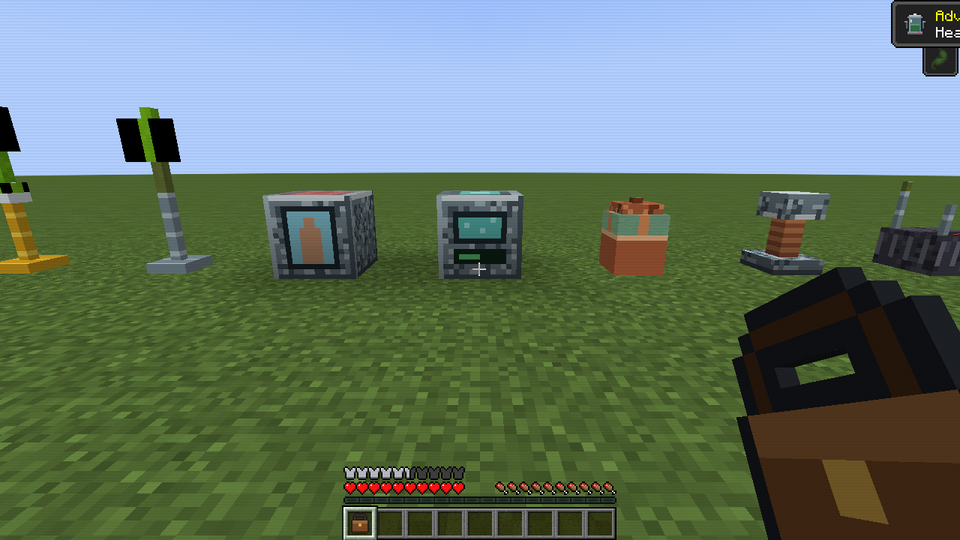

- **Cranial Saline** (Saline Mixer: water, sugar, kelp and redstone) keeps a head alive; a jar out in the world slowly
  drinks it. **Jar Integrity** is the glass: hits crack it, Glass Patches mend it.
- **Charge** (FE) runs jar modules. Charge in a Charging Dock, a Cradle, or from a Galvanic Pile fed with meat.
- **Power:** Leyden Jars store FE, Tesla Nodes beam it wirelessly. **Relay Masts** (two tiers) carry your link across the
  map; a **Signal Jammer** ruins other people's.
- **Safety placards**, because the company cares.

## Jar modules

A jar has 3 (Life Support Jar), 5 (Reinforced) or 7 (Executive) module slots:

Hop Springs, Propeller (flight), **Wheels**, Manipulator Arm, **Telekinesis** (grab and throw blocks, creatures and items), Drill Bit,
Armour Plating, Heat Shield, Night Lens, Magnet, Water Jet, Suction Cups, Spider Legs, Speaker Grille, Saline Recycler,
Shock Lid, Self-Righting Gyro, Hub Antenna, Life Sign Monitor, Hat Mount, Cortex Coprocessor, **Lacrimal Laser** (the head
weeps a beam) and **Body Recall Beacon** (your body walks to you).

## Hostile Takeover: mob bodies

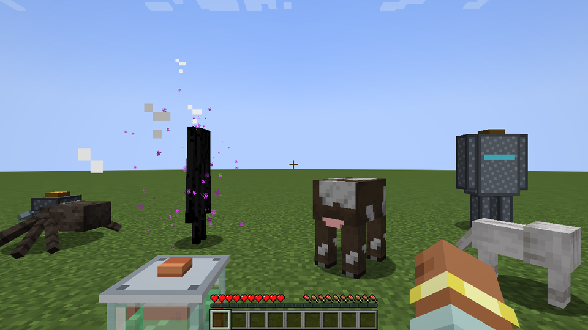

- The **Surgical Saw** takes the head off a weakened creature and leaves its body standing: a **host**. As a jar, climb on
  and drive it. It goes where you look, and its own abilities answer R and G: the enderman teleports, the blaze throws
  fireballs, the spider shoots webs, the ravager charges, the warden booms.
- Hosts **rot** unless embalmed, and grow **sync** the longer you pilot them (a Neural Handshake minigame on first contact).
  Neural Lace keeps a good host for good. A **Body Locker** stores one, frozen in time.
- With an empty jar in your other hand, the saw keeps the **head** instead. A jarred villager keeps trading, and other
  heads find work (see Board of Directors).
- **Utility Shells**: the Lunk, the Rover and the Spider Walker, robot bodies that need no saw.

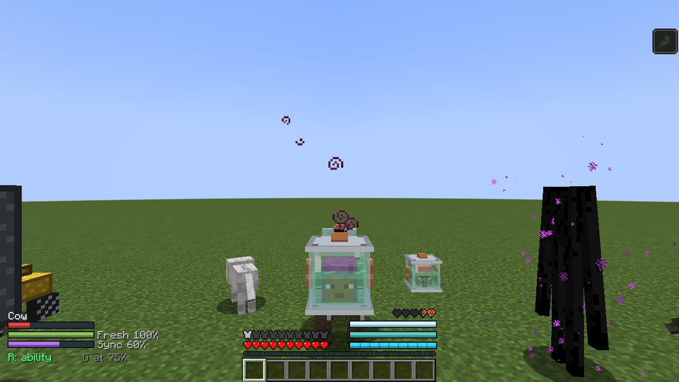

## Mecha Division

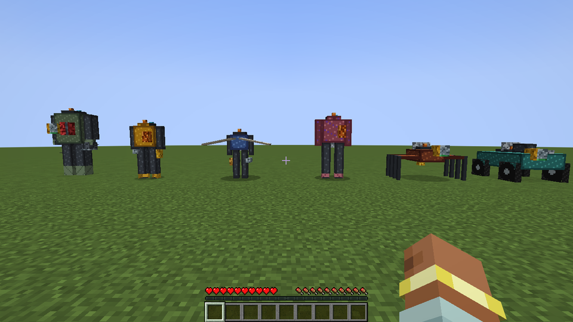

Build a mecha at the **Assembly Gantry**: a frame plus modules in slots of the right kind, then Assemble. Pilot it from the
cockpit as a jar.

| Frame | What it is |
|---|---|
| **Hopper** | a light biped, the first mecha |
| **Bulwark** | the all-rounder golem |
| **Chimera** | grown from Bio-Gel; three Gene Ports |
| **Wheelhouse** | a car: fast on roads, two passenger seats |
| **Skitter** | a quad spider that walks up walls |
| **Kite** | an ornithopter that flaps and glides |
| **Colossus** | a heavy biped with shoulder weapons; too big for a nether portal |
| **Executive** | Colossus Mk II with four Gene Ports |

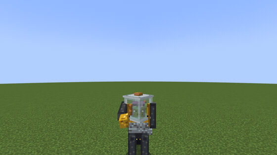

- **58 modules** across legs, back, core, torso, arms and sensors, each with a tuning slider: Hydraulic Legs, Spring Heels,
  Arachnid Legs, Hover Skirt, Jump Jets, Rocket Pack, Glider Wings, Cargo Hold, Passenger Pod, Missile Pod, Smoke Mortar,
  Ender Satchel, Galvanic Stack, Combustion Kernel, Bio-Reactor, Fusion Bottle, Armour Plating, Reactive Armour, Energy
  Shield, Stealth Field, Tesla Coil, Medical Injector, Drill, Chainsaw, Hydraulic Fist, Grapple Hook, Tractor Beam, Rivet
  Gun, Riot Shield, Flamethrower, Arc Cannon, Plasma Lance, Harvester, Welding Torch, Hemo-Syringe, Night Optics, Thermal
  Imaging, Ore Scanner, Target Lock and more.
- **Power, heat and weight** all matter. Batteries drain and cores refill them; overheating vents a cloud of scalding steam;
  mass against the frame's load rating sets your speed. Below 10% health the **Golden Parachute** throws you clear.
- The mouse buttons work the arms; R fires a utility module and G picks the next.

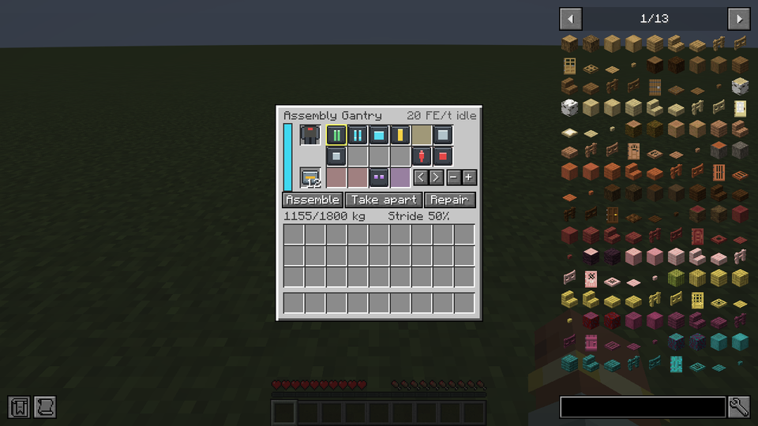

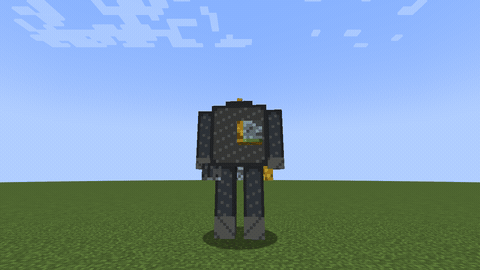

## Genetics Department

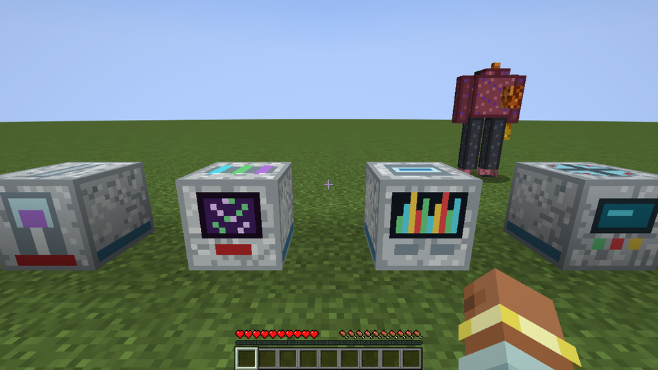

1. **Collect.** Syringes draw Blood Samples (healthier creatures give better ones). The bloodless need a Marrow Drill, Oil
   Tap or Ecto Trap; bosses need the Leviathan Needle. A Leech Jar samples your mob farm for you.
2. **Spin** a sample in the **Centrifuge** into a DNA Fraction.
3. **Sequence** it in the **DNA Sequencer**: auto-read, or call the twelve bases yourself for a better read. Your team
   shares one gene library.
4. **Splice** up to three genes into a **Serum Cassette** at the **Gene Splicer**. Stability, mutation odds and load show
   before you commit; conflicts cost stability, synergies and catalysts add it.
5. **Inject** it into your own body (Injection Rig), a host, or a Chimera's Gene Ports. Blood types can reject; mecha never do.

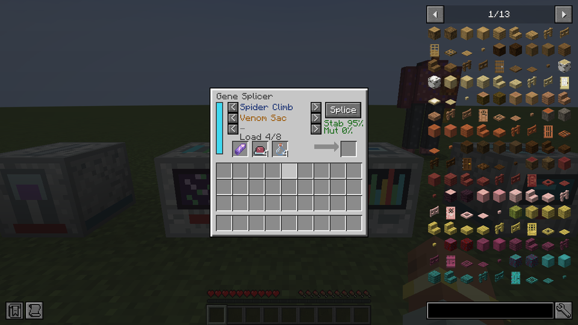

**38 genes and 11 mutations**, from Spider Climb, Ender Blink and Gills to Blaze Core, Guardian Eye and Creeper Gland, plus legendary ones:
**Draconic Wings** (true flight on any mecha), **Sonic Boom**, **Decay Aura**, and more from the pack's other mods. Low
stability mutates: Hiccups, Clucking, Brittle Bones, Gigantism... or, rarely, Hybrid Vigour. **Gene Wash** starts you over.
Active genes fire on R and G.

## Board of Directors: heads at work

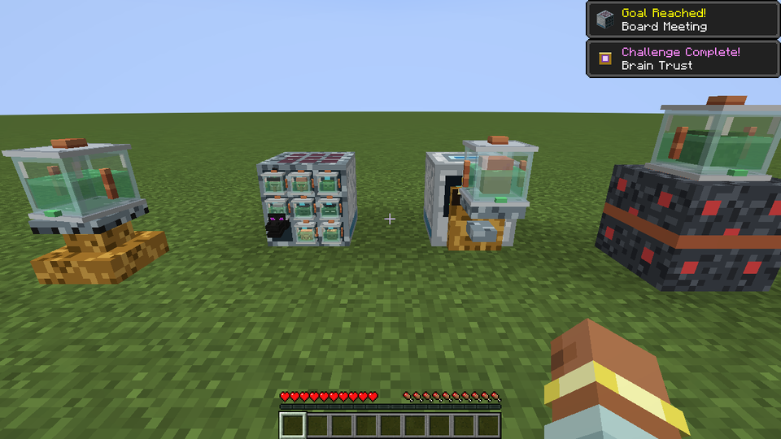

- **Turret Pedestal:** a jarred mob head guards the area the way the mob fought: skeleton arrows, blaze fireballs, a
  guardian laser, witch potions, evoker fangs, a creeper mine. Never at you, your team, pets or villagers.
- **Cerebral Array:** nine heads make power by thinking very hard about Nutrient Broth. Five or more hold a **Board
  Meeting** (+10%, and the occasional vote in chat). A Dragon Head with the Board Room Core makes 1,000 FE/t.
- **Villager staff:** hang a jarred villager on an **Employee Mount** beside a machine. Librarians read DNA better, Clerics
  steady the Splicer, Masons spare the blade, Fletchers speed up turrets, and so on, for one emerald a day. Unpaid staff
  work at half speed and complain about dental.
- **Neural Socket:** plug your own jar in and drive six redstone channels from a HUD, or let a mob head run a program
  (a zombie is a 1 Hz clock).

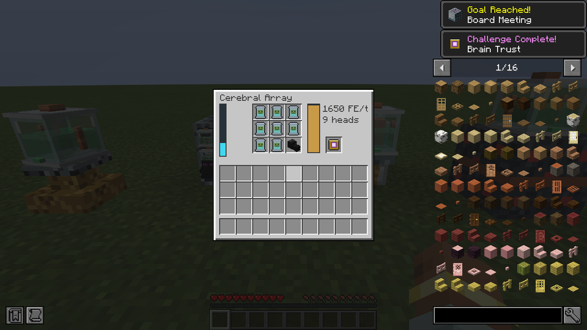

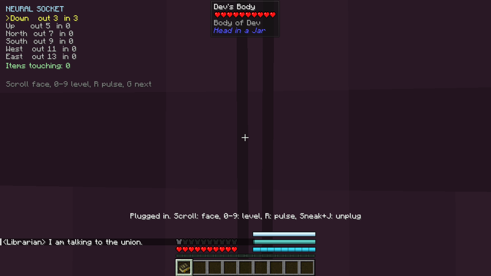

## Telepresence gear

- **Relay Goggles** (three tiers) and **Quantum Goggles** (anywhere in the dimension).
- **Entangled Pair:** split it, entangle your goggles and your Collar Cam, and the link crosses dimensions.
- **Collar Cam upgrades:** Wide Lens, Periscope Stalk, Night Optics, Waterproof Seal, Shielded Housing, Antenna Whip,
  Noise Filter, Thermal Overlay, Zoom Optic.
- **EMP Grenade:** drops linked players back into their jars, drains jars and mecha, and knocks turrets offline. Shielded
  Housing keeps you linked.

## Controls

| Key | Default | Does |
|---|---|---|
| Jar menu | J | the jar's modules, charge, the Courier and Let Go (Sneak + J ejects from a mecha or unplugs a socket) |
| Ability | R | Telekinesis in a jar, a host's main ability, a mecha's utility module, your first active gene |
| Secondary | G | a host's second ability, the next utility, the Lacrimal Laser, your second active gene |
| Swap | K | between your body and your head |
| Wheels / tip over | V | in a jar: drop the Wheels, or tip over and roll |
| Collar zoom | C | x3 zoom with the Zoom Optic |

## Other mods

All optional. Nothing changes if a mod is missing.

- **Hosts and genes from:** Brazil Legends (the Headless Mule needs no saw), Twilight Forest, Aether, Mowzie's Mobs, L_Ender's
  Cataclysm, Mutant Monsters, Naturalist, Friends & Foes, Bumblezone, Plants & Zombies and OreSpawn.
- **Curios:** wear the Head Satchel on your belt and goggles on your head.
- **JEI:** an information page for every machine.
- **Jade:** mecha power, heat and mass; host freshness and sync; whose body it is; the genes a creature carries.
- **Patchouli:** the Employee Handbook.

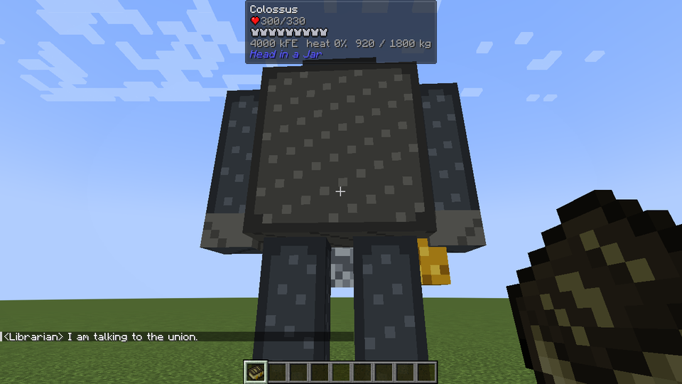

## Handbook, advancements and sounds

- **The Employee Handbook** (Patchouli): eight chapters, from Orientation to Human Resources.
- **25 advancements**, among them Signed in Triplicate, Have You Tried Turning It Off and On Again, Headless Horseman,
  Mula-sem-cabeça, Splice of Life, Board Meeting and Chairman of the Board.
- **Original sounds** for the blade, the botched cut, the link, the mecha's boot jingle, splicing, mutations, the Board
  murmuring and staff complaining.

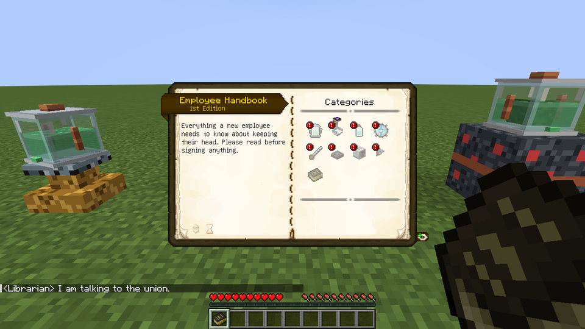

## Building from source

Requires JDK 21.

```bash
./gradlew build
```

The jar lands in `build/libs/`. The optional JEI, Jade, Curios and Patchouli integrations compile against those mods'
jars in `libs/` (not included; copy them in from your mods folder).

## License

All rights reserved for now.
