# Head in a Jar

[English](README.md) · **Português (Brasil)**

*Sede da Noggin & Sons: o programa de colaboradores para os ambiciosos e os levemente desequilibrados.*

Um mod de Minecraft para **NeoForge 1.21.1**. Sente na Cadeira de Separação, assine o Formulário 27-B e perca a cabeça
de propósito. Sua cabeça mora num pote de suporte vital; seu corpo sem cabeça anda por aí numa neuroconexão sem fio
enquanto você enxerga por uma câmera no pescoço dele. Daí em diante, fica mais estranho. Potes podem montar nos corpos
sem cabeça de criaturas, pilotar mechas que você constrói peça por peça, emendar genes das criaturas de que tirou
amostra e pôr a cabeça dos outros para trabalhar.

Candidatos podem conhecer as instalações antes no
[site de apresentação](https://coolfreeze23.github.io/head-in-a-jar/). A visita é sem compromisso; o compromisso vem
depois, no Formulário 27-B.

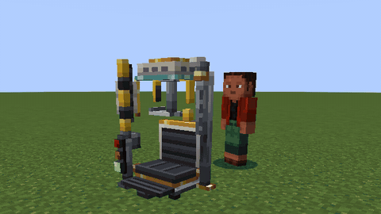

*A operação, vista por um colega (em velocidade dobrada). Sente com **Usar** e segure o botão Assinar na tela dela.*

Totalmente jogável em **inglês** e **português do Brasil** (cada linha de texto, o manual, as conquistas e a voz da
DOLORES). Esta página descreve a versão **0.7.2**.

## Requisitos

- Minecraft **1.21.1** com **NeoForge 21.1.200** ou mais recente.
- **GeckoLib 4.9.3** ou uma 4.x mais recente para 1.21.1 (obrigatório; o GeckoLib 5 não é aceito).
- Instale no cliente e no servidor.
- Opcional: Curios, JEI, Jade, Patchouli, Entity Model Features, Vanilla Backport 1.2.2 (veja [Outros mods](#outros-mods)).

## Como ler esta página

Chegou agora? Leia [Sua primeira semana na Sede](#sua-primeira-semana-na-sede): ela leva você de um mundo novo até o
seu primeiro mecha. Perdido num corpo estranho? [O que posso fazer agora?](#o-que-posso-fazer-agora) diz o que cada
forma pode e não pode fazer. Todo o resto é referência. As teclas são chamadas pela ação (**Habilidade**, **Trocar**,
**Usar**...); a tecla padrão de cada uma está em [Controles](#controles).

## Sumário

- [Sua primeira semana na Sede](#sua-primeira-semana-na-sede)
- [O que posso fazer agora?](#o-que-posso-fazer-agora)
- [A Cadeira de Separação](#a-cadeira-de-separação)
- [Vivendo sem a cabeça](#vivendo-sem-a-cabeça)
- [Potes e equipamento de telepresença](#potes-e-equipamento-de-telepresença)
- [Blocos de energia e de suporte vital](#blocos-de-energia-e-de-suporte-vital)
- [Módulos de pote](#módulos-de-pote)
- [Aquisição Hostil: corpos de criaturas](#aquisição-hostil-corpos-de-criaturas)
- [Cascos Utilitários](#cascos-utilitários)
- [Cabeças no pote](#cabeças-no-pote)
- [Fichas funcionais, salário e crachás](#fichas-funcionais-salário-e-crachás)
- [Cabeças no trabalho: a campainha, o almoço e os serviços de mesa](#cabeças-no-trabalho-a-campainha-o-almoço-e-os-serviços-de-mesa)
- [Divisão de Mechas](#divisão-de-mechas)
- [Departamento de Genética](#departamento-de-genética)
- [Conselho de Administração: cabeças no trabalho](#conselho-de-administração-cabeças-no-trabalho)
- [A força de trabalho](#a-força-de-trabalho)
- [Destacamento](#destacamento)
- [Carreiras: cargos, o Conselho, queixas e greves](#carreiras-cargos-o-conselho-queixas-e-greves)
- [Controles](#controles)
- [Comandos](#comandos)
- [Configuração](#configuração)
- [Conquistas](#conquistas)
- [O Manual do Funcionário](#o-manual-do-funcionário)
- [Outros mods](#outros-mods)
- [Sons](#sons)
- [Notas de versão](#notas-de-versão)
- [Compilando a partir do código-fonte](#compilando-a-partir-do-código-fonte)
- [Licença](#licença)

---

## Sua primeira semana na Sede

Um passo a passo de um mundo novo até a sua primeira semana no pote. Todo funcionário novo recebe o **Manual do
Funcionário** no primeiro dia: ele vai para um espaço livre da sua barra de atalhos, não para a sua mão. Uma cópia
perdida se refaz com um livro e uma **Mistura de Aço Cirúrgico**, sem formato. A aba de conquistas **Cabeça no Pote**
fica aberta desde o primeiro momento, e cada etapa ali diz o que fazer em seguida (veja [Conquistas](#conquistas)); a
DOLORES chama você no chat na primeira vez que algo novo acontece (veja [Memorandos da DOLORES](#memorandos-da-dolores)).

### Dia 1: Aço Cirúrgico e peças

Lista de compras antes de começar: ferro, carvão, farinha de osso, cobre, redstone, vidro, **fragmentos de ametista**
(de um geodo), **bolas de slime**, **algas**, açúcar, couro, linha, lã branca, um pistão, uma alavanca, uma tesoura, um
repetidor. Os níveis seguintes pedem quartzo do Nether, ouro, lápis-lazúli, diamantes, pérolas do Ender, fragmentos de
netherita, obsidiana e vidro fumê.

1. **Mistura de Aço Cirúrgico**: lingote de ferro, farinha de osso e carvão, sem formato. Funda na fornalha (10 segundos)
   ou no alto-forno (5 segundos) para obter um **Lingote de Aço Cirúrgico**. Nove lingotes fazem um **Bloco de Aço
   Cirúrgico**, e vice-versa.
2. As peças. Em toda receita desta página, "lingote" sozinho quer dizer Lingote de Aço Cirúrgico, e "vazio" um espaço em
   branco.

| Peça | Receita |
|---|---|
| **Fio de Neurocobre** (faz 4) | lingote de cobre, redstone, lingote de cobre em linha |
| **Lente** | vidro, fragmento de ametista, vidro em linha |
| **Servo** | um pistão em cima; lingote, fio, lingote embaixo |
| **Chip Sináptico** | quartzo, fio, quartzo; lingote de ouro, lápis-lazúli, lingote de ouro embaixo (necessário a partir do Dia 7: quartzo do Nether) |

### Dia 2: energia e soro

- **Pilha Galvânica**: seis lingotes de cobre, dois fios e uma carne podre (anel de cobre, fio acima e abaixo da carne).
  Ela tem dois blocos de altura, então deixe livre o bloco acima dela. Aperte **Usar** com carne nela para alimentá-la:
  carne podre dá 4.000 FE, um olho de aranha 6.000, qualquer carne ou peixe cru 3.000. Ela queima 20 FE por tique e
  divide a energia igualmente entre todas as máquinas encostadas na metade de baixo dela, revezando quem vai primeiro.
  **Usar** com a mão vazia mostra o estoque. Funis podem alimentá-la.
- **Soro Craniano**: uma garrafa de água, açúcar, alga e redstone, sem formato, fazem **dois** frascos. Você precisa de
  **quatro** para a operação. Alguns de reserva são prudentes.

### Dia 3: o kit

| Item | Receita | Para que serve |
|---|---|---|
| **Pote de Suporte Vital** | lingote de cobre em cima; vidro, bola de slime, vidro; lingote, redstone, lingote | Seu novo lar. 3 espaços de módulo |
| **Óculos Retransmissores Mk I** | couro, lingote de cobre, couro; lente, fio, lente | Usados pela sua cabeça. 48 blocos de conexão |
| **Câmera de Colar** | uma lente em cima; fio, servo, fio; três lingotes | Parafusada no seu pescoço. Seu corpo enxerga por ela |
| **Bolsa de Cabeça** | linha, couro, linha; couro, vazio, couro; três couros | Carregue a própria cabeça com conexão perfeita |
| **Kit de Sutura** | linha, bola de slime, pepita de ferro, frasco de soro, sem formato | Põe sua cabeça de volta. Leve um de reserva |

### Dia 4: a operação

1. Faça o **Cabeçote de Excisão** (um Bloco de Aço Cirúrgico em cima; servo, lente, tesoura; um bloco de redstone
   embaixo) e o **Console da Cabine** (fio, painel de vidro, fio; lingote, repetidor, lingote; fio embaixo), depois a
   **Cadeira de Separação** (lã branca, Cabeçote de Excisão, lã branca; lingote, lã branca, lingote; Console da Cabine,
   servo, alavanca).
2. Coloque a cadeira com a sua Pilha Galvânica encostada nela. Ela precisa de **40.000 FE**: dez carnes podres, uns 100
   segundos de queima.
3. Mantenha a sala livre (esquerda do ponto de vista do paciente sentado): o bloco à esquerda do assento e o de cima
   dele (a bandeja do pote), o bloco da frente e os dois acima dele, o bloco da frente à esquerda a um e a dois de
   altura, e o espaço acima da cadeira.
4. Aperte **Usar** na cadeira para sentar; o console dela abre. Coloque o pote, os óculos, a Câmera de Colar e quatro
   frascos de soro. Segure o botão **Assinar** por dois segundos.
5. Assista. Você pode levantar com **Agachar** antes da marca dos cinco segundos. Depois disso, a DOLORES termina.

Você se levanta no seu próprio corpo sem cabeça, enxergando pela Câmera de Colar. Sua cabeça está no pote, na bandeja
da cadeira, à sua esquerda. Se havia um **Berço de Suporte Vital** vazio a até 3 blocos da cadeira, sua cabeça foi
enviada para lá, e a DOLORES avisa. A barra no alto da tela é a **qualidade da conexão**; a setinha à esquerda dela
aponta para a sua cabeça.

### Dia 5: convivendo com isso

- **Pegue sua cabeça.** Com a Bolsa de Cabeça no corpo, aperte **Usar** no seu pote. De mão vazia, você o abraça na
  frente do corpo; segurando qualquer coisa, ele vai para as costas. Uma cabeça carregada sempre tem conexão perfeita e
  não bebe soro.
- **Ou acople-a** num Berço de Suporte Vital, cheio de soro e com energia. Uma cabeça acoplada fica segura e sempre
  abastecida.
- **Trocar** alterna entre corpo e cabeça quando você quiser. Voltar para o corpo exige conexão acima de 20%.
- **Alimente a cabeça.** Uma cabeça deixada em algum lugar bebe soro devagar: 1 mB a cada 12 segundos, cerca de 3 horas
  e 20 minutos para um pote básico cheio. Do seu corpo, aperte **Usar** com Soro Craniano nela. Na forma de pote, o
  **Menu do pote** tem um espaço de recarga para Frascos de Soro, Remendos de Vidro e redstone (5.000 FE por pó, 45.000
  por bloco). Uma **Base de Recarga** carrega um pote que esteja em cima dela.
- **Seu corpo pode morrer sem você.** Ele vira um cadáver que guarda suas coisas, e você acorda no seu pote.

### Dia 6: quando dá errado

Ande longe demais e a conexão cai: você acorda na sua cabeça. Para voltar:

- **Rodinhas** tomba de lado um pote sem módulos, para ele rolar, bem devagar. Com o módulo **Rodinhas**, ele anda à
  metade da velocidade.
- **Entregador**, no **Menu do pote**: seu corpo é entregue à sua cabeça em 30 segundos, por 20.000 FE de carga.
- **Kit de Sutura** no seu corpo, como pote, costura a cabeça de volta de vez.
- **Desistir**, no **Menu do pote**, é o último recurso: uma morte de verdade, e você renasce inteiro.

### Dia 7: e agora

- **Pegue um corpo emprestado.** Faça uma **Serra Cirúrgica**, deixe uma criatura com metade da vida ou menos e serre a
  cabeça dela. Como pote, aperte **Usar** no corpo em pé para subir nele. Veja
  [Aquisição Hostil](#aquisição-hostil-corpos-de-criaturas).
- **Construa um mecha.** **Placa de Mecha** (8 lingotes em volta de um bloco de ferro, faz 2), um **Pórtico de
  Montagem**, uma **Estrutura do Saltador** e **Pernas Hidráulicas**, 10 kFE, Montar, e veja ele se construir sozinho
  na plataforma; entre como pote e segure **Rodinhas** para sair pulando feito pula-pula. Uma **Pilha Galvânica
  Compacta** o mantém carregado. Veja [Divisão de Mechas](#divisão-de-mechas).
- **Monte o laboratório.** Seringa, Centrífuga, Sequenciador de DNA, Emendador de Genes, Estação de Injeção. Veja
  [Departamento de Genética](#departamento-de-genética).
- **Ponha cabeças para trabalhar.** Serre uma cabeça com um Pote de Suporte Vital vazio na outra mão. Veja
  [Conselho de Administração](#conselho-de-administração-cabeças-no-trabalho).

---

## O que posso fazer agora?

A Sede reconhece seis formas de colaborador, mais um arranjo de transporte. Encontre a sua.

| | **Corpo** (com cabeça) | **Conectado** (corpo sem cabeça) | **Carregando a cabeça** | **Pote** (e Pote Compacto) | **Em hospedeiro** | **Piloto** | **Soquete** |
|---|---|---|---|---|---|---|---|
| Como chegar aqui | Você começa aqui | A Cadeira de Separação; **Trocar** a partir de um pote | Conectado, com uma **Bolsa de Cabeça** no corpo: **Usar** na sua cabeça deixada | **Trocar** a partir do corpo conectado; seu corpo conectado morre; a conexão cai | Como pote, **Usar** num corpo hospedeiro ou num casco | Como pote, **Usar** na cabine do seu próprio mecha | Como pote, conecte-se a um **Soquete Neural** |
| Como sair | Cadeira de Separação | **Trocar** (para a cabeça); **Kit de Sutura** | Deixe-a no chão (**Agachar** + **Usar** na bolsa), acople-a ou costure-a no lugar | **Trocar** para o corpo; **Kit de Sutura**; **Desistir** | **Agachar** (num voador, a até três blocos do chão) | Segure **Agachar** e aperte **Menu do pote** | **Agachar** e aperte **Menu do pote** |
| Andar | Sim | Sim (engasga com conexão fraca) | Sim | Não. Tombe e role, ou instale pernas, molas, rodinhas ou uma hélice | O hospedeiro anda | O mecha anda | Não |
| Quebrar e colocar blocos | Sim | Sim | Sim | Só com um **Braço Manipulador** (metade da velocidade, 200 FE por bloco) | Não | Pelos braços do mecha | Não |
| Atacar | Sim | Sim | Sim | Só com um Braço (200 FE por golpe, metade do dano) | As habilidades do hospedeiro | Os braços do mecha | Não |
| Usar itens no ar | Sim | Sim | Sim | Só com um Braço | Não | Não | Não |
| Pegar itens | Sim | Sim | Sim | Só com um Braço ou um **Ímã** (a Telecinese levanta itens, mas não os guarda) | Igual ao pote | Igual ao pote | Igual ao pote |
| Abrir blocos | Todos | Todos | Todos | Só as máquinas da empresa (veja abaixo); blocos do jogo base precisam de um Braço | Nenhum | Nenhum | Nenhum |
| Portais | Sim | **Não**, a menos que você carregue a cabeça ou que seus óculos e sua câmera de colar estejam emaranhados | Sim | Sim | Como uma criatura montada | Sim, menos o Colosso e o Executivo (grandes demais) | Não |
| **Trocar** | "Sua cabeça ainda está no lugar. A Cadeira de Separação resolve." | Acorda na sua cabeça | Vira um pote onde você está | De volta ao corpo | "Daqui de cima, não. Desça primeiro." | Abre o Compartimento de Carga | "A troca é só de pote ou de corpo. Desça primeiro." |
| Morrer | Uma morte normal | Não é morte: seu corpo vira um cadáver e você acorda na sua cabeça | Seu corpo vira um cadáver e você vira um pote ali mesmo | Morte de verdade | Morte de verdade | Morte de verdade | Morte de verdade |

Um pote nunca sente fome e não se afoga. Um corpo conectado não pode usar capacete: ele vai para os seus bolsos.

Sem um Braço, um pote ainda opera todo bloco da Noggin & Sons que tenha menu ou status: a Impressora de Corpos, o
Misturador de Soro, a Base de Recarga, o Berço de Suporte Vital, a Pilha Galvânica, a Garrafa de Leyden, o Nó de Tesla,
os Mastros Retransmissores, o Bloqueador de Sinal, a Placa de Segurança, a Cadeira de Separação e as máquinas dos outros
departamentos. Ele pode consultá-los, não despejar coisas neles: o que ele estiver segurando não é usado no bloco. Ele
também pode apertar **Usar** no próprio corpo, num hospedeiro ou casco para subir, num barco ou num carrinho.

Uma **morte de verdade** na forma de pote encerra o arranjo. Seus módulos, óculos e Câmera de Colar caem onde você
estava. O pote em si não é devolvido. Seu corpo parado cai de vez. Você renasce com a cabeça no lugar. Também acontece
uma morte de verdade se, enquanto você está conectado, sua cabeça deixada for destruída ou secar.

---

## A Cadeira de Separação

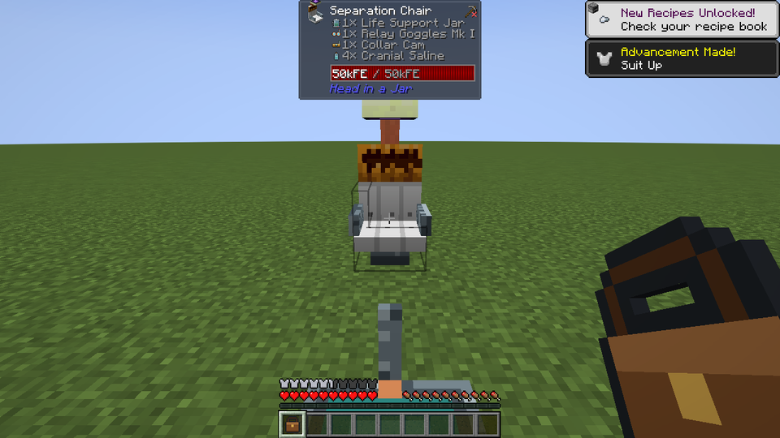

A **Cadeira de Separação** tira sua cabeça e deixa seu corpo conectado a ela. Quem opera é a DOLORES, que é muito
profissional quanto a isso.

### Do que ela precisa

- **Peças**: um pote (qualquer um dos quatro), um par de óculos (qualquer nível), uma **Câmera de Colar**, quatro
  frascos de **Soro Craniano**. Funis e canos podem abastecê-la. Os espaços vazios mostram o que vai neles.
- **Energia**: 40.000 FE armazenados antes de começar. Ela guarda 50.000 e recebe até 2.000 FE por tique. Uma Pilha
  Galvânica encostada nela é o fornecimento de costume.
- **Espaço** (esquerda e direita do ponto de vista do paciente sentado): o bloco à esquerda do assento e o bloco acima
  dele (a bandeja: com eles bloqueados, nem dá para colocar um pote), o bloco da frente e os dois acima dele, o bloco
  da frente à esquerda a um e a dois de altura, e o espaço acima da cadeira.

**Usar** senta você e abre o console. **Agachar** e **Usar** de mãos vazias o abre sem sentar. Quem clicar enquanto
alguém está sentado, e qualquer pote, recebe só o console. Só o paciente sentado pode assinar.

O console lista Energia (40 kFE), Pote de Suporte, Óculos Retransm., Câmera de Colar e Soro Cran. x4, marcados ou não, e
mostra o desgaste da lâmina. **Formulário 27-B**: segure o botão Assinar por dois segundos. Solte ou escorregue para
fora e a caneta se levanta. Aponte para **Assinar** primeiro: se ainda não dá para assinar, o texto que aparece ao passar
o mouse diz por quê ("Sente e assine", ou a fala da DOLORES sobre a primeira peça que falta).

### O que é recusado

Só a primeira coisa que falta é citada, nas palavras da DOLORES:

| Falta | Ela diz |
|---|---|
| Energia | "Energia insuficiente. Eu me recuso a parar no meio." |
| Pote | "Onde colocaríamos sua cabeça? Insira um Pote de Suporte Vital." |
| Óculos | "Óculos Retransmissores necessários. Você vai querer enxergar." |
| Câmera de Colar | "Câmera de Colar necessária. Seu pescoço precisa de um chapéu." |
| Soro | "Quatro frascos de Soro Craniano, por favor. Cabeças sentem sede." |
| Sua cabeça já saiu | "Nossos registros mostram que sua cabeça já saiu." |
| Espaço | "A cadeira precisa de espaço. Libere o bloco da frente." (ou o que for) |
| Espaço da bandeja, ao colocar um pote | "A bandeja do pote não sai. Libere o bloco à esquerda." |
| Não sentado | "Sente e assine" (no botão Assinar) |

Durante a operação, os outros ouvem "Operação em andamento. Aguarde atrás da faixa." A cadeira não pode ser quebrada
até terminar: "Não durante a operação. Ela se desmonta depois." Quebrada quando parada, ela solta o que guarda.

### A operação, passo a passo

Doze segundos. Todos por perto veem o mesmo momento, até quem chega no meio.

| Tempo | O que um espectador vê e ouve | O que o paciente vê |
|---|---|---|
| 0 s | "Obrigada por escolher a Separação Eletiva. Mantenha os braços dentro da cadeira." A barreira desce no motor e trava. | As bordas escurecem |
| 1-3 s | "Administrando um gás agradável. Respire normalmente. Ou não." O capuz acena; um gás verde-claro sai em baforadas de baixo da cúpula; três bipes | Um tom verde |
| 3-5 s | "Escaneando. Fique parado. Você tem um pescoço lindo." Um anel de luz desce pelo rosto | Uma linha verde acompanha o anel |
| 5 s | "Iniciando a separação. Isto não vai doer por muito tempo." Daqui em diante, não dá mais para levantar | Escurece até o preto |
| 5,3-6,7 s | Sobe uma cortina de privacidade. "Privacidade, por favor." | Preto |
| 6 s | A lâmina. Um anel de fumaça branca no pescoço, uma faísca. Ouvida a 24 blocos. Um capacete vai para os seus bolsos | Preto, e silêncio |
| 7-10 s | "Sua cabeça agora está num pote. Parabéns pela promoção." A tampa do pote salta, a garra leva a cabeça até ele, os óculos são colocados, a cabeça cai no pote e o soro sobe | Preto; borbulhar abafado |
| 10,5-12 s | A Câmera de Colar é parafusada com três cliques de catraca; faíscas na antena; a barreira sobe | A imagem inicializa: "NEUROCONEXÃO 2.1 ... 100%" |

No fim você se levanta na frente da cadeira, conectado, um pouco tonto por 8 segundos. DOLORES: "Neuroconexão
estabelecida. Retire sua cabeça na saída." Ou, se um Berço vazio a até 3 blocos ficou com ela: "Sua cabeça foi enviada
ao Berço." Seu pote começa cheio de carga, soro e vidro.

### Levantando antes do corte

**Agachar** antes da marca dos cinco segundos cancela a operação: "Procedimento cancelado. Sua cabeça continua no lugar.
Por enquanto." Você fica com todas as peças. A cadeira mantém três quartos da energia: um cancelamento custa 10.000 FE.
Depois da marca dos cinco segundos, as amarras seguram. Um paciente que sai do jogo depois do corte tem a operação
concluída na hora.

### Desgaste da lâmina e o erro

Cada operação soma 5% de desgaste à lâmina (3% com um Pedreiro de plantão ao lado da cadeira). Acima de 80%, a lâmina
pode errar: 10% de chance com 85% de desgaste, subindo até 40% com 100%. Sem Pedreiro, as primeiras 17 operações saem
sempre limpas. Um erro: a DOLORES diz "Opa.", sua visão fica de cabeça para baixo por 30 segundos, sua cabeça flutua de
cabeça para baixo no pote pelo mesmo tempo, e a Câmera de Colar fica **Torta**, perdendo 10% do alcance para sempre. Um
Giroscópio Autonivelante endireita a visão na hora.

**Lâmina de Reposição**: dois Lingotes de Aço Cirúrgico e um diamante, sem formato. Aperte **Usar** com ela na cadeira
parada: o desgaste volta a 0. "Lâmina nova instalada. Que brilho." Durante a operação: "Não durante a operação. Troque a
lâmina depois."

### DOLORES

Ela fala as falas em voz alta, em inglês ou português do Brasil conforme o seu jogo, no controle de volume **Voz/Fala**;
o paciente a ouve abafada pela anestesia. Cada recusa dela é falada no máximo uma vez por sessão na cadeira.
`doloresVoice = false` na configuração do cliente a deixa só no texto.

### Memorandos da DOLORES


*Um memorando chegando: a primeira vez que você é um pote sem Braço Manipulador.*

Na primeira vez que algo importante acontece com você, a DOLORES manda um recado: uma linha no chat, "[Memorando]
DOLORES: ...", com um bipe. São sete, e cada um vem uma vez por jogador, para sempre:

| Quando | O que ela diz |
|---|---|
| Seu primeiro dia como funcionário novo (não um jogador de uma versão anterior), com a cabeça ainda no lugar | Bem-vindo à Noggin & Sons: o livro que você recebeu é o seu Manual do Funcionário (aperte **Usar** com ele para ler), e suas primeiras tarefas estão na aba Cabeça no Pote das conquistas. |
| Conectado, com a cabeça deixada para trás (na bandeja, no chão ou acoplada) | Agora você é o seu corpo; **Trocar** leva você à sua cabeça, que bebe soro enquanto você está longe, a menos que você a carregue numa Bolsa de Cabeça. |
| Conectado, com a cabeça deixada abaixo de um quarto do soro | Quando acabar, o vidro racha, e aí a morte é de verdade: use Soro Craniano nela, ou carregue-a. |
| Um pote sem Braço Manipulador | Potes não têm mãos; as máquinas da firma atendem você, o resto não. Instale um Braço pelo **Menu do pote**: fabrique-o ainda com as mãos (3 lingotes de ferro, redstone, uma lingote de cobre) e guarde-o no bolso. |
| Em qualquer forma de pote, com a carga abaixo de um quarto | Fique numa Base de Recarga alimentada, ponha redstone no espaço de recarga do menu do pote ou acople num Berço de Suporte Vital. |
| Sua primeira montaria num hospedeiro | A sincronia sobe uns 5% por minuto; a primeira habilidade abre em 50% (**Habilidade**), a segunda em 75%. **Agachar** faz você descer. |
| Seu primeiro mecha montado | Está na plataforma: **Trocar** para o pote e **Usar** no mecha para entrar; segure **Agachar** e **Menu do pote** para sair. |

Cada memorando cita suas teclas do jeito que você as configurou. Com o Patchouli instalado, um link "[Manual]" no fim
abre o manual na página que explica mais. Memorandos são uma cortesia, não uma exigência: `memos = false` na
configuração do cliente os desliga (um memorando perdido assim não é enviado de novo depois).

---

## Vivendo sem a cabeça

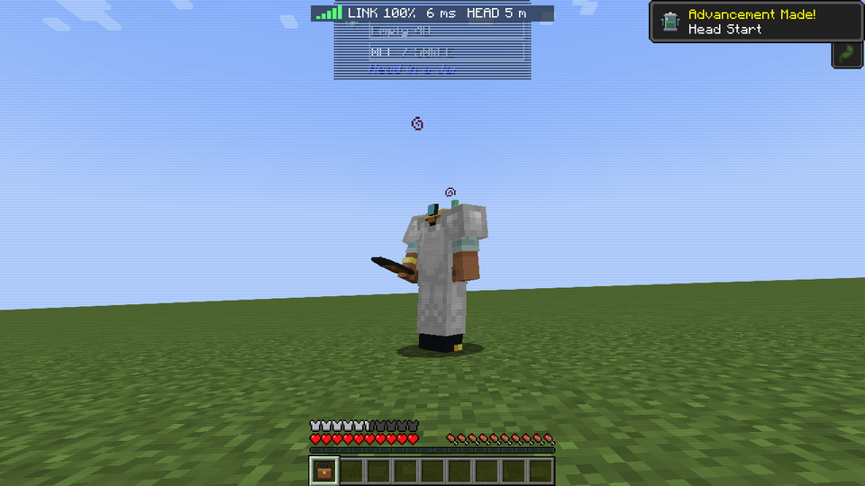

### Qualidade da conexão

A barra no alto da tela mostra SINAL (porcentagem), CABEÇA ou CORPO (até qual metade ela mede) e a distância em
metros: até a sua cabeça, como corpo conectado; até o seu corpo, como pote. Cinco níveis mostram o sinal num relance.
Ela fica visível enquanto a conexão está abaixo de 70%, enquanto você é um pote e enquanto sua cabeça está pousada em
algum lugar; fora isso, aparece por alguns segundos depois de alguma mudança e então some. Quando o seu jogo enxerga a
sua outra metade (a até uns 96 blocos), uma pequena seta à esquerda da barra aponta para ela, girada conforme a direção
em que você olha: para cima significa bem à frente. Carregando a cabeça, a barra diz "NO CINTO". Enquanto sua cabeça
está longe, uma pequena caixa "NO CHÃO" ou "NO BERÇO" à direita da barra mostra o soro e o vidro dela. Quando o Jade
mostra a caixa dele no alto, ao centro, a barra desce para baixo dela.

- **Distância**: força total até metade do alcance dos seus óculos, depois caindo por igual até zero no alcance máximo.
  Óculos Retransmissores Mk I alcançam 48 blocos (perfeito até 24), Mk II 160, Mk III 640, Óculos Quânticos a dimensão
  inteira.
- **Reforços de alcance**: módulo Antena Central x1,5 (enquanto o pote tiver carga), Antena Chicote no colar x1,25. Um
  colar torto x0,9.
- **O que está ao seu redor** multiplica o sinal: debaixo d'água x0,6 (exceto com Vedação à Prova d'Água), no fundo da
  terra, sem céu acima e a mais de 16 blocos abaixo da superfície x0,8, tempestade de raios x0,85, um Portal do Nether a
  até 8 blocos x0,7, a Escuridão do Warden x0,5, Fadiga de Mineração III ou pior x0,5.
- **Bloqueador de Sinal**: de outra pessoa, a até 16 blocos, x0,3.
- **Mastros Retransmissores**: sua cabeça alcança um mastro dentro do alcance dos óculos, os mastros alcançam uns aos
  outros, e o último mastro alcança seu corpo dentro do raio dele (96 blocos, Mk II 192). Cada mastro na corrente custa
  3%.
- **Outras dimensões**: nenhuma conexão, a menos que seus óculos e a Câmera de Colar estejam emaranhados (80%, antes do
  resto).
- **Carregando a cabeça**: sempre 100%.

Um Berço de Suporte Vital não afeta a conexão.

**Quando está fraca**: as linhas de varredura engrossam conforme a conexão cai. Abaixo de 40%, seu corpo engasga de vez
em quando e o chuvisco vai tomando conta. Abaixo de 20%, "SINAL FRACO" pisca, o corpo engasga mais e um clique em cada
quatro se perde (a moldura da barra pisca em vermelho e "CLIQUE PERDIDO" aparece embaixo dela).
`staticIntensity` e `photosensitive` na config do cliente suavizam isso; o Filtro de Ruído corta pela metade.

**Quando cai**: com 0% por cinco segundos, ou quando seu corpo sai da dimensão sem uma conexão emaranhada, você acorda
na sua cabeça. "Conexão com o corpo perdida. Volte até ele ou chame o Entregador." Seu corpo continua de pé. Uma
conexão que volta depois de dois segundos ou mais em 0%, antes de cair, avisa em voz alta ("Conexão restabelecida").

### Troca

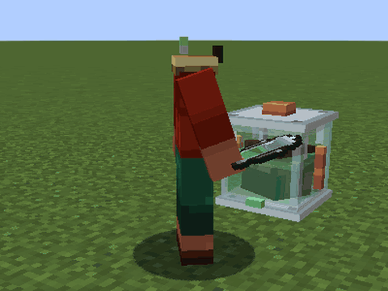

*A troca, vista por um colega: do corpo para o pote, e de volta. Aperte **Trocar**.*

- **Conectado**: **Trocar** faz você acordar na sua cabeça com qualquer sinal. Seu corpo fica de pé, com a armadura.
- **Pote**: **Trocar** pousa sua cabeça onde ela está (num Berço, se você estiver sentado num) e passa você para o
  corpo. Exige um corpo registrado, que não seja cadáver, uma Câmera de Colar e conexão acima de 20%: "Sinal em 18%.
  Aproxime-se do corpo ou de um Mastro Retransmissor." **Usar** o seu corpo de pé faz o mesmo.
- Com a cabeça ainda no lugar: "Sua cabeça ainda está no lugar. A Cadeira de Separação resolve." Não funciona de um
  hospedeiro, de um mecha nem de um soquete.

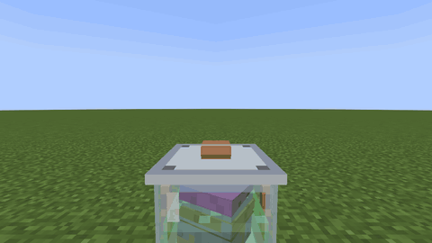

*O Deslocamento visto de dentro: do corpo para o pote, e de volta. Aperte **Trocar**.*

**O Deslocamento.** Indo para o corpo, a visão do pote recua e sobe pela tela, há uma única rajada de estática, uma
faixa verde-azulada clara sobe pela tela, e a visão do corpo se assenta no lugar, partindo de um pouco mais aberta e um
pouco mais alta. Voltando para o pote, a faixa desce. Leva meio segundo, e você tem o controle na hora. Quem estiver por
perto ouve o corpo desligar com três bipes descendentes do colar quando você sai ("Corpo desliga"), e ligar com três
ascendentes quando você chega ("Corpo liga"). Com `photosensitive`, a troca é uma transição simples; `screenShake`
define o quanto a visão se assenta, e em 0 ela chega parada.

### Seu corpo, enquanto você está fora

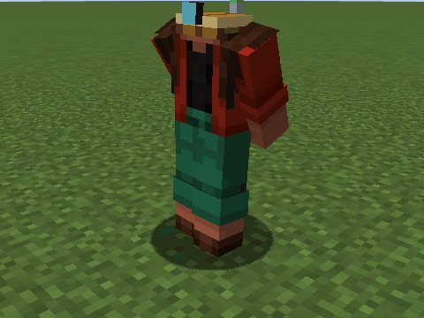

*Um corpo deixado de pé: em posição de sentido, uma inquietação, sentando depois de três minutos, e um aceno quando o
pote dele chega perto e olha para ele (tempo acelerado entre os trechos).*

Seu corpo espera em posição de sentido, mãos cruzadas atrás das costas, respirando, trocando o peso de perna a cada
poucos segundos. Depois de meio minuto, começa a se inquietar, mais ou menos a cada doze segundos: apalpa os bolsos,
ergue a mão para endireitar a Câmera de Colar (ou dá tapinhas no toco), confere um relógio que não tem ou bate o pé.
Depois de três minutos, senta de pernas cruzadas e espera com as mãos no colo. Quando você volta como pote a até 16
blocos, ele se vira para você; a até 8, se você olhar para ele, ele acena; a até 3, estende os braços para você.
Lembramos aos colaboradores que o corpo não é cabideiro. O relógio é o do seu próprio jogo: começa quando o seu jogo vê
o corpo pela primeira vez.

### Carregando a cabeça

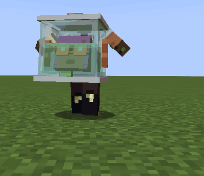

*Carregando a cabeça com a mão vazia: **Use** sua cabeça pousada com uma Bolsa de Cabeça consigo.*

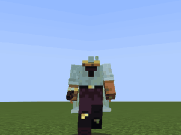

*Segure qualquer coisa e o pote vai para as costas.*

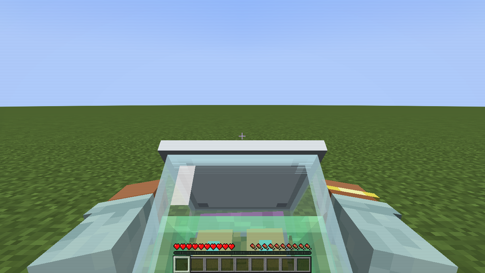

Com uma **Bolsa de Cabeça** no inventário (ou num cinto do Curios; uma renomeada também vale), **Use** sua cabeça
pousada; para tirá-la de um Berço, **Use** o Berço. Sem bolsa: "Você precisa de uma Bolsa de Cabeça para carregar sua
cabeça".

Com a mão vazia, você abraça o pote à sua frente, uma mão de cada lado, com sua cabeça virada lá dentro olhando para
você. Segure qualquer coisa e ele vai para as suas costas, olhando para trás. Carregada, a conexão é perfeita, a cabeça
não bebe soro e os portais deixam você passar. Os golpes acertam o corpo, não o pote. Se o seu corpo morrer, você vira o
pote ali mesmo.

**Para pousar**: segure a bolsa na mão (enquanto isso, o pote vai para as costas), então **Agache** e **Use** a bolsa:
a cabeça desce à sua frente (aos seus pés, se você estiver junto a uma parede), ou sobre uma Base de Recarga para a qual
você estiver olhando. **Use** um Berço vazio para acomodá-la nele, ou uma Base de Recarga para pô-la de pé sobre a
placa.

### Sua cabeça pousada

Nenhum jogador consegue feri-la, nem você: "Essa é a sua própria cabeça. Carregue-a na sua Bolsa de Cabeça." Criaturas,
explosões, fogo e lava conseguem. O calor racha um ponto de vidro por segundo; qualquer outra coisa, um ponto por ponto
de dano. Cada pancada é comunicada a você, com o que resta. Enquanto você está offline, ela fica segura. Um amigo de
confiança pode reabastecê-la.

### Soro

| Pote | Soro |
|---|---|
| Pote de Suporte Vital, Pote Compacto | 1.000 mB |
| Reforçado | 1.500 mB |
| Executivo | 2.000 mB |

Uma cabeça solta no mundo bebe 1 mB a cada 12 segundos (metade disso com um Reciclador de Soro): um pote básico cheio
dura cerca de 3 horas e 20 minutos. Uma cabeça acomodada num Berço ou carregada não bebe nada. Um **Frasco de Soro**
acrescenta 250 mB; a dica dele diz quanto tempo o soro do seu pote dura solto no mundo com as configurações deste
servidor.

Acabou o soro: "Sem soro: o vidro racha a cada 30 s, depois você morre. Arrume soro." A partir daí, a cada 30 segundos
o pote perde um ponto de vidro; quando o vidro acaba, um pote perde meio coração a cada 30 segundos, e **uma cabeça
pousada morre de verdade**. Uma cabeça básica deixada sem soro morre cinco minutos depois de secar.

### Integridade do Pote

O vidro absorve o dano antes de você. Potes de Suporte Vital e Compactos têm 10 pontos, o Reforçado 20, o Executivo 30.
Qualquer golpe num pote custa pelo menos um ponto. O pote avisa: "Vidro: restam 7/10. Um Remendo de Vidro conserta."
Com 3 ou menos: "Vidro 3/10: mortal. Fuja e use um Remendo de Vidro." Com 0: "Sem vidro: cada golpe é de verdade.
Fuja; descanse num Berço de Suporte Vital."

Um **Remendo de Vidro** conserta 5 pontos. Um Berço conserta um ponto a cada 10 segundos, para uma cabeça acomodada
nele ou um pote sentado na almofada dele.

### Carga

| Pote | Carga |
|---|---|
| Pote de Suporte Vital, Pote Compacto | 100.000 FE |
| Reforçado | 250.000 FE |
| Executivo | 500.000 FE |

Um pote gasta 2 FE por tick só por estar vivo (um pote básico cheio: cerca de 42 minutos), mais o que os módulos
usarem. Um jogador conectado não gasta nada. Carregue com redstone no espaço de recarga (5.000 FE por pó, 45.000 por
bloco), numa **Base de Recarga** (500 FE por tick) ou acomodado num Berço (até 10.000 FE por segundo). Sem carga, os
módulos alimentados param: "O pote está sem carga. Recarregue numa Base de Recarga."

### Os medidores do pote


*O HUD na escala de interface 3, um pote montado num enderman com pouca carga: a coluna lateral no alto à esquerda, os
corações do enderman e as barras do pote junto à barra de atalhos. O vidro está inteiro, então os corações e a armadura
do próprio pote ficam ocultos.*

Como pote (montado, pilotando ou conectado a um soquete, inclusive), três barras ficam onde estaria a sua barra de fome:
a carga embaixo, marcada com um raio; o soro acima dela, com uma gota; a Integridade do Pote no topo, com uma vidraça.
Uma barra abaixo de 15% fica vermelha e hachurada, para que o nível baixo se leia sem depender da cor. Os números (carga
em porcentagem, soro em mB, vidro em pontos restantes) aparecem logo à direita das barras por três segundos depois que
qualquer uma delas muda, enquanto alguma estiver abaixo de um quarto e enquanto você segura **Agachar**;
`hudNumbers = true` na config do cliente os mantém sempre visíveis. O vidro leva cada golpe antes da sua cabeça, então
seus corações e sua fileira de armadura ficam ocultos enquanto ele se mantém acima de 3 pontos e sua cabeça está ilesa;
eles voltam quando o vidro chega a 3 ou menos, ou assim que a própria cabeça se fere.

Todo o resto que o mod informa fica numa coluna no alto à esquerda, nunca mais larga que um terço da tela: o painel do
hospedeiro enquanto você monta, o painel do mecha numa cabine e seus genes ativos com suas teclas. Uma linha longa
quebra.

### Lendo um pote

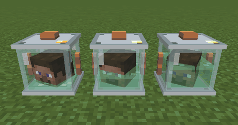

*Um pote quase seco e com pouca carga, um meio cheio e um cheio: o nível de soro no vidro, a lâmpada na tampa.*

Todo pote mostra como vai o seu ocupante, para quem olhar: o seu, como pote, num hospedeiro ou num mecha, nos seus
braços, e a sua cabeça pousada.

- **Soro** fica no seu nível dentro do vidro. Um pote seco é vidro vazio.
- **Carga**: uma pequena lâmpada na tampa. Verde fixa; um pulso lento em âmbar abaixo de um quarto; apagada quando
  zerada.
- **Vidro**: quando a integridade cai abaixo da metade, você o ouve rachar ("Vidro do pote racha"), e abaixo de um
  quarto, trincar ("Vidro do pote trinca").

Uma cabeça acomodada num Berço sempre parece cheia e abastecida. Cabeças de criaturas em potes, torretas e montarias não
mostram nada disso.

### O Menu do pote

**Menu do pote**, em qualquer forma de pote. Sete espaços de módulo, cada um com moldura; os que passam do nível do seu
pote ficam fechados e dizem qual pote os abre. Um de cada módulo. Aponte para um espaço vazio e ele diz o que vai ali.
Um **espaço de recarga** para redstone, blocos de redstone, Frascos de Soro e Remendos de Vidro (o que sobrar volta
quando você fecha o menu); aponte para ele vazio para ver quanto vale cada um. A barra de carga, que mostra o valor
exato ("11.416 / 100.000 FE") quando você aponta para ela. Dois botões: **Entregador** e **Desistir**. Como corpo
conectado: "O menu do pote está com sua cabeça. Troque para ela primeiro."

### Andando por aí como pote

**Rodinhas** tomba de lado um pote sem nada: ele rola a um oitavo da velocidade de caminhada e o mundo fica de lado.
**Rodinhas** de novo o põe sentado. Com o módulo **Rodinhas**, a tecla **Rodinhas** baixa as rodinhas (veja Módulos do
pote). Um pote também pode andar de barco ou de carrinho de mina.

### O Entregador

Pelo **Menu do pote** (ou `/headoffice courier`), como pote ou num soquete. Trinta segundos depois, a Noggin & Sons
pousa seu corpo ao seu lado, venha de onde vier, outra dimensão incluída. A taxa é de 20.000 FE, ou toda a sua carga,
se você tiver menos: o pedido nunca é recusado por falta de carga. Reembolsada se o corpo não for encontrado, ou se você
deixar de ser um pote antes. Recusas: "Seu corpo está bem aqui. Use-o." (a menos de 8 blocos), "O Entregador já está a
caminho. Obrigado por aguardar." Um cadáver também é entregue: "um corpo, falecido".

### Morte do corpo e cadáveres

Um corpo ocioso tem 10 corações e veste sua armadura de peito, pernas e pés. Morto, ele se deita como cadáver.

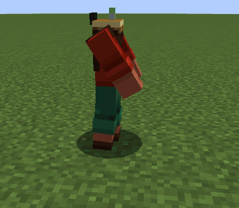

*Um corpo morrendo onde estava, visto de lado.*

Um corpo que morre senta com força quando os joelhos cedem, depois tomba de costas com um baque e três últimos bipes do
colar. Se estava esperando ocioso, o dono é avisado no chat: "Seu corpo faleceu. O RH mandou um cartão." O cartão fica
sobre o peito, sob as mãos cruzadas; enquanto alguém está com os pertences abertos, as mãos se afastam. O seu próprio
cadáver solta um pequeno sinalizador laranja a cada dois segundos, que só você vê, e, como pote, a seta da barra de
conexão aponta para ele.

Quando o seu corpo **conectado** morre, não é a sua morte. Ele vira um cadáver com seu inventário e sua armadura, e você
acorda na sua cabeça com a vida cheia, avisado uma vez: "Seu corpo morreu. Você acorda na sua cabeça. Um Kit de Sutura
no cadáver o traz de volta." (desta vez, sem cartão do RH) `linkLossInventory` na config do servidor pode manter suas
coisas com você, ou derrubá-las.

Um cadáver não pode ser ferido. Você, num corpo, pode **Usar** o cadáver para abrir os pertences dele, assim como
qualquer pessoa em quem você confia (e o seu time). Qualquer outra pessoa: "A pessoa libera com /headoffice trust."
Como pote, junto ao seu cadáver, **Use** o cadáver: um Kit de Sutura em qualquer lugar com você ou no cadáver é usado e
sua cabeça volta ao lugar; sem kit, os pertences abrem para você pegar as peças de um (o Kit de Sutura é uma receita sem
forma fixa e cabe na grade de criação do próprio inventário). Um corpo que cai no vazio deixa o cadáver onde esteve por
último.

### Recolocando a cabeça

**Kit de Sutura**:

- **Carregando a cabeça**: segure **Usar** por 3 segundos. A mão da agulha faz pequenos círculos, um ponto de cada vez;
  a campainha de mesa toca quando você termina.
- **Como pote**: **Use** o kit no seu próprio corpo ou cadáver.

Você fica inteiro de novo, de volta onde estava o seu corpo. Seus módulos e um pote vazio do mesmo tipo voltam; os
óculos e a Câmera de Colar voltam um pouco gastos (melhorias e emaranhamento mantidos). Você fica enjoado por 30
segundos. De um cadáver, você recupera todas as suas coisas e começa com 3 corações.

### Desistir

O botão **Desistir** do **Menu do pote**, após uma confirmação: "Sua cabeça desiste. Você morre, seus módulos caem e
você renasce com um corpo." O pote não é devolvido.

### A Impressora de Corpos

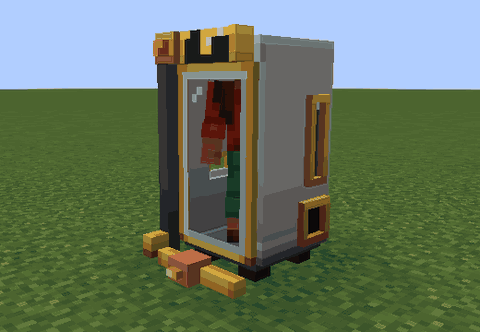

*O fim de uma impressão: aperte **Imprimir** como pote, com tudo carregado.*

Perdeu seu corpo de vez? A **Impressora de Corpos** imprime um novo, com Câmera de Colar instalada. Receita: lingote,
vidro, lingote; servo, pistão, servo; lingote, bloco de redstone, lingote. É uma cabine de fotos de dois blocos de
altura.

Coloque 16 carnes podres, 8 blocos de osso, 4 blocos de redstone, 8 bolas de slime e 2.000 mB de soro (frascos, baldes
ou canos; o tanque comporta 4.000), armazene 200.000 FE (ela comporta 250.000 e recebe até 5.000 FE por tick) e então
aperte **Imprimir** como pote. Nada é consumido até que a energia da impressão inteira esteja armazenada. Um minuto
depois, o corpo está de pé na frente da impressora: "Seu corpo novo está pronto. Está um pouco úmido." O corpo novo
substitui o antigo; um corpo antigo que esteja de pé cai. Se você estiver num corpo quando ela terminar, o novo espera
no tanque até você ser um pote.

Durante a impressão, a barra de impressão desce pela cabine e o corpo toma forma embaixo dela, depois ganha cor de cima
para baixo; no fim, a porta se abre e o corpo sai. Com os quatro materiais carregados, o cabeçote de impressão espera no
meio. Se faltar energia no meio da impressão, a barra cede e a lâmpada enfraquece.

Recusas: "Corpos são para cabeças em potes. Volte decapitado.", "Faltam 4 de Bola de Slime. Coloque e aperte Imprimir
de novo.", "Pede 200 kFE; tem 100. Alimente a Pilha Galvânica.", "Já está imprimindo, faltam 40 s.
Espere o corpo."

#### Impressão sob Encomenda


*Uma vaca impressa a partir de uma Fração de DNA: a hospedeira sai pela porta e se sacode para secar.*

A impressora tem um quinto espaço, o **Molde**. Ponha nele uma **Fração de DNA** de qualidade 40 ou mais e a
impressora imprime um **hospedeiro sem cabeça** dessa espécie em vez do seu próprio corpo. A tela mostra o nome da
espécie e o tamanho dela, e os materiais necessários. Qualquer um, em qualquer forma, pode apertar **Imprimir** para uma
espécie; quem apertou é o empregador do hospedeiro. Um minuto depois, o hospedeiro sai pela porta, se sacode como um
cachorro molhado e fica de pé: "Seu pedido (Vaca) está pronto. Está um pouco úmido." O frescor dele é a qualidade da
fração, a sincronia é 0, e a fração é consumida. Um aldeão impresso não tem profissão ("Aldeão impresso vem sem
experiência."). Hospedeiros impressos não deixam itens ao morrer; o Jade diz "Sob encomenda. Não deixa nada ao morrer."

A porta tem um bloco de largura e dois de altura, e os materiais acompanham o tamanho:

| Tamanho | Por exemplo | Materiais | Soro | Energia |
|---|---|---|---|---|
| Miúdo (um quarto) | galinha, coelho, morcego, sapo, papagaio, bacalhau, salmão, peixe tropical, baiacu, axolote | 4 carnes podres, 2 blocos de osso, 1 bloco de redstone, 2 bolas de slime | 500 mB | 50 kFE |
| Pequeno (metade) | porco, ovelha, lobo, raposa, gato, jaguatirica, tatu, aranha das cavernas | 8, 4, 2, 4 | 1.000 mB | 100 kFE |
| Médio (uma impressão inteira) | vaca, aldeão, bruxa, zumbi, esqueleto, creeper, blaze, piglin, lula, guardião, lavagante, lhama | 16, 8, 4, 8 | 2.000 mB | 200 kFE |

Modelos marinhos (lulas, peixes, golfinhos, guardiões, axolotes) são entregues na água: "Modelos marinhos são entregues
molhados. Alague a soleira antes." Um modelo morto-vivo impresso a céu aberto durante o dia vem com um aviso: "Ele
queima no sol. Retire depois que escurecer, ou debaixo de um teto." Quebrar a impressora no meio da impressão devolve os
materiais que ela consumiu e o molde. Com o espaço vazio, a impressora imprime o seu próprio corpo exatamente como
antes.

Recusas: "Molde é Fração de DNA. Centrifugue uma Amostra de Sangue antes.", "Fração fraca demais para imprimir
(qualidade 32). Mínimo: 40.", "Esse modelo não passa pela porta." (aranha, panda, tartaruga), "Esse modelo é alto
demais para a cabine.", "Chefões não são impressos. O Jurídico foi muito claro.", "Nossa licença não cobre esse
modelo." (warden, guardião ancião), "Imprimimos carne. Golens e espíritos são assunto das Instalações.", "Slime é só
cabeça. Não há corpo para imprimir.", "Esse modelo não consta da nossa lista de homologados." (criaturas de outros
mods) e, com `genetics.specimenPrinting` desligado, "A impressão de espécimes não tem licença neste servidor."

---

## Potes e equipamento de telepresença

### Os potes

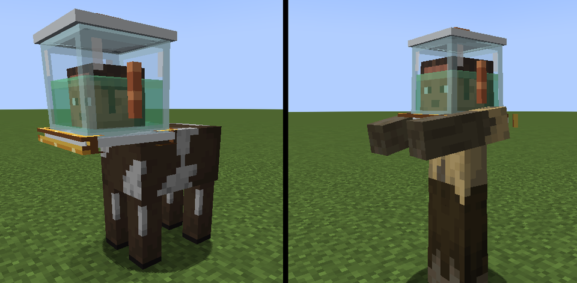

| Pote | Receita | Espaços | Carga | Soro | Vidro |
|---|---|---|---|---|---|
| **Pote de Suporte Vital** | lingote de cobre; vidro, bola de slime, vidro; lingote, redstone, lingote | 3 | 100 kFE | 1.000 mB | 10 |
| **Pote Compacto** | um Pote de Suporte Vital sozinho na grade (e de volta) | 3 | 100 kFE | 1.000 mB | 10 |
| **Pote de Suporte Vital Reforçado** | fragmento de netherita; vidro fumê, Pote de Suporte Vital, vidro fumê; obsidiana. À prova de fogo | 5 | 250 kFE | 1.500 mB | 20 |
| **Pote de Suporte Vital Executivo** | casco de shulker, Chip Sináptico, casco de shulker; bloco de ouro, Pote Reforçado, bloco de ouro. À prova de fogo | 7 | 500 kFE | 2.000 mB | 30 |

Os potes de Suporte Vital, Reforçado e Executivo são espaçosos: sua cabeça gira por completo lá dentro. O Pote Compacto
é do tamanho de uma cabeça: sua cabeça fica virada para a frente dele, e o pote inteiro gira junto. Um pote vai na
Cadeira de Separação. Você só o recebe de volta com um Kit de Sutura.

### Óculos Retransmissores

| Óculos | Receita | Alcance |
|---|---|---|
| **Óculos Retransmissores Mk I** | couro, lingote de cobre, couro; lente, fio, lente | 48 blocos |
| **Óculos Retransmissores Mk II** | lingote de ouro, Chip Sináptico, lingote de ouro; Mk I embaixo | 160 blocos |
| **Óculos Retransmissores Mk III** | diamante, Chip Sináptico, diamante; pérola do ender, Mk II, pérola do ender | 640 blocos |
| **Óculos Quânticos** | Nó Quântico, Mk III, Nó Quântico | a dimensão inteira |

**Óculos novos depois do corte**: como corpo conectado, **Use** os óculos na sua cabeça pousada ou no Berço que a
guarda. O par antigo volta. Uma cabeça carregada precisa ser pousada antes.

### Câmera de Colar e suas melhorias

**Câmera de Colar**: uma lente em cima; fio, servo, fio; três lingotes. Sem uma no pescoço, você não consegue trocar de
volta para o seu corpo.

Cada Câmera de Colar aceita até **4** melhorias. **Use** uma melhoria com uma Câmera de Colar na outra mão, ou, depois
que a cabeça sair, como corpo conectado (ela vai para o colar no seu pescoço). "Nenhuma Câmera de Colar para encaixar,
ou sem espaço (4 melhorias)"

<details><summary>As nove melhorias da Câmera de Colar</summary>

| Melhoria | Receita | O que faz |
|---|---|---|
| **Lente Grande-Angular** | painel de vidro, lente, painel de vidro | Visão mais ampla (conectado) |
| **Haste de Periscópio** | lente sobre duas barras de ferro | Seu corpo sem cabeça fica de pé na altura completa |
| **Óptica Noturna** | lente sobre uma cenoura dourada | Visão noturna (conectado) |
| **Vedação à Prova d'Água** | alga seca, bola de slime, alga seca | Sem perda de conexão debaixo d'água |
| **Carcaça Blindada** | lingote de ferro, laço, lingote de ferro | Imune a PEM |
| **Antena Chicote** | para-raios sobre duas lingotes de cobre | +25% de alcance da conexão |
| **Filtro de Ruído** | lã branca, fragmento de ametista, lã branca | Metade da estática |
| **Sobreposição Térmica** | lente sobre uma bolsa de tinta brilhante | Seres vivos a até 24 blocos brilham (conectado) |
| **Óptica de Zoom** | lente, luneta, lente | Segure **Zoom do colar** para zoom x3 (conectado) |

</details>

### Par Emaranhado, Fragmento Emaranhado, Nó Quântico

**Nó Quântico**: olho do ender, fragmento de eco, olho do ender; fragmento de ametista, Chip Sináptico, fragmento de
ametista; olho do ender, fragmento de ametista, olho do ender. Um ingrediente raro.

**Par Emaranhado**: Nó Quântico, cristal do End, Nó Quântico. **Use** para dividi-lo em dois **Fragmentos
Emaranhados** que compartilham um mesmo estado. Fabrique um fragmento com seus óculos e o outro com sua Câmera de
Colar. Faça o colar antes da operação: depois, não dá para trocá-lo. Óculos e colar emaranhados levam a conexão para
outras dimensões (80%) e deixam um corpo conectado usar portais sem a cabeça.

### Granada de PEM

Duas lingotes de ferro, duas lingotes de cobre e um bloco de redstone (ferro em cima e embaixo, cobre dos lados). **Use**
para arremessar. A até 8 blocos de onde ela cair: corpos conectados voltam para as cabeças ("PEM! A conexão caiu: você
voltou para a cabeça. Troque para retornar."), potes perdem metade da carga, mechas metade da bateria, torretas se
apagam. A Carcaça Blindada protege você. Dois segundos entre arremessos.

### Bolsa de Cabeça, Kit de Sutura, Remendo de Vidro

- **Bolsa de Cabeça**: duas linhas e seis couros. Carrega sua cabeça (veja Carregando a cabeça).
- **Kit de Sutura**: linha, bola de slime, pepita de ferro e um Frasco de Soro, sem forma fixa. Empilha até 16.
  Recoloca sua cabeça.
- **Remendo de Vidro**: um painel de vidro e uma bola de slime, sem forma fixa. Empilha até 16. Conserta 5 pontos de
  vidro. **Use** no ar enquanto carrega a cabeça ou como pote com um Braço, **Use** na sua cabeça pousada, ou ponha no
  espaço de recarga. "O vidro está inteiro. Guarde o remendo para depois."

---

## Blocos de energia e de suporte vital

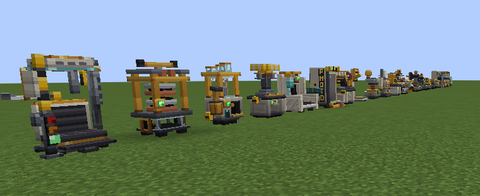

Toda máquina da Noggin & Sons agora é uma máquina de verdade: peças que se mexem quando ela trabalha, sons próprios
(todos com legenda) e uma **lâmpada** na frente que diz como ela está indo.

| Lâmpada | Significa |
|---|---|
| Apagada | Desligada: sem energia, ou sem nada a fazer (**Usar** com a mão vazia mostra qual dos dois) |
| Verde | Pronta |
| Âmbar | Esperando algo que você pode resolver: uma saída cheia, uma entrada faltando, um pote cheio |
| Âmbar, pulsando | Trabalhando |
| Âmbar fraco, pulsando | Trabalhando com energia insuficiente |
| Vermelha, por dois segundos | Acabou de recusar você |

Uma recusa também diz o motivo em uma linha, toca "Noggin & Sons lamenta" e chacoalha a peça em questão.

**Alimentando as coisas.** Toda máquina recebe FE (Forge Energy) por qualquer lado, inclusive pela metade de cima: de
uma Pilha Galvânica, uma Garrafa de Leyden ou um Nó de Tesla não ligado encostados nela, de um Nó de Tesla ligado ou
dos cabos de outro mod. Esses três só mandam energia pela metade de baixo; um cabo pode puxar de qualquer metade. 1 kFE
é 1.000 FE; mB é um milésimo de balde. **Usar** um bloco de energia com a mão vazia mostra a carga dele.

### Dois blocos de altura

A maioria das máquinas tem dois blocos de altura. Das vinte e duas máquinas reconstruídas, só o Bloqueador de Sinal, o
Suporte de Funcionário, o Soquete Neural, a Placa de Segurança e uma Cabeça no Pote colocada cabem em um. Uma máquina
alta precisa do bloco de cima livre na hora de colocar: "Sem espaço acima. Precisa de dois blocos de altura." A metade
de cima (um bloco próprio, **Máquina (metade de cima)**) faz parte da máquina: clicar nela clica na máquina, quebrá-la
quebra a máquina (que cai como sempre), e funis, canos e cabos se conectam a qualquer uma das metades.

**Máquinas de um mundo mais antigo.** Uma máquina colocada antes da 0.4.0 ocupa o bloco de cima no primeiro tick, se
ele estiver vazio (ar, grama, uma camada de neve). Se houver qualquer outra coisa ali, nada é substituído: a máquina
continua com um bloco de altura e funciona como antes, mas só a metade de baixo é desenhada. No Berço de Suporte Vital,
na Base de Recarga, na Impressora de Corpos, na Matriz Cerebral, na Garrafa de Leyden e no Mastro Retransmissor a
lâmpada fica na metade de cima e também não é desenhada. Quebre o bloco de cima e a máquina ocupa a metade de cima em
até dois segundos. As máquinas que antes não tinham direção (a Pilha Galvânica, o Berço de Suporte Vital, a Base de
Recarga, o Nó de Tesla, os dois Mastros Retransmissores, o Bloqueador de Sinal e a Garrafa de Leyden) agora ficam
viradas para o norte. Tudo o que elas guardavam é mantido.

### Pilha Galvânica

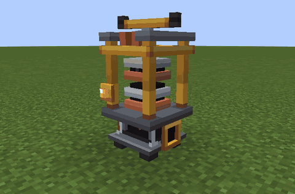

*A Pilha Galvânica trabalhando depois que a carne entra: **Usar** carne podre nela.*

**Pilha Galvânica**: seis lingotes de cobre, dois Fios de Neurocobre e uma carne podre (anel de cobre, fio acima e
abaixo da carne). Uma prensa de Volta sobre uma cuba de vidro com carne.

- **Usar** carne nela a alimenta (um pote não consegue): carne podre dá 4.000 FE, um olho de aranha 6.000, qualquer
  carne ou peixe cru 3.000. Ela diz quanto entrou e quanto ainda falta queimar. O espaço aceita uma pilha de um tipo
  só de carne. Funis podem alimentá-la.
- Ela queima 20 FE por tick para o próprio estoque de 50.000 FE e divide a energia igualmente, até 1.000 FE por tick
  para cada uma, entre as máquinas encostadas na sua metade de baixo. **Usar** com a mão vazia mostra a carga e o
  combustível.
- Trabalhando, a manivela gira o parafuso da prensa um quarto de volta por vez, uma faísca salta entre os terminais, a
  carne solta um pouco de fumaça e de vez em quando se contrai. A prensa desce conforme cada pedaço queima. Um pedaço
  novo faz a manivela voltar; o último deixa a prensa com um suspiro.
- Recusas: "A pilha está cheia de Carne Podre. Deixe queimar um pouco." e, para comida que ela não queima, "A Pilha
  queima Carne Podre e Olho de Aranha, não Bife." (carne e peixe crus também queimam).

### Garrafa de Leyden

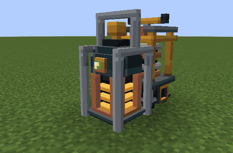

*Uma Garrafa de Leyden enchendo a partir da pilha atrás dela: as células acendem conforme a carga sobe.*

**Garrafa de Leyden**: fio em cima; vidro, bloco de cobre, vidro; vidro, lingote, vidro. Uma bateria de vidro numa
gaiola de transporte.

- Guarda 250.000 FE. Recebe até 2.000 FE por tick e dá até 2.000 FE por tick para cada máquina encostada na sua metade
  de baixo. Ela nunca alimenta outra Garrafa de Leyden, nem ao lado, nem empilhada acima ou abaixo.
- Nada nela se mexe. A carga aparece como células acesas em três janelas, em quatro etapas; a lâmpada pulsa enquanto
  ela enche, e uma faísca estala no botão quando ela está cheia.

### Nó de Tesla

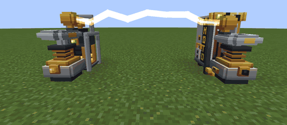

*Dois Nós de Tesla ligados passando energia: ligue-os com a Chave Cirúrgica, primeiro o que envia.*

**Nó de Tesla**: para-raios; fio, bloco de cobre, fio; três lingotes. Uma pequena bobina de Tesla com uma esfera
montada no anel.

- Guarda 10.000 FE e recebe até 2.000 FE por tick. Ligado, envia até 2.000 FE por tick para o nó ao qual está ligado,
  a até 16 blocos, perdendo 5%. Não ligado, alimenta as máquinas encostadas na sua metade de baixo (mas não outros
  nós); o nó receptor de um par ligado faz o mesmo.
- **Chave Cirúrgica** (com formato: um lingote em cima no meio; um fio no centro com um lingote à direita; um lingote
  embaixo à esquerda): **Usar** no nó que envia ("Nó de envio escolhido: agora use o nó receptor"; o nó olha em volta
  procurando o parceiro), depois no que recebe ("Nós de Tesla ligados"). **Agachar** e **Usar** num nó o desliga.
  Qualquer uma das metades do nó serve. Cada clique que dá certo gira a chave um quarto de volta, em três estalos de
  catraca.
- A esfera de cada nó se vira para o parceiro. Enquanto a energia flui, o anel do nó que envia gira, um arco
  crepitante une as duas esferas com uma conta correndo em direção ao receptor, e uma vez por segundo o anel dá um
  tranco e a esfera se acende. A opção `photosensitive` da configuração do cliente desliga o tranco e a luz.
- Recusas: "Longe demais: os nós alcançam 16 blocos. Ponha um mais perto.", "Um nó não envia para si mesmo. Use um
  segundo nó.", "Este nó não envia para lugar nenhum. Desligue no nó que envia." A chave em qualquer outro bloco da
  empresa: "A chave só liga cada Nó de Tesla. Nada a ajustar aqui."

### Base de Recarga

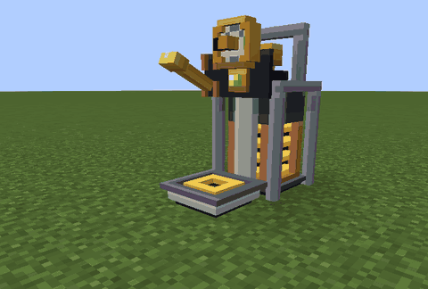

*Uma cabeça pousada numa Base de Recarga: carregando sua cabeça, **Usar** na base.*

**Base de Recarga**: lingote de cobre, fio, lingote de cobre; lingote, bloco de redstone, lingote. Uma placa de recarga
com chave-faca e mostrador.

- Guarda 20.000 FE e recebe até 2.000 FE por tick. Carrega a 500 FE por tick um pote parado sobre a placa, ou a sua
  própria cabeça pousada nela enquanto você está fora no corpo: carregando sua cabeça, **Usar** na base coloca a cabeça
  na placa. "Base de Recarga: carregando, 40%." e, quando termina, "Base de Recarga: seu pote está com carga completa."
- Uma cabeça pousada na placa fica de lado em relação à coluna da base, e trocar para ela faz você acordar virado para
  esse lado, para que sua visão, sua mira e a câmera em terceira pessoa fiquem livres da base.
- Quando há um pote ou uma cabeça na placa, a chave fecha e o ponteiro acompanha a carga de E até F; saem faíscas
  enquanto carrega e um sino toca quando está cheio. Sem mais nada para dar, a chave cai aberta e o ponteiro afunda
  abaixo do E.
- **Usar** com a mão vazia mostra a carga. Sem carga nenhuma, ela recusa: "A Base de Recarga está vazia. Alimente com
  uma Pilha Galvânica ou um cabo."

### Mastro Retransmissor

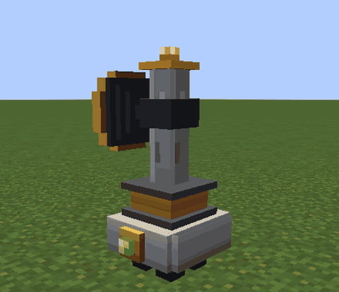

*Um Mastro Retransmissor girando a antena na direção da conexão que transmite.*

**Mastro Retransmissor**: lente; fio, lingote, fio; lingote. Um poste com uma antena parabólica.

- Retransmite sua conexão por 96 blocos (veja [Qualidade da conexão](#qualidade-da-conexão)). Guarda 100.000 FE, recebe até
  2.000 FE por tick e gasta 1 FE por tick (cerca de 83 minutos com a carga cheia), mesmo com o chunk descarregado. Um
  Cartógrafo no quadro de funcionários soma mais metade ao alcance.
- Enquanto transmite uma conexão, a antena se vira para o próximo mastro da cadeia (o último, para o seu corpo) e a
  lâmpada pulsa. A luz de sinalização aérea fica acesa enquanto ele tem energia. Sem energia, a antena murcha. Ele
  estremece com um raio a até 32 blocos quando chove.

### Mastro Retransmissor Mk II

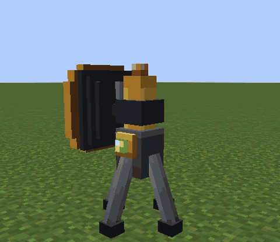

*Um Mastro Retransmissor Mk II virando a antena para um novo salto.*

**Mastro Retransmissor Mk II**: Chip Sináptico; fio, Mastro Retransmissor, fio; bloco de ouro. Como o Mastro, com 192
blocos. A plataforma da lâmpada sobe acima da antena enquanto ele transmite uma conexão, e o farol brilha enquanto ele
tem energia.

### Bloqueador de Sinal

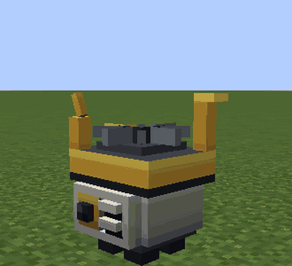

*Um Bloqueador de Sinal com energia, a turbina girando.*

**Bloqueador de Sinal**: fio, Chip Sináptico, fio; ametista, lingote, ametista; fio, bloco de redstone, fio. Um bloco
de altura, com uma turbina em cima.

- Corta a conexão dos outros para 30% num raio de 16 blocos. Quem o colocou, as pessoas em quem essa pessoa confia e o
  time dela são poupados. Um bloqueador colocado por comando não tem dono e não poupa ninguém. Guarda 100.000 FE e
  gasta 4 FE por tick.
- Com energia, a turbina gira devagar. Quando ele corta a conexão de alguém, a turbina acelera com força, ele crepita
  e a grade se enche de estática.

### Misturador de Soro

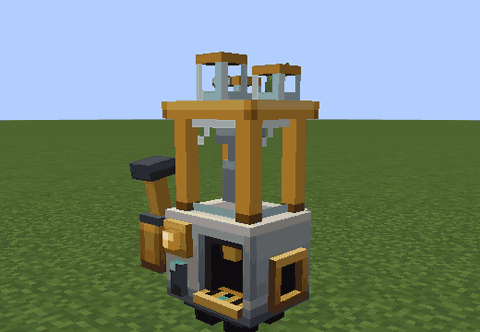

*O Misturador de Soro preparando um lote: começa sozinho quando a água e os ingredientes estão dentro.*

**Misturador de Soro**: lingote, balde, lingote; fio, caldeirão, fio; lingote, redstone, lingote. Uma máquina de
refrigerante de lanchonete.

- 1.000 mB de água + açúcar + alga (ou alga seca) + redstone + 2.000 FE em 10 segundos = 1.000 mB de soro. Começa
  sozinho quando tudo está dentro; um lote que fica sem algo espera onde parou. Um Pescador no quadro de funcionários
  mistura 25% mais rápido.
- Guarda 4.000 mB de água, 4.000 mB de soro e 20.000 FE (até 1.000 FE por tick). **Usar** abre a tela dele. **Usar**
  um balde de água nele despeja a água; um balde vazio tira 1.000 mB de soro. Frascos de vidro no espaço de frascos
  enchem com 250 mB cada. Canos colocam água e tiram soro.
- Misturando, as tampas das latas de açúcar, alga e redstone sobem uma de cada vez e soltam uma dose, a pá gira e o
  soro borbulha. Engarrafando, a torneira é puxada e o soro escorre para o frasco. Uma bandeira sobe quando há frascos
  prontos. O tanque e o visor de água mostram o quanto estão cheios.
- Recusas: "Falta Soro Craniano no Misturador para encher um Balde." e, para o líquido errado, "Misturador de Soro não
  aceita Lava. Veja do que precisa."

**Soro Craniano**: um frasco sai de um frasco de água, açúcar, alga e redstone, sem formato (rende 2); um **Balde de Soro
Craniano** sai de um balde vazio usado no Misturador de Soro. 250 mB por frasco, 1.000 por balde. Um frasco completa um
pote; baldes e frascos enchem o Berço e a Impressora de Corpos. Despejado, é um líquido verde-azulado em que dá para
nadar.

### Berço de Suporte Vital

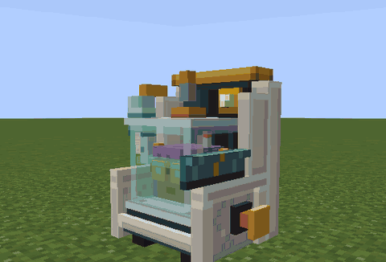

*Uma cabeça acomodada no Berço: carregando sua cabeça, **Usar** no Berço vazio.*

**Berço de Suporte Vital**: vidro, vazio, vidro; fio, vazio, fio; três lingotes. Uma poltrona de orelhas que mantém uma
cabeça viva.

- Guarda uma cabeça acomodada, a salvo de qualquer dano. A cada segundo repõe o soro da cabeça a partir do tanque de
  4.000 mB, dá até 10.000 FE de carga e gasta 100 FE; a cada 10 segundos conserta um ponto de vidro. O soro e o vidro
  funcionam sem energia; a carga precisa dela. Uma cabeça acomodada não bebe soro. Ele guarda 50.000 FE (até 2.000 FE
  por tick). Quebrado, ele pousa a cabeça. Não muda a conexão.
- **Acomodar uma cabeça**: carregando sua cabeça, **Usar** no Berço vazio. Como pote, **Usar** nele para subir na
  almofada ("Você se acomoda no Berço. Troque agora e sua cabeça fica nele."). Sentado ali, você é mantido abastecido
  como uma cabeça acomodada, pelo mesmo tanque e reserva; use **Trocar** e sua cabeça fica acomodada. Ou tenha um a até
  3 blocos da Cadeira de Separação quando for operado. Para tirar a cabeça, **Usar** no Berço com uma Bolsa de Cabeça
  com você.
- Ao acomodar, a mangueira se encaixa na válvula do pote e um cobertor é estendido sobre o colo. Com energia, o fole
  nas costas respira devagar enquanto a cabeça estiver ali. Ao retirar, a mangueira e o cobertor voltam ao lugar. A
  bolsa de soro mostra o nível.
- Qualquer outra pessoa que o use fica sabendo de quem é a cabeça e, se faltar energia ou soro, o que trazer: "Este
  Berço está sem energia. Coloque uma Pilha Galvânica ao lado.", "Este Berço não tem soro para dar. Encha com Soro
  Craniano." ou "Sem energia nem soro: Pilha Galvânica ao lado e Soro Craniano dentro." Outras recusas: "O Berço está
  vazio. Traga sua cabeça numa Bolsa de Cabeça e use-o.", "Sua cabeça está aqui. Traga uma Bolsa de Cabeça para
  tirá-la.", "O tanque do Berço está cheio. Guarde o frasco.", "O Berço só aceita Soro Craniano.", "Sem espaço para
  entrar. Libere o espaço acima do Berço."

### Placa de Segurança

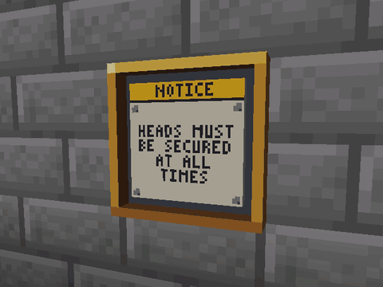

*Uma Placa de Segurança trocando de aviso: **Usar** nela.*

**Placa de Segurança**: corante amarelo, corante preto, corante amarelo; corante amarelo, lingote, corante amarelo
(rende 4). Fica pendurada na parede. **Usar** nela mostra o próximo de dezenove avisos da empresa, de "CABEÇAS DEVEM
FICAR PRESAS SEMPRE" a "FAVOR NÃO BATER NO VIDRO", entre eles "CORPO SAUDÁVEL, CORPO PRODUTIVO". O aviso é pintado na
placa no idioma do seu jogo e lido acima da sua barra de itens.

### Materiais

| Material | Receita |
|---|---|
| **Mistura de Aço Cirúrgico** | lingote de ferro, farinha de osso, carvão, sem formato |
| **Lingote de Aço Cirúrgico** | funda a mistura na fornalha (10 s) ou no alto-forno (5 s); nove a partir de um bloco |
| **Bloco de Aço Cirúrgico** | nove lingotes |
| **Fio de Neurocobre** | lingote de cobre, redstone, lingote de cobre em linha (rende 4) |
| **Lente** | vidro, fragmento de ametista, vidro em linha |
| **Servo** | pistão em cima; lingote, fio, lingote embaixo |
| **Chip Sináptico** | quartzo, fio, quartzo; lingote de ouro, lápis-lazúli, lingote de ouro embaixo |
| **Cabeçote de Excisão** | Bloco de Aço Cirúrgico em cima; servo, lente, tesoura; bloco de redstone embaixo |
| **Console da Cabine** | fio, painel de vidro, fio; lingote, repetidor, lingote; fio embaixo |
| **Lâmina de Reposição** | dois lingotes e um diamante, sem formato |

## Módulos de pote

Uma cabeça num pote é só uma cabeça. Os módulos são como a Noggin & Sons faz dela um colaborador de novo.

### Instalando um módulo

- Os módulos vão no pote, não no item do pote. Você os instala **depois** da operação, como **pote**: aperte **Menu do
  pote** e arraste um módulo para um espaço livre (ou clique nele no inventário com **Agachar**). Para tirar, do mesmo
  jeito. Fabrique os módulos antes da operação ou como corpo conectado, e guarde-os no inventário: sua cabeça fica com
  o inventário, mas um pote não usa bancada de trabalho.
- Um de cada tipo por pote. Um segundo **Módulo de Telecinese** simplesmente não entra.
- Espaços: **Pote de Suporte Vital** 3, **Pote Compacto** 3, **Pote de Suporte Vital Reforçado** 5, **Pote de Suporte
  Vital Executivo** 7. Os espaços que seu pote não tem aparecem fechados; aponte para um e ele diz qual pote o tem.
- A dica de cada módulo diz para instalá-lo pelo **Menu do pote**; o Módulo de Telecinese, o Laser Lacrimal e as
  Rodinhas também dizem a tecla que os aciona, do jeito que você a configurou.
- O **Menu do pote** abre como **pote**, **hospedado**, **piloto** ou num **soquete**. Como corpo **conectado** ele diz
  "O menu do pote está com sua cabeça. Troque para ela primeiro." Com a cabeça ainda no lugar: "Sua cabeça ainda está
  no lugar. O menu do pote é para uma cabeça no pote."
- O menu também mostra sua carga, um espaço de recarga (redstone: 5.000 FE por pó, 45.000 FE por bloco; frascos de
  soro e Remendos de Vidro também entram), **Desistir** e **Entregador**.
- Quando você recoloca a cabeça, todos os módulos voltam para você junto com um pote vazio do mesmo tipo. Se o pote
  quebrar de verdade, os módulos caem onde ele quebrou.

### Quanto custa manter um pote

- **Carga:** um Pote de Suporte Vital ou um Pote Compacto guarda 100.000 FE, um Pote de Suporte Vital Reforçado
  250.000 FE, um Pote de Suporte Vital Executivo 500.000 FE.
- **Manter a cabeça viva:** 2 FE por tick (40 FE por segundo) enquanto você é o pote, faça o que fizer. Um pote básico
  cheio dura uns 42 minutos só com isso (config `idleDrain`, `maxCharge`).
- **Com um Braço Manipulador**, como **pote**: cada ataque, cada bloco quebrado e cada bloco colocado custa 200 FE.
- Os módulos cuja dica diz "Usa carga" gastam carga e param de funcionar em 0 FE. Os que dizem "Precisa de alguma
  carga" não gastam nada por conta própria, mas também param em 0 FE; a tabela diz qual é qual.
- Uma tecla apertada sem módulo por trás faz o pote gorgolejar e diz "Nenhum Módulo de Telecinese instalado. Instale
  pelo menu do pote" (com a tecla). Um módulo instalado num pote sem carga diz "O pote está sem carga. Recarregue numa
  Base de Recarga."

### Telecinese

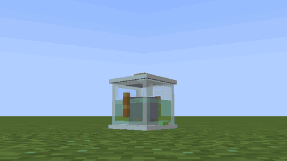

*Telecinese: **Habilidade** para agarrar, olhe para mover, **Atacar** para arremessar.*

O **Módulo de Telecinese** deixa a cabeça mover coisas para as quais não tem mãos. Fabrique com 4 Fragmentos de
Ametista (cantos), 3 Pérolas do Ender, 1 Lingote de Cobre (centro) e 1 Redstone (embaixo no meio).

Só funciona como **pote** sozinho (o Pote Compacto também, e num barco ou carrinho de mina). **Hospedado**, **piloto**
ou num **soquete**, a **Habilidade** é do hospedeiro, do mecha ou do soquete, e o que você segurava é solto.

- **Agarrar:** olhe para o alvo e aperte **Habilidade**. Alcança 16 blocos (config `telekinesisRange`). Enquanto nada
  está seguro, cantoneiras mostram o que você pegaria, até onde o servidor deixa você alcançar: verde-azuladas se dá
  para erguer, cinza se não. (As coisas de outra pessoa aparecem verde-azuladas mesmo sem a confiança dela; ao agarrar,
  o pote avisa.) 500 FE.
- **Segurar:** fica suspenso na frente do pote (um bloco seguro vira um **Bloco Erguido** até você soltar), longe o
  bastante para você ver tudo. Olhe para cima para subir, para baixo para descer. Coisas pesadas se atrasam e balançam
  atrás. Uma linha luminosa sai dos óculos; uma criatura segura brilha em verde-azulado e para de andar. 50 FE por tick
  (1.000 FE por segundo): um pote básico cheio segura por cerca de um minuto e meio.
- **Pousar:** aperte **Habilidade** de novo. Cai onde estiver.
- **Arremessar:** **Atacar** enquanto segura. Voa na direção em que você olha. Um bloco arremessado cai como bloco em
  queda e fere o que atingir, mais quanto maior a queda. 2.000 FE.
- **Também solta** quando você usa **Trocar** para ir ao corpo, quando a carga acaba (a linha enfraquece duas vezes e
  afrouxa), quando a coisa segura fica a mais de 24 blocos (a linha arrebenta), quando você tira o módulo, ou quando
  sobe num hospedeiro ou entra num mecha.

O que dá para erguer: qualquer criatura, um item no chão, um pote de cabeça pousado e qualquer bloco simples avulso até
a dureza da obsidiana (config `telekinesisMaxHardness`). O que não dá, e o que o pote diz:

| Tentou erguer | O pote diz |
|---|---|
| nada, ar ou um líquido | "Nada ao alcance para erguer. Olhe direto para o alvo." |
| um baú, uma fornalha, qualquer máquina | "Máquinas e baús não saem do lugar. Erga um bloco simples." |
| rocha-matriz, qualquer coisa mais dura que obsidiana | "Duro demais para mexer. Escolha algo mais macio." |
| uma porta, uma flor alta, uma cama | "Desajeitado demais para erguer inteiro. Tente um bloco só." |
| um bloco que você não pode quebrar ali | "Você não pode mover isso aqui. Não é seu." |
| o Dragão do Ender, o Wither | "Importante demais para erguer. Procure algo menor." |
| um jogador no modo criativo ou espectador | "Esse aí não pode ser erguido. Tente uma criatura ou um bloco." |
| outro jogador, a cabeça pousada ou o corpo dele, o mecha dele, ou qualquer coisa que outro jogador esteja montando | "(nome) não confia em você. Peça: /headoffice trust add." |

Outro jogador, a cabeça, o corpo e o mecha dele (estacionado ou não) só podem ser erguidos depois que ele confiar em
você com `/headoffice trust add`, ou enquanto você estiver no time dele e ele estiver online. Qualquer coisa que outro
jogador esteja montando, um hospedeiro, um casco ou um cavalo, conta como dele enquanto ele estiver montado.
Um agarrão que falha lança a linha e a enrola de volta, com um chiado.

### Laser Lacrimal

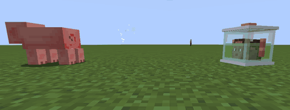

*O Laser Lacrimal, visto de lado. Aperte **Secundária** como pote.*

O **Laser Lacrimal** faz a cabeça chorar sob pressão. Fabrique com 1 Lente em cima de 2 Lágrimas de Ghast com um
Lingote de Cobre entre elas.

Como **pote**, aperte **Secundária**: dois feixes finos de lágrimas saem dos óculos e se encontram na primeira criatura
à sua frente a até 8 blocos, causando 4 de dano (2 corações), ignorando a armadura. O feixe para no primeiro bloco no
caminho: nada atrás de uma parede é ferido. Não incendeia nada. Cada disparo custa 1.500 FE, acertando ou não, e o
laser precisa de 1 segundo entre disparos.

- Abaixo de 1.500 FE: "Carga insuficiente para o laser. Recarregue numa Base de Recarga."
- Cedo demais: "O laser ainda está esfriando. Espere um segundo."
- **Hospedado**, **piloto** ou num **soquete**, a **Secundária** é do hospedeiro, do mecha ou do soquete.

### Rodinhas, e tombar o pote

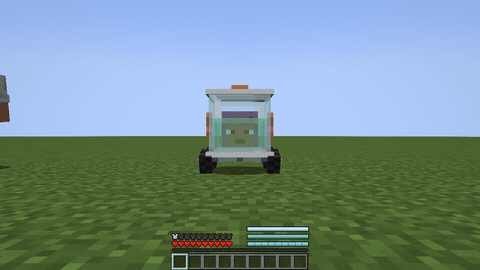

*Rodinhas abaixadas: aperte **Rodinhas** com o módulo Rodinhas instalado e ande.*

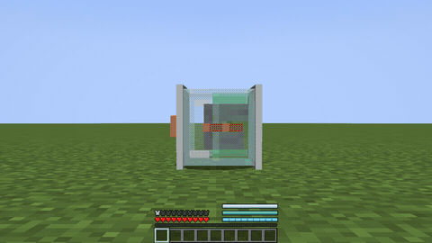

*Sem rodinhas: **Rodinhas** tomba o pote e ele rola, bem devagar.*

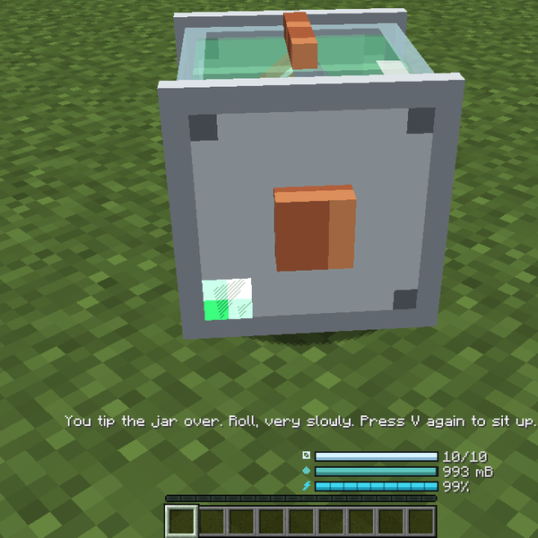

*Um pote sozinho tombado: **Rodinhas** tomba o pote e o endireita de novo.*

O módulo **Rodinhas** é o vale-transporte do pote. Fabrique com 2 Pepitas de Ferro sobre 2 Corantes Pretos com um
Lingote de Cobre entre eles.

- Como **pote**, aperte **Rodinhas**: "Rodinhas abaixadas". Quatro rodinhas descem sob o pote e você anda à metade da
  velocidade de caminhada, 10 FE por tick em movimento. Nada de pular sobre rodinhas. **Rodinhas** de novo: "Rodinhas
  recolhidas".
- Se a carga acabar com as rodinhas abaixadas, elas se recolhem e o pote avisa: "Rodinhas recolhidas. Carregue numa
  Base de Recarga; (sua tecla **Rodinhas**) rola."
- **Sem Rodinhas** (ou sem carga)? **Rodinhas** tomba o pote sozinho de lado: "Você tomba o pote. Role, bem devagar.
  Aperte (sua tecla **Rodinhas**) de novo para se endireitar." Você rola a cerca de um oitavo da velocidade de
  caminhada e vê o mundo de lado. Não custa nada. **Rodinhas** de novo: "De pé de novo".
- As rodinhas se recolhem e o pote se endireita quando você deixa a forma de **pote**. Com a cabeça no lugar,
  **Rodinhas** diz "Nada para dirigir a pé. Isso é para potes e mechas."; **conectado**, "Seu corpo tem pernas. Ande.";
  **hospedado** ou **piloto**: "Daqui de cima, não. Desça primeiro."; num soquete, "Conectado ao soquete. Agache com a
  tecla do menu do pote para sair."

### Hélice

A **Hélice** faz o pote voar. Fabrique com 4 Penas nos cantos, 2 Lingotes de Ferro, uma Lingote de Cobre no meio e um
Redstone embaixo.

Um pote sozinho não anda, mas com uma Hélice ele pode **Pular**. Aperte **Pular** duas vezes rápido para decolar e voe
como no criativo: **Pular** para subir, **Agachar** para descer. 25 FE por tick voando. No chão ele continua só dando
pulinhos.

### Todos os módulos de pote

<details><summary>Todos os 23 módulos de pote: receita, o que faz, custo</summary>

Todas as receitas são com formato, na bancada de trabalho. "Precisa de alguma carga" quer dizer que o módulo para em
0 FE, mas não gasta nada por conta própria.

| Módulo | Receita | O que faz | Custo | Tecla |
|---|---|---|---|---|
| **Molas Saltadoras** | Pistão em cima, Lingote de Ferro, Lingote de Cobre, Lingote de Ferro no meio, Bola de Slime embaixo | o pote vai pulando sempre que você anda, a 60% da velocidade | 100 FE por pulo | andar |
| **Hélice** | 4 Penas, 2 Lingotes de Ferro, Lingote de Cobre, Redstone | voo (**Pular** duas vezes) | 25 FE por tick voando | **Pular** |
| **Rodinhas** | 2 Pepitas de Ferro, 2 Corantes Pretos, Lingote de Cobre | anda à metade da velocidade de caminhada | 10 FE por tick em movimento | **Rodinhas** |
| **Pernas de Aranha** | 4 Linhas, 2 Lingotes de Aço Cirúrgico, Servo | anda a 80% da velocidade e sobe blocos inteiros | precisa de alguma carga | andar |
| **Ventosas** | 2 Bolas de Slime, Lingote de Cobre, Lingote de Aço Cirúrgico | ande contra uma parede para escalá-la; **Agachar** para ficar grudado; sem dano de queda enquanto estiver nela. Precisa de pernas, molas ou rodinhas para chegar à parede | precisa de alguma carga | andar, **Agachar** |
| **Jato d'Água** | Alga, 2 Fragmentos de Prismarinho, Lingote de Cobre, 2 Lingotes de Ferro, Redstone | nada 2,5 vezes mais rápido; vai pulando pelo fundo | 50 FE por tick em movimento na água | andar |
| **Braço Manipulador** | 3 Lingotes de Ferro, Redstone, Lingote de Cobre | como **pote**: minera (à metade da velocidade), coloca, usa itens e blocos, abre baús, negocia, luta (metade do dano), pega coisas | 200 FE por ataque, bloco quebrado ou colocado | **Usar**, **Atacar** |
| **Módulo de Telecinese** | 4 Fragmentos de Ametista, 3 Pérolas do Ender, Lingote de Cobre, Redstone | agarra, segura, pousa e arremessa blocos, criaturas e itens | 500 ao agarrar, 50 por tick segurando, 2.000 ao arremessar | **Habilidade**, **Atacar** |
| **Broca** | Diamante, Lingote de Ouro, 2 Lingotes de Ferro, Lingote de Cobre | minera seis vezes mais rápido do que um pote cavaria sem ela (o triplo do normal). Só funciona como **pote** com um **Braço Manipulador** | nenhum | **Atacar** |
| **Blindagem** | 8 Lingotes de Ferro em volta de uma Lingote de Cobre | +6 de armadura, +2 de resistência da armadura | nenhum | - |
| **Escudo Térmico** | 4 Pós de Blaze, 4 Cremes de Magma, Lingote de Cobre | fogo, lava e magma não ferem o pote, e ele para de queimar; mantém sua cabeça pousada fresca enquanto você está fora no corpo | 100 FE por tick queimando ou na lava | - |
| **Lente Noturna** | Vidro, 2 Pepitas de Ouro, Lingote de Cobre, Cenoura Dourada | Visão Noturna | nenhum | - |
| **Ímã** | Redstone, Lápis-Lazúli, 3 Lingotes de Ferro, Lingote de Cobre | puxa para o pote itens no chão a até 6 blocos; deixa um pote sem braço pegá-los | nenhum | - |
| **Grade de Alto-falante** | 3 Barras de Ferro, 2 Fios de Neurocobre, Bloco Musical | o que você diz no chat flutua sobre o seu pote por 5 segundos (até 60 letras), toda linha, inclusive as mesmas palavras duas vezes | nenhum | chat |
| **Reciclador de Soro** | 2 Vidros, Funil, 2 Fios de Neurocobre, Servo | a cabeça gasta metade do soro (1 mB a cada 24 segundos), seja você o pote, seja ela pousada enquanto você anda com o corpo | precisa de alguma carga | - |
| **Tampa de Choque** | 3 Para-raios, 2 Fios de Neurocobre, Bloco de Redstone | quem bater no pote corpo a corpo leva 3 de dano (1,5 coração) e é empurrado, com vidro ou sem vidro | 500 FE por choque | - |
| **Giroscópio Autonivelante** | 4 Lingotes de Ouro em volta de uma Bússola | sem repulsão; sem visão de cabeça para baixo depois de um corte malfeito | nenhum | - |
| **Antena Central** | Para-raios, Fio de Neurocobre, 2 Lingotes de Aço Cirúrgico, Chip Sináptico | +50% de alcance da conexão neural, enquanto o pote tiver carga | precisa de alguma carga | - |
| **Monitor de Sinais Vitais** | 2 Fios de Neurocobre, Fatia de Melancia Reluzente, 2 Lingotes de Aço Cirúrgico, Redstone | a vida do seu corpo no HUD ("CORPO 20/20") enquanto você é o pote | nenhum | - |
| **Suporte de Chapéu** | Capacete de Couro entre 2 Lingotes de Aço Cirúrgico | o capacete no seu espaço de capacete fica em cima da tampa | nenhum | - |
| **Coprocessador Cortical** | 2 Pepitas de Ouro, Chip Sináptico, 2 Redstones, Lente | perdoa uma base lida errado por leitura no Sequenciador de DNA; como **piloto**, puxa sua mira para um hostil a até 24 blocos | precisa de alguma carga | - |
| **Laser Lacrimal** | Lente, 2 Lágrimas de Ghast, Lingote de Cobre | feixes gêmeos de lágrimas: 4 de dano (2 corações) na primeira criatura a até 8 blocos; para no primeiro bloco | 1.500 FE por disparo, com 1 s de intervalo | **Secundária** |
| **Farol de Chamado do Corpo** | Sino, 2 Lingotes de Cobre, Fio de Neurocobre | enquanto você é o pote, seu corpo parado anda até você (3 blocos por segundo) se estiver no mesmo mundo e com o chunk carregado; para diante de quedas de mais de 3 blocos, lava e fogo | 10 FE por tick enquanto anda | - |

</details>

## Aquisição Hostil: corpos de criaturas

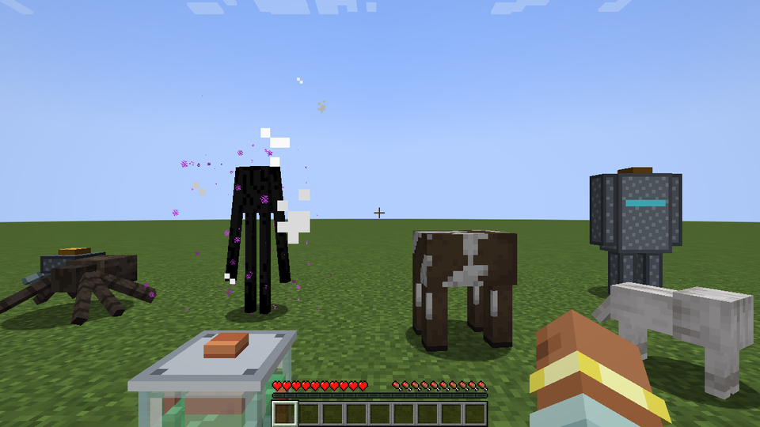

Uma criatura sem cabeça continua andando, desde que alguém conduza. A Noggin & Sons chama isso de **hospedeiro**.
O alguém é você.

### A Serra Cirúrgica

A **Serra Cirúrgica** tira a cabeça de uma criatura enfraquecida. Ela tem 200 usos.

- **Receita** (com forma): um Diamante no canto inferior esquerdo, um Servo no centro, um Lingote de Aço Cirúrgico à
  direita do Servo e outro no canto superior direito. Ou seja: 2 Lingotes de Aço Cirúrgico, 1 Servo, 1 Diamante.
- **Use** a serra numa criatura com **metade da vida ou menos**. Você precisa de mãos: um corpo ou um corpo conectado.
  Acima da metade: "Vivo demais. Deixe-o com metade da vida ou menos antes." Qualquer arma comum, do punho a uma espada
  ou machado de diamante, deixa uma vaca, porco, ovelha, aldeão, esqueleto ou zumbi nesse ponto por pelo menos um golpe
  antes do golpe que mata (uma espada de pedra leva uma vaca de 10 a 5 e depois à morte: serre depois do primeiro
  golpe). Só um machado de pedra, ferro ou diamante mata uma ovelha de uma vez.
- **A tabela da serra** é consultada antes de qualquer coisa girar. O que ela recusa não custa nada (nem uso, nem
  pote): a frase, o som de recusa, e a criatura balança a cabeça uma vez (um aldeão balança a dele).

| Criatura | O que a serra diz |
|---|---|
| Um filhote (tudo o que o jogo chama de filhote) | "Trabalho infantil é contra a política da empresa. Volte quando crescer." (o valor de servidor `saw.allowBabies` os permite) |
| O Dragão do Ender | "O Dragão é assunto do Conselho. Procure o Núcleo da Sala de Reuniões." |
| O Wither | "O Wither tem três cabeças e nenhum departamento de Recursos Humanos." |
| Qualquer outro chefão | "Chefões estão fora de questão. O Jurídico foi muito claro." |
| **Qualquer criatura com etiqueta** | "Este tem nome. Alguém se importa. A serra não corta criaturas com nome." (os nomes que o RH dá aos funcionários não são etiquetas e nunca impedem a serra) |
| O bicho domesticado de outra pessoa (o seu pode) | "Esse bicho é de Steve. A serra não corta bichos dos outros." |
| Já é um hospedeiro | "Já é um hospedeiro. Um corte por criatura." |
| Um Casco Utilitário ou um mecha | "Isso é equipamento da empresa, não um colega. Não há o que cortar." |
| Um suporte de armadura | "Esse já veio sem cabeça e vazio. É mobília." |
| Um jogador, ou o corpo sem cabeça de um colega | "Colegas não são espécimes. Use Serra Cirúrgica numa criatura." |
| Um golem de neve com a abóbora | Não é recusa: o primeiro corte tira a abóbora (ela cai, um uso) com "Abóbora removida. A cabeça por baixo é de neve. Serre de novo." O corte seguinte é um corte normal. |

- **Só cabeça:** um slime, cubo de magma, shulker, vex, abelha, traça, endermite ou girino não tem corpo para guardar,
  então só pode ser serrado para dentro de um pote ("Um slime é só cabeça. Traga um pote; não sobraria corpo para
  guardar.", e uma frase própria para cada um). No pote vai a criatura inteira: nada fica para trás, nada cai, e o
  slime não se divide.
- **Cabeça grande pede pote grande:** um warden, guardião ancião, hoglin, zoglin, farejador, ou um slime ou cubo de
  magma de tamanho 2, precisa de um Pote de Suporte Vital Reforçado ou maior ("Cabeça de Warden: só num Pote de Suporte
  Vital Reforçado ou maior."); um ghast, um devastador, ou um slime ou cubo de magma de tamanho 4 ou mais, de um Pote de
  Suporte Vital Executivo. Um pote maior sempre aceita uma cabeça menor. Sem pote, essas criaturas rendem um corpo como
  qualquer outra.
- Todo corte custa um uso. A criatura fica perfeitamente imóvel enquanto a serra ganha rotação, e então a cabeça sai do
  pescoço como uma rolha de champanhe ("Cabeça salta fora"), com o estalo da lâmina e uma pequena baforada sanitária no
  pescoço. A cabeça sobe, dá uma cambalhota e some numa baforada lá no alto. Um instante depois a mesa faz *plim*: a
  papelada está pronta.
- O corpo demora um pouco para perceber. Meio segundo depois, uma criatura de quatro patas (ou de qualquer formato que
  não seja de gente) dá um passo para trás e se sacode como um cachorro molhado. Uma de dois braços leva as mãos até
  onde a cabeça estava, apalpa o ar duas vezes e baixa as mãos.
- Nas suas mãos a serra é segurada com as duas mãos; ela treme enquanto ganha rotação e empurra no momento do estouro.

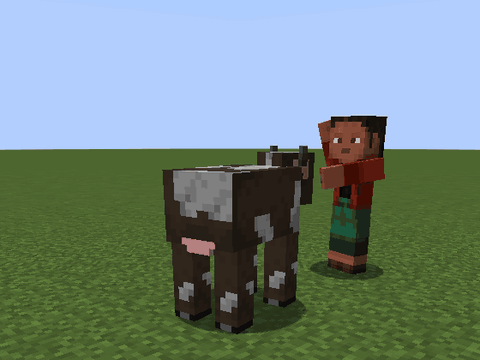

*Pegando um corpo, visto por um colega: **Use** a serra numa criatura com metade da vida ou menos.*

A serra faz uma de duas coisas, dependendo da sua **outra mão**:

| Outra mão | Resultado |
|---|---|
| Qualquer coisa menos um Pote de Suporte Vital | A cabeça sai e o corpo fica de pé como **hospedeiro**: "Vaca agora é um corpo hospedeiro". Se estiver com menos de um quarto da vida, sobe para um quarto. |
| Um Pote de Suporte Vital vazio (básico, Compacto, Reforçado ou Executivo, grande o bastante para a cabeça) | A cabeça não sai voando: ela faz um arco do pescoço até o pote na sua mão. Você fica com a **cabeça** no pote, e o corpo cai (com os drops normais). Uma criatura que é só cabeça entra inteira no pote e não deixa nada. A cabeça lembra em qual pote entrou. Veja [Cabeças no pote](#cabeças-no-pote). |

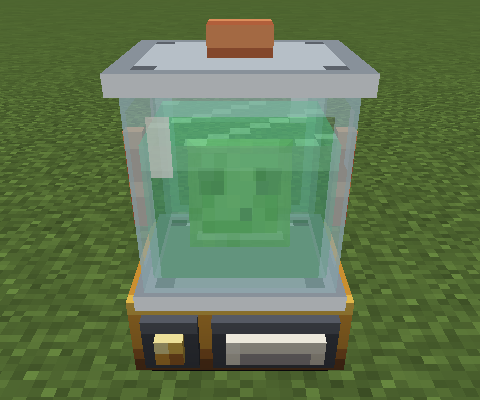

Toda criatura que a serra corta vai para o arquivo: veja [Fichas funcionais](#fichas-funcionais-salário-e-crachás).

Um pote na mão principal não conta. Se a criatura de algum jeito sobreviver ao corte (um totem, Resistência, um
terreno protegido), você fica com o pote e ouve "Vaca resistiu. Enfraqueça mais e tente de novo."

Um hospedeiro não tem vontade própria. Ele fica onde foi cortado, não briga com ninguém, nunca desaparece (nem um
monstro no Pacífico) e é desenhado sem a cabeça, inclusive com pacotes de recursos que refazem os modelos, como o
Fresh Animations. (A cabeça que sai voando é a própria cabeça do modelo da criatura; com um pacote desses, pode ser a
do vanilla.)

### Subindo e descendo

- **Subir:** como **pote**, **Use** o hospedeiro. Você sobe no pescoço dele e passa a estar **hospedado**. Se estiver
  **carregando a sua cabeça** na Bolsa de Cabeça, **Usar** também funciona: seu corpo fica de pé e você sobe no pote.
- Com a cabeça no lugar, **Usar** num hospedeiro só lê os dados dele: "Hospedeiro: frescor 87%, sincronia 40%".
- Já tem alguém em cima: "Alguém já está nesse corpo".
- Ao subir, o pote trava no pescoço com um giro de baioneta e uma vedação suave ("Pote se encaixa"): um colar de latão
  em volta da base do pote dá um quarto de volta até o fim, o corpo firma as pernas sob o peso e se acomoda, e um
  instante depois resmunga com a própria voz, baixo e grogue. O colar fica enquanto você estiver montado.
- **Descer:** **Agache**. Num voador a mais de três blocos de altura, agachar não derruba você: "Alto demais para sair
  de Morcego. Segure (sua tecla de **Agachar**): desce e sai." Continue segurando e o voador desce; a até três blocos
  do chão ou da água você desce sozinho. Ao descer de um voador, você vai para o chão ao lado dele (embaixo dele, se não
  houver espaço), não para cima dele para cair de lá. Se o hospedeiro morrer
  ou apodrecer, você volta a ser um pote comum na hora. Seja como for que você saia, a vedação se solta ("Pote se
  solta"), as pernas cedem um pouco e o corpo resmunga até voltar a dormir.

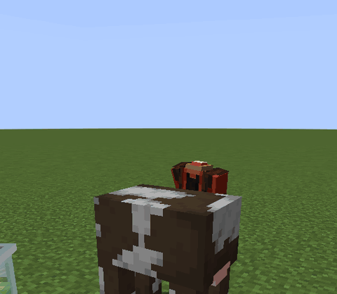

*Um pote se encaixando num hospedeiro: como pote, **Use** o hospedeiro.*
- Hospedado, você não tem mãos. **Usar** em qualquer outra coisa dá "Hospedeiro não tem mãos para isso. Desça
  primeiro." (em outro hospedeiro: "Um corpo por vez. Desça deste primeiro."). **Trocar** e **Rodinhas** dão "Daqui de
  cima, não. Desça primeiro."

### Conduzindo

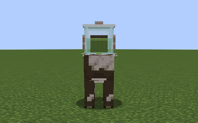

*Montado num hospedeiro: ele vai para onde você olha. **Agache** para descer.*

- Ele vai para onde você olha. Para a frente é velocidade máxima, para trás um quarto, de lado metade.
- **Pular** pula, menos o Golem de Ferro, que não consegue.
- **Voadores** sobem enquanto você segura **Pular**, descem enquanto você segura **Agachar** e planam devagar até o chão
  quando você solta. Eles não sofrem dano de queda.
- **Escaladores** sobem qualquer parede em que encostam. **Os de queda lenta** descem flutuando e não sofrem dano de
  queda.
- **Atacar** faz o hospedeiro golpear com a própria força (2 de dano se não tiver nenhuma), até uns 2,5 blocos à frente
  dele. Longe demais: "Fora do alcance deste corpo. Chegue mais perto." O golpe conta como seu para PvP, terrenos
  protegidos e crédito pela morte.
- **Velocidade:** hospedeiros terrestres ficam limitados a mais ou menos o ritmo de um jogador: até 5,1 blocos por
  segundo, 5,6 com sincronia total (uma corrida). Cavalos, burros, mulas, lhamas e camelos mantêm a própria velocidade
  de montaria. Voadores, e nadadores na água, não têm limite.

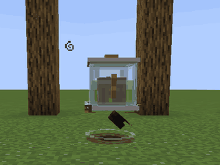

*Num voador: segure **Pular** para subir, segure **Agachar** para descer e sair.*

### O Aperto de Mão Neural

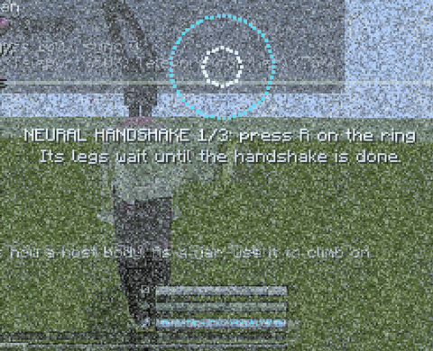

*O Aperto de Mão Neural ao subir num hospedeiro pela primeira vez: aperte **Habilidade** quando o anel encontrar o
círculo.*

Na primeira vez que alguém sobe num hospedeiro, o pote e o corpo se apresentam.

- Um círculo branco aparece na parte de cima da tela, bem acima da sua mira, com um anel ciano se fechando sobre ele e,
  embaixo dos dois, "APERTO DE MÃO NEURAL 1/3: aperte (sua tecla de **Habilidade**) no anel". Aperte **Habilidade** uma
  vez quando o anel encontrar o círculo. A janela é curta, cerca de um terço de segundo
  em cada rodada.
- Três rodadas de 1,5 segundo cada. O círculo pisca em verde no acerto e em vermelho no erro. "As pernas esperam o
  aperto neural terminar": você não consegue se mexer até acabar.
- Cada acerto: **+3% de sincronia**. Cada erro: 2 segundos de Náusea. Um aperto perfeito dá +9%.
- Cada acerto toca a próxima nota do jingle da empresa; um erro dá um zumbido e a música recomeça. Um aperto perfeito
  termina o jingle com um pequeno brilho verde-azulado. Só você ouve: o resto do escritório é poupado.
- Acontece uma vez por corpo. Descer no meio cancela, e tudo recomeça na próxima vez.
- Dispensa o ritual? Defina `handshake = false` na configuração do cliente e receba +5% fixos no lugar.

### Sincronia

Sincronia é o quanto o pote e o corpo se entendem. Ela começa em 0 e sobe **1% a cada 12 segundos montado**: 10 minutos
de montaria até 50%, 20 até 100%. Ela não sobe enquanto ninguém monta.

| Sincronia | O que você ganha |
|---|---|
| abaixo de 25% | as pernas param de obedecer por meio segundo a cada 10 segundos |
| 25% | os traços do corpo: imunidade a fogo, respiração aquática, nada de dano de queda, imunidade a repulsão, visão noturna, Graça do Golfinho, e as criaturas da mesma espécie deixando você em paz |
| 50% | a **Habilidade** (e o corpo passa a aceitar Renda Neural) |
| 75% | a **Secundária** |
| 100% | +10% de vida, dano e velocidade; a conquista **Sincronia Total** |

Abaixo do limite: "Precisa de 50% de sincronia". Um corpo se move do seu jeito desde o primeiro segundo: quem voa voa,
a aranha escala, a galinha plana; até 25%, o painel do hospedeiro diz "Já anda como ele; traços com 25% de sinc.".
Usar uma habilidade que o corpo não tem: "Vaca não tem esse truque. Tente outro corpo." Cedo demais depois da última:
"Este corpo está recuperando o fôlego. Um instante." Subir no seu primeiro hospedeiro rende **Aquisição Hostil**.

Cada vez que a sincronia passa de um quarto (25, 50, 75, 100%), um anel verde-azulado desce pelo corpo; em 100%, um
anel largo e pálido se espalha pelo chão. Qualquer um por perto consegue ver.

### Frescor e apodrecimento

Um hospedeiro perde **2% de frescor por minuto**, montado ou não: 50 minutos de fresco até nada. Abaixo de 50%, anda
15% mais devagar, começa a se curvar para a frente e uma mosca o encontra. Abaixo de 25%, anda 30% mais devagar, se
curva mais, balança e tem duas moscas. Abaixo de 10%, tropeça de vez em quando e tem três. As moscas zumbem, baixinho e
agudo. Em 0 ele se desmancha, larga o que largaria e deixa você no chão. Um corpo embalsamado não tem nada disso.

**Fluido de Embalsamar** (sem forma: Soro Craniano, Olho de Aranha, Açúcar, Farinha de Osso; empilha até 16). **Use**
num hospedeiro: frescor de volta a 100%, e pelos próximos 20 minutos ele apodrece na **metade** do ritmo. Isso não
para o apodrecimento. O frasco volta para você. "Embalsamado: fresco de novo e dura mais". Ele entra com um chiado, um
brilho lavanda e um *plim*. Numa criatura com cabeça: "Fluido de Embalsamar é para
hospedeiros. Use uma Serra Cirúrgica nele antes." Numa máquina: "Máquina não apodrece. Fluido de Embalsamar é para
carne." Hospedeiros não comem: comida dá "Não tem boca para comer. Fluido de Embalsamar mantém fresco."

**Renda Neural** (com forma: Pepita de Ouro, Linha, Pepita de Ouro / Olho de Aranha, Chip Sináptico, Olho de Aranha /
Pepita de Ouro, Linha, Pepita de Ouro). **Use** num hospedeiro com **50% de sincronia ou mais**: frescor de volta a
100%, e o corpo **nunca mais apodrece**. "Renda Neural enxertada: este corpo nunca vai apodrecer". Abaixo de 50%: "A
renda precisa de 50% de sincronia", e você fica com a renda. Depois que um corpo tem renda, o Fluido de Embalsamar é
recusado e fica com você: "Corpo com Renda Neural não apodrece. Guarde o Fluido de Embalsamar para outro." Uma segunda
renda: "Este corpo já tem renda. Guarde a Renda Neural."

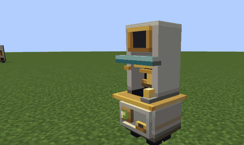

*Um corpo retirado do Armário de Corpos: **Use** o armário.*

**Armário de Corpos** (com forma: Lingote de Aço Cirúrgico, Porta de Ferro, Lingote de Aço Cirúrgico / Lingote de Aço
Cirúrgico, Vidro, Lingote de Aço Cirúrgico / Lingote de Aço Cirúrgico, Gelo Compactado, Lingote de Aço Cirúrgico). Uma
chapelaria de teatro, com dois blocos de altura. **Use** para guardar o hospedeiro sem ninguém montado mais próximo, a
até 3 blocos, onde o tempo para para ele: "Entrada registrada: Vaca. Vai se conservar." O corpo é puxado para dentro, a persiana
desce, o tíquete tilinta, o retrato do corpo aparece no cabeçalho e a Noggin & Sons aprova. **Use** de novo e o corpo
sai na frente na hora, "Saída registrada: Vaca", enquanto a persiana destrava, a campainha toca e a persiana sobe de volta. O
corpo só é devolvido a quem
o guardou, ou a alguém em quem essa pessoa confia (`/headoffice trust`, ou o time dela). Qualquer outro: "Corpo de outra
pessoa. O dono pode confiar em você: /headoffice trust." Um corpo guardado antes da 0.4.0 não tem dono no tíquete, e
qualquer um pode retirá-lo. O armário guarda um corpo, aceita cascos e os seus próprios mechas, e não aceita o mecha de
outra pessoa, nem um bicho cujo dono não confia em você (a mesma frase). Quebre o armário e o corpo sai andando, mas um
armário com o corpo de alguém só quebra para o dono ou para alguém em quem ele confia: "Esse armário guarda Vaca de
outra pessoa. Só o dono o quebra." (dito uma vez a cada vez que você segura o botão) (Um armário vazio, ou com um corpo
guardado antes da 0.4.0, quebra para qualquer um.) Nada no alcance: "Nenhum corpo
hospedeiro num raio de 3 blocos". Um pote consegue operá-lo. Ele não precisa de energia e não puxa nenhuma dos cabos.

### O HUD do hospedeiro

Hospedado, o canto superior esquerdo da tela mostra o nome do hospedeiro, uma barra vermelha de vida, uma barra verde
de frescor ("Frescor 87%"), uma barra roxa de sincronia ("Sincronia 40%") e uma linha para cada habilidade que o corpo
de fato tem: verde, com a tecla, quando já liberada ("R: Teleporte", com a sua tecla), cinza, com a sincronia que a
libera, até lá ("Teleporte (mais longe): sinc. 75%"). Uma segunda habilidade do mesmo tipo da primeira se chama "(mais
longe)". Um corpo sem nenhuma diz "Este corpo não tem habilidades". Um Casco Utilitário não mostra frescor e diz "SEM
CARGA: recarregue numa Base de Recarga" quando o seu pote está descarregado. O painel não passa de um terço da largura
da tela; uma linha longa quebra. Com o Jade instalado, olhar para um hospedeiro mostra o frescor, a sincronia e as
habilidades dele (veja [Outros mods](#outros-mods)).

### Habilidades

| Habilidade | O que faz |
|---|---|
| Teleporte | o corpo salta para o bloco para onde você olha |
| Explodir | uma explosão que não quebra blocos; o corpo se vai e o seu pote perde metade da integridade, a menos que tenha uma Tampa de Choque |
| Bola de Fogo | bolas de fogo para onde você olha (blaze: três pequenas; ghast: uma grande) |
| Saraivada de Flechas | uma rajada de flechas que não podem ser recolhidas |
| Teia | uma teia na criatura ou no bloco para onde você olha, só em espaço aberto; ela derrete depois de 10 segundos. Bloqueado: "Sem espaço para teia aí. Mire no ar livre." |
| Investida | um avanço para a frente que acerta e empurra o que estiver no caminho |
| Bote | uma investida com um pulinho |
| Arremesso | joga para o alto a criatura para onde você olha (a até 4 blocos) |
| Rugido | tudo por perto recebe Lentidão V e Fraqueza e é empurrado para trás |
| Nuvem de Tinta | Cegueira por 4 segundos em tudo a até 6 blocos |
| Estrondo Sônico | 10 de dano na criatura para onde você olha, a até 15 blocos |
| Gemido | toda criatura da espécie do hospedeiro a até 16 blocos ataca aquela para onde você olha |
| Ecolocalização | tudo a até 16 blocos brilha por 10 segundos |
| Carga de Vento | uma carga de vento para onde você olha |
| Jogar Poção | uma Poção Arremessável de Fraqueza |
| Pairar | o corpo flutua para cima e depois desce devagar |
| Disparada | Velocidade III por 5 segundos |
| Botar um Ovo | um ovo |
| Mugido | todo animal a até 16 blocos que come trigo (vacas, ovelhas, cabras...) segue você por 10 segundos, 24 no máximo. Ninguém por perto: "Ninguém aqui come trigo. O mugido foi registrado." |
| Fuçar | cenouras, batatas, beterrabas e cogumelos a até 16 blocos ficam contornados só para você, através do chão, por 10 segundos, e são contados: "12 coisas que valem a escavação. O focinho já entregou o relatório." |
| Desprender Lã | 1 a 3 lãs da cor da ovelha; o velo continua no lugar |
| Cuspe | um cuspe de lhama para onde você olha: 1 de dano e um empurrão, a até 12 blocos, o golpe conta como seu |
| Tocar o Sino | saqueadores a até 32 blocos brilham por 10 segundos; aldeões a até 32 correm para dentro de casa, como com o sino da vila |
| Escambo | uma lingote de ouro dos seus bolsos vai para a mão do piglin; 6 segundos depois cai o saque de um escambo. Sem ouro: "Nenhum ouro nos bolsos. Piglins conferem." |
| Esquentar | liga e desliga; ligado, ficar parado sobre lava cura 1 por segundo ("Esquentar: ligado" no painel do hospedeiro). Fora da lava: "Esquentar precisa de lava sob os pés. Fique parado nela." |
| Recolher | 5 segundos dentro do casco: 80% menos dano, e o corpo não sai do lugar |
| Salto em Distância | o pulo do próprio sapo, uns 6 blocos para onde você olha, na pose de salto dele |
| Bufar | creepers a até 8 blocos recuam por 5 segundos, com o pavio apagado |
| Arrancada | o pulo do camelo, uns 8 blocos para a frente |
| Empinar | o corpo empina; tudo a até 3 blocos é empurrado para trás (jogadores só onde o PvP está ativado) |
| Remendo | uma lingote de ferro dos seus bolsos, +25 de vida. Sem ferro: "Nenhum ferro nos bolsos. Golens são exigentes." |
| Uivo | os seus lobos domesticados a até 16 blocos se levantam e seguem você por um minuto, depois sentam onde estiverem |
| Faro de Tesouro | uma trilha de bolhas sai do corpo rumo ao naufrágio, ruína oceânica ou tesouro enterrado mais próximo a até 4 chunks, por 10 segundos. Nenhum: "Nenhum tesouro por perto. Tente o mar." |

Habilidades com mira sem nada à vista: "Nada para mirar aí. Olhe para um alvo." Os tempos abaixo são as recargas.

<details><summary>Todos os hospedeiros vanilla</summary>

Qualquer criatura que a serra aceita pode ser hospedeiro. Uma que não está na lista só anda: sem traços, sem
habilidades. Todas apodrecem 2% por minuto. Traços que não sejam voo, escalada, queda lenta e andar sobre lava precisam
de 25% de sincronia.

| Criatura | Habilidade (50%) | Secundária (75%) | Traços |
|---|---|---|---|
| Morcego | Ecolocalização, 10 s | – | voo, visão noturna |
| Blaze | 3 bolas de fogo, 5 s | Pairar (4 s subindo, 7 s descendo), 8 s | imune a fogo, queda lenta |
| Breeze | Carga de Vento, 2 s | – | sem dano de queda |
| Camelo | Investida (um empurrão, sem dano), 4 s | Arrancada (o pulo do camelo, uns 8 blocos), 5 s | – |
| Gato | Bufar (creepers a até 8 recuam por 5 s), 10 s | – | sem dano de queda; phantoms ficam longe (como sempre) |
| Aranha das Cavernas | Teia (12 blocos), 3 s | – | escala, visão noturna |
| Galinha | Botar um Ovo, 60 s | – | queda lenta |
| Vaca | Mugido (quem come trigo a até 16 segue você por 10 s), 20 s | – | – |
| Creeper | Explodir | – | – |
| Golfinho | Investida (4 de dano), 3 s | Faro de Tesouro (4 chunks), 60 s | respiração aquática, Graça do Golfinho para você |
| Burro | Disparada, 10 s | Empinar (anel de repulsão, 3 blocos), 8 s | – |
| Afogado | Gemido, 10 s | – | respiração aquática; zumbis deixam você em paz |
| Enderman | Teleporte (24 blocos), 3 s | Teleporte (48 blocos), 10 s | endermen deixam você em paz |
| Raposa | Bote (3 de dano), 3 s | – | visão noturna |
| Sapo | Salto em Distância (uns 6 blocos), 4 s | – | sem dano de queda |
| Ghast | 1 bola de fogo grande, 3 s | – | voo, imune a fogo |
| Lula Brilhante | Nuvem de Tinta, 10 s | – | respiração aquática, visão noturna |
| Cabra | Investida (2 de dano, muita repulsão), 4 s | – | sem dano de queda |
| Cavalo | Disparada, 10 s | Empinar (anel de repulsão, 3 blocos), 8 s | – |
| Zumbi-do-Deserto | Gemido, 10 s | – | zumbis deixam você em paz |
| Golem de Ferro | Arremesso, 2 s | Remendo (uma lingote de ferro, +25 de vida), 10 s | imune a repulsão; não pula |
| Lhama | Cuspe (1 de dano, 12 blocos), 2 s | – | – |
| Mula | Disparada, 10 s | Empinar (anel de repulsão, 3 blocos), 8 s | – |
| Jaguatirica | Disparada, 8 s | – | sem dano de queda |
| Phantom | Bote (6 de dano), 4 s | – | voo |
| Porco | Fuçar (plantações e cogumelos a até 16 contornados por 10 s), 15 s | – | – |
| Piglin | Escambo (uma lingote de ouro; saque depois de 6 s), 6 s | – | piglins deixam você em paz |
| Urso-Polar | Rugido (4 blocos, 1,5 s), 10 s | – | – |
| Devastador | Investida (12 de dano), 5 s | Rugido (6 blocos, 2 s), 10 s | – |
| Ovelha | Desprender Lã (1 a 3 lãs), 60 s | – | metade do dano de queda |
| Esqueleto | 3 flechas, 6 s | – | 2,5 corações a menos de vida |
| Aranha | Teia (16 blocos), 3 s | – | escala, visão noturna |
| Lula | Nuvem de Tinta, 10 s | – | respiração aquática |
| Errante | 3 flechas, 6 s | – | – |
| Lavagante | Esquentar (liga e desliga: parado sobre lava, cura 1 por segundo) | – | imune a fogo; anda sobre lava |
| Tartaruga | Recolher (80% menos dano, sem se mexer, 5 s), 15 s | – | respiração aquática |
| Aldeão | Tocar o Sino (32 blocos), 60 s | – | golens de ferro deixam você em paz |
| Warden | Estrondo Sônico, 10 s | – | visão noturna, imune a repulsão |
| Bruxa | Jogar Poção, 5 s | – | – |
| Lobo | Bote (4 de dano), 3 s | Uivo (seus lobos domesticados a até 16 seguem por 60 s), 30 s | – |
| Zumbi | Gemido, 10 s | – | zumbis deixam você em paz |

</details>

<details><summary>Hospedeiros de outros mods</summary>

Cada um só funciona com o seu mod instalado. O apodrecimento é de 2% por minuto, a não ser que a última coluna diga
outra coisa.

| Mod | Criatura | Habilidade (50%) | Secundária (75%) | Traços | Apodrecimento |
|---|---|---|---|---|---|
| Aether | Flying Cow | – | – | voo | |
| Aether | Moa | Pairar, 6 s | Disparada, 10 s | queda lenta, sem dano de queda | |
| Aether | Phyg | – | – | voo | |
| Brazil Legends | Capelobo | Bote (5 de dano), 3 s | – | visão noturna | |
| Brazil Legends | Mula-sem-cabeça | 1 bola de fogo, 2 s | Disparada, 10 s | imune a fogo; dispensa a serra | nunca |
| Brazil Legends | Mapinguari | Rugido, 10 s | Investida (8 de dano), 6 s | imune a repulsão | |
| Brazil Legends | Saci Pererê | Teleporte (8 blocos), 3 s | – | sem dano de queda | |
| Friends & Foes | Copper Golem | – | – | – | nunca |
| Friends & Foes | Tuff Golem | – | – | imune a repulsão | nunca |
| Friends & Foes | Wildfire | 3 bolas de fogo, 2 s | – | imune a fogo, queda lenta; blazes deixam você em paz | |
| Mowzie's Mobs | Foliaath | Bote (6 de dano), 2 s | – | imune a repulsão | 1%/min |
| Mowzie's Mobs | Grottol | Investida (4 de dano), 4 s | – | imune a repulsão | nunca |
| Mutant Monsters | Mutant Creeper | Explodir (maior), 10 s | Bote (6 de dano), 3 s | – | |
| Mutant Monsters | Mutant Enderman | Teleporte (32 blocos), 2 s | Arremesso, 3 s | endermen deixam você em paz | |
| Mutant Monsters | Mutant Skeleton | 5 flechas, 2 s | – | esqueletos deixam você em paz | |
| Mutant Monsters | Mutant Zombie | Rugido, 8 s | Arremesso, 3 s | imune a repulsão; zumbis deixam você em paz | |
| Naturalist | Alligator | Bote (7 de dano), 3 s | – | respiração aquática | |
| Naturalist | Bear | Rugido, 10 s | – | – | |
| Naturalist | Elephant | Arremesso, 3 s | Investida (6 de dano), 5 s | imune a repulsão | |
| Naturalist | Giraffe | Disparada, 10 s | – | – | |
| Naturalist | Komodo Dragon | Bote (5 de dano), 3 s | – | – | |
| Naturalist | Lion | Bote (6 de dano), 2 s | Rugido, 10 s | – | |
| Naturalist | Rhino | Investida (8 de dano), 3 s | – | imune a repulsão | |
| Naturalist | Tiger | Bote (6 de dano), 2 s | – | visão noturna | |
| OreSpawn | Baryonyx | Bote (6 de dano), 3 s | – | respiração aquática | |
| OreSpawn | Cryolophosaurus | Investida (6 de dano), 3 s | – | – | |
| OreSpawn | Emperor Scorpion | Bote (8 de dano), 3 s | – | imune a repulsão | |
| OreSpawn | Mothra | – | – | voo, queda lenta | |
| OreSpawn | Spider Robot | Teia, 3 s | – | escala, sem dano de queda | nunca |
| OreSpawn | T-Rex | Rugido (8 blocos), 8 s | Investida (10 de dano), 5 s | imune a repulsão | |
| Plants & Zombies | Chomper | Bote (8 de dano), 3 s | – | – | 1%/min |
| Plants & Zombies | Gargantuar | Arremesso, 3 s | Rugido, 10 s | imune a repulsão | |
| Plants & Zombies | Peashooter | 1 flecha, 1 s | – | – | 1%/min |
| Plants & Zombies | Sunflower | – | – | – | 1%/min |
| Bumblezone | Beehemoth | – | – | voo, queda lenta; abelhas deixam você em paz | |
| Twilight Forest | Boar | Investida (3 de dano), 3 s | – | – | |
| Twilight Forest | Deer | Disparada, 10 s | – | sem dano de queda | |
| Twilight Forest | Minotaur | Investida (8 de dano), 4 s | – | minotauros deixam você em paz | |
| Twilight Forest | Skeleton Druid | Jogar Poção, 5 s | – | druidas deixam você em paz | |
| Twilight Forest | Troll | Arremesso, 3 s | – | imune a repulsão | |
| Twilight Forest | Yeti | Arremesso, 3 s | Rugido, 10 s | – | |

</details>

### A galinha sem cabeça

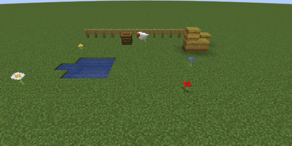

Uma galinha serrada sem pote não fica parada: ela corre em círculos fechados, batendo as asas, em volta do lugar onde
foi cortada, dando um pulinho a cada meio segundo e parando para tomar fôlego a cada seis, e nunca se afasta mais de
**12 blocos** desse lugar. Ela contorna laguinhos, lava e desníveis de mais de um bloco; se for empurrada para mais
longe, volta direto. DOLORES tem uma palavra a dizer, toda vez: "DOLORES: Vai ficar tudo bem. Provavelmente." Ela para
enquanto alguém está montado nela (e recomeça dois segundos depois), numa guia, num barco ou numa Esteira, e continua
botando ovos. Uma galinha hospedeira de antes da 0.6.3 corre em volta de onde está. O valor de servidor
`bodies.headlessChicken` desliga a correria. Ver uma correr por 10 segundos, a até 16 blocos, rende a conquista oculta
**Feito Galinha sem Cabeça**.

### A Esteira de Bem-Estar Corporativo

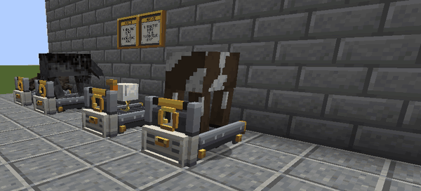

**Esteira de Bem-Estar Corporativo** (com forma: três Couros / Servo, Fio de Neurocobre, Servo / três Lingotes de Aço
Cirúrgico). Tem dois blocos de comprimento e é colocada como uma cama: a ponta de perto onde você clica, a ponta do
console longe de você. Sem espaço: "A esteira precisa de dois blocos livres à sua frente." Quebrar qualquer uma das
pontas quebra as duas e solta uma Esteira.

Leve um hospedeiro montado até a esteira, pare em cima dela e desça com **Agachar**: "Ponto batido." O corpo caminha
sem sair do lugar, de frente para o console, e gera FE conforme a espécie:

| FE/t | Corpos |
|---|---|
| 2 | traça, endermite |
| 4 | esqueleto, errante, pantanoso, esqueleto wither, cavalo esqueleto, tartaruga |
| 6 | zumbi, zumbi-do-deserto, afogado, piglin zumbificado, aldeão zumbi, cavalo zumbi, gato, tatu, golem de neve |
| 8 | porco, ovelha, raposa, creeper, aranha das cavernas, sapo, coelho, jaguatirica, e qualquer corpo que não esteja nesta lista |
| 10 | vaca, coguvaca, aldeão, vendedor ambulante, cabra, lobo, bruxa, saqueador, vingador, invocador, ilusionista, piglin, piglin bárbaro |
| 12 | galinha (ela nunca para), panda |
| 14 | lhama, lhama de vendedor, aranha |
| 16 | burro, enderman |
| 18 | mula, urso-polar |
| 20 | cavalo, farejador |
| 24 | camelo |

Ela guarda 10 kFE e empurra até 1.000 FE/t pela **ponta de perto** para as máquinas encostadas nela, como faz a Pilha
Galvânica; o mostrador no console indica o ritmo. Um corpo na esteira apodrece **duas vezes mais rápido** (um
embalsamado, no ritmo de sempre); um corpo com renda fica Cansado e gera metade, para sempre; sincronia total soma 10%.
Um pote montado num corpo na esteira também gera o FE, e sincroniza como em qualquer montaria, mas para a frente não
leva a lugar nenhum: para trás, de lado ou pular sai da esteira. **Use** com a mão vazia para ler os dados ("Vaca: 10
FE/t. Frescor 92%, sincronia 40%."), ou "Esteira parada. Monte um corpo nela e desça para bater o ponto." Na primeira
vez que uma Esteira alimenta uma máquina, o dono recebe um memorando ("Seu colega está caminhando pela empresa.
Mantenha a esteira livre e o corpo fresco.") e **Bem-Estar Corporativo**; 100 FE/t de Esteiras num raio de 16 blocos
rendem **Departamento de Cardio**. Tudo o que cai de um corpo na esteira vai para a ponta de perto, então um funil
embaixo dela recolhe.

Alguns corpos se recusam: voadores ("Morcego não anda. Tente uma vaca."), nadadores ("Peixe fora d'água.
Literalmente."), o ghast ("Ghasts não fazem cardio."), o lavagante ("Só anda em cima de lava."), slimes e cubos de
magma ("Slime quica. A esteira precisa de pés."), o golem de ferro, o devastador, o warden, o hoglin e o zoglin ("Golem
de Ferro precisa da Esteira Industrial. A Matriz já encomendou."), Cascos Utilitários e mechas ("Cascos andam com
carga, não com cardio."), e qualquer criatura que ainda tenha cabeça ("Funcionários com cabeça usam a escada."). Os
ritmos e as recusas ficam num mapa de dados,
`data/<namespace>/data_maps/entity_type/treadmill.json` (`{"fe": 10}` ou `{"refuse": "flier"}`), então um modpack pode
incluir as próprias criaturas; o valor de servidor `bodies.treadmillOutput` (100%) ajusta todos os ritmos.

### A Mula-sem-cabeça

A Mula-sem-cabeça do Brazil Legends nunca teve cabeça, então dispensa a serra: como **pote**, **Use** a mula e você
está a bordo. Ela nunca apodrece, fica imune a fogo depois de sincronizada, lança bolas de fogo e dispara. Montar numa
rende **Mula-sem-cabeça**.

## Cascos Utilitários

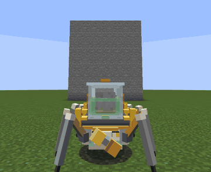

*Um Andador Aranha escalando: ande contra a parede.*

Desde a 0.7.2, as pernas do Andador Aranha acham o próprio apoio: cada pé procura o bloco embaixo dele, parede acima
e escada abaixo, e cada pata pousa com uma pancada metálica.

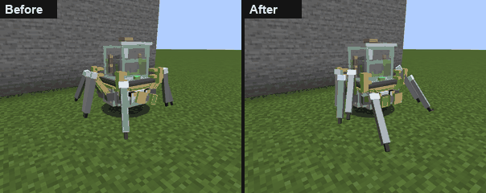

Corpos robóticos para um pote, para quando uma vaca não basta. Um casco dispensa a serra e o aperto de mão, nunca
apodrece e conta como totalmente sincronizado desde o início. Ele funciona com a carga do seu pote.

| | **Brutamontes** | **Rover** | **Andador Aranha** |
|---|---|---|---|
| Receita (com forma) | Servo, Bloco de Ferro, Servo / Bloco de Ferro, Câmera de Colar, Bloco de Ferro / Bloco de Ferro, –, Bloco de Ferro | –, Câmera de Colar, – / Lingote de Aço Cirúrgico, Baú, Lingote de Aço Cirúrgico / Servo, –, Servo | Linha, Câmera de Colar, Linha / Servo, Lingote de Aço Cirúrgico, Servo / Linha, Lingote de Aço Cirúrgico, Linha |
| Item do chassi | **Chassi do Brutamontes** | **Chassi do Rover** | **Chassi do Andador Aranha** |
| Vida | 66 (33 corações) | 33 (16,5 corações) | 33 (16,5 corações) |
| Ataque | 9,9 | 2,2 | 4,4 |
| Velocidade | uns 4,4 blocos/s | uns 9 blocos/s | uns 7 blocos/s |
| Sobe degraus de | 1 bloco | 1,5 bloco | 1 bloco |
| **Habilidade** | Arremesso: ergue acima da cabeça a criatura para onde você olha (a até 4 blocos) e a joga para o alto, a cada 1,5 s | Disparada: Velocidade III por 5 s, a cada 10 s | Teia, a até 16 blocos, a cada 3 s |
| Extras | não sofre repulsão | compartimento de carga de 9 espaços | escala paredes, nunca sofre dano de queda |

Nenhum deles tem **Secundária**.

- **Montagem:** **Use** o chassi no chão. O casco fica ali, de frente para você.
- **Entrar:** como **pote** (ou **carregando a sua cabeça**), **Use** o casco. **Sair:** **Agache**. O Rover e o
  Andador Aranha deixam você atrás deles, ou à direita, à esquerda ou na frente quando atrás está bloqueado. O
  Brutamontes se vira e desce você à frente dele, ou atrás, à direita ou à esquerda.
- **O arremesso do Brutamontes:** os punhos se fecham no que você olha, erguem acima da cabeça e jogam para cima e um
  pouco para a frente. O arremesso em si não machuca; a aterrissagem é problema da criatura. Ele só pega um jogador se
  esse jogador confiar em você (colegas de time contam): "... não autorizou o manuseio. Peça que confie em você." Tudo
  o que tiver até 1,5 bloco de largura e 2 de altura é erguido antes; o que for maior é arremessado sem essa cortesia.
  Recusado, os braços sobem e caem: "Nada para mirar aí. Olhe para
  um alvo."
- **A disparada do Rover:** o motor ronca, a campainha toca e ele sai a galope. O Rover manca quando o seu pote está
  quase descarregado.
- **A teia do Andador Aranha:** mirada numa criatura, se houver uma ao alcance; senão, no bloco para onde você olha. A
  teia cai um instante depois do cuspe e derrete depois de 10 segundos. "Sem espaço para teia aí. Mire no ar livre."
- **O compartimento do Rover:** **Agache** e **Use** o Rover, em qualquer forma, para abrir os 9 espaços. Cascos não têm
  dono, então qualquer um abre o Rover de qualquer um. Os outros dois dizem "Só o Rover tem compartimento de carga".
- **Carga:** um casco puxa **3 FE por tick** do seu pote, além do consumo do próprio pote, então um pote básico dura uns
  17 minutos, um Reforçado uns 42 e um Executivo uns 83. Sem carga, o casco para: "SEM CARGA: recarregue numa Base de
  Recarga", e as habilidades dão "O pote está sem carga. Recarregue numa Base de Recarga."
- **Batidas:** dirija contra uma parede a mais de 6 blocos por segundo e o pote leva um tranco (um ponto de
  integridade, nunca o último): faíscas na frente, um estrondo metálico, e "Batida! Rover encontrou uma parede. O pote
  levou um tranco." A batida seguinte só conta depois de 2 segundos. O Rover e o Andador Aranha são rápidos o bastante
  para isso; o Brutamontes não, a menos que algo o acelere.
- **Amassados:** um casco lembra de onde vieram os últimos oito golpes e amassa no lado mais atingido, um estágio a mais
  em três quartos, metade e um quarto da vida, como um mecha; inteiro de novo, ele esquece. Um jogo 0.5.1 num servidor
  0.5.2, ou um jogo 0.5.2 num servidor 0.5.1, vê os seus cascos sem amassados.
- Cascos não se afogam, não desaparecem e ficam parados quando vazios. Guias, Fluido de Embalsamar e Renda Neural não
  funcionam neles ("Máquina não tem nervos. Renda Neural é para carne.").
- Um casco não pode ser dobrado de volta no chassi. Destruído, ele encena os seus últimos momentos e depois solta 2
  Servos, 3 Lingotes de Aço Cirúrgico e o que estiver no compartimento.

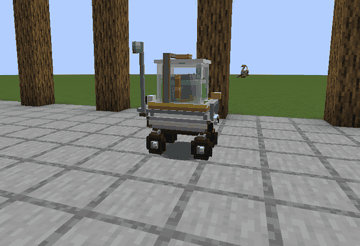

*A disparada do Rover: **Habilidade**.*

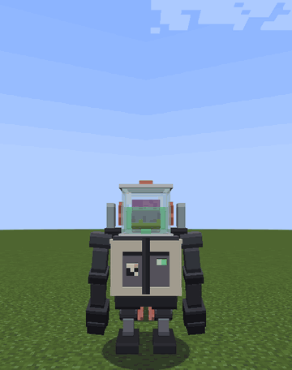

*O arremesso do Brutamontes: olhe para uma criatura a até 4 blocos e aperte **Habilidade**.*

## Cabeças no pote

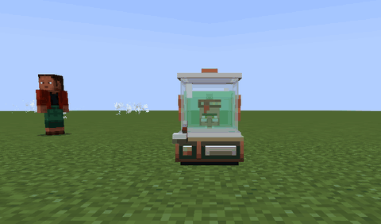

*Uma cabeça no pote colocada girando para ver um jogador passar.*

Serre uma criatura com um Pote de Suporte Vital vazio na **outra mão** e você fica com a cabeça dela: uma **Cabeça no
Pote**, com o nome do dono ("Cabeça de Aldeão no Pote"). Ela guarda tudo o que a criatura era.

- **Colocar:** **Use** em qualquer superfície, com mãos (não como pote sozinho). Não precisa de nada embaixo. Ela fica
  no pote, sobre um pequeno pedestal com campainha de balcão, de frente para você, e a cabeça se vira para olhar o
  jogador mais próximo a até 6 blocos.
- **Use a cabeça colocada** (um pote consegue fazer isso): um aldeão no pote abre a tela de troca de sempre com todas as
  ofertas (a campainha toca), guarda os usos e a experiência que você der, acena a cada troca e repõe o estoque se já
  tiverem passado 10 minutos desde a última vez. Se outra pessoa estiver negociando, ele balança a cabeça: "Esta cabeça
  está com outro cliente. Volte já já." Qualquer outra cabeça toca a campainha e responde (veja
  [Cabeças no trabalho](#cabeças-no-trabalho-a-campainha-o-almoço-e-os-serviços-de-mesa)); a cabeça de uma criatura de outro mod sem falas
  próprias ainda diz "Uma cabeça de Vaca no pote. Ela olha para você."
- **Quebre** para recuperar o item com tudo o que havia nele, inclusive uma troca pela metade e o caldo da tigela. Uma
  cabeça com empregador só pode ser quebrada pelo empregador ou por alguém em quem ele confia: "Mimosa responde a
  Steve. Peça que confie em você."
- **A cabeça de toda criatura é desenhada** no pote, em escala para flutuar dentro do soro (o pote fica mais cheio que
  o do próprio jogador); as criaturas que são só cabeça (um slime, um shulker, uma abelha) aparecem inteiras, um ghast
  como o rosto, uma cabra com a cabeça erguida e os chifres para trás. Uma cabeça num Pote Compacto é desenhada no
  formato do Pote Compacto; os potes de Suporte Vital, Reforçado e Executivo têm a mesma aparência. A dica da cabeça diz
  em qual pote ela está ("Num Pote de Suporte Vital Reforçado").
- **Agache** e **Use** a cabeça colocada com a mão vazia para abrir a ficha dela (veja abaixo). **Usar** sem agachar faz
  o que sempre fez.
- Só aldeões negociam. Alimentada, uma cabeça faz um serviço de mesa (veja
  [Cabeças no trabalho](#cabeças-no-trabalho-a-campainha-o-almoço-e-os-serviços-de-mesa)), e numa estação tem outro trabalho: veja
  [Conselho de Administração](#conselho-de-administração-cabeças-no-trabalho).

## Fichas funcionais, salário e crachás

*"Não perdemos funcionários. Às vezes os extraviamos."*


Na primeira vez que a empresa encosta numa criatura (uma seringa ou qualquer ferramenta de coleta, o Pote de
Sanguessugas ou a Hemosseringa, a serra, colocar uma cabeça no pote, instalá-la numa estação, colocar um Casco
Utilitário no chão), ela ganha uma **matrícula** e uma **Ficha Funcional**: o número (quatro dígitos, depois cinco a
partir de 9999), um nome que o RH dá a partir de uma lista no seu idioma, a espécie e o departamento (Pecuária, Trabalho
de Campo, Logística, Segurança, Turno da Noite, Instalações, Contabilidade, Jurídico, Vendas, Divisão Marítima,
Demolições, Alta Gerência; cabeças numa Matriz Cerebral ficam n'O Conselho; Cascos Utilitários vêm da Agência de
Temporários; criaturas de outros mods são Pessoal Geral), o empregador, o dia em que entrou e as últimas oito linhas
do histórico ("Amostra de sangue colhida no dia 3.", "Entrou no pote no dia 5.", "Admissão por Steve no dia 6."). Na
primeira vez que uma das suas recebe número, DOLORES escreve: "O funcionário Nº 0001 (Vaca) entrou no cadastro. Nós não
perdemos funcionários. Às vezes os extraviamos."

- **Quem é o empregador:** quem a serrou (cabeça ou hospedeiro), colocou a cabeça, instalou numa estação ou colocou o
  casco no chão. Uma criatura que só teve amostra colhida não trabalha para ninguém. Cabeças e hospedeiros de mundos
  anteriores à 0.6.0 entram no arquivo na primeira vez que carregam, com "Registro retroativo"; o dono de um Pedestal
  de Torreta é o empregador da cabeça dele, e a de todos os outros fica "em arquivo" até ser instalada ou paga de novo.
  Nada muda no funcionamento de Torreta, Matriz, Suporte ou Soquete.
- **O Jade** mostra a qualquer um "Nº 0012 · Pecuária · equipe de Steve" (ou "Empregador: em arquivo") numa criatura,
  numa cabeça colocada ou numa estação; o nome, "Mimosa (Vaca)", só ao empregador e aos jogadores em quem ele confia.
- **A ficha:** **Agache** e **Use** uma cabeça colocada com a mão principal vazia (seja lá o que estiver na outra mão):
  número, nome, espécie, departamento, empregador, dia de entrada, moral, salário, pote, genes e histórico. O
  empregador, ou alguém em quem ele confia, pode renomeá-la ali (16 caracteres; o nome fica na ficha e nunca é uma
  etiqueta, então nunca impede a serra). Qualquer outro: "Mimosa responde a Steve. Peça que confie em você."

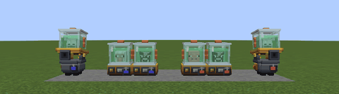

- **Salário:** uma cabeça colocada é um **troféu** até alguém pagá-la à mão. **Use** o salário dela nela (trigo para
  uma vaca, uma cenoura para um porco, carne podre para um zumbi; a ficha diz qual) e ela entra na folha: "Mimosa está
  na folha. Salário ao amanhecer, de um baú ao lado." Quem paga é o empregador. Dali em diante, a cada amanhecer ela
  tira um salário de um baú, barril ou qualquer coisa que guarde itens encostada no pedestal: paga, um tilintar e um
  brilho verde; sem pagamento, um suspiro e uma baforada cinza e, na primeiríssima vez, DOLORES: "A folha veio curta
  esta manhã. Mimosa percebeu. Mimosa não vai esquecer." Uma cabeça que passou dias fora (descarregada) tira um
  salário quando volta, nunca mais que isso. Pagar duas vezes no mesmo dia: "Já recebeu hoje." O salário errado:
  "Mimosa recebe em Trigo. O RH tem a papelada." Criaturas que não querem nada (um slime, um ghast) contam como pagas e
  não podem ser contratadas à mão: "Slime não tem salário. O RH arquiva como troféu." Um troféu nunca tira nada de um
  baú ao lado.
- **Cabeças de aldeão** nunca são pagas à mão: uma esmeralda na mão continua servindo para negociar. Uma cabeça de
  aldeão, ou de uma criatura que não quer salário, é contratada pelo almoço (veja
  [Cabeças no trabalho](#cabeças-no-trabalho-a-campainha-o-almoço-e-os-serviços-de-mesa)).
- **Moral**, para cabeças na folha: começa em 50, sobe 10 a cada amanhecer pago (até 100) e cai 15 a cada amanhecer sem
  pagamento. 75 ou mais é **Engajado** (a cabeça se inclina um pouco para cima e balança mais), de 40 a 74
  **Satisfeito**, abaixo de 40 **Desmotivado** (ela murcha e se vira um pouco para longe de você); abaixo de 15 em dois
  amanheceres seguidos, ela abre uma **Queixa Formal** (veja [Queixas](#queixas)). A moral muda o jeito como uma
  cabeça alimentada trabalha (veja [Cabeças no trabalho](#cabeças-no-trabalho-a-campainha-o-almoço-e-os-serviços-de-mesa)).
  O aldeão de um Suporte de Funcionário mostra uma faixa lida do
  histórico de pagamento dele (pago hoje e ontem, Engajado; pago hoje, Satisfeito; sem pagamento há um ou dois dias,
  Desmotivado; três ou mais, Queixa Formal); nada muda no Suporte. O valor de servidor `staff.morale` desliga a moral.
- **Crachás:** uma cabeça na folha, e todo Pedestal de Torreta, Suporte de Funcionário, Soquete Neural e Matriz Cerebral
  com uma cabeça, usa um pequeno crachá na cor do time do placar do empregador, ou no verde-azulado da empresa. O valor
  de cliente `lanyards` os esconde.
- **Saída:** quando morre um hospedeiro ou Casco Utilitário com empregador, o empregador (só ele) recebe uma linha no
  chat, ou no próximo login: "[Entrevista de Desligamento] Mimosa (Vaca), Pecuária, 12 dias: 'Muu.' Motivo da saída:
  caiu de um lugar alto." Os motivos: uma queda, lava (ou fogo), afogamento, uma explosão, "a gerência" (morta pelo
  próprio empregador), o nome do que a matou, "desgaste natural" (um hospedeiro que apodreceu) ou "um acidente de
  trabalho". Um **Cartão de Condolências** cai onde aconteceu: "O RH lamenta a perda de Mimosa. A mesa será esvaziada
  até terça." Na lava ou no vazio, ele se perde junto com todo o resto. Uma fazenda de hospedeiros manda uma linha para
  cada hospedeiro que apodrece.

## Cabeças no trabalho: a campainha, o almoço e os serviços de mesa

*"Todo funcionário tem um cargo. Alguns têm até uma cabeça para acompanhar."*

![Andando ao longo de uma fileira de cabeças colocadas numa saliência de pedra e tocando cada uma com a mão vazia: uma galinha, uma vaca, um creeper, um blaze e um ghast dizem, um de cada vez, uma frase sobre o pote ("Muu. Tem cantina aqui?", "Fuuush. Sou esquentado. Está na minha avaliação.", o ghast "Uuuuuuh. Coube. O RH chama de aconchegante."), a mesma frase na barra de ação, e o Jade, no canto superior direito, dá o cargo de cada uma: Controle de Ponto, Supervisora da Cantina, Demolição (Em Experiência), Aquecimento, Apoio ao Luto](docs/images/heads_rung.gif)

*Uma fileira de funcionários tocados um de cada vez: cada um acena, diz sua frase sobre o pote e na sua barra de ação,
e o Jade dá o cargo.*

- **Um cargo:** toda cabeça colocada tem um cargo, na dica, no Jade e na ficha: a vaca é a Supervisora da Cantina, o
  ghast é o Apoio ao Luto, o phantom é o Auditor do Sono; o cargo de um aldeão é a profissão dele.
- **A campainha:** **Use** uma cabeça colocada com a mão vazia. A campainha do pedestal toca, a cabeça levanta os olhos
  e acena, e diz uma frase no seu próprio som com a tradução do RH, sobre o pote por 5 segundos para todos a até 16
  blocos (cada um no seu idioma) e na sua barra de ação: "Muu." (O RH traduz: "Tem cantina aqui?"). Toda espécie tem
  de duas a quatro frases e nunca repete a mesma duas vezes seguidas; um segundo toque em menos de um segundo é
  ignorado. Qualquer um pode tocar a cabeça de qualquer um. Uma cabeça que precisou de um Pote Reforçado ou Executivo
  diz o seu som e "Coube. O RH chama de aconchegante." na primeiríssima vez que é tocada (uma vez só, onde quer que seja
  colocada depois).
- **Almoço:** o pedestal tem uma tigela no canto da frente. **Use** um Balde de Caldo Nutritivo no pedestal: a tigela
  enche (1.000 mB) e o balde vazio volta. Uma cabeça come 1 mB a cada 72 ticks, então um balde dá três dias de almoço no
  jogo; uma colher bate na tigela mais ou menos uma vez por minuto enquanto ela come. O primeiro almoço contrata um
  troféu, e quem o alimenta vira o empregador ("Mimosa está no almoço. Almoço gera vínculo empregatício."), e rende **O
  Almoço Está Servido**. A tigela de uma cabeça contratada também recebe caldo por cano, de qualquer lado menos de cima;
  a de um troféu, nunca. Tigela cheia: "Já almoçou. Próximo almoço em 3,0 dias." Outro fluido: "Cabeça só come Caldo
  Nutritivo. Balde de Água, não." Um Agricultor pago num Suporte de Funcionário virado para o pedestal reduz pela metade
  o que ela come.
- **Serviços de mesa:** uma cabeça alimentada faz o seu serviço. O que é usado numa cabeça segue esta ordem: uma
  ferramenta de coleta, um balde de caldo, o item de mesa da espécie, um bolo, e então o salário. Um item de mesa numa
  cabeça que não está alimentada: "Isso, só de barriga cheia. Use um Balde de Caldo Nutritivo no pedestal."; um item
  diário usado duas vezes: "Já fez isso hoje. Volte amanhã."


*A primeira lágrima do Apoio ao Luto, ao amanhecer.*

| Cabeça | Serviço de mesa |
|---|---|
| Aldeão | Tocado com uma esmeralda na mão, lê em voz alta a melhor oferta ("Melhor oferta: Esmeralda x1 por Pão x4."); a tela de troca abre como sempre. |
| Vaca | O caldo usado por qualquer tigela ou Matriz Cerebral a até 8 blocos dura um décimo a mais. |
| Ovelha | Tesoura: uma lã da cor dela, uma vez por dia. Um corante: o velo pega a cor, para sempre. |
| Coguvaca | Uma tigela: ensopado, uma vez por dia; uma marrom alimentada antes com uma flor pequena dá o ensopado suspeito daquela flor. Tesoura: "Os cogumelos ficam. São estruturais." |
| Galinha | Cacareja a cada hora do jogo (ouvida a 16 blocos) e bota uma pena ao amanhecer. |
| Gato | Creepers ficam a 6 blocos e phantoms desistem do mergulho a até 16, como com um gato vivo. Ao amanhecer, se o empregador dormiu, um presente matinal da própria lista do gato. |
| Blaze | Fornalhas, defumadores e altos-fornos encostados no pedestal cozinham um quarto mais rápido; conta um blaze por fornalha. Não gosta de chuva nem de água. |
| Ghast | Uma Lágrima de Ghast ao amanhecer (duas quando Desmotivado). Lamenta uma vez por noite, ouvido de longe. |
| Piglin | Uma lingote de ouro: ele a inspeciona por 6 segundos, e então um escambo vanilla. Fora do Nether, longe de um bloco do Nether (netherrack, nílio, areia ou terra das almas, pedra-negra, basalto), uma cabeça de piglin alimentada vira a de um piglin zumbificado depois de 15 segundos, para sempre; você é avisado ao alimentá-la. |
| Allay | Use qualquer item nele: ele pega um (outro troca, e o antigo volta para você). A cada 30 segundos, ele chama um item daquele tipo largado a até 16 blocos para um recipiente encostado no pedestal. |
| Sapo | Coaxa um minuto antes de chuva ou tempestade: "Sapo coaxando, chuva chegando: em um minuto." |
| Lula | Um frasco de vidro: uma Bolsa de Tinta, uma vez por dia; o frasco fica na sua mão. |
| Cabra | Tocada enquanto ainda tem chifre, dá uma cabeçada no vidro e cai um Chifre de Cabra do tipo dela: duas vezes, e só. Uma cabra gritadora grita às 3 da manhã. |
| Farejador | Num pedestal sobre terra, grama, musgo ou lama, uma semente da própria lista do farejador ao amanhecer. |
| Golem de Ferro | Cabeças de aldeão da equipe a até 16 ganham 2 de moral ao amanhecer. No primeiro toque do dia, ele entrega uma papoula a você. |
| Invocador | A cada 30 segundos, deixa vermelha uma ovelha azul, ou cabeça de ovelha azul, a até 8 blocos. |
| Warden | O Registro de Ruído: ouve toda vibração a até 16 blocos como um sensor de sculk (lã bloqueia) e se vira para a última. Tocado, ele faz *shh* e lê as cinco últimas ("Registrado: 3 passos, 1 abertura."). Mais de 20 num minuto custam 5 de moral; em Queixa Formal, ele grita uma vez e dá Escuridão por 10 segundos a todo jogador a até 16 (valor de servidor `heads.wardenDarkness`). |
| Zumbi | Esmurra uma porta a até 4 blocos do pedestal quando um jogador chega a até 4 da porta, no máximo uma vez por jogador a cada 30 segundos. Solta fumaça à luz do dia a céu aberto (sem dano nenhum) e não gosta disso. |

- **A moral trabalha** numa cabeça alimentada da equipe: cabeças **Engajadas** fazem o trabalho cronometrado (as
  fornalhas do blaze, a inspeção do piglin) um quinto mais rápido, as **Desmotivadas** na metade da velocidade, e um
  ghast Desmotivado chora duas lágrimas. Uma cabeça Desmotivada reclama sobre o pote a cada dois minutos com a própria
  voz ("Muu." (O RH traduz: "Me prometeram plano odontológico.")), nunca no chat; na primeira vez, DOLORES avisa o
  empregador. O valor de servidor `staff.complaints` silencia as reclamações.
- **O que mexe na moral** de uma cabeça colocada da equipe, ao amanhecer: alimentada +5 (nunca acima de 60 só pelo
  almoço); no almoço com a tigela vazia -5 (nunca abaixo de 30 só pela fome); um colega do mesmo departamento a até 8
  blocos +2; um rival a até 4 (aldeão e aldeão zumbi, saqueador ou vingador; esqueleto e lobo; piglin e esqueleto
  wither; creeper e gato ou jaguatirica; aranha e tatu) -5; algo de que a espécie não gosta -5 (chuva para abelha ou
  enderman, trovão para panda, céu aberto para zumbi, esqueleto ou phantom, bioma quente para urso-polar, a Superfície
  para lavagante, fungo distorcido a até 8 para hoglin). A qualquer hora: um bolo usado nela +40, uma vez por dia ("Não
  está com fome de bolo."; numa cabeça de estação, "O Conselho não come bolo. Toma caldo."); uma amostra de sangue
  -10. Cabeças em estações ficam Satisfeitas.
- **Despedidas:** um funcionário arrancado do pedestal, ou tirado de um Pedestal de Torreta, se despede onde estava:
  "Esvaziando minha mesa." (um zumbi: "Cérebrooos." (O RH traduz: "Pode deixar, eu saio sozinho.")).
- O valor de servidor `heads.deskJobs` desliga os serviços de mesa (cargos, campainhas e almoço continuam).

## Divisão de Mechas

Um pote sozinho é uma carreira modesta. Um pote num mecha é alta gerência. Você monta um mecha a partir de uma
**estrutura** e de **módulos** no **Pórtico de Montagem**, entra na cabine como pote, e o mecha cuida da caminhada, do
levantamento e, quando necessário, da reestruturação. Toda estrutura tem um movimento próprio em **Rodinhas**.

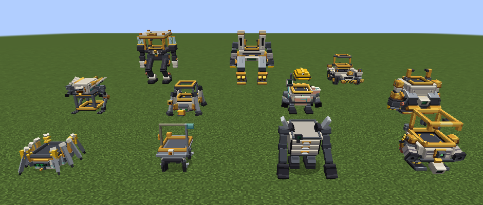

*As oito estruturas e os três cascos.*

### O Pórtico de Montagem

O **Pórtico de Montagem** monta, desmonta, repara e carrega mechas. O mecha fica **em cima do bloco**: o Pórtico é a
plataforma.

- **Receita** (bancada de trabalho, com formato): 2 Fio de Neurocobre, 1 Chip Sináptico, 2 Lingote de Aço Cirúrgico,
  1 Bigorna e 3 **Placa de Mecha** (linha de cima fio, chip, fio; linha do meio aço, bigorna, aço; linha de baixo três
  placas).
- **Energia:** armazena 100.000 FE e recebe até 5.000 FE por tick de qualquer lado. Não fornece nada.
- **Automação:** um funil ou cano pode manter abastecido o espaço de Placa de Mecha por cima ou pelos lados. Os espaços
  de estrutura e de módulos são só seus.

O Pórtico é um pedestal creme com um prato giratório listrado em cima e um braço de solda articulado, de luminária de
mesa, dobrado atrás dele, com a cabeça de latão apoiada num encaixe. A lâmpada segue o padrão de toda máquina da empresa:
verde quando ele tem 10.000 FE ou mais, âmbar enquanto há uma estrutura estacionada na plataforma, âmbar pulsante
enquanto monta, repara, desmonta ou carrega, fraca e pulsante quando falta energia, apagada quando vazio, e vermelha
quando recusa. Abra a tela e a cabeça se ergue e olha para você.

**Placa de Mecha** sai de 2 em 2 a partir de 8 Lingote de Aço Cirúrgico em volta de 1 Bloco de Ferro. Vai no Pórtico,
na maioria das estruturas e em muitos módulos, e é com ela que se remenda um mecha (veja *Dano e reparo*).

**Use** o Pórtico para abrir a tela:

- A estrutura vai no espaço de cima à esquerda, a Placa de Mecha logo abaixo. Depois vêm até 16 espaços de módulo, em
  fileiras de seis. Só ficam abertos tantos espaços quantos a estrutura tiver; o resto fica cinza. Cada espaço aberto
  tem a cor do seu tipo (Pernas verde, Costas azul, Núcleo amarelo, Torso cinza, Braço vermelho, Sensor roxo) e aceita
  um módulo desse tipo. Coloque a estrutura primeiro.
- A tela soma a massa contra a capacidade de carga da estrutura (em vermelho quando passa) e o consumo fixo de energia
  em FE por tick. Acima de 125% da capacidade, ela mostra, por exemplo, "807/350 kg: travado", e a dica explica: "Acima
  de 125% da carga os servos travam: fica de pé, mas não anda. Tire um módulo."
- **<** e **>** escolhem um espaço de módulo (contornado em amarelo). **-** e **+** movem o controle deslizante desse
  módulo em 10%, de 0 a 100% (módulos novos começam em 50%). A regulagem fica guardada no próprio módulo. Um módulo sem
  controle: "... não tem ajuste. Escolha outro módulo."
- **Montar** gasta 10.000 FE: uma sirene, o braço recua e se afasta, e meio segundo depois o mecha **se monta sozinho
  em cima do Pórtico** enquanto o braço avança e solda cada módulo no lugar, numa chuva de faíscas, à medida que ele
  chega (num Colosso ou num Executivo o braço é telescópico: o braço e o antebraço deslizam para fora sobre aço tão
  grosso quanto o próprio braço para alcançar os ombros, com um curso hidráulico na ida e na volta; um Colosso recebe
  por último o ponto de fixação do ombro esquerdo, depois que o prato giratório vira esse ombro para o braço). O prato
  giratório gira a estrutura para alcançar o lado de lá e depois a vira de frente para quem apertou Montar: dez
  segundos para a maioria das estruturas, onze para uma Quimera, doze para um Executivo e dezesseis para um Colosso,
  cada módulo instalado encaixando na sua vez ("Módulo encaixa"). O dono é você. A bateria começa com o que sobrar no
  Pórtico depois dos 10.000 FE, até o tamanho da bateria, então um mecha novo tem no máximo 90.000 FE. Uma estrutura que
  guardou soros de um mecha anterior (uma Quimera, um Executivo ou qualquer estrutura que tinha uma Porta de
  Biointegração) os devolve ao lugar. Montado acima da trava, você é avisado: "807/350 kg: pesado demais para andar.
  Tire um módulo." Entrar antes de a montagem terminar pula o resto dela.
- **Desmontar** (três segundos de braço trabalhando com uma chave inglesa, terminando em "Mecha desmontado") devolve o
  mecha da plataforma aos espaços: estrutura, módulos com suas regulagens e eventuais soros (guardados na estrutura, cuja
  dica diz "Guarda N soros"). A carga da bateria volta para o Pórtico, o quanto couber nos seus 100.000 FE; o resto se
  perde. **O conteúdo do Compartimento de Carga cai em cima do Pórtico**. Os espaços de estrutura e de módulos precisam
  estar vazios antes (a Placa de Mecha pode ficar). Um mecha remontado assim volta com a vida cheia.
- **Reparar** gasta Placa de Mecha do seu espaço, 20 de vida por placa, até o mecha da plataforma ficar inteiro. Um
  armeiro, ferreiro de armas ou ferramenteiro pago num Suporte de Funcionário virado para o Pórtico faz cada placa render
  um terço a mais (sem pagamento: um sétimo). O reparo também enche a bateria na hora, com o estoque do próprio Pórtico;
  depois o prato giratório apresenta a estrutura e o braço passa uma solda ao longo dela enquanto um cabo de carga sai do
  carretel, e o medidor da tela vai baixando.
- **Carregando na plataforma:** qualquer mecha em cima do Pórtico, pilotado ou estacionado, recebe dele até 5.000 FE
  por tick, então um Executivo vazio enche em uns 20 segundos enquanto o Pórtico for alimentado nesse ritmo.

O que o Pórtico diz quando não quer:

| Quando | Ele diz |
|---|---|
| sem estrutura | "Nenhuma estrutura para montar. Ponha uma no espaço da estrutura." |
| um aperto enquanto ainda trabalha | "O pórtico está trabalhando. Espere o braço se afastar." |
| blocos no espaço sobre a plataforma | "Algo ocupa o espaço sobre a plataforma. Libere para a estrutura." |
| blocos ao lado da plataforma onde ficaria a cabeça da estrutura (uma estrutura pode se projetar sobre qualquer coisa mais baixa) | "A cabeça da estrutura ficaria nos blocos ao lado da plataforma. Libere-os." |
| já há um mecha na plataforma | "Tem algo em cima do pórtico. Libere o topo primeiro." |
| uma estrutura que precisa de pernas não tem nenhuma que ande | "Esta estrutura não anda. Instale pernas que andem, como Pernas Hidráulicas." (Pernas Aracnídeas, Pernas de Pau, Saia Flutuante e Esteiras de Lava também andam) |
| menos de 10.000 FE | "A montagem precisa de 10 kFE. Alimente o pórtico." |
| a estrutura não consegue ficar de pé | "A estrutura não ficou de pé. Tente de novo." |
| nada na plataforma (Desmontar, Reparar) | "Nenhum mecha no pórtico. Estacione um em cima dele." |
| alguém está a bordo | "Tem alguém a bordo do mecha. Precisa sair antes." |
| o mecha é de outra pessoa | "Esse mecha não é seu. O dono pode confiar em você." |
| Desmontar com os espaços ocupados | "Os espaços estão cheios. Esvazie o pórtico primeiro." |
| Reparar sem Placa de Mecha no espaço | "Nada para consertar. Ponha Placa de Mecha no espaço de placas." (a bateria é completada mesmo assim) |
| Reparar um mecha inteiro sem nada para completar | "Saltador está em perfeita ordem. Nada a consertar." |
| botões de regulagem num espaço vazio | "Nada nesse espaço para ajustar. Escolha um módulo instalado." |

Estruturas e módulos usados no ar avisam que vão no Pórtico.

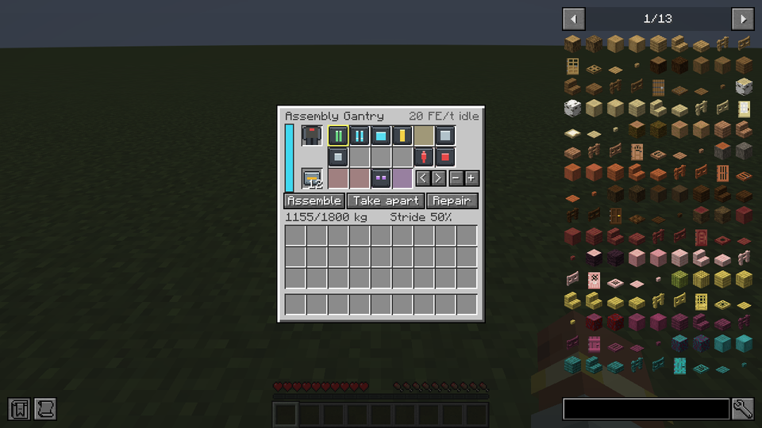

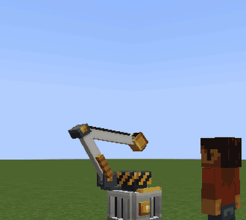

*Montar: a estrutura se monta sozinha na plataforma enquanto o braço solda cada módulo no lugar.*


*Num Colosso ou num Executivo o braço se estende para alcançar os ombros.*

### Seu primeiro mecha

O mecha mais barato que anda:

1. Um **Pórtico de Montagem**, com energia, com pelo menos 10.000 FE (mais, se você quiser que a bateria comece com
   alguma coisa). O Chip Sináptico dele leva quartzo do Nether, então primeiro vem uma viagem ao Nether.
2. Uma **Estrutura do Saltador**: 1 Câmera de Colar, 2 Placa de Mecha, 3 Servo (Câmera de Colar no meio da linha de
   cima; placa, servo, placa na linha do meio; servos nos cantos de baixo).
3. **Pernas Hidráulicas**: 2 Servo, 4 Placa de Mecha. Uma estrutura montada sobre pernas precisa de pernas que andem, ou
   o Pórtico recusa.
4. Opcional, mas recomendável: uma **Pilha Galvânica Compacta** (energia, sempre) e um **Braço Broca** (algo para fazer
   com as mãos, que você não tem mais).

Estrutura no lugar, módulos no lugar, **Montar**. O Saltador se monta sozinho em cima do Pórtico e continua carregando
enquanto estiver sobre ele. Entre e ele inicializa: um autoteste, o jingle da empresa e "AUTOTESTE ... OK. N módulos
responderam."

### Entrando e saindo

- **Entrar:** como **pote**, **Use** o mecha. **Carregando sua cabeça**, **Use** o mecha: seu corpo fica de pé ali e o
  pote entra. Agora você é **piloto**. A tela diz "Segure **Agachar** e **Menu do pote** para sair".
- Só o dono, um jogador de confiança do dono ou um colega de equipe do dono (enquanto o dono estiver online) pode entrar:
  "Esse mecha é de outra pessoa. Peça para confiarem em você." Um mecha que já tem alguém dentro: "Alguém já está nesse
  corpo".
- **Sair:** segure **Agachar** e **Menu do pote** juntos por cerca de um segundo (a linha de status conta "Ejetando...
  N%", a não ser que já esteja mostrando um aviso). **Agachar** sozinho não tira você. **Menu do pote** sozinho abre o
  menu do pote, como sempre. A estrutura deixa você sair e você é posto atrás dela (ou ao lado, ou na frente, quando
  atrás está bloqueado) como um simples **pote**.
- Qualquer outra pessoa que **Usar** um mecha vê "Mecha: N kFE, H / M de vida", ou ocupa um assento de passageiro, se
  ele tiver um e estiver sendo pilotado.

### Pilotagem

| Ação | Na cabine |
|---|---|
| **Atacar** | o braço esquerdo. No Colosso ou no Executivo, também o ponto de fixação do ombro esquerdo. |
| **Usar** | o braço direito. No Colosso ou no Executivo, também o ponto de fixação do ombro direito. |
| **Rodinhas** | o movimento próprio da estrutura: veja *O movimento de cada estrutura*. |
| **Pular** | pula (não na Casa sobre Rodas, nem acima de 100% de carga); no ar, os Jatos de Salto; segurado, a Mochila Foguete, as asas da Pipa ou as Asas de Planador. Pendurado na linha de um Rastejador, segurado, solta mais linha. |
| **Agachar** | passa **Habilidade** e **Secundária** para os genes; num Rastejador agarrado a uma parede, solta |
| **Habilidade** | aciona o módulo utilitário selecionado (Bolsa do Ender, Morteiro de Fumaça, Lança-Mísseis, Bancada, Scanner de Minério) |
| **Secundária** | escolhe o próximo módulo utilitário |
| **Agachar** + **Habilidade** / **Agachar** + **Secundária** | acionam o primeiro / segundo gene ativo do mecha. Sem utilitário instalado, **Habilidade** e **Secundária** sozinhas os acionam. |
| **Trocar** | abre o Compartimento de Carga |

Seus cliques vão para os braços, nunca para o mundo. Cada braço age ao apertar, enquanto segurado ou ao soltar,
conforme o módulo. Um botão de braço sem nada instalado: "Nada instalado nesse braço. Instale um no Pórtico de
Montagem." Expelindo calor, os braços dizem "Expelindo calor. Os braços voltam quando esfriar."; com a bateria
descarregada, "Bateria descarregada. Estacione no Pórtico de Montagem para carregar." Sem nada em **Habilidade** nem em
**Secundária**: "Nenhum módulo utilitário instalado. Instale um no Pórtico de Montagem." O dano dos braços conta como
seu: regras de PvP, proteções de terreno e crédito por abates valem, e a escavação passa pelas mesmas verificações de
proteção que a sua.

O painel do piloto, na coluna do canto superior esquerdo, mostra o nome do mecha, o utilitário selecionado
("[**Habilidade**] Lança-Mísseis [**Secundária**] próximo"), a tecla do Compartimento de Carga se houver um, a vida,
"Bateria N kFE", "Calor N%", "Massa N / M kg" contra a capacidade de carga, cada braço na sua linha ao lado do controle
que o aciona ("Botão Esquerdo: Braço Broca", "Botão Direito: -", conforme você configurou **Atacar** e **Usar**), e
uma linha de status: "LIBERANDO VAPOR: espere esfriar", "SEM ENERGIA: estacione no Pórtico", "SOBRECARGA: servos
travados. Alivie no Pórtico de Montagem", "SEM PERNAS: instale pernas no Pórtico de Montagem", ou a contagem de ejeção.
Abaixo dela, um lembrete do que **Rodinhas** faz nesta estrutura ("**Rodinhas** ajoelha para o Cerco"). Um Colosso ou
Executivo acrescenta os ombros: "Ombros, com o braço de baixo  E: ...  D: ...". Com um **Bioscanner**, a criatura sob a
sua mira é lida em voz alta: "Vaca: 8 / 10 de vida, Sangue quente". Os genes ativos do mecha, se houver, aparecem
listados abaixo.

A câmera em terceira pessoa fica mais afastada nas estruturas maiores e gira em torno do topo da máquina, para que a mira
passe por cima do pote e não através do casco (o Saltador mantém o seu próprio olho como eixo). Primeira pessoa: pelos
olhos do próprio pote num Colosso, Executivo ou Quimera; na sua altura de olhos de sempre num Saltador, Baluarte, Casa
sobre Rodas ou Rastejador; de dentro do corpo da Pipa, com as peças que atrapalham sem ser desenhadas. Pousos, o aríete
da Casa sobre Rodas e os passos e as pás de Cerco do Colosso sacodem a câmera, a não ser que a opção de
fotossensibilidade esteja ligada.


### O movimento de cada estrutura

**Rodinhas** na cabine é o movimento característico da estrutura. Todo aperto recebe uma resposta: o movimento, ou a
recusa da estrutura (um dar de ombros, uma campainha, uma tossida do lançador de linha) e uma linha explicando o motivo.

| Estrutura | **Rodinhas** | Custo |
|---|---|---|
| **Saltador** | O **Protocolo Pogo**: segure para agachar ("PROTOCOLO POGO N%"), solte para saltar de 3 a 9 blocos conforme o tempo que segurou; olhe para cima para ganhar altura. Pousa com um baque e um anel de repulsão que não machuca nada. | 250 a 1.000 FE e 5 a 15 de calor, conforme a carga |
| **Baluarte** | **Trabalho Pesado**: ergue acima da cabeça o que estiver bem à sua frente (uma criatura até o tamanho de um cavalo, ou um bloco solto) e anda com ele. Aperte de novo para arremessá-lo para onde você olha ou, olhando para baixo, para baixá-lo à frente. | 500 FE por levantamento, 5 FE por tick segurando, 750 FE e 12 de calor por arremesso |
| **Colosso** | **Cerco**: parado, em chão firme e aberto, ele se ajoelha e crava as pás dos joelhos. Ancorado: sem repulsão, as armas dos ombros recarregam duas vezes mais rápido, ele perde calor com metade a mais de velocidade, e golpes pela frente caem 30%. Os braços ficam firmados e ele não pode andar nem virar. Aperte de novo para levantá-lo. | 10.000 FE para ajoelhar, 8 FE por tick mantido |
| **Executivo** | O **jingle premium**: ele ajeita a lapela, acena com a cabeça, e o jingle toca para todos ouvirem. Ele não levanta nada; ele delega. Seus quatro frascos de Porta Genética mostram os soros. | 20.000 FE (toca com o que sobrar) |
| **Casa sobre Rodas** | **Hora do Rush**, numa estrada: a bandeira de PREFERÊNCIA sobe num estalo e ela corre a 1,6 vez a velocidade por 4 segundos, com o para-choque tirando do caminho o que estiver à frente. Depois esfria por 10 segundos. | 3.000 FE e 8 de calor, depois 3 FE por tick |
| **Rastejador** | A **Linha de Içar**: dispara uma linha de segurança refletiva no bloco para onde você olha, a até 24 blocos. Segure para recolher, segure **Pular** pendurado para soltar mais linha, solte para balançar, toque **Rodinhas** para cortar. | 2.000 FE e 3 de calor por linha, 3 FE por tick recolhendo |
| **Pipa** | O **Içamento por Garras**, em voo: apanha a criatura logo abaixo (até o tamanho de uma ovelha) e a leva sob o quadril. Aperte de novo para soltá-la. | 625 FE por captura, 2 FE por tick carregando |
| **Quimera** | O **Enxerto**: até 5 segundos depois de um braço acertar uma criatura, o braço sobe até o rosto, ela fareja e engole, e fica com o gene daquela criatura por 60 segundos, com força total e sem ocupar Porta Genética. Enquanto isso, as veias correm na cor do sangue da criatura. | 2.000 FE, 1 Biogel (Compartimento de Carga ou seus bolsos), depois 3 FE por tick |

Os detalhes, e o que cada estrutura diz quando não quer:

- **Saltador:** precisa de pernas que andem, chão sólido e dois blocos livres acima. "Carga insuficiente para saltar.
  Recarregue no Pórtico de Montagem.", "Já está no ar. Pouse antes de saltar.", "Sem espaço para saltar. Procure céu
  aberto.", "Expelindo calor. As molas esperam esfriar." O pouso só empurra outros jogadores se eles confiarem em você
  (colegas de equipe contam), e o Saltador não sofre dano de queda do próprio salto.
- **Baluarte:** a pegada procura onde você olha, e o corpo se vira para lá enquanto os punhos avançam. Enquanto os punhos
  estão cheios, os braços esperam: "Mãos ocupadas. Arremesse ou baixe a carga antes." Ele recusa com "Nada ao alcance
  para erguer. Chegue bem perto.", "... passa do limite de carga. Tente algo do tamanho de uma vaca.", "... não é carga.
  Procure outra carga." (chefões), "... não autorizou o manuseio. Peça que confie em você." (um jogador que não confia
  em você e não é da sua equipe), "Sem espaço acima para carregar Vaca. Procure céu aberto." Ele solta sozinho com
  "Carga solta: o teto é baixo demais para carregá-la.", "Carga solta: sem energia para segurar." ou "Carga solta: os
  punhos expelem calor com o resto." Blocos seguem as regras da Telecinese, e um bloco arremessado pode ferir o que
  atingir.
- **Colosso:** "O Cerco começa parado. Pare primeiro.", "Sem apoio para o Cerco. Pouse primeiro.", "O Planejamento
  recusa obra na água. Ache chão seco.", "O chão não segura as pás. Ache chão firme.", "Sem espaço atrás para os apoios.
  Procure terreno aberto atrás." (ele precisa de 2,4 blocos livres de cada lado e 3,5 atrás), "Carga insuficiente para o
  Cerco. Recarregue no Pórtico de Montagem." Em Cerco, **Atacar** e **Usar** acionam só os ombros ("Os braços estão
  firmados no Cerco. Levante-o para usá-los."). Se a bateria acabar, ele se levanta: "Cerco desfeito: sem carga para
  mantê-lo." Saia dele no meio do Cerco, ou perca-o lá, e ele se levanta sozinho.
- **Executivo:** "O jingle ainda está tocando. Deixe terminar." Cada frasco se enche conforme a carga do seu soro, ganha
  a cor do tipo de gene que forma a maior parte dele e escurece enquanto esse gene descansa.
- **Casa sobre Rodas:** terra e grama, areia, neve, cascalho, folhas e lama são fora de estrada: "FORA DE ESTRADA: sem
  preferência na terra. Ache uma estrada." Fora isso: "ESFRIANDO: preferência de novo em N s.", "SEM ENERGIA para a
  Hora do Rush. Recarregue no Pórtico de Montagem.", "EXPELINDO CALOR: preferência suspensa. Espere esfriar." O aríete
  fere cada criatura uma vez por corrida (4 a 8, mais quanto mais rápido você estiver) e só empurra um jogador se ele
  confiar em você (colegas de equipe contam); máquinas e qualquer coisa sendo montada ficam em paz.
- **Rastejador:** "Nada onde prender a linha a 24 blocos. Mire numa parede.", "Carga insuficiente para a Linha de Içar.
  Recarregue no Pórtico de Montagem." A linha vai a 32 blocos no máximo: "Linha rompida: longe demais da ancoragem." ou
  "Linha perdida: a ancoragem cedeu." O Rastejador também sobe paredes e se segura nelas onde parar; **Agachar** solta.
  Numa parede, com a bateria descarregada ou expelindo calor, ele não consegue se segurar: "Sem energia para se segurar
  na parede. Recarregue no Pórtico de Montagem." ou "Expelindo calor: as pernas soltam a parede."
- **Pipa:** "As garras trabalham no ar. Decole antes.", "Nada embaixo para apanhar. Voe baixo sobre ele.", "... passa do
  limite aéreo. Tente algo do porte de uma ovelha.", "... não é correio aéreo. Procure outra encomenda.", "... não
  autorizou o manuseio. Peça que confie em você." (um jogador que não confia em você e não é da sua equipe). Uma
  encomenda que toca o chão é deixada ali; uma que engancha num bloco é solta ("Encomenda solta: ela enganchou em
  algo.").
- **Quimera:** "Nada provado ultimamente. Acerte algo e enxerte.", "... não tem gosto de nada útil. Tente outra
  criatura.", "... está acima do nosso salário. Enxerte algo comum." (genes Lendários), "Sem Biogel a bordo. Leve no
  compartimento ou com você.", "Um enxerto ainda está pegando (N s). Espere passar." O HUD mostra "Enxertado: ... (N s)"
  enquanto dura.

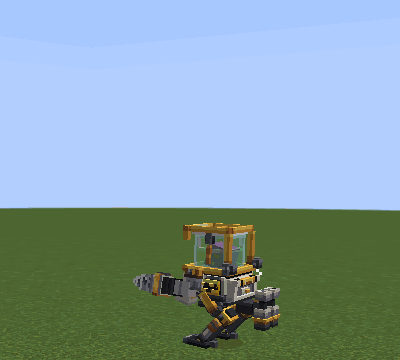

*Saltador: segure **Rodinhas** para agachar, solte para saltar.*

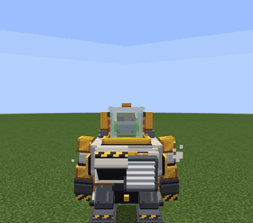

*Baluarte: **Rodinhas** ergue o que está à frente; **Rodinhas** de novo arremessa.*


*Colosso: **Rodinhas** parado ajoelha em Cerco; **Rodinhas** de novo o levanta.*


*Executivo: **Rodinhas** toca o jingle premium.*


*Casa sobre Rodas: **Rodinhas** numa estrada para a Hora do Rush.*


*Rastejador: **Rodinhas** num bloco a até 24 dispara a linha; segure para recolher.*


*Pipa: em voo, baixo sobre uma criatura, **Rodinhas** a apanha; **Rodinhas** de novo a solta.*


*Quimera: acerte uma criatura com um braço e depois **Rodinhas** em até 5 segundos.*

### Braços em ação


*Uma Lança de Plasma: segure o botão do braço e o feixe vai para onde você mira.*

Todo feixe e todo jato sai do bocal da própria ferramenta no braço e chega onde você mira: o feixe de cobre da Lança de
Plasma (enquanto a sua lança queima, as bordas da sua visão escurecem como a máscara de um soldador), o raio branco do
Canhão de Arco, saltando para até três hostis com um instante de intervalo (um erro cai onde você mira), as três fitas
azul-petróleo retorcidas do Raio Trator em volta do que ele segura, o jato do Lança-Chamas curvando para cima na ponta, o
arco curto branco-azulado do Maçarico, os rebites da Rebitadeira saindo do lado da própria arma. Cada ferramenta se mexe
conforme o seu tipo: a Broca, a Motosserra e a Colheitadeira giram; a Rebitadeira e o Canhão de Arco dão coice; o
Lança-Chamas, o Raio Trator, o Maçarico e a Lança de Plasma se firmam e seguram; o Punho Hidráulico, o Gancho, a Pá
Escavadeira e a Hemosseringa golpeiam; o Escudo de Choque e a Mão Manipuladora se defendem, e um golpe numa guarda
erguida joga o braço para trás. O golpe do punho e a picada da seringa acertam quando o braço chega lá, um instante
depois do aperto, e o Canhão de Arco dispara no recuo; o custo é pago no aperto. A Mão Manipuladora segura o item
selecionado na garra.

### Energia, calor e massa

**Bateria.** Todo mecha tem a própria bateria; a carga do pote não é tocada. Enquanto pilotado, ele paga o consumo
ocioso da estrutura, o consumo fixo de cada módulo, 4 FE por tick em movimento e o que custarem os braços, os
utilitários e o seu movimento próprio. Em sobrecarga, o consumo ocioso, fixo e de movimento é 1,5 vez maior.
**Estacionado, um mecha consome só 1 FE por tick** (mais 20 por tick para Esteiras de Lava sobre lava, e 5.000 para
cada carga de Blindagem Reativa que ele recompõe), e uma Pilha Galvânica Compacta ou Pele Solar continua carregando;
o mesmo vale para um Núcleo de Combustão, um Núcleo Biorreator ou uma Garrafa de Fusão com combustível no Compartimento
de Carga. Carregue no Pórtico, ou instale um núcleo.

**Modo manco.** Com 0 FE o mecha anda a 30% da velocidade, não pode voar nem escalar, e todo braço, utilitário e módulo
com energia para: "Bateria descarregada. Estacione no Pórtico de Montagem para carregar." Pular normalmente e as Asas de
Planador ainda funcionam.

**Calor.** O calor é contado em pontos até o limite de calor da estrutura (veja *Estruturas*); o HUD o mostra como
porcentagem do limite. Módulos e ações geram calor; a estrutura perde uma quantidade fixa por tick (mais 4 com Aletas de
Radiador, 6 com um Circuito de Refrigeração). A perda é três vezes mais rápida embaixo d'água, metade mais rápida na
chuva e na metade da velocidade no Nether. Lava soma 10 de calor por tick, queimar soma 3 (não com Supressão de
Incêndio). A partir de 60% a barra de calor fica amarela, as Aletas de Radiador se abrem, as saídas de ar brilham num
âmbar escuro e o metal quente estala; a partir de 85% o brilho é âmbar, e vermelho ao expelir calor. A partir de 85% a
maioria dos braços trabalha a 70%. Em 100% ele **expele calor**: 5 segundos de desligamento numa nuvem de vapor que cega
e escalda qualquer um a até 3 blocos (2 de dano por segundo, 10 numa expulsão completa: mantenha distância de máquina
quente); o calor cai pela metade na hora e continua caindo durante a expulsão. O vapor também escalda a cabine uma vez,
com 2 de dano (que o mecha recebe, como qualquer golpe no piloto), a não ser que o pote tenha um Escudo Térmico. Enquanto
expele calor, ele não pode andar, pular, disparar nem usar nada, embora um que já esteja no ar continue voando e
manobrando, e uma Mochila Foguete ainda erga: "Expelindo calor. Tudo volta quando esfriar."
**Um mecha estacionado não gera calor próprio e nunca expele calor sozinho**: chegue perto de um com Garrafa de Fusão e
ele fica quieto. Uma **Granada de PEM** corta a bateria pela metade e força uma expulsão de calor, estacionado ou não.

**Massa.** Estrutura mais módulos, mais 1 kg para cada espaço ocupado do Compartimento de Carga. Contra a capacidade de
carga da estrutura:

| Carga | Velocidade | Pulo |
|---|---|---|
| até 60% | total | total |
| 60 a 100% | cai até 60% | cai até a metade |
| 100 a 125% (sobrecarga) | 30%, consumo 1,5 vez | nenhum, e a Pipa não voa |
| acima de 125% | nenhuma: "SOBRECARGA: servos travados. Alivie no Pórtico de Montagem" | nenhum |

### Dano e reparo

- **Amassados.** Toda máquina anota onde caíram os seus últimos oito golpes. A três quartos, metade e um quarto da vida,
  os painéis do lado que mais apanhou amassam mais um estágio; um lado que levou, além disso, dois desses golpes fica um
  estágio atrás. Uma máquina que não foi atingida desde a última vez que esteve inteira não mostra nenhum, seja qual for
  a vida (uma estacionada antes de esta política entrar em vigor começa com a ficha limpa). **Reparar** no Pórtico
  desamassa à medida que as placas são colocadas, e a ficha é encerrada quando a máquina fica inteira. Danos estéticos
  não são cobertos pela garantia.
- O dano também aparece de outras formas: abaixo da metade da vida, faíscas saltam das juntas; abaixo de um quarto, o
  casco solta fumaça, todo golpe estala, e uma estrutura que anda manca na velocidade de sempre: a perna do lado que mais
  apanhou arrasta a ponta, pisa chapada e atrasada, o quadril pende para ela e o braço desse lado fica caído. Bateria
  descarregada também faz mancar, devagar. O Rastejador mantém o trote (os pés acham o chão sozinhos) e a Casa sobre
  Rodas não tem pernas para poupar.


- Um golpe mirado no piloto cai no mecha. O piloto não consegue ferir o próprio mecha. Quedas de até 6 blocos não fazem
  nada.
- **Destruído** (0 de vida de uma vez): o Paraquedas Dourado é acionado (veja abaixo) e o vidro leva uma pancada (nunca a
  última): "Saltador destruído; ejetado. Vidro N/M." (o seu vidro, atual e máximo). A máquina desaba de cara no chão, e
  depois vem uma pequena explosão que não quebra blocos e poupa quem estava a bordo. Cada módulo tem chance igual de cair;
  senão, cai como uma Placa de Mecha. O Compartimento de Carga derruba tudo. A estrutura se perde.
- **Reparo:** **Reparar** no Pórtico (20 de vida por placa), Placa de Mecha **Usada** no seu próprio mecha (20 de vida;
  "Nada para remendar. A placa pode esperar." quando inteiro; piloto não tem mãos para isso), o **Maçarico**, a
  **Hemosseringa**, ou um **Injetor Médico** numa Quimera.

### O Paraquedas Dourado

Quando um golpe deixa um mecha pilotado abaixo de 10% da vida, ou o destrói, o pacote de desligamento da empresa entra em
ação. Toca a sirene de ejeção, a contenção da estrutura é aberta à força (o aro do Saltador, as presilhas do pote do
Baluarte, o anel da Casa sobre Rodas, o piso da lanterna da Pipa) e o pote é disparado para cima e para trás, longe da
máquina (para longe da parede, se ela estava escalando uma; uma Pipa em voo, em vez disso, o derruba da lanterna). Um
dossel dourado se abre num estalo e o pote desce flutuando sob ele, sustentado até pousar: "PARAQUEDAS DOURADO
ACIONADO". Com menos de três blocos de ar acima, o dossel se embola ("Paraquedas Dourado embolado: sem espaço acima para
abrir. Prepare-se para o pouso."), e numa queda curta demais não dá tempo de abrir ("Paraquedas Dourado embolado: pouco
ar para abrir. Prepare-se para o pouso."). Todo paraquedas vem com uma carta, mesmo quando a máquina sobrevive: "A
Noggin & Sons lamenta a perda do seu Saltador em x, y, z. Seu Termo de Desligamento segue pelo correio." (para as outras
estruturas, "do seu mecha (Estrutura do Baluarte)" e assim por diante). O mecha fica para trás, vazio.


*O Paraquedas Dourado é acionado sozinho quando um golpe deixa um mecha pilotado abaixo de 10% da vida.*

### Passageiros e o Compartimento de Carga

- **Assentos:** a Casa sobre Rodas tem 2, uma **Cápsula de Passageiro** acrescenta 1. Um jogador na forma **corpo** ou
  **conectado** **Usa** um mecha pilotado para ocupar um assento ("Nenhum assento livre. Espere vagar um." quando cheio)
  e sai com **Agachar**. Um pote não pode ocupar assento de passageiro. Passageiros que saem do jogo são deixados no chão.
- **Compartimento de Carga:** 27 espaços. Abra com **Trocar** de dentro da cabine, ou com **Agachar** e **Usar** num
  mecha estacionado, por fora (dono ou de confiança). Brocas, serras, pás, a Colheitadeira e a Hemosseringa guardam a
  coleta nele; os núcleos, a Rebitadeira, o Injetor Médico, o Maçarico e o Enxerto da Quimera tiram os suprimentos dele.
  Pastilhas de Plasma e Biogel **Usados** num mecha são recusados: "Combustível vai no Compartimento de Carga. Agache e
  use o mecha para abrir." Sem um instalado: "Nenhum Compartimento de Carga instalado. Instale um no Pórtico de
  Montagem."

### Confiança

Um mecha pertence a quem o montou. O dono, os jogadores em quem ele confia com `/headoffice trust add <player>` e os
colegas de equipe do dono (enquanto o dono estiver online) podem pilotá-lo, abrir o compartimento, remendá-lo com placas,
injetar nele, renomeá-lo com uma Etiqueta, e desmontá-lo ou repará-lo num Pórtico. O Raio Trator de mais ninguém pode
pegá-lo. Laço não vai em máquina. Os levantamentos, pousos e aríetes de um mecha, o seu Raio Trator e o seu Gancho só
movem outro jogador se esse jogador confiar no piloto (`/headoffice trust add`) ou for da equipe do piloto.

### Portas Genéticas

A Quimera tem 3 Portas Genéticas, o Executivo 4, e uma **Porta de Biointegração** acrescenta 1 a qualquer estrutura. Um
jogador com mãos (**corpo** ou **conectado**, ou um pote com Braço Manipulador) **Usa** um Soro no mecha por fora. Cada
porta aceita um soro de carga até 8; o tipo sanguíneo nunca importa, embora um soro ainda possa sofrer mutação ou
talhar. O frasco volta. "Este mecha não tem Porta Genética. Instale uma Porta de Biointegração no pórtico."; "Não cabe
outro soro"; "Pesado demais para este corpo: hospedeiro aguenta 6, Porta Genética 8." Genes funcionam com força total
num mecha, e as Asas Dracônicas deixam qualquer mecha voar (um hospedeiro as aceita mas não voa; um corpo não aguenta,
carga 6). Acione os ativos com **Agachar** + **Habilidade** e **Agachar** + **Secundária** (ou só as teclas, quando não
houver utilitário instalado). Desmontar o mecha mantém os soros na estrutura. O Enxerto da Quimera acrescenta um gene por
um minuto sem usar porta.

### Estruturas

A velocidade é comparada à de um jogador andando (1,0 = passo de caminhada). Os espaços são Pernas / Costas / Núcleo /
Torso / Braço / Sensor.

| Estrutura | Vida | Armadura | Bateria | Carga / massa vazia | Velocidade | Limite de calor / resfriamento por tick | Espaços | **Rodinhas** | Também |
|---|---|---|---|---|---|---|---|---|---|
| **Saltador** | 60 | 6 | 100 kFE | 350 / 150 kg | 1,3 | 400 / 3 | 1/1/1/2/2/1 | Protocolo Pogo | o primeiro mecha |
| **Baluarte** | 140 | 12 | 300 kFE | 800 / 320 kg | 1,1 | 800 / 5 | 1/2/1/3/2/2 | Trabalho Pesado | |
| **Quimera** | 120 | 8 | 200 kFE | 700 / 220 kg | 1,2 | 700 / 6 | 1/1/1/3/2/1 | Enxerto | 3 Portas Genéticas; o Injetor Médico a repara |
| **Casa sobre Rodas** | 90 | 10 | 300 kFE | 1000 / 300 kg | 2,4 em chão construído, 0,8 fora de estrada | 600 / 4 | 0/2/1/2/1/1 | Hora do Rush | anda sem pernas; 2 assentos de passageiro; não pula, então nada de Mochila Foguete nem Asas de Planador, e os Jatos de Salto só disparam quando ela já está no ar (saindo de uma beirada) |
| **Rastejador** | 100 | 10 | 200 kFE | 600 / 260 kg | 1,2 | 600 / 4 | 0/1/1/2/1/2 | Linha de Içar | anda sem pernas, sobe paredes e se agarra a elas; um braço só |
| **Pipa** | 70 | 6 | 250 kFE | 280 / 120 kg | 1,2, bem mais rápida voando | 500 / 6 | 1/0/1/1/2/1 | Içamento por Garras | voa segurando **Pular** (40 FE e 2 de calor por tick no ar), sem dano de queda; anda sem pernas, então o espaço de Pernas aceita qualquer módulo de Pernas; não voa em sobrecarga; sem espaço de Costas |
| **Colosso** | 300 | 18 | 1.000 kFE | 1800 / 700 kg | 0,9 | 1600 / 8 | 1/2/2/5/4/2 | Cerco | 2 braços e 2 pontos de fixação nos ombros; grande demais para um portal do Nether |
| **Executivo** | 360 | 20 | 2.000 kFE | 2000 / 750 kg | 1,0 | 2000 / 10 | 1/2/2/5/4/2 | jingle premium | o Colosso, só que mais; 4 Portas Genéticas; grande demais para um portal do Nether |

Consumo ocioso: 2 FE por tick (Saltador, Pipa), 3 (Quimera, Casa sobre Rodas, Rastejador), 5 (Baluarte), 8 (Colosso),
10 (Executivo). Toda estrutura sobe um bloco de degrau, nunca se afoga e ignora a maior parte da repulsão. As dicas das
estruturas listam vida, armadura, carga, bateria, espaços e Portas Genéticas.

| Item de estrutura | Receita (bancada de trabalho, com formato) |
|---|---|
| **Estrutura do Saltador** | 1 Câmera de Colar, 2 Placa de Mecha, 3 Servo |
| **Estrutura do Baluarte** | 4 Placa de Mecha, 1 Câmera de Colar, 1 Fragmento de Netherita, 2 Servo |
| **Estrutura da Quimera** | 2 Biogel, 1 Câmera de Colar, 2 Placa de Mecha, 1 Bloco de Fungo do Nether, 2 Servo |
| **Estrutura da Casa sobre Rodas** | 4 Placa de Mecha, 1 Câmera de Colar, 1 Carrinho, 2 Servo |
| **Estrutura do Rastejador** | 4 Servo, 1 Câmera de Colar, 2 Placa de Mecha, 1 Olho de Aranha Fermentado |
| **Estrutura da Pipa** | 2 Membrana de Phantom, 1 Câmera de Colar, 2 Placa de Mecha, 2 Servo |
| **Estrutura do Colosso** | 4 Placa de Mecha, 1 Câmera de Colar, 2 Lingote de Netherita, 1 Estrutura do Baluarte, 1 Servo |
| **Estrutura do Executivo** | 4 Bloco de Ouro, 2 Chip Sináptico, 2 Estrela do Nether, 1 Estrutura do Colosso |

As oito estruturas são animadas: cada uma se monta sozinha na plataforma, inicializa quando você entra, anda, vira, manca
quando ferida, mexe os braços, expele calor, deixa você sair e desaba quando destruída, com o pote de verdade no assento e
cada módulo no seu encaixe. Cada uma tem os próprios sons, do "Mecha estala o pescoço" do Baluarte ao "Sapato bate,
impaciente" do Executivo, todos com legenda. Um mecha estacionado (parado, sem ninguém a bordo) é desenhado a partir de
uma cópia guardada da sua aparência, então um pátio cheio de máquinas estacionadas custa cerca de um décimo do tempo de
desenho de antes. Com o Iris 1.8.12 e o pacote de shaders BSL Classic v10.0 ou Complementary Reimagined r5.5.1, a cópia é
desenhada pelos próprios programas do pacote, sombra incluída, e uma máquina estacionada custa um quinto ou menos do que
custava; com qualquer outro pacote ou versão do Iris, as máquinas estacionadas são desenhadas como antes.

### Módulos

58 módulos em seis tipos. Todo módulo empilha até 1 e é feito numa bancada de trabalho. A dica diz o que ele faz, o seu
espaço e a sua massa, e a regulagem, se tiver uma. Os custos em FE são por uso, a não ser quando marcados "por tick"; os
custos "fixos" são pagos a cada tick enquanto pilotado. Todo módulo aparece na máquina, onde estiver instalado.


*Um Baluarte com todos os espaços ocupados.*

<details>
<summary>Todos os 58 módulos de mecha</summary>

**Pernas.** Uma estrutura montada sobre pernas (Saltador, Baluarte, Quimera, Colosso, Executivo) tem um espaço de Pernas,
e ele precisa ter um módulo que ande. A Pipa anda sozinha, então os módulos daqui que não andam só servem numa Pipa.

| Módulo | Massa | Receita | O que faz | Tecla | Regulagem |
|---|---|---|---|---|---|
| **Pernas Hidráulicas** | 60 kg | 2 Servo, 4 Placa de Mecha | Anda. | – | Passada: 60% a 140% da velocidade |
| **Calcanhares de Mola** | 20 kg | 2 Pistão, 2 Bloco de Slime | Pula mais alto. Só na Pipa, e uma Pipa com carga decola em vez de pular, então só funcionam com a bateria descarregada. | **Pular** | Tensão: altura |
| **Grampos de Ancoragem** | 30 kg | 2 Bigorna, 2 Placa de Mecha | Agarram o chão: sem repulsão enquanto parado; sem dano de queda. Só na Pipa. | – | nenhuma |
| **Barbatanas Aquáticas** | 15 kg | 2 Fragmento de Prismarinho, 2 Placa de Mecha | Duas vezes mais rápido na água; sai pela margem. Só na Pipa. | – | nenhuma |
| **Servos de Corrida** | 25 kg | 2 Pó de Redstone, 1 Servo | Até 80% mais rápido enquanto houver energia; 15 FE por tick em movimento. Só na Pipa. | – | Impulso: quanto mais rápido |
| **Pernas de Pau** | 35 kg | 2 Placa de Mecha, 4 Barras de Ferro | Anda; sobe degraus de dois blocos. | – | nenhuma |
| **Pernas Aracnídeas** | 90 kg | 4 Linha, 2 Servo, 1 Placa de Mecha | Anda; sobe paredes com energia (12 FE por tick numa parede). Sem dano de queda enquanto escala. | – | nenhuma |
| **Saia Flutuante** | 50 kg | 3 Placa de Mecha, 2 Membrana de Phantom | Anda; flutua sobre chão, água e lava. Sem dano de queda. Fixo de 30 FE e 2 de calor por tick. | – | Altitude: 0,5 a 2 blocos |
| **Esteiras de Lava** | 40 kg | 2 Bloco de Magma, 1 Placa de Mecha | Anda; sobe para fora da lava e apaga o próprio fogo (20 FE e 3 de calor por tick na lava, além do calor da própria lava). | – | nenhuma |

**Costas**

| Módulo | Massa | Receita | O que faz | Tecla | Regulagem |
|---|---|---|---|---|---|
| **Jatos de Salto** | 45 kg | 2 Bola de Fogo, 2 Alto-forno, 1 Chip Sináptico | Um impulso para cima. Três por pouso, 600 FE e 15 de calor cada. "Jatos esgotados. Recarregam quando você pousar." | **Pular** no ar | Empuxo: altura de cada impulso |
| **Mochila Foguete** | 110 kg | 2 Vara de Blaze, 1 Chip Sináptico, 2 Bola de Fogo | Voo enquanto o empuxo vencer a massa do mecha: sobe, ou desce devagar ao cair. 120 a 300 FE e 6 de calor por tick subindo. | segure **Pular** | Empuxo: 200 a 800 kg |
| **Asas de Planador** | 40 kg | 2 Membrana de Phantom, 1 Placa de Mecha | Plana para onde você olha ao cair. Sem dano de queda enquanto plana. Funciona com a bateria descarregada. | segure **Pular** | nenhuma |
| **Compartimento de Carga** | 80 kg | 5 Placa de Mecha, 1 Baú | 27 espaços; veja *Passageiros e o Compartimento de Carga*. | **Trocar** | nenhuma |
| **Cápsula de Passageiro** | 120 kg | 3 Vidro, 2 Placa de Mecha, 1 Lã Branca | Um assento de passageiro para um jogador na forma **corpo** ou **conectado**. | – | nenhuma |
| **Aletas de Radiador** | 30 kg | 3 Barras de Ferro, 3 Placa de Mecha | Perde 4 de calor a mais por tick; as aletas se abrem quando esquenta. | – | nenhuma |
| **Rack de Baterias** | 70 kg | 3 Garrafa de Leyden, 3 Placa de Mecha | +125 kFE de bateria. | – | nenhuma |
| **Bolsa do Ender** | 15 kg | 2 Placa de Mecha, 1 Baú do Ender | Utilitário: abre o seu baú do Ender. 2.000 FE. | **Habilidade** | nenhuma |
| **Morteiro de Fumaça** | 35 kg | 1 Fogueira, 2 Placa de Mecha, 1 Ejetor | Utilitário: uma nuvem de fumaça de 8 blocos de diâmetro onde você mira (até 24 blocos), por 10 segundos. Cega quem está dentro; criaturas nela perdem o alvo. 2.000 FE, 10 de calor. | **Habilidade** | nenhuma |
| **Lança-Mísseis** | 90 kg | 3 Fogo de Artifício, 2 Placa de Mecha, 1 Chip Sináptico | Utilitário: quatro **Micromísseis** teleguiados (menos, se a carga acabar), repartidos em turnos entre o que você mira (até 48 blocos) e os hostis mais próximos a até 32; sem alvo, voam em linha reta. 4 a 12 de dano por acerto e uma pequena explosão que não quebra blocos. 4.000 FE cada. | **Habilidade** | Ogiva: dano, e 10 a 30 de calor por míssil |

**Núcleo**

| Módulo | Massa | Receita | O que faz | Tecla | Regulagem |
|---|---|---|---|---|---|
| **Pilha Galvânica Compacta** | 25 kg | 1 Pilha Galvânica, 1 Placa de Mecha | 10 FE por tick, sempre, inclusive estacionado. | – | nenhuma |
| **Núcleo de Combustão** | 60 kg | 4 Placa de Mecha, 1 Alto-forno, 1 Fio de Neurocobre | Queima combustível de fornalha do Compartimento de Carga: até 80 FE (e 0,2 de calor) por tick (um carvão dá 16.000 FE). Continua queimando estacionado, cheio ou não. | – | nenhuma |
| **Núcleo Biorreator** | 50 kg | 4 Placa de Mecha, 1 Biogel, 1 Defumador | Come do Compartimento de Carga: Biogel 20.000 FE, um Frasco de Plasma 10.000, comida 2.000 por ponto de fome. Até 60 FE e 2 de calor por tick. | – | nenhuma |
| **Banco de Capacitores** | 50 kg | 3 Garrafa de Leyden, 2 Placa de Mecha, 1 Chip Sináptico | +500 kFE de bateria. | – | nenhuma |
| **Garrafa de Fusão** | 140 kg | 2 Vidro Fumê, 1 Estrela do Nether, 2 Placa de Mecha, 1 Sinalizador | Queima Pastilhas de Plasma do Compartimento de Carga ou do seu inventário, 1.000.000 FE cada. Muito quente. | – | Saída: 150 a 600 FE e 3,75 a 15 de calor por tick |

**Torso**

| Módulo | Massa | Receita | O que faz | Tecla | Regulagem |
|---|---|---|---|---|---|
| **Blindagem de Mecha** | 60 kg | 5 Placa de Mecha, 1 Bloco de Ferro | Tira de 10 a 30% de todo golpe. | – | Espessura: quanto |
| **Blindagem de Espinhos** | 50 kg | 2 Cacto, 1 Placa de Mecha | Quem ataca corpo a corpo recebe de volta 30% do golpe. | – | nenhuma |
| **Supressão de Incêndio** | 25 kg | 2 Balde de Água, 1 Placa de Mecha | O mecha não pega fogo; mecha e piloto são apagados. | – | nenhuma |
| **Reciclador de Suporte Vital** | 20 kg | 2 Reciclador de Soro, 1 Placa de Mecha | Com energia, mantém cheios o soro e a carga do piloto e conserta o vidro do pote em um ponto a cada 30 segundos. Fixo de 10 FE por tick. | – | nenhuma |
| **Amplificador de Sinal** | 15 kg | 1 Mastro Retransmissor, 2 Placa de Mecha, 1 Chip Sináptico | Um Mastro Retransmissor que anda: com carga, a sua cabeça alcança o mecha dentro do alcance dos seus óculos e o mecha alcança o seu corpo a até 96 blocos, para você e para quem tem a sua confiança. Fixo de 20 FE por tick. | – | nenhuma |
| **Pele Solar** | 20 kg | 3 Sensor de Luz Solar, 3 Placa de Mecha | 15 FE por tick de dia, a céu aberto. | – | nenhuma |
| **Circuito de Refrigeração** | 45 kg | 2 Gelo Compactado, 1 Placa de Mecha | Perde 6 de calor a mais por tick. | – | nenhuma |
| **Blindagem Reativa** | 70 kg | 2 Dinamite, 1 Placa de Mecha | Tira 40% de explosões e projéteis, 6 cargas; uma volta a cada 30 segundos por 5.000 FE. | – | nenhuma |
| **Escudo de Energia** | 40 kg | 2 Fragmento de Ametista, 3 Placa de Mecha, 1 Chip Sináptico | Desvia parte de cada golpe para a bateria, 1.000 FE (e 1 de calor) por ponto de dano, enquanto a bateria durar. Fixo de 40 FE e 4 de calor por tick. | – | Força: 25 a 100% do golpe |
| **Injetor Médico** | 30 kg | 2 Biogel, 1 Seringa, 3 Placa de Mecha | Uma vez por segundo, cada jogador a bordo abaixo do limiar recebe 4 de vida por 1 Biogel (Compartimento de Carga ou seu inventário). Uma Quimera ferida recupera 1 de vida por segundo, 20 de vida por Biogel. | – | Limiar: 0 a 100% da vida |
| **Campo Furtivo** | 30 kg | 2 Olho do Ender, 3 Placa de Mecha, 1 Chip Sináptico | Criaturas a mais de 4 blocos perdem você de vista. Qualquer braço o desliga por 3 segundos. Fixo de 200 FE e 8 de calor por tick. | – | nenhuma |
| **Bobina de Tesla** | 60 kg | 1 Nó de Tesla, 1 Placa de Mecha | Uma vez por segundo, arcos atingem até 3 hostis próximos (10 de calor quando isso acontece). 100 a 400 FE por tick enquanto pilotado. | – | Voltagem: alcance de 3 a 6 blocos, 2 a 6 de dano |
| **Bancada** | 10 kg | 1 Bancada de Trabalho, 1 Placa de Mecha | Utilitário: uma grade de fabricação. Grátis. | **Habilidade** | nenhuma |
| **Porta de Biointegração** | 40 kg | 2 Biogel, 1 Estação de Injeção, 2 Placa de Mecha, 1 Chip Sináptico | Uma Porta Genética em qualquer estrutura; a bateria guarda 20% a menos. | – | nenhuma |

**Braços.** Instalados num espaço de braço ou, num Colosso ou Executivo, num ponto de fixação do ombro, que dispara junto
com o braço de baixo (o Escudo de Choque só funciona num braço). **Atacar** opera o esquerdo, **Usar** o direito. "Nada
ao alcance. Mire em algo." e "Esse braço ainda está recarregando. Um instante." valem para todos.

| Módulo | Massa | Receita | O que faz | Tecla | Regulagem |
|---|---|---|---|---|---|
| **Braço Broca** | 70 kg | 3 Diamante, 1 Bloco de Ferro, 1 Servo | Minera o bloco a até 6 como uma picareta de ferro, 50 FE e 1 de calor por bloco, para o Compartimento de Carga se houver. "Este terreno é protegido. Cave em outro lugar." | segurar | Torque: velocidade; a partir de 50%, uma cabeça 3x3 na metade da velocidade |
| **Braço Motosserra** | 60 kg | 3 Lingote de Ferro, 2 Tesoura, 1 Servo | Numa criatura a até 4: 8 de dano, 40 FE. Segurado num tronco por menos de um segundo: derruba a árvore inteira (até 128 troncos), 40 FE e 0,5 de calor por tronco. "A motosserra quer uma criatura ou um tronco. Mire num." | apertar, segurar | nenhuma |
| **Punho Hidráulico** | 90 kg | 5 Pistão, 1 Servo | Numa criatura a até 4,5: 10 a 22 de dano e repulsão. 300 a 1.500 FE, até 4 de calor. Uma vez a cada 0,6 segundo. | apertar | Força: dano, repulsão e custo |
| **Gancho** | 30 kg | 2 Gancho de Armadilha, 1 Servo | Uma criatura a até 32 é puxada até você; senão, você é puxado até o bloco para onde mira. 800 FE por lançamento, acertando ou não, uma vez por segundo. Um jogador só é puxado se confiar em você (colegas de equipe contam); senão, o gancho fica parado e não custa nada: "... não autorizou o manuseio. Peça que confie em você." | apertar | nenhuma |
| **Raio Trator** | 50 kg | 1 Módulo de Telecinese, 1 Servo | Agarre uma criatura ou um bloco solto a até 24, segure para carregar, solte para largar. 80 FE por tick. "O feixe não pega isso. Não é seu para mover." Um jogador só é pego se confiar em você (colegas de equipe contam): "... não autorizou o manuseio. Peça que confie em você." | apertar, segurar | nenhuma |
| **Rebitadeira** | 45 kg | 2 Lingote de Ferro, 1 Besta, 1 Servo | Cinco rebites por segundo, uma Pepita de Ferro (Compartimento de Carga ou inventário), 30 FE e 0,5 de calor cada. "Sem rebites. Leve pepitas de ferro." | segurar | nenhuma |
| **Escudo de Choque** | 80 kg | 5 Placa de Mecha, 1 Escudo | Golpes pela frente causam um quinto do dano. | segurar | nenhuma |
| **Mão Manipuladora** | 30 kg | 3 Lingote de Ferro, 1 Servo | Usa o item selecionado na sua barra de atalhos como uma mão, num bloco a até 6 ou no ar; uma criatura a até 6 é atingida com ele. 50 FE. | apertar | nenhuma |
| **Pá Escavadeira** | 80 kg | 4 Pá de Ferro, 1 Servo | Cava 3x3 de terra, areia e cascalho de uma vez, 20 FE por bloco, para o Compartimento de Carga se houver. | segurar | nenhuma |
| **Lança-Chamas** | 50 kg | 2 Pó de Blaze, 1 Bola de Fogo, 1 Servo | Um cone de fogo de 7 blocos. Incendeia criaturas por 4 segundos, 1 de dano de fogo por acerto. 60 FE e 8 de calor por tick. | segurar | Abertura: cone estreito a largo |
| **Canhão de Arco** | 85 kg | 2 Para-raios, 1 Nó de Tesla, 1 Servo | Um raio na primeira criatura a até 16 que salta para até três hostis próximos. 6.000 FE, 25 de calor. "Esse braço precisa de 6 kFE. Recarregue no Pórtico de Montagem." | apertar | Carga: 8 a 16 de dano, 0,5 a 2 segundos entre disparos |
| **Hemosseringa** | 25 kg | 1 Seringa de Precisão, 1 Servo | Numa criatura a até 4: 4 de dano, a estrutura recupera um décimo disso, e uma Amostra de Sangue (qualidade até 80, menos de uma criatura ferida, envenenada ou em chamas) vai para o Compartimento de Carga ou o seu inventário. 20 FE. "Jogador não doa sangue aqui. Mire numa criatura." Como as seringas de mão, ela não atravessa o couro grosso de um chefão, do Guardião-ancião ou do Warden: "O couro é grosso demais: use uma Agulha Leviatã". Uma criatura sem sangue também não é picada; a linha cita a ferramenta certa, "Ferramenta errada para esta criatura. Use a Torneira de Óleo." para um golem de ferro. | apertar | nenhuma |
| **Colheitadeira** | 10 kg | 3 Enxada de Ferro, 1 Servo | Colhe e replanta toda plantação madura num 5x5 em volta de onde você mira, 10 FE por planta. "Nada maduro aí. Volte na colheita." | apertar | nenhuma |
| **Maçarico** | 30 kg | 1 Vara de Blaze, 1 Isqueiro, 1 Servo | Conserta o mecha para onde você mira a até 5, ou o seu, 2 de vida por segundo; uma Placa de Mecha do Compartimento de Carga a cada 20 de vida. 80 FE e 6 de calor por tick. | segurar | nenhuma |
| **Lança de Plasma** | 120 kg | 2 Vara do End, 1 Pastilha de Plasma, 1 Servo | Um feixe de 32 blocos. 1 de dano por acerto e incendeia o alvo por 3 segundos. 600 FE e 15 de calor por tick. | segurar | nenhuma |

**Sensores**

| Módulo | Massa | Receita | O que faz | Tecla | Regulagem |
|---|---|---|---|---|---|
| **Óptica Noturna** | 5 kg | 1 Lente, 1 Cenoura Dourada, 1 Servo | Visão noturna para o piloto enquanto houver energia. 2 FE por tick. | – | nenhuma |
| **Bioscanner** | 5 kg | 1 Lente, 1 Chip Sináptico | Mostra no HUD a criatura sob a sua mira: "Vaca: 8 / 10 de vida, Sangue quente". 1 FE por tick. | – | nenhuma |
| **Imagem Térmica** | 8 kg | 1 Lente, 1 Bolsa de Tinta Brilhante, 1 Servo | Seres vivos a até 32 blocos brilham, para todos que puderem vê-los. 10 FE e 1 de calor por tick. | – | nenhuma |
| **Scanner de Minério** | 12 kg | 1 Lente, 1 Bússola, 1 Bloco de Redstone | Utilitário: marca os minérios ao seu redor por 5 segundos, só para os seus olhos. 4.000 FE a cada 8 blocos de raio, 6 de calor. | **Habilidade** | Raio: 8 a 24 blocos |
| **Trava de Mira** | 5 kg | 1 Lente, 1 Chip Sináptico, 1 Pó de Redstone | Com energia, a sua mira desliza para um hostil a até 24 blocos perto da mira. 2 FE por tick. | – | nenhuma |

</details>

Um utilitário que não consegue pagar: "Lança-Mísseis precisa de 4 kFE. Carregue no Pórtico de Montagem."

Conquistas desta divisão: **Pedido à Manutenção** (coloque um Pórtico de Montagem), **Subindo na Carreira** (monte um
mecha), **Sala da Diretoria** (entre na cabine), **Presidente do Conselho** (construa um Executivo), **Pesada É a
Cabeça** (pilote um Colosso ou um Executivo), **Paraquedas Dourado** (seja ejetado por ele), **Milhas Acumuladas** (30
segundos no ar numa Pipa, somando todos os voos dela), **Quimera** (dê cinco ou mais genes a um mecha). O Jade, se
instalado, mostra a carga, o calor e a massa de um mecha, e os genes que ele carrega.

---

## Departamento de Genética

O Departamento de Genética toma emprestado o que outras criaturas têm de melhor e põe em você, nos seus hospedeiros e
nos seus mechas. O trabalho segue cinco etapas:

1. **Colete** uma **Amostra de Sangue** com uma ferramenta de coleta.
2. **Centrifugue** a amostra na **Centrífuga** até virar uma **Fração de DNA**.
3. **Leia** a fração no **Sequenciador de DNA**, que a soma à sua biblioteca de genes.
4. **Emende** até três genes num **Cartucho de Soro Genético** no **Emendador de Genes**.
5. **Injete** o soro: no seu próprio corpo, na **Estação de Injeção**, ou à mão num hospedeiro ou num mecha com Portas
   Genéticas.

**Leia isto antes de emendar.** Todo gene tem um **peso**. O peso de um soro é a soma dos pesos dos genes, e cada alvo
tem um limite:

| Alvo | Peso máximo por soro | Soros que comporta | Pode rejeitar |
|---|---|---|---|
| Seu próprio **corpo** (Estação de Injeção) | 3 | 2 | sim |
| Um **hospedeiro** (à mão) | 6 | 1 | sim |
| As **Portas Genéticas** de um mecha (à mão) | 8 | um por porta | nunca |

Um corpo, portanto, só aceita genes de peso 1 a 3. A maioria dos vistosos (Piscar do Ender, Olho de Guardião, Sopro
Gélido e todos os lendários) pesa de 4 a 6 e só vai num hospedeiro ou num mecha. Os dois genes ativos que um corpo
pode carregar são **Corrente de Breeze** e **Redemoinho do Saci**. A tabela completa de genes está no fim desta seção.

Os genes só funcionam no seu corpo enquanto você está na forma **corpo** ou **conectado**. Eles pertencem ao corpo:
ficam com ele quando você tira a cabeça e voltam quando você a põe de novo. Sobrevivem à morte, a menos que o servidor
defina `keepGenesOnDeath` como false. Em corpos e hospedeiros, os números de um gene valem 70%; num mecha, a força é
total.

### Colhendo amostras

Toda ferramenta de coleta funciona do mesmo jeito: **Use** numa criatura viva, com o corpo no lugar. Você recebe uma
**Amostra de Sangue** com o nome da criatura ("Amostra de Sangue (Vaca)"), e a ferramenta perde um ponto de
durabilidade. Ferramenta que machuca causa 1 de dano, mas **nunca tira o último ponto de vida de uma criatura**:
nenhuma amostra custa a vida de um espécime. A coleta leva um instante na sua mão: a agulha entra, fica enquanto aspira
(um pequeno plic molhado, "Seringa aspira") e sai.

| Ferramenta | Receita (com formato) | Coleta de | Qualidade | Machuca | Atravessa couro grosso | Durabilidade |
|---|---|---|---|---|---|---|
| **Seringa** | pepita de ferro sobre vidro sobre um Lingote de Aço Cirúrgico | tudo que tem sangue | 30-60 | sim | não | 32 |
| **Seringa de Precisão** | uma Lente entre duas pepitas de ouro, uma Seringa sob a Lente | tudo que tem sangue | 60-90 | não | não | 64 |
| **Agulha Leviatã** | uma Seringa de Precisão entre dois fragmentos de netherita | tudo que tem sangue | 50-80 | sim | sim | 16 |
| **Broca de Medula** | Servo numa cruz de três Lingotes de Aço Cirúrgico, Fio de Neurocobre embaixo | medula (esqueletos, o Wither) | 40-80 | sim | sim | 64 |
| **Torneira de Óleo** | um balde entre dois Lingotes de Aço Cirúrgico na diagonal | óleo (golens de ferro, carcaças, mechas) | 40-80 | não | sim | 64 |
| **Armadilha de Ecto** | Lingote de Aço Cirúrgico sobre uma lanterna das almas, quatro vidros em volta | ecto (obsessor, sereno, breeze, golem de neve) | 40-80 | não | sim | 64 |

- A **qualidade** é sorteada dentro da faixa da ferramenta e depois cortada em até metade numa criatura ferida
  (inteira com a vida cheia, metade com um décimo), e cortada em mais 20 se ela estiver envenenada, definhando ou em
  chamas. Criaturas saudáveis e calmas dão o melhor sangue.
- **Couro grosso:** chefões, o Guardião-ancião e o Warden. "O couro é grosso demais: use uma Agulha Leviatã". As
  ferramentas para os sem sangue também atravessam, então a Broca de Medula colhe amostra do Wither.
- Criaturas **sem sangue**: "Sem sangue aqui: use uma Broca de Medula, Torneira de Óleo ou Armadilha de Ecto". Uma
  ferramenta para os sem sangue numa criatura com sangue: "Ferramenta errada para esta criatura. A descrição dela diz de
  quem ela tira." Em outro tipo sem sangue, ela diz a ferramenta que aquela criatura pede: uma Broca de Medula num golem
  de ferro diz "Ferramenta errada para esta criatura. Use a Torneira de Óleo."
- Jogadores não são espécimes: "Colegas não são amostras. Tire de uma criatura."
- O Dragão do Ender pode fornecer amostra pela Agulha Leviatã, ou pelo jeito fácil: ponha **Bafo do Dragão** na
  Centrífuga.
- Dez amostras rendem **Sede de Sangue**.
- **A Biblioteca Viva:** uma cabeça colocada, ou uma cabeça num Pedestal de Torreta, Suporte de Funcionário, Soquete
  Neural ou Matriz Cerebral, dá uma amostra por dia à ferramenta de sempre, com qualidade de 70 a 95 seja qual for a
  ferramenta (50 a 75 para um troféu ou uma cabeça com a tigela vazia), sem dano nenhum: ela faz careta. Use a
  ferramenta no pedestal ou na estação (agachado também funciona); uma Matriz Cerebral dá da primeira cabeça que ainda
  não doou hoje. De novo no mesmo dia: "Já doou sangue hoje. O RH exige um dia de descanso."; uma Matriz em que todas as
  cabeças já doaram: "O Conselho inteiro doou sangue hoje. A reunião continua." Só o empregador da cabeça e quem ele
  autoriza podem tirar sangue de uma cabeça que tem empregador. Uma cabeça de pedestal no quadro de funcionários perde
  10 de moral; cabeças de estação, não. A mesma cabeça sangrada à mão em sete dias diferentes rende **Banco de Sangue**.
  O valor de servidor `heads.livingLibrary` desliga o recurso.

A descrição de uma amostra mostra a qualidade, o tipo sanguíneo da criatura, os genes que ela carrega e quantas
leituras automáticas de amostras desse nível são necessárias para ler cada gene até um Rascunho. Uma criatura sem genes
(um gigante, ou uma criatura de um mod que não tem nenhum) diz "Não carrega genes legíveis".

**Tipos sanguíneos.** Sangue quente, sangue frio e icor são todos carne e se misturam. Sangue do Ender, de enxofre, de
cova e arcano só combinam consigo mesmos. Medula, óleo e ecto são sem sangue. Jogadores têm sangue quente. Um soro pode
ser rejeitado quando um gene nele vem apenas de criaturas cujo sangue não combina com o do alvo (veja Injetando).

### Pote de Sanguessugas


*O Pote de Sanguessugas tirando amostra de uma vaca ao lado, a cada 30 segundos, sozinho.*

O **Pote de Sanguessugas** (vidro em toda a volta, um Lingote de Aço Cirúrgico em cima, uma bola de slime no meio) é o
banco de sangue de uma fazenda de criaturas: uma máquina de chiclete de dois blocos de altura com uma sanguessuga no
globo. A cada 30 segundos, tira uma amostra de uma criatura em cima dele, ao lado ou logo embaixo, causando 0,5 de dano
(um quarto de coração). As amostras são pequenas: qualidade 15-35 antes da regra da vida. Nunca tira amostra de
jogadores, de couros grossos nem dos sem sangue. Comporta nove amostras e então para. **Use** para esvaziá-lo no seu
inventário ("9 amostras"), ou retire com um funil. Não precisa de energia. Um Pote de Sanguessugas encostado numa
cabeça colocada tira sangue dela uma vez por dia, na qualidade da cabeça, e passa o resto do dia na fazenda; ao lado de
uma cabeça da qual não consegue tirar (sem sangue, ou de couro grosso demais) e sem mais nada para cultivar, a lâmpada
fica âmbar, e o Jade diz por quê.

Quando uma criatura para ao lado, a sanguessuga acorda, vira para ela e se aperta contra o vidro. Cada amostra faz o
bico saltar, gira a manivela e solta um frasco na janelinha sob o globo. Ao ser esvaziado, a manivela gira duas vezes e
os frascos caem tilintando. Cheio, a sanguessuga emburra.

Como as seringas, as sanguessugas nunca tiram o último ponto de vida de uma criatura: fazenda não é matadouro.

### Centrífuga


*A Centrífuga girando amostras: coloque Amostras de Sangue.*

**Centrífuga:** quatro Lingotes de Aço Cirúrgico, Fio de Neurocobre, duas lingotes de cobre, um Servo e redstone. Dois
blocos de altura.

Coloque uma Amostra de Sangue. Oito segundos e cerca de 3.000 FE depois, você tem uma **Fração de DNA** da mesma
criatura e qualidade, e um **Frasco de Plasma**. Bafo do Dragão vira uma Fração de DNA de Dragão do Ender de qualidade
60 e uma garrafa vazia. Comporta 20.000 FE (até 1.000 FE por tick). Saída cheia ou uma oscilação de energia a pausam
("Pausado: saída cheia", "Pausado: sem energia"); ela continua de onde parou. Funis podem abastecê-la e esvaziá-la.

O rotor acelera e os quatro suportes se abrem para fora conforme ganha velocidade. Carregue de uma a três amostras e
ela roda desequilibrada, bambeando, com "PLEASE BALANCE ROTOR" na lateral; com quatro, roda lisa. A gaveta desliza para
fora enquanto a tela está aberta, e uma bandeira sobe quando há algo para retirar.

### Sequenciador de DNA


*Uma leitura automática: coloque uma Fração de DNA e aperte **Auto**.*

**Sequenciador de DNA:** quatro Lingotes de Aço Cirúrgico, uma Lente, duas lingotes de cobre, um Chip Sináptico e
redstone. Uma caixa registradora de dois blocos de altura. Comporta 40.000 FE (até 2.000 FE por tick).

Coloque uma Fração de DNA. Há duas formas de lê-la, e cada leitura consome a fração:

- **Auto.** Aperte **Auto**: lê uma fração a cada 10 segundos por 4.000 FE, com 60% de precisão, e continua enquanto
  chegarem frações. Aperte **Auto** de novo para parar.
- **Chame as bases você mesmo.** Doze letras passam pela tela. Chame cada uma na vez com os botões **A**, **C**,
  **G** e **T** (as mesmas letras do teclado funcionam com a tela aberta). Quando entra a décima segunda, a leitura
  acontece na hora por 4.000 FE: precisão de 50%, mais 50% proporcional a quantas você acertou. "Acertou 11 de 12
  bases". Um pote equipado com um **Coprocessador Cortical** tem um erro perdoado.

Cada base lida é registrada na caixa: a tecla desce, a manivela gira, a bandeira de chamada mostra a base e o recibo
cresce. Uma leitura que você chama marca os acertos e os erros. No fim, o recibo é destacado e a gaveta do caixa
tilinta. Quem estiver olhando vê na tela as teclas que você bate.

**Como a biblioteca cresce.** Cada leitura soma, a cada gene que a criatura carrega:

> qualidade x precisão x 25% / o número de genes que a criatura carrega

Então uma leitura automática soma 15% da qualidade da amostra; uma chamada perfeita, 25%. Uma amostra de qualidade 80 de
uma criatura com um gene soma 12% por leitura automática: três leituras até um Rascunho. Uma criatura com dois genes
(um morcego, uma aranha-das-cavernas) divide isso. Um gene para em 100%. A tela mostra os genes da fração com a sua
porcentagem atual.

| Biblioteca | Faixa | O gene funciona a | Custo de estabilidade |
|---|---|---|---|
| abaixo de 30% | inutilizável | - | - |
| 30% ou mais | **Rascunho** | 50% | x1,5 |
| 60% ou mais | **Funcional** | 75% | x1,2 |
| 100% | **Completo** | 100% | x1 |

A biblioteca pertence à sua equipe do placar, ou só a você, se não tiver equipe. Colegas de equipe compartilham todas
as porcentagens. Uma leitura é registrada em nome de quem apertou um botão da máquina por último. Ler qualquer gene
lendário até 100% rende **Genes Lendários**.

Recusas: "Nada para ler. Coloque uma Fração de DNA no espaço." e "Essa criatura não existe neste mundo. Tire a fração."
(uma fração de um mod que não está instalado; nada é gasto).

#### O Cadastro de Pessoal

![A aba Cadastro de Pessoal do Sequenciador de DNA: "Cadastro de Pessoal, 2 de 77 cadastrados", fileiras de ovos geradores sob Pecuária, Trabalho de Campo, Logística, Segurança e Turno da Noite, com a vaca e o porco já amostrados sem esmaecer e com seus carimbos; apontar para as células em branco da Mooshroom e da Ovelha mostra onde vivem, o pote que pedem, o sangue, a ferramenta e os genes com 0% lido; mais abaixo, a célula em branco do Errante diz "Onde achar: planícies nevadas, picos de gelo e o gelo. Qualquer pote. Broca de Medula, não seringa."](docs/images/staff_directory.gif)

*O Cadastro de Pessoal: aponte para uma célula em branco para saber onde achar a criatura e com o que tirar o sangue
dela.*

A tela do Sequenciador tem duas abas: **Sequenciador** e **Cadastro de Pessoal**. O Cadastro traz todas as criaturas
vanilla, 82 ao todo, em fileiras por departamento, cada uma representada pelo seu ovo gerador (uma pasta de pessoal
para as duas que não têm). Uma célula recebe carimbo quando alguém da sua equipe **tira amostra** da espécie, **põe a
cabeça dela num pote** ou a **monta** como hospedeiro. Aponte para uma célula para ver o tipo sanguíneo, a ferramenta
que ela pede, os genes e a leitura da sua equipe em cada um, o cargo dela como cabeça e o pote de que a cabeça precisa;
uma célula em branco dá uma pista de onde encontrá-la. Três criaturas aparecem como **[SIGILOSO]** até serem
cadastradas: "A Sede não tem registro desta criatura." Criaturas de outros mods ganham uma fileira própria por mod.
Quando um colega cadastra uma espécie enquanto você está com a aba aberta, o topo da grade avisa: "Baiacu: cadastrado
por Alex".

Dez espécies carimbadas trazem um memorando ("Seu cadastro está enchendo. O almoço é problema seu."), 25 espécies em
potes rendem **Caça-Talentos**, e todas as 77 espécies dos registros com amostra colhida rendem **Censo Completo**. O
Cadastro pertence à sua equipe do placar, ou só a você, como a biblioteca de genes. Espécies que já estavam na sua
biblioteca antes da 0.6.2 começam carimbadas como amostradas quando o gene pertence só àquela espécie. O Bioscanner de
um mecha acrescenta "Sem ficha" a uma criatura da qual sua equipe nunca tirou amostra.

### Emendador de Genes


*Uma emenda em andamento: escolha os genes, carregue o gel e uma garrafa, aperte **Emendar**.*

**Emendador de Genes:** duas Lentes, um Chip Sináptico, quatro Lingotes de Aço Cirúrgico, um suporte de poções e
redstone. Uma máquina de costura de dois blocos de altura. Comporta 40.000 FE (até 2.000 FE por tick).

A tela tem três fileiras de fita. **Use** as setas de cada fileira para passar por todos os genes que sua biblioteca
tem em Rascunho ou melhor; os nomes vêm coloridos pela faixa. Carregue os espaços: um **catalisador** opcional, um
**Biogel**, uma garrafa de vidro. Leia os números e aperte **Emendar**. Uma emenda leva 60 segundos e cerca de 20.000
FE, consome um catalisador, um Biogel e a garrafa, e produz um **Cartucho de Soro Genético**. A primeira rende **Emenda
Perfeita**.

Cada gene escolhido ergue o seu carretel, com a linha na cor do gene. Emendando, o volante gira, a agulha costura e os
carretéis giram; uma fita mais arriscada faz o ponto enganchar de vez em quando, e um sino toca a cada quarto. No fim,
o volante gira em falso, solta um soluço ou dois numa fita arriscada, e o cartucho salta.

- A **estabilidade** começa em 100. Cada gene custa o seu custo de estabilidade vezes o fator da sua faixa. Pares em
  conflito custam mais 15, pares em sinergia devolvem 10, o catalisador soma o seu bônus. Fica sempre entre 0 e 100.
- Chance de **mutação** na injeção: nenhuma com estabilidade 60 ou mais, depois 1,5% por ponto abaixo de 60 (60% em 20,
  90% em 0). Os dois números aparecem antes de você se comprometer.
- O **peso** aparece contra o alvo mais leve que o aceita: "Peso 3/3 (corpo)", "Peso 5/6 (hospedeiro)", "Peso 8/8
  (Quimera)". Acima de 8, não emenda.

| Conflitos (-15 cada) | Sinergias (+10 cada) |
|---|---|
| Núcleo de Blaze + Guelras | Escalada de Aranha + Bolsa de Veneno |
| Núcleo de Blaze + Regeneração de Axolote | Piscar do Ender + Ecolocalização |
| Piscar do Ender + Estrutura de Golem | Núcleo de Blaze + Solas de Lavagante |
| Glândula de Creeper + Casco de Tartaruga | Células Brilhantes + Olhos de Gato |
| Olhos de Gato + Ecolocalização | Estrutura de Golem + Presas de Hoglin |

**Catalisadores:** Estrela do Nether +40, Fragmento de Eco +20, Fragmento de Ametista +10, Bola de Slime +5. Um Clérigo
no quadro de funcionários soma mais 10.

**Biogel:** uma bola de slime entre dois Frascos de Plasma faz dois.

Recusas, entre outras: "Nenhum gene escolhido. Escolha pelo menos um com as setas.", "Piscar do Ender já está na fita.
Escolha outro gene.", "Sem Biogel. Coloque no segundo espaço.", "O último Cartucho de Soro Genético ainda está lá. Tire
primeiro.", "Emenda em andamento. Espere o cartucho." Tirar o gel ou a garrafa no meio do processo o pausa.

A descrição do cartucho lista cada gene e a sua força, depois a estabilidade, o peso e a chance de mutação
("Estabilidade 85, peso 4, mutação 0%").

### Injetando


*O braço da estação se estendendo: aperte **Injetar** parado na estação, com o corpo no lugar.*

**Seu próprio corpo: a Estação de Injeção.** Seis Lingotes de Aço Cirúrgico em volta de uma Seringa, um Servo embaixo.
Dois blocos de altura. Comporta 20.000 FE (até 1.000 FE por tick). Coloque o cartucho, fique parado na estação com o
corpo no lugar (**corpo** ou **conectado**) e aperte **Injetar**. O braço leva a seringa até você e a picada acontece
um segundo e meio depois; se você se mover mais de um bloco nesse tempo, ela é cancelada: "Fique parado: a injeção foi
cancelada. Nada foi gasto." Cada injeção custa 5.000 FE e 1 de dano, e devolve a garrafa de vidro. Soros não podem ser
injetados à mão em você mesmo: "Nada de se injetar à mão. Use a Estação de Injeção."
Recusas: "A estação injeta corpos. Volte a cabeça ao corpo, ou conecte.", "Pesado demais para este corpo. Emende um soro
mais leve." (peso acima de 3), "Não cabe outro soro. Uma Lavagem Genética limpa o corpo." (já tem dois), "O injetor
está aplicando uma injeção. Espere." Recusada na hora da picada, a estação recolhe a agulha, a lâmpada fica vermelha e
nada é cobrado.

**Um hospedeiro.** **Use** o cartucho num hospedeiro, com o corpo no lugar. Um soro, peso até 6. Os genes passivos de
um hospedeiro funcionam nele enquanto ele vive. Os genes ativos disparam como os de um mecha: enquanto estiver
**hospedado**, segure **Agachar** com **Habilidade** ou **Secundária**, ou aperte só a tecla quando o hospedeiro não
tiver uma habilidade própria nela. As linhas de genes no canto superior esquerdo os listam nas teclas a que respondem.

**Um mecha.** **Use** o cartucho no seu próprio mecha. A **Quimera** tem três Portas Genéticas, o **Executivo** quatro,
e um módulo **Porta de Biointegração** acrescenta uma a qualquer estrutura. Peso até 8 por soro, nunca rejeitado. Sem
portas: "Este mecha não tem Porta Genética. Instale uma Porta de Biointegração no pórtico." Se não for seu: "Esse mecha
pertence a outra pessoa". Os genes ficam com a estrutura quando ela é desmontada no Pórtico de Montagem. Um mecha com
cinco genes ou mais rende **Quimera**.

Qualquer outra coisa (uma criatura comum, outro jogador, um Corpo sem Cabeça): "Soro é para hospedeiros. Use a Estação
de Injeção ou crie um: Serra Cirúrgica."

**O que pode acontecer.** Num corpo ou num hospedeiro, um soro com um gene de sangue incompatível é rejeitado em 30%
das vezes: "REJEITADO: os tipos sanguíneos brigaram", com náusea e veneno, e o soro se perde. **Sangue de Herói**, no
soro ou já no corpo, impede a rejeição por completo. Depois vem o sorteio da mutação: "Soro genético aceito... com uma
mutação". Quase sempre um incômodo; às vezes nada pega ("FALHOU: o soro talhou. Nada pegou.") e o soro é consumido; de
vez em quando, algo bom. Fora isso: "Soro genético aceito". Um soro com um par em sinergia rende **Sinergia!**; a
primeira mutação, **Mutação Garantida**.

**Acúmulo.** O mesmo gene num segundo soro soma mais metade; num terceiro, um quarto; num quarto, nada.

**Disparando genes ativos.** Seu primeiro gene ativo responde a **Habilidade**; o segundo, a **Secundária**. As teclas
aparecem no canto superior esquerdo da tela (para o seu corpo e para um mecha). Na forma **corpo** ou **conectado**,
disparam sempre. Como **piloto**, disparam se o mecha não tiver módulos utilitários; senão, segure **Agachar** com a
tecla. **Hospedado**, o mesmo vale para as habilidades do próprio hospedeiro. Uma tecla que não consegue disparar diz
por quê: "Nenhum gene ativo neste corpo. A Estação de Injeção pode dar um.", "Só um gene ativo aqui: Piscar do Ender,
em (sua tecla **Habilidade**).", "Piscar do Ender ainda está se recuperando. Um instante.", "Olho de Guardião precisa
de algo ao alcance para mirar."

#### Departamentos

![A tela de um Emendador de Genes: o selo de departamento da primeira fileira apertado várias vezes, com o ponteiro parado sobre ele; a faixa do título nomeia cada departamento com o começo da sua frase ("Trabalho de Campo: Fora do escritório...", "Logística: As coisas vão aonde...", "Jurídico: Presas, contratos...", "Vendas: Hrm.", "Divisão Marítima: Nossa filial..."), as letras e a cor do selo mudam, a fileira escolhe o primeiro gene daquele departamento (Dieta de Bambu, Piscar do Ender, Estrutura de Golem, Membrana de Phantom, Escalada de Aranha, Guarda Wither, Atravessar, Sangue de Herói, Graça do Golfinho, Glândula de Creeper, Estrondo Sônico), e uma nota sob o selo diz "Aperte para o próximo departamento; o outro botão volta."](docs/images/splicer_departments.gif)

*O selo de departamento de uma fileira apertado departamento a departamento: a faixa do título nomeia cada um.*

Oitenta e nove genes precisam de organização, então cada fileira do Emendador começa com um **selo de departamento**:
aperte para ir ao próximo departamento que tenha um gene utilizável (o outro botão do mouse volta), depois **<** e **>**
para os genes daquele departamento. A faixa do título nomeia o departamento enquanto você aponta para o selo
("Jurídico: Presas, contratos, machados."). Aponte para o nome de um gene para ver a ficha dele: nome completo,
departamento, peso e estabilidade, onde cabe e, para os quarenta genes novos, o que faz e quanto custa. Aponte para
**Est** para ver os pares nomeados da fita e o que o Emendador diz de cada um. Um cartucho de soro mostra o custo de
cada gene novo em cinza ("Custo: você muge quando se machuca."). Na primeira vez que você abre um Emendador, a DOLORES
escreve: "A lista de genes agora está organizada por departamento. Quem organizou foi o RH. O RH pede que conste em
ata."

### Lavagem Genética

**Lavagem Genética:** um balde de leite sobre dois Frascos de Plasma com uma garrafa de vidro entre eles; faz duas.
Beba com o corpo no lugar e todos os soros e mutações somem: "Seus genes voltaram às configurações de fábrica". Um pote
não bebe: "Um pote não tem o que lavar. Beba com o corpo no lugar." Hospedeiros e mechas não podem ser lavados.

### Toda criatura carrega um gene


*Uma vaca amostrada, centrifugada e lida: a DOLORES pede desculpas à vaca, e a Pança Ruminante entra na biblioteca.*

Toda criatura vanilla natural agora carrega pelo menos um gene: quarenta novos, oitenta e nove ao todo. "Após revisão,
constatou-se que a vaca carrega genes, sim. O RH pede desculpas à vaca." (a conquista oculta **Desculpas à Vaca**).
Amostras e frações antigas são sequenciadas nos genes novos: uma amostra de vaca guardada num baú desde uma versão
anterior é lida como Pança Ruminante. A amostra de um Bobo diz "Não carrega genes legíveis. O RH conferiu duas vezes.";
todos os outros aldeões continuam carregando Sangue de Herói. O gigante, o ilusionista e o cavalo zumbi continuam sem
nenhum.

Os genes novos seguem as regras antigas: estabilidade 5 por peso, peso de 1 a 3 cabe num corpo, peso 4 (Atravessar,
Fileira de Presas, Trator, Glândulas Chorosas, Disparo Levitante) só num hospedeiro ou numa Porta Genética, e os
números valem 70% em corpos e hospedeiros. Genes de comida, arco, troca e armadura só funcionam para jogadores. Seis são
ativos: Bote na Neve, Língua e Glândula de Cuspe cabem num corpo; Atravessar, Fileira de Presas e Disparo Levitante só
num hospedeiro ou num mecha. Um corpo que carrega um terceiro ativo não consegue dispará-lo; o HUD o lista como "Sem
tecla". Atravessar para em terrenos protegidos, na rocha-matriz e na borda do mundo ("Essa parede é protegida.
Atravesse em outro lugar."), Trator e Rastro de Neve nunca alteram terreno protegido, e a Língua nunca pega um colega
("Língua é para itens e bichos pequenos. Colega, não."). O Enxerto de Quimera de um mecha não aceita gene de peso 4 ou
mais. As suas próprias manias genéticas (o mugido, o grunhido, o coaxar, o espirro, o soluço de choro) tocam para todo
mundo; a opção de cliente `geneQuirks` silencia as dos outros. A Lã não se acumula com nada além do próprio silêncio:
com lã, seus passos, quedas e refeições não fazem vibração, então os sensores de sculk ficam apagados e um Warden à
escuta a 8 blocos não ouve você (o faro ainda acha você de perto). Pelagem Ártica e Cauda de Girino somam 30% de
velocidade de nado cada uma, e se acumulam com Graça do Golfinho.

<details><summary>Os 40 genes da 0.6.2</summary>

| Gene | Carregado por | Tipo | O que faz | Custo | Peso | Aceita |
|---|---|---|---|---|---|---|
| **Pança Ruminante** | vaca | passivo | Comida rende 25% a mais. De mão vazia, agache e use a grama para pastar. Trigo é almoço. Na grama, o hospedeiro não piora. | você muge quando se machuca. | 1 | C H M |
| **Glândulas de Ensopado** | mooshroom | passivo | Flores pequenas viram comida, com o efeito do ensopado, em geral triplicado. Agache e use uma tigela: ensopado a cada 5 min. | ensopado sustenta metade, e rosa de wither faz mal. | 2 | C H M |
| **Apetite Suíno** | porco | passivo | Carne podre, olho de aranha, frango cru, batata venenosa e baiacu nunca fazem mal. Carne podre sustenta 2 a mais. | você grunhe a cada mordida. | 1 | C H M |
| **Lã** | ovelha | passivo | Você cria lã em 5 min. Com lã, seus passos, quedas e refeições não fazem vibração, e a neve em pó não congela você. | com lã, o fogo dura mais e queima 25% mais. | 2 | C H M |
| **Cascos de Montanha** | cabra | passivo | Você sobe blocos inteiros andando (não agachado), quedas de até 7 blocos não machucam, e você anda na neve em pó. | casco não calça bota. | 2 | C H M |
| **Atravessar** | obsessor (Armadilha de Ecto) | ativo | Ativo: avance 5 blocos para onde olha, por até 2 blocos de parede, até um espaço livre. Recarga de 6 s. Respeita terrenos protegidos. | travessia tira 2 de vida do hospedeiro, 3% do mecha. | 4 | H M |
| **Dieta de Bambu** | panda | passivo | Bambu e cana-de-açúcar viram comida, comidos na hora. Fatia de bolo sustenta o dobro. | você senta para comer. | 1 | C H M |
| **Bote na Neve** | raposa | ativo | Ativo: salte até o bloco para onde olha, a até 8. Quem estiver onde você cai leva 3, é empurrado e fica lento. Recarga de 4 s. | de dia a céu aberto, a recarga é de 8 s. | 3 | C H M |
| **Polinizador** | abelha | passivo | Plantações e mudas no caminho crescem, cada uma até uma vez por minuto. Abelhas não se irritam com você. Mel sustenta 4 a mais. | 20% mais lento na chuva. | 2 | C H M |
| **Pelagem Ártica** | urso-polar | passivo | Você nunca congela. Lentidão dura metade do tempo em você. Você nada 30% mais rápido. | o calor e o Nether deixam você lento e faminto. | 2 | C H M |
| **Retranca** | tatu | passivo | Agachado e parado por um segundo, você se encolhe rente ao chão: 60% menos dano e nada de empurrão. Solta uma escama a cada 20 min. | encolhido, você não anda, não bate e não usa nada. | 3 | C H M |
| **Faro Fino** | farejador | passivo | Criatura com gene que você não terminou de ler deixa um rastro que só você vê. Areia suspeita solta pó. Agache na grama: sementes. | você espirra perto de flores. | 1 | C H M |
| **Imitação** | papagaio | passivo | A cada 8 s, você imita em voz alta um hostil a até 32 blocos que você não vê. O chiado de um creeper, atrás da parede. | biscoito envenena você. | 1 | C H M |
| **Língua** | sapo | ativo | Ativo: lamba o que olha, a até 8. Itens e bichos do tamanho de uma galinha vêm até você; slime pequeno é engolido. Recarga de 2 s. | você coaxa quando pula. | 3 | C H M |
| **Cauda de Girino** | girino | passivo | Você nada 30% mais rápido. | nenhum. É um girino. | 1 | C H M |
| **Baiacu** | baiacu | passivo | Um hostil a até 2, ou um golpe corpo a corpo, infla você por 3 s: 30% maior, e quem encosta é envenenado. Comer baiacu não faz mal. | inflado, você fica 30% mais lento e não corre. | 2 | C H M |
| **Glândula de Cuspe** | lhama, lhama de mercador | ativo | Ativo: cuspa no que olha, a até 12: 1 de dano, e a criatura perde o interesse em você por 4 s, uma vez a cada 12 s. Recarga de 2 s. | quem fica 5 s na sua frente leva cuspe. | 2 | C H M |
| **Trago do Anoitecer** | mercador ambulante | passivo | Ao anoitecer você fica invisível por 60 s. À noite, o primeiro hostil que mirar em você em 2 min faz você sumir por 8 s. | ao amanhecer, bebe o leite que levar: some todo efeito. | 2 | C H M |
| **Morto-Vivo** | zumbi | passivo | Dano Instantâneo cura e Cura Instantânea fere. Veneno e Regeneração não fazem nada. Zumbis ignoram você até você bater num. | sem nada na cabeça, o sol queima. Julgamento dói. | 3 | C H M |
| **Curtido ao Sol** | cascoso | passivo | O sol nunca queima você, com Morto-Vivo ou sem. Seus golpes corpo a corpo deixam jogadores com fome e criaturas fracas. | 30 s na água deixam você lento por um minuto. | 2 | C H M |
| **Reabilitado** | aldeão zumbi | passivo | Aldeões dão a você o desconto de zumbi curado, como se você mesmo os tivesse curado. | maçã dourada enjoa. Bateu em aldeão: um dia de gancho. | 2 | C H M |
| **Podridão Dourada** | piglin-zumbificado | passivo | Espadas e machados de ouro dão 3 a mais em mortos-vivos e não se desgastam neles. Piglin zumbificado em que você bate briga sozinho. | armadura de ouro gasta duas vezes mais rápido. | 2 | C H M |
| **Fúria** | zoglin | passivo | Cada golpe corpo a corpo até 3 s depois do anterior dá 1 a mais, até 3 a mais. Três segundos de calma encerram a sequência. | na sequência você leva 15% mais dano e não agacha. | 3 | C H M |
| **Braço de Arqueiro** | esqueleto (Broca de Medula) | passivo | O arco estica todo em 0,7 s em vez de 1, e suas flechas dão 1 a mais. | lobos selvagens caçam você. | 2 | C H M |
| **Flechas de Geada** | errante (Broca de Medula) | passivo | Suas flechas, de arco ou de besta, deixam lento o que acertam por 5 s. | o fogo queima você 20% mais. | 2 | C H M |
| **Flechas de Esporos** | pantanoso (Broca de Medula) | passivo | Suas flechas, de arco ou de besta, envenenam o que acertam por 4 s. | veneno dura 50% mais em você. | 2 | C H M |
| **Passo de Ressaca** | cavalo-esqueleto (Broca de Medula) | passivo | Você anda no fundo do mar como em terra, pula dele e não boia. | você afunda, e nada para cima na metade da velocidade. | 2 | C H M |
| **Rastro de Neve** | golem de neve (Armadilha de Ecto) | passivo | Você deixa neve por onde anda, onde um golem de neve deixaria. Suas bolas de neve dão 2 e deixam lento por 2 s. | você derrete no calor, no Nether e na chuva. | 2 | C H M |
| **Padrão-Ouro** | piglin | passivo | Piglins tratam você como se usasse ouro. Cenoura dourada e maçã dourada rendem 50% a mais. | ouro à vista no chão deixa você 10% mais lento. | 2 | C H M |
| **Força Bruta** | piglin bárbaro | passivo | Machados dão 3 a mais, e Fraqueza não faz nada com você. | piglins atacam você, com ouro ou sem, e nunca negociam. | 3 | C H M |
| **Arrombamento** | vindicador | passivo | Com machado, portas, alçapões e portões de madeira quebram num golpe e caem. Machado dá 1 a mais. Respeita terreno protegido. | aldeão não negocia com você de machado na mão. | 2 | C H M |
| **Mira Firme** | saqueador | passivo | Bestas carregam 40% mais rápido. Os virotes voam 25% mais rápido, e por isso batem cerca de um quarto mais forte. | o arco estica 20% mais devagar. | 2 | C H M |
| **Fileira de Presas** | invocador | ativo | Ativo: uma fileira de oito presas de invocador rumo à sua mira, a até 12, 6 em cada criatura pega. Olhe para baixo: um anel. Recarga de 4 s. | ovelha azul vira vermelha. Mecha: 15% do limite de calor. | 4 | H M |
| **Tolerância a Poções** | bruxa | passivo | Poções que você bebe duram 50% mais. Poções nocivas jogadas em você duram metade. | leite não faz nada por você. | 3 | C H M |
| **Trator** | devastador | passivo | Folhas, plantações, mudas, bambu, cipós, flores, cana e teias quebram quando você passa. Respeita terrenos protegidos. | você pisoteia tudo, inclusive a sua horta. | 4 | H M |
| **Glândulas Chorosas** | ghast | passivo | Uma Lágrima de Ghast a cada 20 minutos: aos pés do hospedeiro, ou no Compartimento de Carga do mecha. | soluça a cada poucos minutos; embaça o vidro do mecha. | 4 | H M |
| **Digestão de Pérolas** | endermite | passivo | A pérola do Ender que você joga voa 50% mais longe, não machuca você, e a recarga cai pela metade. | endermen atacam você assim que o veem. | 2 | C H M |
| **Disparo Levitante** | shulker | ativo | Ativo: um projétil teleguiado de shulker no que você mira, a até 24: 4 de dano e 3 s de Levitação. Recarga de 3 s. | o mecha ganha 10% do limite de calor por disparo. | 4 | H M |
| **Pulmões de Pedra** | traça | passivo | Você nunca sufoca dentro de blocos. Pedra, ardósia e pedregulho quebram 20% mais rápido. | um bloco de pedra em cem solta uma traça. | 2 | C H M |
| **Leva e Traz** | sereno (Armadilha de Ecto) | passivo | Itens no chão iguais ao da sua mão secundária vêm até você, de até 12 blocos, ou vão a um bloco musical tocado nos últimos 30 s. | com jukebox tocando, você dança em vez de bater. | 2 | C H M |

C = corpo, H = hospedeiro, M = mecha.

</details>

<details><summary>Pares nomeados</summary>

Um par na mesma fita tem nome: uma sinergia soma 10 de estabilidade, um conflito tira 15. A maioria dos pares novos só
cabe num hospedeiro ou numa Porta Genética. Duas sinergias fazem algo a mais: **Naja Cuspideira** (Glândula de Cuspe e
Bolsa de Veneno: o cuspe envenena por 3 s) e **Raizeiro** (Tolerância a Poções e Glândulas de Ensopado: ensopado
suspeito conta como poção).

| Par | Genes | Tipo | O Emendador diz |
|---|---|---|---|
| **A Aranha Completa** | Escalada de Aranha + Bolsa de Veneno | +10 | Sobe pela parede, depois morde. |
| **Salto às Cegas** | Piscar do Ender + Ecolocalização | +10 | Ouve aonde vai antes de ir. |
| **Expediente na Lava** | Núcleo de Blaze + Solas de Lavagante | +10 | Vai trabalhar pela lava. |
| **Luz de Plantão** | Células Brilhantes + Olhos de Gato | +10 | Brilha e enxerga. O queridinho do Turno da Noite. |
| **Aríete** | Estrutura de Golem + Presas de Hoglin | +10 | Ferro atrás, presas na frente. |
| **Invernada** | Lã + Pelagem Ártica | +10 | Dois casacos. O RH parou de perguntar do aquecimento. |
| **Abominável** | Rastro de Neve + Pelagem Ártica | +10 | Deixa pegadas. Não sente frio. Nunca sai nas fotos. |
| **Múmia** | Morto-Vivo + Curtido ao Sol | +10 | O zumbi que não pega fogo. |
| **Caravana** | Glândula de Cuspe + Trago do Anoitecer | +10 | Cospe, some e segue viagem. |
| **Naja Cuspideira** | Glândula de Cuspe + Bolsa de Veneno | +10 | E o cuspe envenena, 3 s. |
| **Alarme Antecipado** | Imitação + Ecolocalização | +10 | Ouve chegando, e avisa. |
| **Biólogo de Campo** | Faro Fino + Ecolocalização | +10 | Acha o espécime no escuro. |
| **Floricultura** | Polinizador + Glândulas de Ensopado | +10 | Planta as flores. Come as flores. |
| **Raizeiro** | Tolerância a Poções + Glândulas de Ensopado | +10 | Ensopado suspeito conta como poção. |
| **Casca-Grossa** | Retranca + Casco de Tartaruga | +10 | Dois cascos. Nada entra. Nada sai. |
| **Dar um Gelo** | Braço de Arqueiro + Flechas de Geada | +10 | Flecha rápida, recepção fria. |
| **Javali Solto** | Fúria + Presas de Hoglin | +10 | Bate mais forte quanto mais dura. A conta também. |
| **Berço de Ouro** | Padrão-Ouro + Podridão Dourada | +10 | Ouro dos dois lados da família. |
| **Serviço Comunitário** | Reabilitado + Sangue de Herói | +10 | Pagou a dívida com a vila. A vila paga de volta. |
| **Fura-Parede** | Atravessar + Pulmões de Pedra | +10 | Atravessa paredes, e respira lá dentro. |
| **Correio Aéreo** | Disparo Levitante + Corrente de Breeze | +10 | Postado para cima. Sem remetente. |
| **Demolição** | Trator + Estrutura de Golem | +10 | As Instalações aprovam. As Instalações estão preocupadas. |
| **Chefe da Invasão** | Fileira de Presas + Arrombamento | +10 | Primeiro as portas, depois as presas. |
| **Caçador Noturno** | Bote na Neve + Olhos de Gato | +10 | Enxerga no escuro. Cai em cima. |
| **Batimetria** | Passo de Ressaca + Guelras | +10 | Anda no fundo do mar. Respira lá embaixo. |
| **Chororô** | Glândulas Chorosas + Olho de Guardião | +10 | Abre o berreiro, depois o laser. |
| **Alpino** | Cascos de Montanha + Salto de Coelho | +10 | Sobe o morro e desce aos pulos. |
| **Vapor** | Núcleo de Blaze + Guelras | -15 | Fogo e água. Escolha um. |
| **Calor Seco** | Núcleo de Blaze + Regeneração de Axolote | -15 | O axolote resseca perto da fornalha. |
| **Excesso de Bagagem** | Piscar do Ender + Estrutura de Golem | -15 | Ferro não se teletransporta bem. |
| **Panela de Pressão** | Glândula de Creeper + Casco de Tartaruga | -15 | Casco é péssimo lugar para explodir. |
| **Segunda Opinião** | Olhos de Gato + Ecolocalização | -15 | O gato vê, o morcego ouve. Os dois discutem. |
| **Cadeia Alimentar** | Bote na Neve + Salto de Coelho | -15 | O gene do coelho não divide fita com o da raposa. |
| **Fobia** | Retranca + Escalada de Aranha | -15 | Tatu tem medo de aranha. |
| **Assédio Moral** | Digestão de Pérolas + Piscar do Ender | -15 | O gene do enderman implica com o gene do endermite. |
| **Briga do Ar-Condicionado** | Pelagem Ártica + Núcleo de Blaze | -15 | Um quer casaco, o outro quer fornalha. |
| **Derretimento** | Rastro de Neve + Núcleo de Blaze | -15 | Não dá para ser boneco de neve e fornalha. |
| **Histórico Médico** | Morto-Vivo + Regeneração de Axolote | -15 | Para os mortos, curar é complicado. |
| **Conflito de Interesses** | Arrombamento + Sangue de Herói | -15 | O aldeão e o vindicador não dividem a fita. |
| **Recaída** | Reabilitado + Arrombamento | -15 | Recuperação é nunca mais arrombar porta. |
| **Luta de Classes** | Força Bruta + Padrão-Ouro | -15 | O bruto despreza o puxa-saco do ouro. |
| **Norma da Aljava** | Flechas de Esporos + Flechas de Geada | -15 | Uma aljava, uma cobertura. |
| **Descrição de Cargo** | Língua + Glândula de Cuspe | -15 | Uma boca, uma função. |
| **Briga de Terra** | Trator + Polinizador | -15 | Um faz crescer, o outro passa por cima. |
| **Segurança do Trabalho** | Atravessar + Estrutura de Golem | -15 | Massa e atravessar paredes não combinam. |

</details>

### Todos os genes

Os números valem para Completo, uma cópia, num mecha. Corpos e hospedeiros recebem 70% dos números marcados (*). C =
corpo, H = hospedeiro, M = mecha. "Sangue estranho" quer dizer que um corpo de jogador pode rejeitá-lo (30%), a menos
que tenha Sangue de Herói.

<details><summary>Os 38 genes de antes da 0.6.2</summary>

| Gene | Carregado por | Tipo | O que faz | Peso | Aceita |
|---|---|---|---|---|---|
| **Escalada de Aranha** | aranha, aranha-das-cavernas | passivo | escala paredes; sem dano de queda enquanto escala | 2 | C H M |
| **Piscar do Ender** | enderman | ativo | teletransporta para o bloco para onde você olha, até 24 blocos; recarga de 3 s | 4 | H M |
| **Salto de Coelho** | coelho | passivo | força do pulo +0,15* | 1 | C H M |
| **Solas de Lavagante** | lavagante | passivo | flutua para fora da lava (sem proteção contra fogo); sangue estranho | 3 | C H M |
| **Membrana de Phantom** | phantom, morcego | passivo | caindo rápido, segure **Agachar** para planar para a frente; sem dano de queda | 3 | C H M |
| **Graça do Golfinho** | golfinho | passivo | velocidade de nado +100%* | 2 | C H M |
| **Passo Equino** | cavalo, camelo, burro, mula | passivo | velocidade +15%* | 2 | C H M |
| **Corrente de Breeze** | breeze (Armadilha de Ecto) | ativo | dispara uma carga de vento, recarga de 1,5 s; também sem dano de queda; sangue estranho | 3 | C H M |
| **Guelras** | lula, bacalhau, salmão, afogado, peixe-tropical | passivo | o ar nunca acaba debaixo d'água | 2 | C H M |
| **Estrutura de Golem** | golem de ferro (Torneira de Óleo) | passivo | armadura +4*, resistência a repulsão +50%*; sangue estranho | 3 | C H M |
| **Casco de Tartaruga** | tartaruga | passivo | dano de projéteis -30% | 2 | C H M |
| **Núcleo de Blaze** | blaze, cubo de magma | passivo | nunca pega fogo, imune a fogo; sangue estranho | 3 | C H M |
| **Corpo de Slime** | slime | passivo | sem dano de queda; repele quem bate em você | 2 | C H M |
| **Guarda Wither** | esqueleto wither (Broca de Medula) | passivo | imune a Wither; seus golpes aplicam Wither por 3 s; sangue estranho | 3 | C H M |
| **Olhos de Gato** | gato, jaguatirica | passivo | visão noturna (jogadores) | 1 | C H M |
| **Células Brilhantes** | lula-brilhante | passivo | você emite luz (nível 10) | 1 | C H M |
| **Ecolocalização** | morcego | passivo | a cada 4 s, tudo num raio de 16 blocos brilha por 3 s | 1 | C H M |
| **Bolsa de Veneno** | aranha-das-cavernas | passivo | seus golpes envenenam por 4 s | 2 | C H M |
| **Instinto de Matilha** | lobo | passivo | +1 de dano por jogador ou bicho domesticado a até 8 blocos, até +3 | 2 | C H M |
| **Presas de Hoglin** | hoglin | passivo | seus golpes jogam o alvo para cima; sangue estranho | 2 | C H M |
| **Olho de Guardião** | guardião, guardião-ancião | ativo | laser no que você mira a até 16 blocos, 8* de dano; recarga de 3 s | 4 | H M |
| **Glândula de Creeper** | creeper | passivo | você explode quando morre (sem dano a blocos) | 3 | C H M |
| **Regeneração de Axolote** | axolote | passivo | na água ou na chuva, cura meio coração a cada 2 s | 2 | C H M |
| **Ossos de Pena** | galinha | passivo | cai devagar, sem dano de queda | 1 | C H M |
| **Sangue de Herói** | aldeão | passivo | Herói da Vila (jogadores); impede a rejeição de sangue; não custa estabilidade | 1 | C H M |
| **Asas Dracônicas** | Dragão do Ender | passivo | um mecha que o carrega pode voar | 6 | H M |
| **Estrondo Sônico** | warden (Agulha Leviatã) | ativo | estrondo sônico no que você mira a até 15 blocos, 10 de dano; recarga de 15 s | 6 | H M |
| **Aura da Decadência** | wither (Broca de Medula) | ativo | dispara uma caveira de wither (recarga de 2 s); hostis a até 6 blocos definham | 6 | H M |
| **Asas de Moa** | moa (Aether) | passivo | plana devagar para baixo, a menos que você segure **Agachar** | 3 | C H M |
| **Redemoinho do Saci** | saci (Brazil Legends) | ativo | rodopia 8 blocos para onde você olha; recarga de 4 s | 3 | C H M |
| **Fogo da Mula** | mula-sem-cabeça (Brazil Legends) | passivo | imune a fogo; deixa um rastro de fogo que incendeia quem segue você; sangue estranho | 3 | C H M |
| **Sopro Gélido** | frostmaw (Mowzie's Mobs), iceologer (Friends & Foes) | ativo | cone congelante de 9 blocos: 4* de dano, lentidão; recarga de 5 s | 4 | H M |
| **Força Mutante** | zumbi mutante, esqueleto mutante (Mutant Monsters) | passivo | dano de ataque +3*, mais repulsão; sangue estranho | 3 | C H M |
| **Couro de Paquiderme** | elefante, rinoceronte, hipopótamo (Naturalist) | passivo | armadura +3*, resistência a repulsão +30%* | 2 | C H M |
| **Fotossíntese** | girassol, calêndula (Plants & Zombies) | passivo | sob a luz do sol, um pouco de comida (jogadores) ou cura | 1 | C H M |
| **Regeneração da Hidra** | hidra (Twilight Forest) | passivo | uma vez a cada 10 minutos, um golpe fatal deixa você com 30% de vida | 5 | H M |
| **Alma Flamejante** | Ignis (Cataclysm) | passivo | ao cair de 3+ blocos: sem dano de queda, um anel de fogo em volta de você (4* de dano) | 6 | H M |
| **Sopro Atômico** | Godzilla (OreSpawn) | ativo | raio de fogo de 24 blocos: 12* de dano, incendeia o alvo; esquenta muito um mecha; recarga de 15 s | 6 | H M |

Genes de outros mods só aparecem quando o mod está instalado.

</details>

<details><summary>Todas as 11 mutações</summary>

| Mutação | Efeito |
|---|---|
| **Soluços** | a cada 20-40 s no chão, um pulinho e um arroto |
| **Cacarejo** | você cacareja a cada 15 s |
| **Bioluminescência** | você emite luz, como Células Brilhantes |
| **Ossos Frágeis** | dano de queda x1,5 |
| **Fotofobia** | 15% mais lento sob a luz do dia a céu aberto |
| **Queixo de Vidro** | todo dano recebido +10% |
| **Gigantismo** | 10% maior |
| **Encolhimento** | 10% menor |
| **Personalidade Magnética** | lingotes e pepitas de ferro a até 4 blocos flutuam até você |
| **Vigor Híbrido** (rara) | vida máxima +10% |
| **Harmonia Quimérica** (rara) | Não tem efeito nesta versão. |

Uma Lavagem Genética limpa as mutações junto com todo o resto.

</details>

## Conselho de Administração: cabeças no trabalho

Uma cabeça é valiosa demais para desperdiçar. Serre uma com um pote vazio na outra mão (veja a Serra Cirúrgica) e a
**Cabeça no Pote** encontra trabalho aqui. **Use** um bloco segurando a cabeça para encaixá-la; **Use** de mão vazia
para retirá-la.

### Pedestal de Torreta


*Um Pedestal de Torreta girando para um zumbi: encaixe uma cabeça de criatura no pote e dê energia.*

**Pedestal de Torreta:** um funil entre duas lingotes de ouro, um ejetor entre Lingotes de Aço Cirúrgico, redstone
embaixo entre mais dois lingotes. Um suporte de canhão de latão, com dois blocos de altura.

Encaixe uma cabeça de criatura no pote e o pedestal guarda 16 blocos em volta do jeito que aquela criatura lutava.
Funciona com FE: 1 FE/t enquanto vigia, 10 FE/t enquanto tem um alvo. Comporta 40.000 FE (até 2.000 FE por tick). Sem
cabeça, não consome nada.


| Cabeça | Ataque | A cada |
|---|---|---|
| Esqueleto | flecha; precisa de flechas num baú ou outro recipiente embaixo ou ao lado do pedestal. Sem elas, estala e espera | 1 s |
| Errante | flecha com lentidão (10 s) | 1 s |
| Pantanoso | flecha com veneno (5 s) | 1 s |
| Blaze | bola de fogo | 1,5 s |
| Guardião, Guardião-ancião | trava a mira por 2 s, depois um laser de 6 de dano (3 corações) | 3 s |
| Creeper | explode quando um hostil chega a 3 blocos; a cabeça se gasta | uma vez |
| Zumbi, Cascoso, Afogado | morde com 4 de dano a até 2,5 blocos | 1 s |
| Golem de Neve | bola de neve; lentidão no que acerta | 0,5 s |
| Bruxa | poção arremessável de Fraqueza | 3 s |
| Invocador | uma fileira de presas rumo ao alvo | 3 s |

Só atira em criaturas hostis que consegue ver, as mais próximas primeiro: nunca através de parede. Nunca mira no dono
(quem o colocou), em outros jogadores (a menos que o servidor ative `pvpTurrets`, e aí só em jogadores fora da equipe
do dono), em bichos domesticados, aldeões, golens de ferro ou na equipe do dono, e suas flechas, bolas de fogo, poções,
presas e rajadas passam por cima de todos eles.

O pote da cabeça fica no berço do suporte. Sem nada para atirar, varre 60 graus para cada lado da frente; com um alvo,
gira até ele e se inclina para mirar; sem energia, murcha. Cada tiro dá um coice no cano, e cada cabeça tem o seu: o
blaze se prepara com uma chama na boca do cano, o zumbi dá uma cabeçada, o creeper chia, o invocador acena com a
cabeça. A trava de mira de um guardião aparece como um raio de guardião saindo da boca do cano até o alvo, esquentando
de um roxo frio para amarelo ao longo dos dois segundos, enquanto colchetes se fecham sobre o alvo, âmbar, depois
vermelho; um anel pisca quando o laser acerta.

**Vigias.** Qualquer outra cabeça também serve: "Cabeça de Vaca não ataca. Vai vigiar e dar o alarme." Um Vigia não
causa dano. Procura um hostil uma vez por segundo, pelas mesmas regras, e enquanto houver um à vista dá o alarme
próprio da espécie (um mugido, um cacarejo) com um duplo plim ("Vigia dá o alarme") a cada 5 segundos, faz o hostil
brilhar para todo mundo por 5 segundos, vira para ele e diz uma frase sobre o pote na primeira vez; o soro dele se
agita. 1 FE/t vigiando, 2 FE/t em alarme. O valor de servidor `heads.lookouts` desliga os Vigias (e a antiga recusa do
porco volta). Só o empregador e quem ele autoriza podem retirar uma cabeça que tem empregador.


*Um Vigia vaca dando o alarme enquanto a cabeça de esqueleto ao lado cuida dos tiros; o comparador dele acende a
lâmpada.*

**O comparador.** Um comparador encostado em qualquer uma das duas células de um Pedestal de Torreta lê **15** enquanto
o Vigia está em alarme ou a cabeça tem um alvo, e por 2 segundos depois; 0 no resto do tempo.

Recusas (o suporte balança a cabeça): "Uma torreta precisa de cérebro. Encaixe uma Cabeça no Pote.", "Esta torreta já
tem cabeça (Esqueleto). Tire à mão primeiro." Encaixar uma cabeça de arqueiro sem flechas ao alcance avisa "Sem flechas
ao alcance. Ponha um Baú delas embaixo."; uma cabeça de creeper avisa "Cabeça de creeper explode uma vez e acabou.
Escolha o lugar."

### Matriz Cerebral


*Uma Matriz Cerebral alimentada trabalhando, o martelo do presidente subindo.*

**Matriz Cerebral:** um Pote de Suporte Vital entre dois Lingotes de Aço Cirúrgico, Chips Sinápticos em cima e embaixo,
Fio de Neurocobre nos cantos. Uma bancada de júri com nove potes de espécimes e a mesa do presidente em cima, com dois
blocos de altura.

Até nove cabeças no pote geram FE pensando muito, muito forte em caldo. **Use** para abrir o rack: nove espaços para
cabeças e um décimo para o **Núcleo da Sala de Reuniões**. Cabeças e o Núcleo só entram à mão. Cada cabeça bebe 1 mB
de **Caldo Nutritivo** por segundo; **Use** um balde de caldo na Matriz ou abasteça por cano (tanque de 8.000 mB,
mostrado na urna). Sem caldo, sem energia.


| Cabeça | FE/t |
|---|---|
| Zumbi, Cascoso, Afogado | 20 |
| Aldeão, Aldeão Zumbi, Mercador Ambulante | 40 |
| Bruxa, Piglin, Piglin Bárbaro | 60 |
| Enderman | 80 |
| Esqueleto Wither | 100 |
| Invocador | 120 |
| Qualquer outra criatura no pote | 10 |
| Cabeça de Dragão (com o Núcleo da Sala de Reuniões) | 300 |

- Alimentadas, as cabeças se aprumam e balançam um pouco, e o presidente ergue o martelo a cada poucos segundos; sem
  comida, elas murcham.
- Cinco cabeças ou mais fazem uma **Reunião do Conselho**: produção +10%, e a cada cinco minutos uma votação: o martelo
  desce, as placas dos jurados viram uma a uma, e o resultado é anunciado a todos num raio de 32 blocos: "[Reunião do
  Conselho] Moção: plano odontológico. Aprovada por 4 a 1." Uma moção só é aprovada quando os votos a favor superam os
  contra (empate não basta), e a frase avisa quando ela cai: "[Reunião do Conselho] Moção: um piquenique da equipe.
  Rejeitada: 1 a favor, 4 contra." Dá para ouvir o Conselho murmurando.
- A **Cabeça de Dragão** é a vanilla. Não gera nada sem um Núcleo da Sala de Reuniões, e só uma se senta à cabeceira da
  mesa: uma segunda não gera nada.
- A Matriz comporta 500.000 FE e empurra energia para todas as máquinas encostadas na metade de baixo. A tela mostra o
  caldo, os FE/t e as cabeças.
- Conquistas: **Reunião do Conselho** (cinco cabeças trabalhando) e **Cérebros da Empresa** (500 FE/t).

**Núcleo da Sala de Reuniões:** quatro blocos de ouro, quatro Chips Sinápticos e uma Estrela do Nether. Faz uma coisa
só: deixa a Cabeça de Dragão assumir a presidência.

**Balde de Caldo Nutritivo:** um balde de água, sopa de beterraba, ensopado de cogumelos e açúcar, sem formato.

### Suporte de Funcionário


*Dia de pagamento num Suporte de Funcionário: uma esmeralda do baú ao lado.*

**Suporte de Funcionário:** quatro Lingotes de Aço Cirúrgico e duas lingotes de ferro: um lingote de aço em cada canto
de cima, uma lingote de ferro entre dois de aço na fileira do meio, uma lingote de ferro embaixo, no centro. Uma baia
pequena, com um bloco de altura.

Pendure numa máquina: segure **Agachar** enquanto **Usa** na máquina (sem Agachar, uma máquina com tela abre em vez
disso, como um baú quando você coloca um bloco encostado nele). Depois **Use** o suporte com um aldeão no pote. O
aldeão trabalha para aquela máquina por uma esmeralda por dia, tirada de qualquer baú ou recipiente encostado no
suporte (não na máquina). **Use** o suporte para ver como ele está ("Bibliotecário: trabalhando, salário em dia");
**Agachar** e **Usar** de mão vazia o retira. Só aldeões se candidatam: "Vagas de funcionário só para Aldeão no pote."
A primeira contratação rende **Funcionário do Mês**.

Funcionários pagos carimbam formulários na mesa, dão uma olhada em volta de vez em quando e deixam a esmeralda do dia na
bandeja; o pagamento chega com um tilintar. Funcionários sem salário dão metade do bônus, baixam a cabeça e, a cada dois
minutos, pegam o telefone para reclamar ("Me prometeram plano odontológico."). Três dias sem salário e eles viram para a
parede. Bobos não fazem nada, nunca recebem e reclamam mesmo assim.


| Profissão | Trabalha em | Pago | Sem salário |
|---|---|---|---|
| Bibliotecário | Sequenciador de DNA (Auto) | precisão de 90% | 75% |
| Clérigo | Emendador de Genes | estabilidade +10 | +5 |
| Açougueiro | Pote de Sanguessugas | amostras com qualidade x1,5 | x1,25 |
| Agricultor | Matriz Cerebral | metade do caldo | três quartos |
| Flecheiro | Pedestal de Torreta | atira 25% mais rápido | 12,5% |
| Pedreiro | Cadeira de Separação | desgaste da lâmina de 3 por operação em vez de 5 | 4 |
| Armoreiro, Armeiro, Ferramenteiro | reparo no Pórtico de Montagem | cada placa rende um terço a mais | cerca de um sétimo |
| Pescador | Misturador de Soro | 25% mais rápido | 12,5% |
| Cartógrafo | Mastro Retransmissor | alcance +50% | +25% |

Pastores e coureiros não têm vaga na empresa. Uma máquina aceita um suporte em cada lado. Numa máquina de dois blocos,
um suporte conta encostado em qualquer uma das metades, virado para ela, ou em cima da máquina; a Cadeira de Separação e
o Pórtico de Montagem também aceitam um em cima.

### Soquete Neural


*Um pote se conectando a um Soquete Neural: como pote, **Use** o soquete.*

**Soquete Neural:** redstone nos cantos, Chips Sinápticos em cima e embaixo, Fio de Neurocobre dos dois lados de um
Lingote de Aço Cirúrgico. Um bloco de altura. Não precisa de energia.

Seus seis canais de redstone aparecem como barras acesas, um por face: nos quatro lados, uma faixa sob a tampa (cima) e
no pé (baixo). Quando um pote se conecta, ou uma cabeça é encaixada, as garras sobem em volta do pote, o plugue entra
nele por baixo e as barras acendem uma vez, em sequência.

**Conecte-se você mesmo.** Na forma **pote**, **Use** o soquete vazio. Você se senta em cima na forma **soquete** e
controla seis canais de redstone, um por face:

- **rolar** escolhe uma face; **Secundária** passa para a próxima;
- as teclas da barra de atalhos definem o nível daquela face, 1 o mais baixo (nível 1) e 9 o máximo (15); 0 desliga. A
  barra de atalhos fica onde estava;
- **Habilidade** envia um pulso de força total nela (o primeiro rende **Pode Perguntar**);
- **Agachar** com **Menu do pote** desconecta: "Desconectado. De volta a um pote comum."

O HUD mostra a saída de cada face e o sinal que ela recebe, quantos itens há nos inventários encostados e quão cheios
estão os tanques encostados. Você não pode se mover nem usar coisas enquanto está conectado: "Conectado ao soquete.
Agache com a tecla do menu do pote para sair." Se o soquete for quebrado ou você for afastado: "O soquete soltou. De
volta a um pote comum."

**Ou deixe uma cabeça de criatura comandar.** Uma cabeça no pote roda um programa fixo nas seis faces:


| Cabeça | Programa |
|---|---|
| Zumbi, Cascoso, Afogado | um relógio de 1 Hz: ligado meio segundo, desligado meio segundo |
| Aldeão | uma escada, de 1 a 15 em oito degraus, um degrau a cada meio segundo |
| Enderman | sinal máximo enquanto qualquer jogador a até 16 blocos olhar diretamente para ela |

Outras cabeças não têm programa: "Cabeça (Porco) sem programa. Tente zumbi, aldeão ou enderman." Um soquete com
alguém conectado: "Steve está conectado. Espere desconectar." Na recusa, as garras abertas dão um pulinho, ou as
fechadas batem os dentes.

## A força de trabalho

*"Use o crachá o tempo todo. É assim que sabemos que você é do quadro."* Criaturas vivas, com a cabeça ainda no lugar,
contratadas com um crachá e postas para trabalhar num Relógio de Ponto.


### O Crachá de Funcionário

Com formato, rende 2: Linha, Fio de Neurocobre, Linha na fileira de cima; Papel no centro; uma Pepita de Ouro embaixo.
Com mãos (um corpo, um corpo conectado ou um pote com Braço Manipulador), **Usar** com ele numa criatura. A alça e o
crachá descem pela cabeça dela; ela para, olha para você e fica aguardando designação até haver, a até 16 blocos, um
Relógio de Ponto seu com vaga. Daí em diante a mente dela está desligada: nunca some (nem um monstro no Pacífico), não
ataca ninguém, pode ser levada na corda e trabalha para você. O crachá vem na cor do seu time (azul-petróleo da empresa,
se não houver time), e o Jade mostra a tarefa e a situação dela abaixo da linha de funcionário.

| Quem | Contratado? |
|---|---|
| Criaturas passivas e neutras, seus próprios bichos, golens que você construiu | sim |
| Criaturas hostis | com metade da vida ou menos ("O candidato não está pronto para ouvir.") |
| Filhotes | "Trabalho infantil é contra a política da empresa. Volte quando crescer." |
| O golem de ferro de uma vila | "Já trabalha para a vila. Não roubamos gente do setor público." |
| O bicho ou funcionário de outra pessoa | "Já trabalha para %s. Roubar funcionários é contra a política." |
| Hospedeiros | "Hospedeiro não usa crachá. Crachá precisa de um pescoço com cabeça." |
| Chefões, o Warden, o guardião ancião | "Este candidato é qualificado demais. E barulhento demais." |
| Creepers | "Um creeper só explode uma vez. O RH está criando uma vaga para ele." |
| Peixes, girinos, morcegos, guardiões | "Este candidato não tem pernas nem futuro." |
| Vexes; shulkers | "Um vex é só intenção."; "Shulker não pega condução." |
| Jogadores | "Colegas são contratados pelo RH, não por crachá." |
| O seu 25º | "Quadro congelado: %s na ficha. Dispense alguém antes." |

**Dispensa:** **Agachar** + **Usar** com uma Prancheta no funcionário, duas vezes em 3 segundos ("Dispensar %s? Faça de
novo para confirmar."). Só o empregador, ou alguém de confiança dele, pode fazer isso. O crachá volta com um **Aviso de
Desligamento (Formulário 45-S)** e o Capacete de Obra, se houver; o que ele carregava é deixado no chão; a ficha dele
passa a dizer "Saiu da empresa: reestruturação" e o empregador recebe uma Entrevista de Desligamento. Depois ele cumpre
10 segundos de aviso: não mira ninguém e caminha, de cabeça baixa, até um ponto a 12 blocos do jogador mais próximo,
enquanto um colega da Segurança do mesmo local caminha ao lado e a DOLORES avisa. Depois disso é uma criatura comum,
livre para sumir como antes; um hostil volta a ser hostil.

Funcionário que morre deixa cair o crachá, a carga, as ferramentas e o Capacete de Obra; o empregador recebe a Entrevista
de Desligamento e um Cartão de Condolências, e os colegas a até 16 blocos perdem 5 de moral.

### O Relógio de Ponto


Com formato: Lingote de Aço Cirúrgico, Relógio, Lingote de Aço Cirúrgico; Fio de Neurocobre, Baú, Fio de Neurocobre; um
Lingote de Aço Cirúrgico embaixo. Ele cria um **local**: 16 blocos a partir do relógio na horizontal (33 por 33), 8 para
cima e 8 para baixo. Um relógio precisa de 8 blocos entre ele e qualquer outro ("Outro local perto demais."). Funcionários
a até 16 blocos sem relógio entram num que tenha vaga; um relógio comporta 8 ("Local lotado: %s."). **Usar** nele (o
dono, ou alguém de confiança dele) abre quatro abas:

| Aba | O que tem |
|---|---|
| **Quadro de Pessoal** | cada funcionário: número, nome, espécie, tarefa, turno, um rostinho de moral e a situação; **Renomear** (o nome da ficha, nunca uma etiqueta de nome) e **Chamar de Volta** (larga o cartão e volta) |
| **Quadro de Tarefas** | 8 Cartões de Tarefa impressos para este local, e quantos trabalham em cada um |
| **Gaveta de Pagamento** | 9 espaços e os salários do dia a pagar. Ao amanhecer cada funcionário pega seu salário, como faz uma cabeça no pedestal; um funil pode abastecê-la, e nada tira dela a não ser os funcionários |
| **Turnos** | Dia (1.000 a 11.000), Noite (13.000 a 23.000) ou Redstone (enquanto o relógio tiver sinal) para cada funcionário, pelo horário da Superfície em todas as dimensões. Mortos-vivos e raposas começam na Noite; mortos-vivos no Dia precisam de Capacete de Obra |

A cada turno, os funcionários fazem fila na frente do relógio e sobem para bater o ponto um de cada vez (o relógio toca o
sino para quem chega mais de 30 segundos atrasado), pegam um cartão e vão. Fora do turno, ficam em volta do relógio, a
até 2 blocos dele, de frente para ele. O mostrador marca a hora do dia. Mortos-vivos a até 2 blocos do próprio relógio
não queimam: o relógio tem um toldo. A lâmpada fica verde com funcionários e nada de errado, âmbar quando alguém está
travado, âmbar piscando enquanto trabalham e vermelha numa recusa. Um relógio quebrado deixa cair a gaveta e o quadro;
seus funcionários ficam fora do local até outro relógio a até 16 blocos recebê-los.

### A Prancheta e os Cartões de Tarefa

Com formato: uma Pepita de Ferro em cima, três Papéis no meio, qualquer laje de madeira embaixo. **Usar** com ela no seu
relógio para vinculá-la ("Prancheta vinculada a este local."). Depois, dentro do local:

- **Usar** num recipiente: uma **Coleta**. **Agachar** + **Usar** num: uma **Entrega**. A face clicada é a usada (o topo,
  a lateral ou a base de uma fornalha).
- **Usar** em dois blocos que não sejam recipientes: os cantos de uma **área** (um campo, um cercado ou uma ronda; no
  máximo 16 por 16).
- **Usar** de novo numa parada marcada a desmarca. Um recipiente que você não pode abrir (terrenos protegidos,
  trancas) é recusado.
- **Usar** no ar: a tela de pedido. Escolha a tarefa, defina um filtro para cada Entrega, marque uma como "Todo o resto",
  dê nome ao pedido e **Imprimir**: um Papel do seu inventário vira um **Cartão de Tarefa**.

Os cartões vão no Quadro de Tarefas do relógio, onde os funcionários ociosos pegam, de cima para baixo, o primeiro cartão
que conseguem fazer entre os que têm menos gente nele (um cartão, oito funcionários; oito cartões, um em cada). **Usar**
com um cartão num funcionário o entrega só para ele. Enquanto você segura a Prancheta, as marcações dela aparecem como
linhas de giz; ninguém mais as vê.

| Tarefa | O que faz |
|---|---|
| **Transporte** | uma viagem por vez de uma Coleta até uma Entrega que aceite a carga, até o limite do funcionário; espera numa Entrega cheia ("Entrega cheia. Esperando.") e quando há um gato no baú |
| **Triagem** | esvazia uma Coleta nas Entregas por filtro, o resto em "Todo o resto"; funcionários Desmotivados arquivam errado 1 item em 20 (um Bibliotecário, nunca) |
| **Lavoura** | colhe as plantações maduras do seu campo e replanta, semeando a terra arada vazia com sementes da Coleta; num cercado, tosquia ovelhas e ordenha vacas com tesouras e baldes da Coleta; nunca pisoteia |
| **Segurança** | patrulha sua área ou o local inteiro e expulsa hostis com o próprio ataque; funcionários de longo alcance pegam flechas da Coleta; nunca sai do local ("Fora do local. Não é problema nosso.") |

O que cada espécie pode fazer vem da ficha de funcionário dela (um pacote de dados pode mudar isso): aldeões fazem as
quatro (um Agricultor colhe mais rápido, um Bibliotecário faz triagem, um Flecheiro atira), zumbis transportam e vigiam,
mas "não leem etiqueta", esqueletos vigiam com arcos, endermen se teleportam entre as paradas, slimes levam a carga
dentro de si, aranhas escalam até paradas altas, ghasts e allays voam, golfinhos e lulas trabalham na água, gatos e
jaguatiricas mantêm creepers e phantoms longe do local sem cartão nenhum ("Gato tem uma função."). Quando um funcionário
para, ele diz o motivo acima da cabeça ("Nada no quadro para mim.", "Não consigo chegar lá. Seguindo em frente.").
Nadadores (uma lula, um golfinho, um destacado com corpo de lula) batem o ponto da água, ao alcance do relógio; num
relógio sem água por perto, dizem "O relógio fica em terra firme. Eu não."

### O Capacete de Obra

Com formato: Corante Amarelo, Lingote de Ferro, Corante Amarelo; um Chapéu de Couro no centro. **Usar** com ele num
funcionário para colocá-lo (qualquer capacete que ele usava volta para você): funcionários mortos-vivos com ele podem
trabalhar no turno do Dia e não queimam, e blocos caindo não machucam funcionários. Só o Capacete de Obra conta ("Norma
4.1: capacete de obra, não elmo."). Você também pode usar um: a armadura de um chapéu de couro e metade do dano de blocos
caindo. Ele nunca se desgasta e vai no Suporte de Chapéu de um pote.

### O Apito do Supervisor


Sem formato: Pepita de Ferro, Lingote de Cobre, Linha. **Usar** com ele nos seus funcionários para pô-los na sua **equipe**
(seis no máximo). **Usar** no ar: Seguir (um apito) ou Parar (dois curtos). **Atacar** com ele na mão: quem luta vai no
que você aponta; os bichos de estimação ficam com você. **Agachar** + **Usar**: a equipe é dispensada e volta para casa.
Os membros voltam a pé se estiverem a até 48 blocos; mais longe, ou deixados 5 minutos sem você, pegam o transporte da
empresa de volta ao relógio e chegam na próxima vez que o chunk dele for carregado. A equipe nunca segue você por um
portal ("Esperando no portal. Eles não viajam."). Seu gato mantém os creepers longe, seu lobo senta junto ao seu corpo
parado enquanto você é um pote, seu papagaio vai no seu ombro e sua raposa traz o que encontra. Um pote apita por uma
Grade de Alto-falante ("Pote não sabe assobiar. Já tentou.").

### Manias

O enderman para enquanto você o encara ("Você se importa?") e se abriga da chuva no relógio; um gato senta nos baús; um
piglin embolsa 1 item em 64 (**Usar** nele com a mão vazia: "Está bem. Estava só descansando no meu bolso.") e vira
zumbificado fora do Nether, sem sair do quadro; uma galinha bota os ovos no que está carregando; uma cabra dá uma
cabeçada num colega de vez em quando; uma lhama sem pagamento cospe em quem abre o relógio dela; um golfinho sobe para
respirar; um aldeão não negocia no turno ("Estou no expediente. Volte depois do meu turno.") e negocia fora dele; um golem
de ferro oferece uma papoula aos aldeões do quadro; uma bruxa joga Regeneração nos colegas feridos; um Bobo, uma vaca ou
um porco são agradáveis de trabalhar junto (+2 de moral ao amanhecer para colegas a até 8 blocos).

### Regras do servidor

Um local custa o mesmo que uma vila: os funcionários pensam a cada 10 ticks, um de cada vez; os caminhos são racionados
e ficam dentro do local; nada carrega chunks, e um local descarregado simplesmente para. Pedestais de Torreta, golens de
ferro, golens de neve e lobos poupam funcionários, a menos que os funcionários comecem. Os operadores têm
`/headoffice staff list [player]`, `/headoffice staff recall <player>` e `/headoffice staff pause` (guardado com o mundo
e mostrado por `/headoffice status`).

## Destacamento

*"Funcionários de mente excelente e sem corpo podem ser destacados para um corpo sem mente."* Uma cabeça de criatura num
pote, no pescoço de um hospedeiro, presa por uma coleira de latão, comandando o corpo para a empresa.


### A Coleira de Destacamento

Com formato: três Lingotes de Aço Cirúrgico em cima; Fio de Neurocobre, um Chip Sináptico, Fio de Neurocobre no meio; um
Lingote de Aço Cirúrgico, um Frasco de Vidro, um Lingote de Aço Cirúrgico embaixo. Com mãos, **Usar** com ela num
hospedeiro (um corpo que você serrou, imprimiu ou encontrou sem cabeça): o anel se fecha no pescoço com um clique
("Coleira colocada."). Depois **Usar** com uma Cabeça no Pote no hospedeiro de coleira: o pote gira, encaixa e veda, o
corpo se firma e resmunga com a voz da própria cabeça ("O pote trava no lugar."). Agora ele é um **destacado**: está no
seu quadro com a Ficha Funcional da própria cabeça e procura, a até 16 blocos, um Relógio de Ponto seu com vaga, como faz
um funcionário contratado. Dê um Cartão de Tarefa a ele.

| Caso | O que você ouve |
|---|---|
| Uma criatura com a cabeça | "A coleira é para hospedeiros. Faça um com a Serra Cirúrgica." |
| Uma cabeça no pote numa criatura com a própria cabeça | "Cabeça de Zumbi no Pote é para hospedeiros. Use uma Serra Cirúrgica nele antes." |
| Um Casco Utilitário ou um mecha | "Máquinas levam o seu pote, não coleira. Cabeça de bicho não pilota." |
| Um hospedeiro que alguém está montando (ou o pote montado nele) | "Já tem alguém nesse corpo." |
| Uma cabeça num hospedeiro sem coleira | "Coloque uma Coleira de Destacamento antes. A cabeça precisa de onde sentar." |
| Uma cabeça de jogador | "Destacar colegas não é política. Só cabeça de bicho." |
| Um crânio ou outra cabeça vanilla | "Isso é troféu, não colega. Traga uma cabeça no pote." |
| A Cabeça de Dragão | "O Dragão é do Conselho. Não aceita cargo de campo." |
| Uma cabeça de creeper | "Cabeça de creeper só explode uma vez. Não dá para destacar." |
| Uma segunda cabeça | "Uma cabeça por corpo. O RH foi bem claro." |
| O seu pote subindo num hospedeiro destacado | "Este corpo já tem cabeça na equipe. Tire-a antes (agache e use)." |
| Acima do seu limite de quadro (24) | "Quadro congelado: 24 funcionários. Dispense alguém antes." |
| A coleira ou a cabeça de outra pessoa | "%s responde a %s." / "Essa cabeça é da equipe de %s. Peça a confiança." |

Um pote sozinho não tem mãos para coleira nem para cabeça ("Hospedeiro não tem mãos para isso. Desça primeiro."); um pote
com Braço Manipulador tem. Um hospedeiro de coleira vazio ainda aceita o seu próprio pote. Um hospedeiro que recusa
sacode o corpo inteiro; uma cabeça já encaixada sacode no pote. A Serra Cirúrgica num destacado: "Lucimar está em
destacamento. Tire a cabeça antes: agache e use."

### A cabeça é o talento, o corpo é o equipamento

Da **cabeça** vêm: quais das quatro tarefas ela faz e com que rapidez, o salário e o departamento, a ficha e o nível, o
temperamento (a timidez do enderman vem com a cabeça de enderman) e o seu **posto de torreta**: uma cabeça com ataque
próprio o usa do pote na Segurança (uma cabeça de esqueleto atira flechas da sua Coleta, uma cabeça de blaze lança bolas
de fogo), e qualquer outra cabeça dá o alarme de um Vigia. Do **corpo** vêm: como ele se desloca (andando, escalando
paredes, voando, nadando, saltando, se teleportando), ter mãos ou não, o que carrega, a vida, os hábitos (um corpo de
zumbi queima de dia e trabalha na Noite, a menos que use um Capacete de Obra, que fica na tampa do pote) e, conforme a
sincronia de equipe cresce, os seus truques.

### Sincronia de equipe

Uma cabeça destacada e seu corpo começam como estranhos. A **sincronia de equipe** cresce 1% a cada 24 segundos de
trabalho, no turno e com cartão, e na metade desse ritmo quando o sangue da cabeça e o do corpo não combinam na tabela do
laboratório (quente, frio e icor combinam; os demais só com o próprio tipo); um corpo de golem de ferro aceita qualquer
cabeça no ritmo cheio. Um anel azul-petróleo percorre o corpo a cada quarto.

| Sincronia de equipe | O que abre | No ritmo cheio |
|---|---|---|
| 25% | as características do corpo (um corpo de lula respira na água) | 10 minutos |
| 50% | a Habilidade dele entra no cérebro de trabalho; o corpo aceita uma Renda Neural | 20 minutos |
| 75% | a Secundária dele | 30 minutos |
| 100% | 10% mais rápido, 10% mais carga, 10% mais vida e ataque; **Espírito de Equipe** | 40 minutos |

No trabalho, o cérebro usa os truques do corpo com as recargas de sempre: na Segurança contra intrusos (flechas, bolas de
fogo, teias, uma investida ou um bote, um arremesso, um rugido, tinta, uma explosão sônica, a poção de um corpo de bruxa)
e entre as paradas (um corpo de enderman salta, um corpo de cavalo dispara até paradas distantes, um corpo de blaze
flutua até uma parada alta, um corpo de galinha bota no que carrega). Truques que atingem todos ao redor miram só os
intrusos; nada quebra bloco. Ele nunca explode, geme ou invoca uma carga de vento: um corpo de creeper a quem se peça isso
diz "Funcionários não explodem. Norma 9.2." Passar uma cabeça para outro corpo recomeça a sincronia de equipe ("Corpo
novo, equipe nova."); o nível e as tarefas ficam com a cabeça.

### Caldo, podridão e vidro

O cantil da coleira guarda 500 mB de Caldo Nutritivo: a cabeça bebe 1 mB a cada 6 segundos, cerca de 50 minutos, e o
visor do cantil mostra cheio, dois terços, um terço ou vazio. Toda vez que o destacado bate o ponto, o cantil é
completado pelo **Tanque de caldo** do Relógio de Ponto (4.000 mB: despeje um balde no relógio ou ligue um cano de caldo;
nada tira de volta), mostrado na nova aba **Caldo** do relógio junto com o cantil de cada destacado. Sem caldo, a cabeça
murcha e o corpo fica parado ("Sem caldo: aguardando."), depois volta a pé ao relógio para buscar mais ("Sem caldo:
voltando para o escritório."). Um Balde de Caldo Nutritivo usado na coleira enche o cantil.

O corpo continua apodrecendo (2% por minuto, por padrão), pela metade durante um dia com Fluido de Embalsamar, e para de
vez com uma Renda Neural, que agora pega com 50% de sincronia ou de sincronia de equipe. Uma equipe cujo sangue não
combina precisa de Fluido de Embalsamar antes da renda.

O pote da cabeça destacada tem vidro, como o seu: 10 pontos num Pote de Suporte Vital ou Pote Compacto, 20 no Reforçado,
30 no Executivo. Explosões, blocos caindo e bigornas, tiros na altura do pescoço ou acima e o golpe de um jogador que
acerta o pote gastam vidro; todo o resto fica por conta do corpo. Um Remendo de Vidro conserta 5. O Jade mostra a
cabeça, o corpo, a sincronia de equipe, o caldo e o vidro.

### O Pacote de Demissão


Quando o corpo morre (morto, queimado, afogado, de queda, explodido, apodrecido), a coleira dispara a cabeça para cima e
para trás sob um minúsculo velame dourado. Ela desce flutuando e pousa como uma Cabeça no Pote colocada, com ficha e
nível mantidos, e a DOLORES escreve ao empregador: "A Noggin & Sons lamenta a perda do corpo de Marlene em 120, 64, -38.
Marlene segue pelo correio." Sob um teto baixo, o pacote embola e cai reto ("Pacote embolou. Preparar para o impacto.");
sobre a água, a cabeça fica boiando como item; um corpo que morre na lava a dispara em direção à margem mais próxima. Uma
cabeça destacada sobrevive ao corpo, **a menos que o vidro tenha acabado, que ela tenha caído no vazio ou que tenha
descido na lava**; aí ela se perde, com uma Entrevista de Desligamento e um Cartão de Condolências.

### Tirar a cabeça, e o que mais a coleira aceita

**Agachar** + **Usar** num destacado com a mão vazia: a cabeça sai para a sua mão como Cabeça no Pote, com ficha e nível
mantidos, e a coleira fica no hospedeiro. **Usar** com uma tesoura num hospedeiro de coleira vazio recupera a coleira.
Uma seringa usada normalmente tira sangue do corpo; segurada agachado, tira o da cabeça pela coleira, uma vez por dia.
Um destacado tem a cabeça retirada, não é dispensado: a Prancheta avisa. Como corpo, de mão vazia, **Usar** mostra a
sincronia de equipe e o caldo.

A DOLORES tem um comentário para dezesseis duplas famosas, um de cada vez: "A Segurança subiu pelas escadas. Por todas."
(uma cabeça de esqueleto numa aranha), "Por favor, não encare o porco." (uma cabeça de enderman num porco), e mais
catorze.

## Carreiras: cargos, o Conselho, queixas e greves

*"A Noggin & Sons respeita o direito de organização. A Noggin & Sons também mantém uma lista."* A equipe viva e os
destacados sobem por tarefas, podem ser promovidos ao Conselho e reclamam quando são negligenciados.


### Cargos e a Avaliação de Desempenho

A equipe ganha tarefas no trabalho (uma viagem de transporte, 8 colheitas ou 4 animais, um hostil afugentado, uma hora
de guarda). Tarefas suficientes deixam um cargo pendente, e o Quadro de Pessoal do Relógio de Ponto mostra "Avaliação
pendente" na linha dele. Aperte **Avaliar** nessa linha com Papel no inventário: uma folha vira uma **Avaliação de
Desempenho**, o cargo vai ao mais alto que as tarefas pagam, e o funcionário ganha +5 de moral. Uma vez por dia por
funcionário, pelo empregador ou por alguém de confiança dele. Passe o mouse sobre a avaliação para lê-la.

| Cargo | Tarefas | Ritmo de trabalho | Filtros por parada de triagem | Carga | Salário | Crachá |
|---|---|---|---|---|---|---|
| **Estagiário** | 0 | x1,0 | 1 | a da espécie | x1 | liso |
| **Associado** | 50 | x1,1 | 3 | a da espécie | x1 | uma listra de latão |
| **Associado Sênior** | 300 | x1,2 | 6 | metade a mais | x1 | duas listras |
| **Líder de Equipe** | 1.000 | x1,3 | 9 | metade a mais | x2 | um cartão dourado e uma gravata azul-marinho |

Um Líder de Equipe faz a equipe do local dele a até 8 blocos trabalhar 10% mais rápido (dois não se somam). A nota da
avaliação: "Colocado em Plano de Desempenho" se abriu uma queixa desde a última avaliação; senão, "Acima das
Expectativas" com 100 tarefas ou mais e Engajado, "Dentro das Expectativas" com 25 ou mais, senão "Precisa Melhorar".
Cartões de triagem impressos a partir da 0.7.2 abrem mais filtros por Entrega (o **+** verde na Prancheta); a Prancheta
se recusa a imprimir um que ninguém do local saiba ler. Os cartões impressos antes continuam funcionando. Estagiário não
faz greve.

### Promoção ao Conselho

Segure na outra mão um pote vazio do tamanho da cabeça e **Use** a Serra Cirúrgica no seu próprio Líder de Equipe vivo.
A regra da meia vida é dispensada (ele concordou). Oito segundos: a DOLORES faz a proposta em voz alta, a equipe a até
16 blocos para e se vira para assistir, o candidato acena com a cabeça, confete verde-azulado e dourado, o jingle, o
corte, a campainha da mesa e "Parabéns pela promoção." Você fica com as duas metades: a cabeça, com "Promovido ao
Conselho" na ficha, e o corpo, um hospedeiro comum já com 50% de sincronia com você, aperto de mão feito. O crachá e um
Capacete de Obra voltam para você. Um slime, uma abelha ou qualquer outra coisa que seja só cabeça vai inteira.

Um Líder de Equipe destacado é promovido pelo Quadro de Pessoal: **Promover** na linha dele, a até 8 blocos do relógio.
Ele caminha até o relógio, a mesma cerimônia acontece, e a coleira solta o pote nas suas mãos.

Numa **Matriz Cerebral**, as três primeiras cabeças promovidas rendem metade a mais que a taxa da espécie (uma vaca 15,
um aldeão 60, um invocador 180); as outras rendem a taxa normal. Recusados: quem está abaixo de Líder de Equipe ("O
Conselho não aceita estagiários. Já tentou."), a equipe de outra pessoa (jogadores de confiança podem avaliar, nunca
promover), uma criatura com Etiqueta vanilla, um chefão, durante uma greve, e enquanto uma Cadeira de Separação a até 32
blocos estiver operando. Uma cadeira que começa no meio da cerimônia a interrompe antes do corte, sem gastar nada, ou
silencia o resto depois dele. Ninguém pode ferir o candidato enquanto isso.

### Queixas

Funcionários na folha abaixo de 15 de moral em dois amanheceres seguidos abrem o **Formulário 66-G**: um carimbo, um
suspiro e um memorando ao empregador. A equipe viva para de trabalhar, vira para a parede mais próxima a até 4 blocos e
fica parada; uma cabeça num pedestal vira o rosto e para de se virar para as pessoas. Quando a moral volta a 40, a
queixa acaba: "Queixa retirada. O Formulário 66-G foi picotado." Um bolo resolve de uma vez (+40, uma vez por dia; a
equipe viva também aceita bolo) e rende **Que Comam Bolo**. O aldeão de um Suporte de Funcionário tem a queixa
registrada depois de três dias sem pagamento e retirada quando é pago; o bônus e as reclamações dele não mudam.

### Greves


No amanhecer, um local entra em greve se metade ou mais da equipe que pode fazer greve (dois no mínimo) está abaixo de
40 de moral, ou se dois quaisquer ficaram dois amanheceres seguidos sem salário. Estagiários, lobos e Palermas nunca
fazem greve, e nada entra em greve na primeira semana do mundo. Os grevistas caminham até o relógio e formam uma roda a
3 a 5 blocos dele, com cartazes (na mão, amarrados nas costas ou colados no pote de um destacado); o relógio pisca
vermelho com um cartão EM GREVE no sino, e eles entoam palavras de ordem a cada 20 segundos. Nada quebra e ninguém se
fere.

O **Representante Sindical** usa uma roseta vermelha. **Use** nele com a mão vazia para ouvir as reivindicações: o
salário de cada grevista por cada amanhecer sem pagamento, até 7. Ponha isso na Gaveta de Pagamento e então **Use** um
bolo no Representante: "Acordo fechado. Atrasados pagos. Haverá bolo." Todos voltam com 50 de moral. Um bolo sem os
atrasados é comido mesmo assim ("Pizza não é aumento."). Largada por três dias com o local carregado, a greve acaba
sozinha, todos com 20, e aquele relógio tem três dias de paz. Enquanto ela dura, o local não contrata ninguém nem aceita
cartões, e os grevistas não podem ser dispensados, chamados no apito, recolhidos nem promovidos. Um Suporte de
Funcionário no local se vira para a parede em solidariedade.

A moção "formar um sindicato" do Conselho não é mais só palavras: quando uma votação sobre ela é aprovada de verdade,
todo local a até 48 blocos da Matriz que já cumpre o critério cruza os braços de uma vez, e a linha da votação dá a
contagem real.

## Controles

Seis teclas próprias, em **Cabeça no Pote** na tela de Controles. Troque como quiser; toda linha que o jogo mostra usa a
tecla que você escolheu.

| Ação (o nome dela na tela de Controles) | Padrão | corpo | conectado | pote | em hospedeiro | piloto | soquete |
|---|---|---|---|---|---|---|---|
| **Menu do pote** (Menu do pote) | J | Recusa: "Sua cabeça ainda está no lugar. O menu do pote é para uma cabeça no pote." | Recusa: "O menu do pote está com sua cabeça. Troque para ela primeiro." | Abre o Menu do pote | Abre o Menu do pote | Abre o Menu do pote; segurado com **Agachar** por um segundo, sai do mecha | Abre o Menu do pote |
| **Habilidade** (Habilidade (pote, hospedeiro, mecha, genes)) | R | Seu primeiro gene ativo | Seu primeiro gene ativo | Telecinese: agarrar ou soltar | A habilidade principal do hospedeiro (precisa de 50% de sincronia); com **Agachar**, ou se o hospedeiro não tiver uma, o primeiro gene ativo do hospedeiro | O módulo utilitário selecionado; com **Agachar**, ou sem utilitário instalado, o primeiro gene ativo do mecha | Pulsa a face selecionada na força máxima |
| **Secundária** (Secundária (laser, hospedeiro, mecha, genes)) | Botão 5 do mouse | Seu segundo gene ativo | Seu segundo gene ativo | Laser Lacrimal | A segunda habilidade do hospedeiro (precisa de 75% de sincronia); com **Agachar**, ou se o hospedeiro não tiver uma, o segundo gene ativo do hospedeiro | Próximo módulo utilitário; com **Agachar**, ou sem utilitário instalado, o segundo gene ativo do mecha | Próxima face |
| **Trocar** (Trocar corpo / cabeça, abrir carga) | Home | Recusa: "Sua cabeça ainda está no lugar. A Cadeira de Separação resolve." | De volta para a sua cabeça, com qualquer sinal | Sai para o seu corpo, com sinal acima de 20% | Recusa: "Daqui de cima, não. Desça primeiro." | Abre o Compartimento de Carga | Recusa: "A troca é só de pote ou de corpo. Desça primeiro." |
| **Rodinhas** (Rodinhas / tombar o pote) | V | Recusa: "Nada para dirigir a pé. Isso é para potes e mechas." | Recusa: "Seu corpo tem pernas. Ande." | Baixa ou recolhe as rodinhas; sem Rodinhas (ou sem carga), tomba ou endireita o pote | Recusa: "Daqui de cima, não. Desça primeiro." | O movimento próprio da estrutura (veja [O movimento próprio de cada estrutura](#o-movimento-de-cada-estrutura)) | Recusa: "Conectado ao soquete. Agache com a tecla do menu do pote para sair." |
| **Zoom do colar** (Zoom do colar) | C | - | Zoom x3 enquanto segurada, com uma **Óptica de Zoom** na **Câmera de Colar** | - | - | - | - |

Um traço quer dizer que a tecla não faz nada ali. Para essas teclas, carregar a sua cabeça conta como conectado. O Iris
também atribui Reload Shaders ao R por padrão: com o Iris instalado, mude uma das duas na tela de Controles.

**Trocar** tem Home como padrão e **Secundária**, o botão 5 do mouse (um botão lateral), teclas que nenhum outro mod comum
usa; até a 0.4.0 eram K e G, que o Curios também usa. Uma tecla que você mesmo definiu é mantida. Quando uma das teclas do
mod coincide com outro controle, o jogo avisa do conflito uma vez quando você entra num mundo; com a cabeça no lugar, um
toque em **Secundária** (sem gene ativo), **Trocar** ou **Rodinhas** numa tecla compartilhada fica para o outro controle e
não diz nada. Troque uma delas se uma atrapalhar a outra.

Alguns detalhes que não cabem na tabela:

- **Habilidade** num pote custa 500 FE por agarrada. Agarradas que falham dizem o motivo: "Nada ao alcance para erguer.
  Olhe direto para o alvo.", "Máquinas e baús não saem do lugar. Erga um bloco simples.", "Duro demais para mexer.
  Escolha algo mais macio.", "Importante demais para erguer. Procure algo menor." Erguer outro jogador, o corpo dele, a
  cabeça colocada dele, o mecha dele ou qualquer coisa em que ele esteja montado exige a confiança dele (veja Comandos).
  Sem o módulo: "Nenhum Módulo de Telecinese instalado. Instale pelo menu do pote (J)."
- **Secundária** num pote dispara o **Laser Lacrimal**: 4 de dano (2 corações) na primeira criatura a até 8 blocos, sem
  atravessar blocos, 1.500 FE por disparo, uma vez por segundo. Senão: "O laser ainda está esfriando. Espere um segundo."
  ou "Carga insuficiente para o laser. Recarregue numa Base de Recarga."
- **Habilidade** e **Secundária** nos genes de um corpo (o seu, o de um hospedeiro, o de um mecha) dizem o motivo quando
  nada dispara: "Nenhum gene ativo neste corpo. A Estação de Injeção pode dar um.", "Só um gene ativo aqui: Piscar do
  Ender, em (sua tecla **Habilidade**).", "Piscar do Ender ainda está se recuperando. Um instante.", "Olho de Guardião
  precisa de algo ao alcance para mirar."
- Num cockpit, **Habilidade** e **Secundária** comandam os módulos utilitários do mecha. Segure **Agachar** junto, ou não
  instale nenhum utilitário, e elas disparam os genes do mecha. Sem nenhum dos dois: "Nenhum módulo utilitário instalado.
  Instale um no Pórtico de Montagem." A Telecinese do próprio pote nunca funciona de dentro de um cockpit.
- **Habilidade** também é a tecla do Aperto de Mão Neural (veja [Aquisição Hostil](#o-aperto-de-mão-neural)).
- Num cockpit, **Rodinhas** é o movimento próprio da estrutura; veja
  [O movimento próprio de cada estrutura](#o-movimento-de-cada-estrutura).
- Se **Habilidade** e **Correr** estiverem na mesma tecla, um pote sem Telecinese e um corpo sem gene ativo entendem o
  toque como corrida. Na primeira vez que a tecla faz as duas coisas, uma linha avisa, uma única vez.

### Teclas vanilla nas formas do mod

| Teclas | Onde | O que acontece |
|---|---|---|
| Segurar **Agachar** + **Menu do pote** por um segundo | piloto | Ejeta você. O HUD conta "Ejetando... %". **Agachar** sozinho não tira você de um mecha. |
| **Agachar** + **Menu do pote** | soquete | Desconecta: "Desconectado. De volta a um pote comum." |
| **Agachar** | em hospedeiro | Faz você descer. Num voador a mais de três blocos de altura: "Alto demais para sair de Morcego. Segure (sua tecla **Agachar**): desce e sai."; segurado, o voador desce e deixa você sair rente ao chão. |
| **Agachar** + **Habilidade** / **Secundária** | em hospedeiro | Dispara os genes ativos do próprio hospedeiro em vez das habilidades dele. |
| **Agachar** | piloto | Passa **Habilidade** e **Secundária** para os genes do mecha. Num Rastejador preso a uma parede, solta dela. |
| **Agachar** | em hospedeiro, num casco | Faz você descer: um Brutamontes põe o pote na frente dele, um Rover ou Andador Aranha atrás (ou à direita, à esquerda ou na frente, se atrás estiver bloqueado). |
| **Pular** / **Agachar** | em hospedeiro, num voador | Sobe / desce. |
| **Pular** no ar | piloto, com **Jatos de Salto** | Um impulso no ar, três por aterrissagem. Esgotados: "Jatos esgotados. Recarregam quando você pousar."; ventilando ou sem bateria, as linhas de sempre de ventilação e de bateria descarregada. |
| **Pular** | piloto | Pula (com Calcanhares de Mola, mais alto; numa Pipa, só com a bateria descarregada, já que uma Pipa carregada decola). A Casa sobre Rodas não pula, nem um Colosso em Cerco. Segurado: uma Pipa decola e sobe, uma Mochila Foguete levanta voo, Asas de Planador planam; pendurado na Linha de Içar de um Rastejador, solta mais linha. |
| **Atacar** | pote segurando algo com Telecinese | Arremessa. |
| **Atacar** / **Usar** | piloto | Braço esquerdo / braço direito, com o ponto de montagem do ombro acima dele num Colosso ou Executivo (em Cerco, só os ombros). Um braço vazio: "Nada instalado nesse braço. Instale um no Pórtico de Montagem." |
| **Atacar** | em hospedeiro | O hospedeiro ataca. |
| **Usar** | em hospedeiro | Recusa: "Hospedeiro não tem mãos para isso. Desça primeiro." |
| **Usar** / **Atacar** | pote sem **Braço Manipulador** | Recusa, com uma batidinha no vidro: "Pote não tem mãos. Instale um Braço Manipulador.", "Pote não cava. Instale um Braço Manipulador.", "Encarar não é atacar. Instale um Braço Manipulador.", "Ninguém negocia com um pote. Instale um Braço Manipulador." O seu próprio corpo, hospedeiros, cascos, mechas, barcos e todo bloco da Noggin & Sons continuam respondendo. |
| **Usar** / **Atacar** | soquete | Recusa: "Conectado ao soquete. Agache com a tecla do menu do pote para sair." |
| **Agachar** + **Usar** com a **Bolsa de Cabeça** | carregando a sua cabeça | Pousa a sua cabeça. |
| Rolagem | soquete | Escolhe uma face do soquete. |
| Teclas da barra de atalhos (1 a 9) | soquete | Definem o nível de redstone da face escolhida: de 1 a 9 dão 1, 3, 5, 6, 8, 10, 12, 13 e 15. A sua barra de atalhos não se mexe. |
| 0 | soquete | Desliga a face escolhida. |
| Qualquer clique | conectado, sinal abaixo de 20% | Um em cada quatro se perde. A barra de conexão mostra "CLIQUE PERDIDO". |
| Teclas de movimento | depois de qualquer mudança de forma | Teclas que você estava segurando contam como soltas até você apertá-las de novo. |


## Comandos

Tudo fica em `/headoffice`.

<details><summary>Todos os comandos</summary>

| Comando | Quem | O que faz |
|---|---|---|
| `/headoffice trust add <players>` | qualquer um | Permite que esses jogadores abram o seu cadáver, mexam na sua cabeça e no seu corpo, ergam com Telecinese você, o seu mecha e o que você estiver montando, e recarreguem o seu pote. "%s agora pode mexer na sua cabeça e no seu corpo", ou "%s já é de confiança" |
| `/headoffice trust remove <players>` | qualquer um | Desfaz isso. "%s não é mais de confiança", ou "%s não estava na sua lista de confiança" |
| `/headoffice trust list` | qualquer um | "Confiáveis: ..." |
| `/headoffice courier` | qualquer um, como pote ou num soquete | Chama o Entregador, como o botão do Menu do pote: o seu corpo é entregue à sua cabeça em 30 segundos, de qualquer lugar, por um quinto da carga de um pote básico (20.000 FE por padrão), ou tudo o que você tiver, se for menos. Recusado se o seu corpo estiver a até 8 blocos, já estiver a caminho, ou se não houver corpo. |
| `/headoffice status` | qualquer um | A sua forma, a força da conexão, onde estão a sua cabeça e o seu corpo (no chão, num Berço, carregada; de pé ou cadáver), com dimensão e coordenadas, e a sua carga, no seu idioma. |
| `/headoffice status <player>` | operadores | O mesmo para outro jogador. |
| `/headoffice separate <player>` | operadores | Tira a cabeça do jogador na hora, com um **Pote de Suporte Vital**, **Óculos Retransmissores Mk I** e **Câmera de Colar** novos. Sem cadeira, soro ou energia. |
| `/headoffice restore <player>` | operadores | Põe a cabeça do jogador de volta no corpo (o corpo precisa estar carregado). |
| `/headoffice staff list [player]` | operadores | Uma linha por funcionário (número, nome, espécie, local, tarefa, situação), e quanto o pensamento dos funcionários custa ao servidor. |
| `/headoffice staff recall <player>` | operadores | Todo funcionário desse jogador devolve o cartão ao quadro e volta ao seu relógio (pelo transporte da empresa, se estiver longe). |
| `/headoffice staff pause` | operadores | Todo funcionário para onde está: "Todos os funcionários estão em pausa obrigatória." De novo: "De volta ao trabalho." Guardado com o mundo. |

</details>

## Configuração

Os valores do servidor são por mundo, em `serverconfig/headinajar-server.toml` dentro da pasta do mundo. Os valores do
cliente ficam em `config/headinajar-client.toml`.

<details><summary>Valores do servidor</summary>

| Chave | Padrão | Faixa | O que muda |
|---|---|---|---|
| `jar.maxCharge` | 100000 | 1.000 a 10.000.000 | FE que um pote básico ou Compacto guarda. Um pote Reforçado guarda 2,5 vezes isso, um pote Executivo 5 vezes. A taxa do Entregador é um quinto disso. |
| `jar.idleDrain` | 2 | 0 a 10.000 | FE por tick que um pote gasta para manter a cabeça viva enquanto você é o pote. 0 desliga. |
| `jar.telekinesisRange` | 16 | 4 a 64 | O alcance da Telecinese, em blocos. O que está seguro se solta 8 blocos além disso. |
| `jar.telekinesisMaxHardness` | 50.0 | 0 a 1.000 | O bloco mais duro que a Telecinese consegue erguer (obsidiana é 50). |
| `booth.energyPerOp` | 40000 | 0 a 1.000.000 | FE que uma separação custa. A cadeira não começa até o buffer dela ter tudo isso. |
| `booth.botchEnabled` | true | true / false | Uma lâmina gasta pode estragar o corte e deixar a sua visão de cabeça para baixo por 30 segundos. |
| `link.goggleRanges` | 48, 160, 640 | números inteiros acima de 0 | Alcance da conexão em blocos dos Óculos Retransmissores Mk I, II e III. |
| `link.portalRule` | block | block / break | Um corpo conectado sem a cabeça num portal: `block` o impede ("Seu corpo não pode deixar a cabeça para trás. Leve-a numa Bolsa de Cabeça."), `break` deixa passar e a conexão cai. Carregando a sua cabeça, ou com um Par Emaranhado, você passa de qualquer jeito. |
| `link.allowManualUnlink` | true | true / false | Se **Trocar** pode tirar você do corpo com qualquer sinal. Desligado: "Este servidor não deixa trocar. Volte a pé até sua cabeça." |
| `life.linkLossInventory` | corpse | corpse / keep / vanilla | Quando um corpo conectado morre: `corpse` deixa as suas coisas no cadáver, `keep` as deixa com você, `vanilla` as derruba. |
| `life.salineDrainSeconds` | 12 | 1 a 3.600 | Segundos por mB de Soro Craniano que uma cabeça gasta solta no mundo. Cabeças no Berço e carregadas não gastam nada. Um Reciclador de Soro dobra isso. |
| `life.protectOfflineBodies` | true | true / false | Corpos parados, cadáveres e cabeças colocadas de jogadores offline não podem ser feridos. |
| `genetics.pvpTurrets` | false | true / false | Pedestais de Torreta podem atirar em jogadores que não são do time do dono. Desligado, os tiros e explosões passam por cima dos jogadores. |
| `genetics.keepGenesOnDeath` | true | true / false | Genes emendados ficam no seu corpo quando você morre e renasce. |
| `genetics.phaseThroughWalls` | true | true / false | O gene Atravessar pode avançar através de paredes. Desligado: "Este servidor faz questão das paredes." |
| `genetics.bulldozeBreaksBlocks` | true | true / false | O gene Trator quebra as folhas, plantações, flores e teias em que esbarra. Desligado: só empurra. |
| `genetics.specimenPrinting` | true | true / false | O espaço de Molde da Impressora de Corpos imprime hospedeiros a partir de Frações de DNA. Desligado, o espaço fica bloqueado: "A impressão de espécimes não tem licença neste servidor." |
| `saw.allowBabies` | false | true / false | Filhotes podem ser serrados (como antes da 0.6.0). Desligado: "Trabalho infantil é contra a política da empresa. Volte quando crescer." |
| `staff.morale` | true | true / false | A moral varia com o pagamento. Desligado: nunca varia e toda cabeça aparece como Satisfeito; os salários continuam sendo cobrados. |
| `staff.complaints` | true | true / false | Cabeças Desmotivadas nos pedestais reclamam acima dos potes a cada dois minutos. Desligado: emburram em silêncio. |
| `heads.deskJobs` | true | true / false | Cabeças alimentadas nos pedestais fazem o seu trabalho de escritório. Desligado: cargos, sinetas e almoço continuam, o trabalho de escritório para. |
| `heads.lookouts` | true | true / false | Uma cabeça sem ataque vai num Pedestal de Torreta como Vigia. Desligado: "Essa cabeça (Porco) não tem com que atirar." |
| `heads.wardenDarkness` | true | true / false | Uma cabeça de Warden em Queixa Formal dá Escuridão a todo jogador a até 16 blocos quando grita. |
| `heads.livingLibrary` | true | true / false | Cabeças colocadas e de estação dão uma amostra por dia a uma ferramenta ou a um Pote de Sanguessugas. Desligado: ferramentas não fazem nada nas cabeças. |
| `bodies.treadmillOutput` | 100 | 0 a 1.000 | O que uma Esteira de Bem-Estar Corporativo produz, em porcentagem do ritmo do corpo dela. |
| `staff.enabled` | true | true / false | Funcionários vivos podem ser contratados. Desligado: o Crachá recusa ("Contratações não são permitidas neste servidor."), os Relógios de Ponto só marcam a hora, e todo cérebro de funcionário fica desligado. |
| `staff.hireHostiles` | true | true / false | Criaturas hostis podem ser contratadas com metade da vida. Desligado: "A Matriz não contrata hostis neste servidor." |
| `staff.maxPerPlayer` | 24 | 0 a 1.000 | Máximo de funcionários vivos que um jogador pode empregar. |
| `staff.maxPerClock` | 8 | 1 a 64 | Máximo de funcionários no Quadro de Pessoal de um Relógio de Ponto. |
| `staff.thinkTicks` | 10 | 5 a 40 | Ticks entre um pensamento e outro de um funcionário. Mais alto é mais barato e mais lento. |
| `staff.clockSpacing` | 8 | 1 a 64 | Blocos exigidos entre dois Relógios de Ponto, na horizontal. |
| `staff.siteRadius` | 16 | 8 a 16 | Até onde um local se estende a partir do relógio, na horizontal (8 para cima e 8 para baixo). |
| `staff.detailSize` | 6 | 0 a 16 | Máximo de funcionários na equipe de um jogador. |
| `staff.detailShuttle` | true | true / false | Uma equipe deixada longe de casa pega o transporte da empresa de volta ao relógio. Desligado: fica onde foi deixada, em Parar. |
| `staff.secondment` | true | true / false | Uma Coleira de Destacamento pode ser colocada e uma cabeça no pote encaixada nela. Desligado: a coleira recusa, e as cabeças já encaixadas ficam aguardando onde estão. |
| `staff.promotion` | true | true / false | Um Líder de Equipe seu pode ser promovido ao Conselho. Desligado: "Promoções estão congeladas neste servidor."; avaliações e cargos continuam. |
| `staff.promotedArrayCap` | 3 | 0 a 9 | Cabeças promovidas por Matriz Cerebral que rendem a taxa de promovida; as demais rendem a taxa normal da espécie. |
| `staff.promotedArrayBonus` | 150 | 100 a 300 | Quanto uma cabeça promovida rende numa Matriz Cerebral, em porcentagem da taxa da espécie. |
| `staff.strikes` | true | true / false | Locais negligenciados entram em greve ao amanhecer (nunca na primeira semana do mundo). Desligado: sem greves. |
| `staff.boardUnionises` | true | true / false | Uma moção "formar um sindicato" aprovada de verdade faz cruzar os braços um local perto da Matriz que já cumpre o critério de greve. Desligado: a moção é só palavras. |
| `combat.lanceUnseatsHosts` | true | true / false | Um golpe de lança que desmonta (uma lança em carga, ou qualquer arma em `#minecraft:spears` que derruba quem está montado) tira um pote do corpo hospedeiro, do Rover ou do Andador Aranha. Desligado: hospedeiros seguram, como mechas, Soquetes Neurais e a Cápsula de Passageiro. |
| `bodies.headlessChicken` | true | true / false | Uma galinha hospedeira que ninguém monta corre em círculos em volta de onde foi cortada. Desligado: fica parada como qualquer hospedeiro. |

</details>

<details><summary>Valores do cliente</summary>

| Chave | Padrão | Faixa | O que muda |
|---|---|---|---|
| `photosensitive` | false | true / false | Sem flashes, rasgos ou rajadas de estática no HUD da conexão; os efeitos de sinal aparecem como texto. A troca é um esmaecimento simples. Também desliga todo movimento de câmera causado pelos efeitos do mod e mantém pequeno o resto do movimento do mod. |
| `staticIntensity` | 100 | 0 a 100 | A intensidade da estática e das linhas de varredura da conexão, em porcentagem. |
| `handshake` | true | true / false | Toca o Aperto de Mão Neural ao subir num hospedeiro pela primeira vez. Desligado: 5% de sincronia fixos. |
| `doloresVoice` | true | true / false | A DOLORES fala as falas dela em voz alta. Desligado: as falas aparecem só como texto. |
| `screenShake` | 100 | 0 a 100 | Quanto os efeitos do mod podem mexer a câmera (tremor, trancos, puxões no campo de visão), em porcentagem. Também reduz, até não menos que cerca de um terço, o quanto se mexem os corpos, os potes e as ferramentas na mão. |
| `memos` | true | true / false | Os memorandos da DOLORES: uma linha no chat com um bipe, na primeira vez que algo novo acontece. Desligado: nenhum aparece, e os perdidos não são enviados de novo. |
| `hudNumbers` | false | true / false | Mantém os números ao lado das barras do pote sempre à vista. Desligado: aparecem enquanto uma barra está abaixo de um quarto, enquanto você segura **Agachar** e por três segundos após uma mudança. |
| `lanyards` | true | true / false | O crachá de funcionário nas cabeças e estações que trabalham para alguém. Desligado: nenhum crachá é desenhado para você. |
| `staffChalk` | true | true / false | As linhas de giz da Prancheta em volta das paradas e áreas marcadas enquanto você segura uma. |
| `staffNameplates` | true | true / false | O nome dado a um funcionário acima dele quando você olha para ele de perto. Desligado: sem nomes (as linhas de parada continuam aparecendo). |
| `geneQuirks` | true | true / false | Ouvir as manias de gene de outros jogadores e hospedeiros (os mugidos, grunhidos, coaxos, espirros e soluços). Desligado: só as suas. |

</details>

## Conquistas

Cinquenta e seis, numa aba própria, começando em **Dia de Integração**, que todo funcionário recebe no momento em que
chega. Os passos dali até o seu primeiro mecha são um plano de carreira: cada um diz o que fazer em seguida.

<details><summary>Todas as conquistas</summary>

| Conquista | Vem depois de | Como conseguir |
|---|---|---|
| **Dia de Integração** | - | Chegar. Concedida no seu primeiro momento no mundo. |
| **Nervos de Aço** | Dia de Integração | Ter um **Lingote de Aço Cirúrgico** no inventário. |
| **Mantenha-se Hidratado** | Dia de Integração | Ter um frasco de **Soro Craniano** no inventário. |
| **Economia de Carne** | Nervos de Aço | **Usar** carne numa **Pilha Galvânica**. |
| **Bem-Estar Corporativo** | Economia de Carne | Abastecer uma máquina com uma **Esteira de Bem-Estar Corporativo** (o dono dela, ou então o jogador mais próximo). |
| **Departamento de Cardio** | Bem-Estar Corporativo | Estar a até 16 blocos de Esteiras que, somadas, produzem 100 FE/t. |
| **Sente-se** | Economia de Carne | Colocar uma **Cadeira de Separação** ao lado de uma **Pilha Galvânica** alimentada (com combustível, ou produzindo energia), ou alimentar uma pilha ao lado de uma cadeira. |
| **Assinado em Três Vias** | Sente-se | Assinar o Formulário 27-B na **Cadeira de Separação**. |
| **Cabeça Fresca** | Assinado em Três Vias | Ver o corte da cadeira ser concluído. |
| **Só Cabeça** (oculta) | Cabeça Fresca | Serrar um slime para dentro de um pote. "O pote guarda o slime inteiro. O slime tem opiniões sobre isso." |
| **Montagem Necessária** | Cabeça Fresca | Como pote, instalar um módulo pelo **Menu do pote**. |
| **Mãos à Obra** | Montagem Necessária | Instalar um **Braço Manipulador**. |
| **Na Tomada** | Cabeça Fresca | Carregar o seu pote: uma Base de Recarga alimentada, um Berço ou redstone no espaço de alimentação. |
| **Gestão Prática** | Cabeça Fresca | Carregar a própria cabeça numa **Bolsa de Cabeça**. |
| **De Volta aos Ombros** | Cabeça Fresca | Pôr a cabeça de volta com um **Kit de Sutura**. |
| **Corte de Gastos** | Cabeça Fresca | Sofrer um corte malfeito. |
| **Já Tentou Desligar e Ligar de Novo?** | Cabeça Fresca | Perder a conexão neural enquanto conectado. |
| **Cavaleiro Sem Cabeça** | Cabeça Fresca | Montar num cavalo, burro, mula, lhama ou camelo enquanto conectado. |
| **De Cabeça Erguida** | Cabeça Fresca | Instalar uma **Haste de Periscópio** na sua Câmera de Colar. |
| **Aquisição Hostil** | Cabeça Fresca | Subir num hospedeiro de criatura como pote (cascos e mechas não contam). |
| **Sincronia Total** | Aquisição Hostil | Chegar a 100% de sincronia com um hospedeiro. A sincronia sobe 1% a cada 12 segundos montado. |
| **Mula-sem-cabeça** | Aquisição Hostil | Subir na Mula-sem-cabeça. Precisa do mod Brazil Legends. |
| **Feito Galinha sem Cabeça** (oculta) | Aquisição Hostil | Ver uma galinha sem cabeça correr por 10 segundos, a até 16 blocos. |
| **Agência de Temporários** | Cabeça Fresca | Como pote, entrar num Brutamontes, Rover ou Andador Aranha. |
| **Pedido à Manutenção** | Nervos de Aço | Colocar um **Pórtico de Montagem**. |
| **Subindo na Carreira** | Pedido à Manutenção | Montar um mecha no Pórtico de Montagem. |
| **Sala da Diretoria** | Subindo na Carreira | Entrar no cockpit de um mecha. |
| **Paraquedas Dourado** | Subindo na Carreira | Ser lançado para longe pelo Paraquedas Dourado do seu mecha: abaixo de 10% de vida, ou destruído. |
| **Milhas Acumuladas** | Subindo na Carreira | Pilotar uma Pipa no ar por 30 segundos no total. O tempo soma todos os voos daquela Pipa e não zera quando você pousa. |
| **Pesada É a Cabeça** | Subindo na Carreira | Subir num Colosso ou num Executivo. |
| **Presidente do Conselho** | Pesada É a Cabeça | Montar um Executivo. |
| **Sede de Sangue** | Dia de Integração | Coletar 10 Amostras de Sangue. |
| **Número de Matrícula** | Sede de Sangue | Ter qualquer criatura inscrita no registro: colher amostra dela, serrá-la, ou colocar ou instalar a cabeça dela. |
| **Banco de Sangue** | Sede de Sangue | Sangrar a mesma cabeça colocada em sete dias diferentes. |
| **Emenda Perfeita** | Sede de Sangue | Fazer um Emendador de Genes terminar um soro da sua biblioteca enquanto você está a até 16 blocos. |
| **Mutação Garantida** | Emenda Perfeita | Sofrer uma mutação por causa de um soro. |
| **Sinergia!** | Emenda Perfeita | Injetar um soro que tenha os dois genes de um par de sinergia. |
| **Quimera** | Emenda Perfeita | Injetar num mecha um soro que o deixe com cinco genes ou mais. Qualquer estrutura conta. |
| **Genes Lendários** | Emenda Perfeita | Ler um gene Lendário até 100% na sua biblioteca. |
| **Desculpas à Vaca** (oculta) | Sede de Sangue | Colher amostra de uma vaca, agora que ela conta. |
| **Censo Completo** | Sede de Sangue | Colher amostra de todas as 77 espécies registradas. |
| **Por Fora** (oculta) | Censo Completo | Fichar uma criatura da qual a Matriz não tem registro. |
| **Caça-Talentos** | Número de Matrícula | Pôr no pote as cabeças de 25 espécies diferentes. |
| **Sob Encomenda** | Emenda Perfeita | Imprimir um hospedeiro a partir de uma Fração de DNA. |
| **Recursos Não Humanos** | Dia de Integração | Contratar o seu primeiro funcionário com um **Crachá de Funcionário**. |
| **Reestruturação** | Recursos Não Humanos | Dispensar um funcionário. |
| **Batendo o Ponto** | Recursos Não Humanos | Ver um funcionário bater o ponto num **Relógio de Ponto**. |
| **Por Escrito** | Batendo o Ponto | Entregar um **Cartão de Tarefa** em mãos a um funcionário. |
| **Passeio da Firma** | Batendo o Ponto | Levar uma equipe de seis a mais de 16 blocos dos seus locais. |
| **Destacamento** | Aquisição Hostil | Encaixar uma cabeça de criatura num hospedeiro com uma **Coleira de Destacamento**. |
| **Espírito de Equipe** | Destacamento | Um destacado chega a 100% de sincronia de equipe. |
| **Pacote de Demissão** | Destacamento | Ver uma cabeça destacada pousar em segurança sob o seu velame. |
| **Feedback Construtivo** | Batendo o Ponto | Imprimir uma Avaliação de Desempenho. |
| **Gerência Intermediária** | Feedback Construtivo | Levar um funcionário a Líder de Equipe. |
| **Promovido ao Conselho** | Gerência Intermediária | Promover um Líder de Equipe ao Conselho e fazer uma Reunião do Conselho. |
| **Ação Sindical** | Batendo o Ponto | Ter uma greve. |
| **Negociação Coletiva** | Ação Sindical | Encerrar uma greve com acordo. |
| **Festa da Pizza** (oculta) | Ação Sindical | Dar um bolo ao Representante Sindical sem pagar os atrasados. |
| **Funcionário do Mês** | Dia de Integração | Pendurar um aldeão no pote num **Suporte de Funcionário**. |
| **Faixa Salarial** | Funcionário do Mês | Pagar em mãos o salário de uma cabeça no pote colocada que não seja de aldeão. |
| **O Almoço Está Servido** | Funcionário do Mês | Alimentar uma cabeça no pote no pedestal dela com um Balde de Caldo Nutritivo. |
| **Vizinhança Solidária** | O Almoço Está Servido | Fazer um Vigia dar o alarme. |
| **Que Comam Bolo** | Faixa Salarial | Encerrar uma Queixa Formal com um bolo. |
| **Reunião do Conselho** | Funcionário do Mês | Estar a até 16 blocos de uma Matriz Cerebral alimentada com cinco cabeças ou mais. |
| **Cérebros da Empresa** | Reunião do Conselho | Estar a até 16 blocos de uma Matriz Cerebral alimentada produzindo 500 FE/t. |
| **Pode Perguntar** | Dia de Integração | Pulsar uma face de um **Soquete Neural** com **Habilidade**. |

</details>

Conquistas obtidas num mundo mais antigo são mantidas.

## O Manual do Funcionário

Todo jogador novo recebe o **Manual do Funcionário** no primeiro dia, uma única vez. Ele vai para o último espaço livre
da barra de atalhos, nunca o da sua mão (depois o inventário; só um inventário cheio o deixa cair aos seus pés). Uma
cópia perdida é fabricada com um Livro e uma **Mistura de Aço Cirúrgico** (sem formato, em qualquer grade de fabricação).

Esta é a Segunda Edição: dez capítulos na ordem em que você vai precisar deles (Integração, Instalações, Suporte Vital,
Separação, A Vida num Pote, De Volta para Casa, Pessoal Temporário, Divisão de Mechas, Pesquisa, Recursos Humanos), 52
entradas. Junto com as explicações, ele traz a papelada da empresa: o Formulário 1-A, a lista de compras de uma operação;
o Formulário 27-B, o checklist da cadeira; o Formulário 12-M, quantos de cada módulo cabem em cada estrutura; o
Formulário 3-P, os avisos ao piloto; o Formulário 9-H, o que cada hospedeiro faz; o Formulário 31-E, funcionários
aldeões. Dois memorandos da DOLORES, cinco Ocorrências e uma ou outra nota de rodapé da DOLORES. Toda tecla aparece como
você a configurou.

Com o Patchouli instalado, é um livro do Patchouli de 95 páginas, com páginas de receita para o que se fabrica à mão e
os próprios itens à mostra. Os memorandos da DOLORES passam a terminar num link "[Manual]" que o abre na página certa
(`/headinajar_handbook <entry>` faz o mesmo).

Sem o Patchouli, é um livro escrito da Noggin & Sons com o mesmo texto em 97 páginas, receitas por extenso e um sumário
cujos nomes de capítulo levam até eles quando clicados.

Os dois aparecem no idioma do seu jogo, inglês ou português do Brasil.


## Outros mods

Nenhum é necessário. Cada integração só liga quando o mod dela está presente.

- **JEI:** uma página de informações para cada máquina e para a maioria dos itens da empresa: a Cadeira de Separação, o
  Berço de Suporte Vital, o Misturador de Soro, a Impressora de Corpos, a Pilha Galvânica, a Garrafa de Leyden, o Nó de
  Tesla, a Chave Cirúrgica, a Base de Recarga, o Mastro Retransmissor e o Mk II, o Bloqueador de Sinal, o Armário de
  Corpos, a Placa de Segurança, o Pórtico de Montagem, a Centrífuga, o Sequenciador de DNA, o Emendador de Genes, a
  Estação de Injeção, o Pote de Sanguessugas, o Pedestal de Torreta, a Matriz Cerebral, o Núcleo da Sala de Reuniões, o
  Suporte de Funcionário, o Soquete Neural; os quatro potes; o Soro Craniano e o balde dele, o Remendo de Vidro, o Kit de
  Sutura e a Lâmina de Reposição; o Braço Manipulador e o Farol de Chamado do Corpo; a Serra Cirúrgica, a Seringa, a
  Seringa de Precisão, o Cartucho de Soro Genético, o Frasco de Plasma, a Renda Neural e o Fluido de Embalsamar; os três
  chassis de Casco Utilitário; o Par Emaranhado, o Nó Quântico, a Granada de PEM e a Cabeça no Pote; e uma página
  compartilhada para as oito estruturas de mecha. Toda receita aparece no JEI como de costume.
- **Jade:** seis linhas, cada uma pode ser desligada nas configurações do Jade. A bateria, o calor e a massa de um mecha
  em relação à sua capacidade de carga. O frescor e a sincronia de um hospedeiro, e as habilidades que montá-lo daria,
  com a sincronia em que cada uma abre ("Habilidades: Teleporte (50%) Teleporte (mais longe) (75%)"). O soro e o vidro
  da sua própria cabeça pousada, mostrados só para você. De quem é este corpo ou cadáver. Os genes que qualquer criatura,
  jogador ou mecha carrega. A cabeça que trabalha num Pedestal de Torreta, Suporte de Funcionário ou Soquete Neural, e a
  profissão de um aldeão ("Funcionário: Bibliotecário").

  

- **Curios:** a **Bolsa de Cabeça** pode ser usada no espaço de cinto e conta como carregada ali. Óculos só contam no seu
  pote, então o mod não oferece espaço de cabeça do Curios para eles (óculos deixados num desses espaços em um mundo mais
  antigo voltam para você quando você entra: para o inventário, ou para o seu Baú do Ender se ele estiver cheio, ou aos
  seus pés, onde nunca somem e esperam, inclusive no criativo, até você ter espaço; uma linha no chat diz onde).
- **Patchouli** (qualquer versão): o Manual do Funcionário como livro do Patchouli, com páginas de receita, e os
  memorandos da DOLORES levam até ele.
- **Entity Model Features**, e pacotes feitos com ele, como o **Fresh Animations** (extensão de jogador): continuam
  animando você enquanto você carrega a sua cabeça; só os seus braços ficam no pote. Eles não animam um corpo sem cabeça,
  que mantém a própria espera, os próprios tiques e a própria queda, e a cabeça de um hospedeiro continua escondida
  também numa criatura remodelada.
- **Mods de braço em primeira pessoa**, como o Punchy: enquanto a sua cabeça está nos seus braços, você vê só as suas
  duas mãos no pote.
- **Camera Overhaul** e **Perception:** com qualquer um dos dois instalado, o tremor de câmera do próprio mod cai pela
  metade.
- **Criaturas que viram hospedeiros** (cada uma precisa do seu mod):
  - Aether: Flying Cow, Moa, Phyg
  - Brazil Legends: Capelobo, Mula-sem-cabeça (aceita um pote sem precisar serrar nada), Mapinguari, Saci Pererê
  - Friends & Foes: Copper Golem, Tuff Golem, Wildfire
  - Mowzie's Mobs: Foliaath, Grottol
  - Mutant Monsters: Mutant Creeper, Mutant Enderman, Mutant Skeleton, Mutant Zombie
  - Naturalist: Alligator, Bear, Elephant, Giraffe, Komodo Dragon, Lion, Rhino, Tiger
  - OreSpawn: Baryonyx, Cryolophosaurus, Emperor Scorpion, Mothra, Spider Robot, T. Rex
  - Plants & Zombies: Chomper, Gargantuar, Peashooter, Sunflower
  - The Bumblezone: Beehemoth
  - Twilight Forest: Boar, Deer, Minotaur, Skeleton Druid, Troll, Yeti
- **Genes de outros mods:** Asas de Moa (o Moa do Aether), Redemoinho do Saci e Fogo da Mula (Brazil Legends), Sopro
  Gélido (o Frostmaw do Mowzie's, o Iceologer do Friends & Foes), Força Mutante (Mutant Monsters), Couro de Paquiderme
  (o Elephant, o Rhino e o Hippo do Naturalist), Fotossíntese (o Sunflower e a Marigold do Plants & Zombies), Regeneração
  da Hidra (a Hydra do Twilight Forest), Alma Flamejante (o Ignis do L_Ender's Cataclysm), Sopro Atômico (o Godzilla do
  OreSpawn). Criaturas do Twilight Forest, do Friends & Foes e do OreSpawn também carregam alguns genes vanilla.

### Vanilla Backport (o fornecedor)

O Vanilla Backport traz criaturas do Minecraft mais novo para a 1.21.1 com os nomes delas. A Matriz chama ele de **o
fornecedor**, e ninguém avisou o fornecedor. É opcional: o Head in a Jar nunca exige ele, e sem ele o jogo funciona
exatamente como na 0.7.2. A versão testada é o **Vanilla Backport 1.2.2** (com a biblioteca Platform 1.4.2) no
NeoForge 1.21.1; versões mais antigas são recusadas ao abrir o jogo.

Com ele instalado:

- O rangedor, o ghast feliz, o golem de cobre, o náutilo, o náutilo zumbi, o camelo-múmia, o ressecado e o cubo de
  enxofre têm cada um cargo, departamento, tipo sanguíneo, pote e as suas próprias recusas, em vez de "Pessoal Geral";
  sete deles podem ser hospedeiros, e seis podem ser contratados com um Crachá de Funcionário.
- O Diretório ganha uma linha Novos Contratados e uma conquista oculta, Recém-Chegados. O Censo Completo continua em
  77.
- Baús de cobre e estantes funcionam como Coleta e Entrega para a equipe.
- Uma lança em carga pode derrubar um pote do hospedeiro (a Política de Desmontagem; `combat.lanceUnseatsHosts`).
- `/headoffice status` lista os novos contratados em arquivo.

Tudo é arquivado com os nomes `minecraft:` das criaturas e só carrega quando elas existem, então um mundo que perde o
fornecedor guarda as cabeças como "Modelo fora de linha" até ele voltar.

## Sons

O mod traz sons próprios, e cada um tem legenda em inglês e em português do Brasil. Nenhum pega mais emprestada a legenda
de outra coisa: onde o mod ainda toca um som do jogo, é sob um nome que diz o que você ouve (nada de abelhas, sinalizadores
ou bigornas fazendo as vezes). Abaixo, os sons são chamados pelas legendas.

- **A Cadeira de Separação**, em cada etapa da operação, de "Cancela desce" a "Cabeça cai no soro", e a **DOLORES**, que
  conduz você em voz alta, em inglês ou em português do Brasil (o idioma em que o seu jogo estiver). O paciente a ouve
  abafada. O volume dela é o controle Voz/Fala em Música e Sons, e `doloresVoice` na configuração do cliente a desliga;
  as falas dela continuam aparecendo na tela. Um memorando dela chega com "DOLORES manda um memorando".
- **A vinheta da empresa** ("Vinheta da Noggin & Sons") quando uma operação termina e quando a Impressora de Corpos
  termina um corpo; uma operação malfeita ganha "Vinheta desafina"; e quando o seu pote fica sem carga, só você ouve
  "Vinheta se despede". A "Sineta de balcão toca" depois do corte da serra, de um embalsamamento e de uma sutura.
- **A cabeça e o corpo:** uma cabeça saltando fora ("Cabeça salta fora"), a Serra Cirúrgica ("Serra cirúrgica corta",
  "Serra corta rente"), um pote se encaixando num hospedeiro e se soltando ("Pote se encaixa", "Pote se solta"), a
  vinheta do aperto de mão e o zumbido dele (só você ouve), um corpo desligando, ligando e desabando ("Corpo desaba"), as
  moscas em volta de um hospedeiro passado ("Moscas zumbem"), a picada de uma seringa, um soro pegando ou sendo rejeitado
  ("Soro pega", "Corpo rejeita o soro") e o vidro do pote ("Vidro do pote leva pancada", "Vidro do pote remendado", "Pote
  se estilhaça"; um pote muito rachado "Pote pinga").
- **Um pote se deslocando:** as Rodinhas descendo e recolhendo ("Rodas do pote descem", "Rodas do pote recolhem") e
  zumbindo mais rápido conforme ele anda ("Rodas do pote zumbem"), um pote tombando, rolando e se endireitando ("Pote
  tomba", "Pote rola", "Pote se endireita"), a Hélice ("Hélice gira"), as Molas Saltadoras ("Molas de salto disparam",
  "Pote aterrissa") e a Tampa de Choque ("Tampa de choque dá choque").
- **A conexão, ouvida na sua cabeça:** uma conexão fraca é uma estática que acompanha a força dela: "Conexão chia" abaixo
  de 70%, "Conexão estala" abaixo de 40%, "Conexão falha" abaixo de 20%, crescendo bem nos momentos em que um clique se
  perde; depois "Conexão perdida" e "Conexão restabelecida". `staticIntensity` na configuração do cliente e o Filtro de
  Ruído a abaixam junto com a estática da imagem. A troca, a Telecinese agarrando, zumbindo, arremessando e soltando, o
  Laser Lacrimal e os Nós de Tesla faiscando também têm sons próprios.
- **O Soquete Neural é uma mesa telefônica:** "Mesa telefônica conecta" quando um pote se conecta e "Mesa telefônica
  desconecta" quando sai, um clique para cada canal ligado ou desligado ("Canal do soquete liga", "Canal do soquete
  desliga"), cada face no seu próprio tom. Uma cabeça de zumbi nele faz tique uma vez por segundo ("Relógio do soquete
  bate") e geme de vez em quando ("Zumbi no soquete geme").
- **Toda máquina da empresa trabalhando**, da prensa da Pilha Galvânica à campainha da chapelaria, e o chacoalhar de
  recusa delas; uma torreta travando a mira ("Torreta trava a mira"). Uma sala cheia de máquinas continua audível:
  máquinas idênticas próximas soam como uma só, no máximo seis sons de máquina tocam ao mesmo tempo, os mais próximos e
  mais altos primeiro, e os sons ociosos (o relógio de um soquete, o suspiro de um funcionário sem pagamento) são
  racionados a poucos por segundo. Os grandes momentos da empresa (as vinhetas, um mecha ligando, o corte da cadeira)
  abaixam por um instante as máquinas próximas.
- **Toda estrutura de mecha e todo casco trabalhando**, cada um com os seus: passos, servos, a mola de pogo do Saltador,
  a agarrada e o arremesso do Baluarte ("Mecha estala o pescoço"), as pás dos joelhos do Colosso ("Pás dos joelhos
  cravam"), a vinheta premium do Executivo e "Sapato bate, impaciente", o motor e a buzina da Casa sobre Rodas ("Buzina:
  bi-bi"), o lançador de cabo e o carretel do Rastejador, o bater de asas e as garras da Pipa, o farejar e o engolir da
  Quimera ("O enxerto desce bem"), as gavetas de arquivo do Brutamontes ("Arquivo voa para todo lado"); "Mecha liga"
  terminando na vinheta da empresa, "Respiros soltam vapor", "Jatos de salto disparam", "Mísseis disparam", o Canhão de
  Arco ("Canhão de Arco carrega", "Canhão de Arco dispara", "Arco salta"; sem trovão), a Lança de Plasma ("Lança de
  Plasma queima") e a Bobina de Tesla ("Bobina de Tesla dá choque"), "Metal quente estala" numa máquina quente, "Mecha
  solta faíscas" numa danificada, a "Blindagem remendada" do Pórtico e os telescópios do braço dele ("Braço do pórtico se
  estende", "Braço do pórtico se recolhe"), a buzina de ejeção e o velame do Paraquedas Dourado; genes se emendando, algo
  sofrendo mutação, o Conselho murmurando, funcionários reclamando.
- **Respostas:** "Noggin & Sons lamenta" quando algo é recusado, "Noggin & Sons aprova" quando uma máquina do laboratório
  termina ou o Armário de Corpos recebe um corpo, uma batidinha no vidro quando um pote sem braço tenta pegar algo, um
  borbulhar no pote quando uma tecla não tem módulo por trás e, ouvidos só por você, "A gerência pigarreia" para um aviso
  e "Alarme dispara" quando a próxima pancada pode ser a última.
- **A Coleira de Destacamento** se fecha com "Coleira colocada"; um pote destacado se encaixa com o mesmo giro e vedação
  do pote, e o Pacote de Demissão abre e se dobra com os sons do Paraquedas Dourado, mais agudos. Ninguém ouviu o fecho no
  jogo ainda.
- **Carreiras (0.7.2):** a multidão de uma greve ("Equipe entoa palavras de ordem") sob a própria voz de cada
  grevista, a pequena comemoração do Representante Sindical ("Representante aceita o acordo"), um carimbo de
  borracha e um suspiro para uma queixa ("Funcionário registra queixa"), e as duas falas da DOLORES na cerimônia, em
  voz alta, em inglês e em português. As patas do Andador Aranha pousam com uma pancada metálica. Ninguém ouviu as
  palavras de ordem, a comemoração nem o carimbo no jogo ainda.

## Notas de versão

As notas de cada versão também ficam em [CHANGELOG.md](CHANGELOG.md).

### Novidades da 0.8.0 · O Contrato com o Fornecedor

O Head in a Jar agora funciona com o Vanilla Backport, que traz as criaturas do Minecraft mais novo para a 1.21.1. A
Matriz chama ele de "o fornecedor". É opcional: sem ele nada muda, e com ele cada criatura nova ganha a sua própria
ficha em vez de ser tratada como uma criatura qualquer.


#### Novidades

- **Oito novos contratados em arquivo.** Com o fornecedor instalado, o rangedor, o ghast feliz, o golem de cobre, o
  náutilo, o náutilo zumbi, o camelo-múmia, o ressecado e o cubo de enxofre têm cada um cargo, departamento, tipo
  sanguíneo, o pote certo e as suas próprias recusas. A cabeça do ghast feliz pede um pote Executivo, como a do primo
  triste; o cubo de enxofre é todo cabeça e vai num pote Reforçado.
- **Hospedeiros para sete deles.** Serre um com metade da vida ou menos e o pote se senta no pescoço: no ghast feliz o
  pote agora fica em cima dele, em vez de afundar.

  

- **Contratação.** O Crachá de Funcionário aceita o ghast feliz, o golem de cobre, o náutilo, o náutilo zumbi, o
  camelo-múmia e o ressecado, cada um com o seu salário. Um rangedor só obedece ao coração ("Já trabalha para o
  próprio coração."), e uma montaria com cavaleiro já trabalha para ele.
- **Novos Contratados no Diretório.** O Diretório do Sequenciador de DNA ganha uma última linha para eles, e uma
  conquista oculta, Recém-Chegados, por coletar amostra de todos. O Censo Completo continua em 77, então um Diretório
  completo continua completo.
- **Baús de cobre e estantes viram recipientes para a equipe.** Marque com a Prancheta como Coleta ou Entrega; o
  transporte e a triagem usam como qualquer baú.

  

- **A Política de Desmontagem.** Uma lança em carga derruba quem está montado. Um pote num hospedeiro cai ao lado do
  corpo com uma pancada no vidro, e o corpo continua de pé. Pilotos de mecha, o Brutamontes, a Cápsula de Passageiro e
  os Soquetes Neurais seguram. Um valor do servidor desliga isso para hospedeiros.

  

- **Modelos fora de linha.** Abra um mundo sem o fornecedor e as cabeças das criaturas dele ficam guardadas, não
  somem: dizem "Modelo fora de linha", não podem ser colocadas e voltam quando o fornecedor voltar. A equipe que sumiu
  com ele aparece listada num só memorando.
- `/headoffice status` lista os novos contratados em arquivo, ou "nenhum. O fornecedor não entregou."

#### Atualizando

- Sem o Vanilla Backport o jogo funciona como a 0.7.2, e mundos da 0.7.2 abrem sem nada mudado. Um jogo 0.8.0 e um
  servidor 0.7.2 se conectam nos dois sentidos, desde que os dois tenham o Vanilla Backport ou nenhum tenha: o próprio
  Vanilla Backport recusa jogo ou servidor sem ele.
- A versão testada é o Vanilla Backport 1.2.2 (com a biblioteca Platform). Ele nunca é obrigatório.

<details><summary>Todos os detalhes</summary>

**Os novos contratados**

| Criatura | Cargo | Departamento | Sangue | Pote |
|---|---|---|---|---|
| Rangedor | Auditor Noturno | A Concorrência | Seiva (tirada com a Torneira de Óleo) | Pote de Suporte Vital |
| Ghast feliz | Diretor de Felicidade | Logística | Quente | Executivo |
| Golem de cobre | Arquivista | Logística | Óleo | Pote de Suporte Vital |
| Náutilo | Oficial de Mergulho | Divisão Marítima | Frio | Pote de Suporte Vital |
| Náutilo zumbi | Salvados | Divisão Marítima | Cova | Pote de Suporte Vital |
| Camelo-múmia | Operações no Deserto | Logística | Cova | Pote de Suporte Vital |
| Ressecado | Compliance (Deserto) | Turno da Noite | Medula | Pote de Suporte Vital |
| Cubo de enxofre | Contenção | Instalações | Enxofre | Reforçado (todo cabeça) |

- Salários: um torrão de resina (rangedor), uma bola de neve (ghast feliz), uma pepita de cobre (golem de cobre),
  qualquer peixe (náutilo), duas carnes podres (náutilo zumbi), um pé de coelho (camelo-múmia), um osso (ressecado). O
  cubo de enxofre ainda não é contratado: "O RH ainda não tem descrição de cargo para Cubo de Enxofre."
- Filhotes (o ghastinho, um cubo pequeno) recebem a fala do trabalho infantil. Uma montaria com cavaleiro já trabalha
  para ele: "Já trabalha para Husk."
- A cabeça do ressecado atira flechas de Fraqueza no Pedestal de Torreta; a do náutilo zumbi morde.
- Novos rivais e colegas de mesa: o Auditor Noturno e o Apoio ao Luto (-5 de moral a até 4 blocos), os dois golens de
  cobre se o Friends & Foes também estiver instalado ("Agora existem dois departamentos de golens de cobre. Uma fusão
  está em estudo. Nenhum dos dois foi avisado."), o Diretor de Felicidade e o Auditor do Sono (+2 a até 8).
- Uma linha da equipe agora pode dizer a taxa da cabeça na Matriz Cerebral, o ataque na torreta e o programa no
  Soquete Neural; os números de todas as criaturas que já existiam não mudam.
- Nas máquinas: o Fluido de Embalsamar e a Renda Neural recusam corpos de rangedor e de camelo-múmia; o favo de mel
  encera um hospedeiro golem de cobre como o jogo faz e é recusado nos outros ("Favo de mel é para cobre. O RH já teve
  que repetir isso mais de uma vez."); o Armário de Corpos recusa um ghast feliz e um rangedor preso ao coração, e um
  golem de cobre guardado para de oxidar; a Pilha Galvânica recusa resina, o Misturador de Soro um ghast seco, a Base
  de Recarga blocos de cobre; a Matriz Cerebral recusa uma estátua de golem de cobre ("Estátua não vai a reunião. Já
  ficou parada em reuniões demais."); um mecha recusa peças de cobre, arreios e armadura de náutilo; uma cabeça em pote
  não entra numa trouxa ("Colega não é bagagem. Leve na mão, como um profissional."), e continua entrando numa caixa
  de shulker.
- Motivos na Entrevista de Desligamento: "ficou a ver navios" (um náutilo), "teve o coração partido" e "longe dos
  olhos, longe do coração" (um rangedor), "aposentou-se no próprio posto" (um golem de cobre que virou estátua).
- A Política de Desmontagem, fala por fala: um piloto de mecha, "O cinto aguentou. A lança foi anotada."; um pote num
  hospedeiro, "Desmontado por Iron Spear de Zombie. Bessie está onde você a deixou." e um primeiro memorando com o
  lugar (a carga que tira o pote passa por cima do corpo embaixo dele, então Bessie continua lá); um Rover ou Andador Aranha, "Desmontado. O Rover seguiu sem você por um tempo."; o Brutamontes, "O
  Brutamontes não faz essa coisa de cair."; a Cápsula de Passageiro, "A cápsula é envidraçada. Passageiro fica
  dentro."; um Soquete Neural, "As garras aguentaram. Por favor, pare de espetar a central telefônica."; a cabeça de
  um destacado, "A coleira segura. Destacado vem parafusado."; um paciente derrubado da Cadeira de Separação antes do
  corte tem o procedimento cancelado. Conquista oculta: Dispensado do Posto. Valor do servidor
  `combat.lanceUnseatsHosts` (padrão true).
- Todo registro de criatura guardado (cabeças em pote, o Armário de Corpos, o Pórtico de Montagem, o transporte da
  firma, as chegadas do Relógio de Ponto) agora leva carimbada a versão do jogo em que foi salvo, pronto para uma
  futura versão do Minecraft. Registros da 0.7.2 são lidos exatamente como antes.
- Uma cabeça colocada de uma criatura que não está mais instalada aparece num pote vazio; o Jade diz "De licença."

</details>

<details><summary>O que mudou na 0.7.2</summary>

### Novidades da 0.7.2 · Os momentos

Sua equipe agora tem carreira. Ela ganha cargos trabalhando, é promovida ao Conselho numa cerimônia curta, abre queixas
quando é negligenciada e entra em greve quando um local inteiro é.

#### Novidades

- **Cargos.** A equipe de um local sobe por tarefas: Estagiário, Associado com 50, Associado Sênior com 300, Líder de
  Equipe com 1.000. Cargos mais altos trabalham mais rápido, Associados Sêniores e Líderes de Equipe levam metade a
  mais, e um Líder de Equipe faz a equipe a até 8 blocos trabalhar 10% mais rápido. O crachá mostra: listras de latão,
  um cartão dourado para um Líder de Equipe e uma gravatinha azul-marinho.
- **A Avaliação de Desempenho.** Um cargo só vale quando alguém aperta **Avaliar** no Quadro de Pessoal do Relógio de
  Ponto: um Papel vira uma folha com as tarefas, os dias sem salário, os pontos fortes ("pontual, calorosa"), o que
  desenvolver ("mãos") e uma nota. Uma vez por dia, +5 de moral, e uma avaliação pode pular cargos.
- **Promoção ao Conselho.** Segure um pote vazio na outra mão e use a Serra Cirúrgica no seu próprio Líder de Equipe. Em
  oito segundos a DOLORES faz a proposta em voz alta, a sua equipe se vira para assistir, o candidato acena com a
  cabeça, cai confete, toca o jingle, e você fica com as duas metades: a cabeça, e o corpo de pé como hospedeiro já com
  metade da sincronia com você.

  

- **Cabeças promovidas rendem metade a mais** numa Matriz Cerebral (uma vaca 15, um aldeão 60, um invocador 180), três
  por Matriz.
- **Queixas.** Funcionários abaixo de 15 de moral em dois amanheceres seguidos abrem o Formulário 66-G: um carimbo, um
  suspiro, e eles se viram para a parede e param de trabalhar até a moral voltar a 40. Um bolo resolve com elegância, e
  a equipe viva agora também aceita bolo.
- **Greves.** Um local negligenciado cruza os braços ao amanhecer: uma roda de cartazes em volta de um Relógio de Ponto
  aceso em vermelho, com palavras de ordem. O Representante Sindical, de roseta vermelha, tem as reivindicações: os
  atrasados na Gaveta de Pagamento e depois um bolo. Nunca na primeira semana do mundo.

  

- **A moção "formar um sindicato" do Conselho** agora faz alguma coisa, quando é aprovada honestamente perto de um local
  que já cumpre o critério de greve: a equipe cruza os braços na hora.
- **As pernas do Andador Aranha acham o próprio apoio.** Cada pé procura o bloco embaixo dele, parede acima e degraus
  abaixo, e pousa com uma pancada metálica.

  

- **Esta página, agora em português do Brasil.** A versão em inglês está em [README.md](README.md).
- Sete conquistas, cinco memorandos, três entradas no manual e dois avisos novos de Placa de Segurança ("GREVES SERÃO
  RECEBIDAS COM BOLO", "BOLO RESOLVE A MAIORIA DAS QUEIXAS").

#### Mudanças

- **Cartões de triagem impressos a partir da 0.7.2** podem citar até 9 itens por Entrega, quantos o cargo do
  funcionário consegue ler. Os cartões impressos antes continuam funcionando como antes.

#### Corrigido

- **Textos em português:** o Passeio da Firma não divide mais o nome com o Dia de Integração, a carta de ejeção do
  Saltador e as falas do Armário de Corpos concordam em gênero, a Câmera de Colar tem um nome só, e a empresa é Noggin &
  Sons em todo lugar.
- **As Placas de Segurança 0, 2, 3, 4 e 6 em português** não passam mais da borda.
- **O Andador Aranha** não bate mais nas paredes e escadas que escala: um casco só bate no que não consegue subir
  nem escalar.

#### Atualizando

- Um jogo 0.7.2 consegue entrar num servidor 0.7.1; um jogo 0.7.1 não consegue entrar num servidor 0.7.2. Atualize os
  dois.
- Funcionários contratados antes da 0.7.2 começam como Estagiários com as tarefas que já fizeram, então um funcionário
  antigo pode aparecer com "Avaliação pendente" já no primeiro dia.

<details><summary>Todos os detalhes</summary>

**Cargos**

| Cargo | Tarefas | Ritmo de trabalho | Filtros por parada | Carga | Salário |
|---|---|---|---|---|---|
| Estagiário | 0 | x1,0 | 1 | a da espécie | x1 |
| Associado | 50 | x1,1 | 3 | a da espécie | x1 |
| Associado Sênior | 300 | x1,2 | 6 | metade a mais | x1 |
| Líder de Equipe | 1.000 | x1,3 | 9 | metade a mais | x2 |

- Uma tarefa é uma viagem de transporte, 8 colheitas ou 4 animais, um hostil afugentado ou uma hora de guarda. As
  tarefas contadas desde a 0.7.0 valem.
- Os 10% do Líder de Equipe são para a equipe do mesmo local a até 8 blocos, e dois Líderes de Equipe não se somam.
- Um funcionário com avaliação pendente continua trabalhando no cargo antigo e de vez em quando diz "Ainda esperando
  aquela avaliação."
- Levar metade a mais vale para transporte e triagem.

**A Avaliação**
- O empregador ou alguém de confiança dele aperta, com o funcionário carregado e naquele relógio, uma vez por dia.
- A nota: "Colocado em Plano de Desempenho" se abriu uma queixa desde a última avaliação; senão "Acima das
  Expectativas" com 100 tarefas ou mais e Engajado, "Dentro das Expectativas" com 25 ou mais, senão "Precisa Melhorar".
  Uma avaliação sem nada desde a última sai impressa mesmo assim: "O RH agradece o esforço."
- O Quadro de Pessoal mostra o cargo de cada funcionário ao lado do nome e "Avaliação pendente" no status; Avaliar e
  Promover são os dois botõezinhos da linha.

**Promoção ao Conselho**
- Só o seu próprio Líder de Equipe, com um pote vazio do tamanho da cabeça. Nunca uma criatura com Etiqueta vanilla, um
  chefão, a equipe de outro jogador (jogadores de confiança podem avaliar, não promover), e nunca durante uma greve.
- O candidato não pode ser ferido durante a cerimônia ("O RH pediu silêncio.").
- Nunca enquanto uma Cadeira de Separação a até 32 blocos estiver operando. Uma cadeira que começa durante a cerimônia
  a interrompe antes do corte sem gastar nada ("O Conselho vai se reunir de novo. Nada foi gasto."), ou silencia o que
  sobra dela depois.
- Afastar-se mais de 16 blocos, ou o candidato descarregar ou morrer, interrompe do mesmo jeito.
- A cabeça mantém ficha, cargo e tarefas, com "Promovido ao Conselho" no histórico. O corpo não fica com ficha: é um
  hospedeiro comum com 50% de sincronia ou mais e o aperto de mão feito ("O corpo de %s se lembra do treinamento."). O
  crachá e um Capacete de Obra voltam para você.
- Uma criatura que é só cabeça (um slime, uma abelha) vai inteira para o Conselho: "Não sobra corpo."
- Um Líder de Equipe destacado: aperte **Promover** na linha dele no Quadro de Pessoal, a até 8 blocos do relógio. Ele
  caminha até o relógio, a mesma cerimônia acontece ali, e a coleira solta o pote nas suas mãos; o corpo fica com a
  coleira vazia.
- Numa Matriz Cerebral, as três primeiras cabeças promovidas rendem 1,5 vez a taxa da espécie; uma cabeça promovida
  conta como uma cabeça para a Reunião do Conselho.

**Queixas**
- A equipe do local vira para a parede mais próxima a até 4 blocos e fica parada; uma cabeça num pedestal vira o rosto
  e para de se virar para as pessoas. Acaba com 40 de moral: "Queixa retirada. O Formulário 66-G foi picotado."
- Um bolo num funcionário vivo: +40 de moral, uma vez por dia.
- O aldeão de um Suporte de Funcionário tem a queixa registrada depois de três dias sem pagamento (ele já ficava de cara
  para a parede), e ela é retirada quando ele é pago. O bônus e as reclamações dele continuam como eram.
- Com a moral desligada não há queixas nem greves.

**Greves**
- O critério, no amanhecer de cada Relógio de Ponto: metade ou mais da equipe que pode fazer greve (dois no mínimo)
  abaixo de 40 de moral, ou dois quaisquer sem salário em dois amanheceres seguidos. Estagiários, lobos e Palermas nunca
  fazem greve.
- Os grevistas formam uma roda a 3 a 5 blocos do relógio, nunca dentro de um bloco e sem quebrar nada; não ferem
  ninguém. Bípedes seguram os cartazes, a equipe de quatro patas os usa nas costas, e os destacados os têm colados no
  pote.
- Palavras de ordem a cada 20 segundos, na própria voz de cada grevista, enquanto nenhuma Cadeira de Separação por perto
  estiver operando.
- Atrasados: o salário de cada grevista por cada amanhecer sem pagamento, até 7. Ponha na Gaveta de Pagamento e então
  use um bolo no Representante: "Acordo fechado. Atrasados pagos. Haverá bolo." Todos voltam com 50 de moral.
- Um bolo sem os atrasados é comido mesmo assim: "Pizza não é aumento."
- Largada por três dias com o local carregado, ela acaba sozinha: todos com 20. Nenhuma greve nova naquele relógio por
  três dias.
- Enquanto dura, o local não contrata ninguém nem aceita cartões, e os grevistas não podem ser dispensados, chamados no
  apito, recolhidos nem promovidos. Um Suporte de Funcionário no local se vira para a parede em solidariedade
  ("Dentista já.").
- O Conselho: quando uma votação sobre "formar um sindicato" é aprovada de verdade, todo relógio a até 48 blocos da
  Matriz cujo local cumpre o critério cruza os braços, e a linha da votação dá a contagem real.

**Também**
- Novos valores de servidor: `staff.promotion`, `staff.promotedArrayCap`, `staff.promotedArrayBonus`, `staff.strikes`,
  `staff.boardUnionises`.
- Conquistas: Feedback Construtivo, Gerência Intermediária, Promovido ao Conselho, Que Comam Bolo, Ação Sindical,
  Negociação Coletiva, Festa da Pizza (oculta).
- Sons novos: "Equipe entoa palavras de ordem", "Representante aceita o acordo", "Funcionário registra queixa", a
  pancada das patas do Andador Aranha, e as duas falas da DOLORES na cerimônia, em inglês e em português. Ninguém ouviu
  as palavras de ordem, a comemoração nem o carimbo no jogo ainda.

</details>

</details>

As notas das versões anteriores (0.2.0 a 0.7.1) estão no [CHANGELOG.md](CHANGELOG.md), em inglês.

## Compilando a partir do código-fonte

Requer JDK 21.

```bash
./gradlew build
```

O jar vai para `build/libs/`. O Gradle baixa tudo de que o build precisa, inclusive os jars com que as integrações
opcionais compilam (JEI, Jade, Curios, Patchouli, Entity Model and Texture Features, Shoulder Surfing Reloaded), do
repositório Maven de cada projeto, então o primeiro build precisa de conexão com a internet. Nenhum deles é necessário
para jogar: o mod exige só NeoForge e GeckoLib.

## Licença

Todos os direitos reservados, por enquanto.
